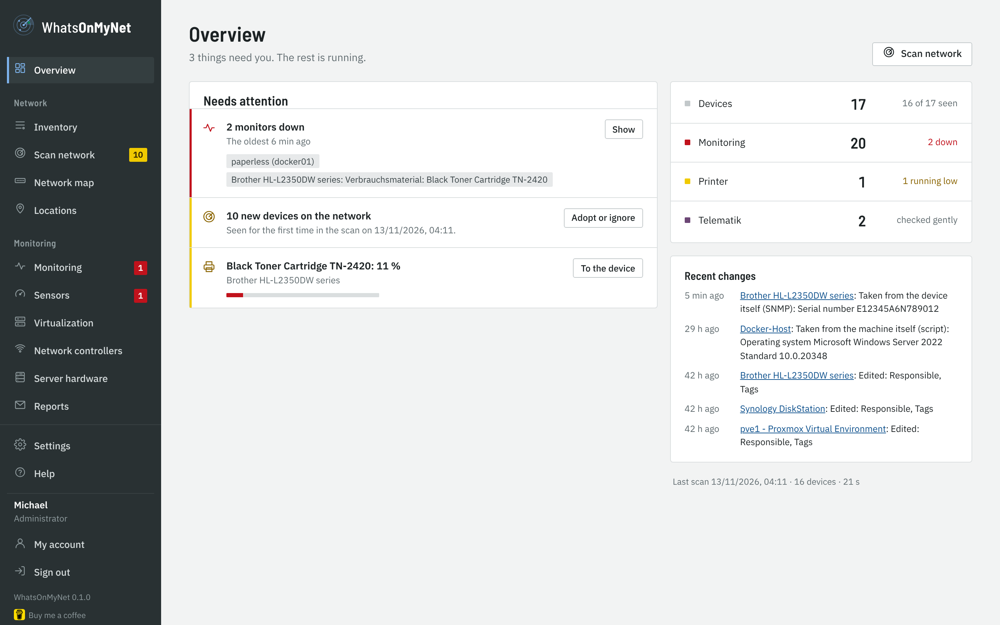
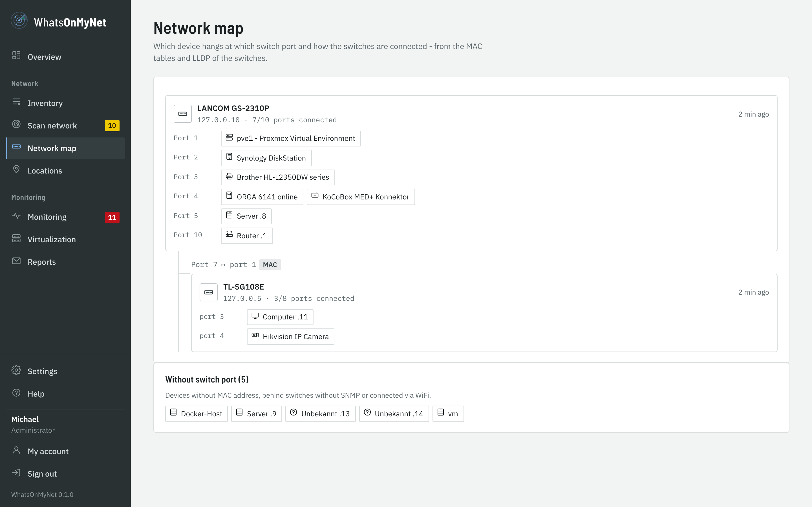
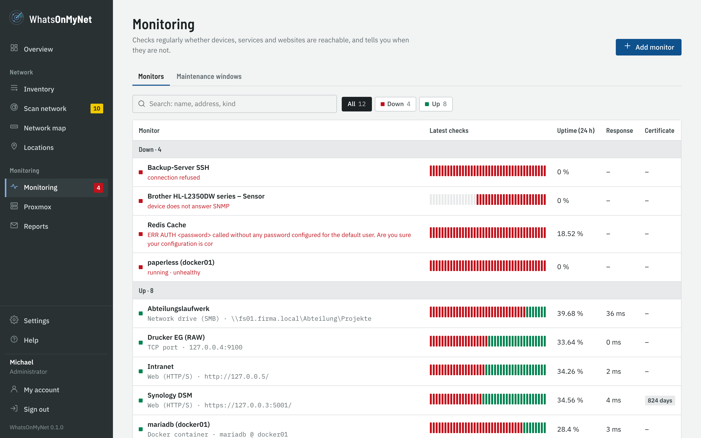
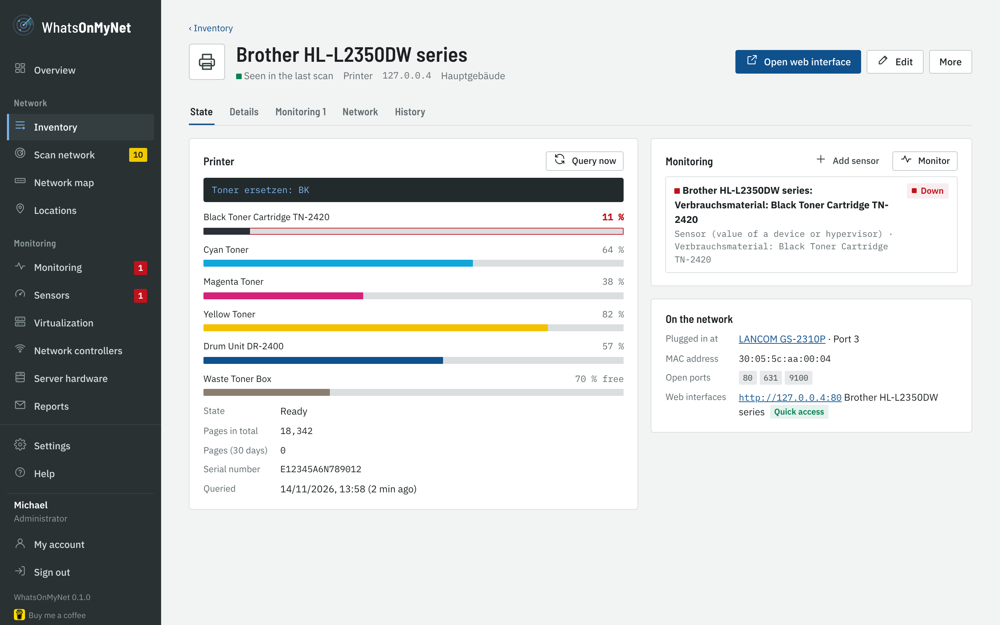
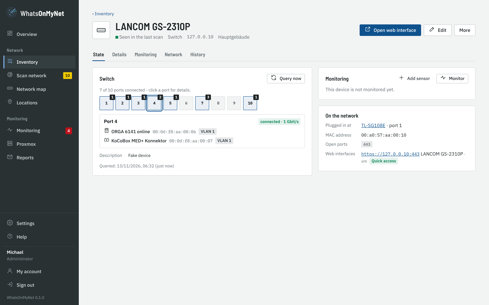
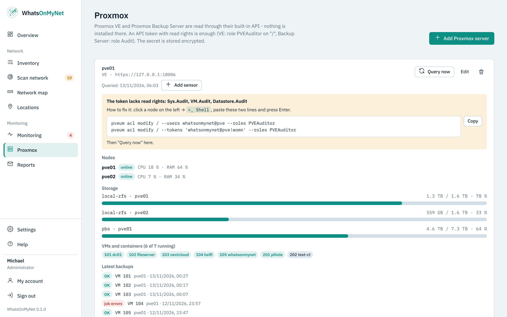
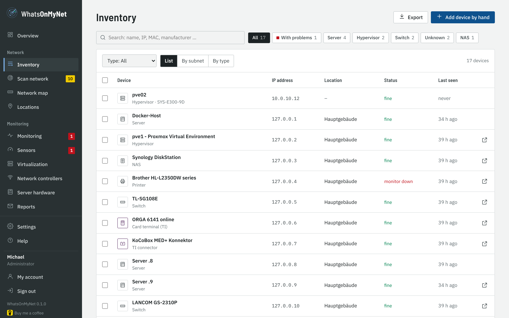

# WhatsOnMyNet

*Deutsche Fassung: [README.md](README.md)*

**Find what is on your network - keep what matters.**

WhatsOnMyNet scans your network, recognises manufacturer and device type by itself (switches, Proxmox, Synology, printers, Telematik components …) and lets you tick what goes into your inventory. No typing of manufacturers and models, no marathon of required fields. After signing in you only see your clean inventory - new devices only when you start a scan yourself.



📖 **Manual:** [as PDF](public/help/WhatsOnMyNet-Manual.pdf) · in the app under *Help* · [deutsches Handbuch](public/help/WhatsOnMyNet-Handbuch.pdf)

| | | |
|---|---|---|
|  |  |  |
| Gentle scan with radar | Network map from the switches | Monitoring with history |
|  |  |  |
| Toner, drum, counter | Ports and attached devices | Proxmox VE and Backup Server |

> Built for own use. Whoever uses WhatsOnMyNet does so at their own risk.

## What WhatsOnMyNet does

- **Gentle network scan** - devices in local networks are found via ARP (every device answers, even with a closed firewall), in routed networks via ping and a few TCP connection attempts. Only 26 typical ports are checked, limited to 40 attempts per second. To a firewall this looks like normal traffic.
- **Automatic recognition** - manufacturer from the MAC address (IEEE registry), device type from open ports, web interface title, certificate, SNMP (read-only), NetBIOS name and reverse DNS. Unsure guesses are marked; you can change the type before adopting.
- **Telematik** - card terminals (SICCT port 4742, ORGA, Cherry …) and TI connectors (KoCoBox, secunet, RISE …) get their own icon and category. Their deep check always keeps the gentle profile - also for a device not yet recognised: the deep check first asks port 4742 (SICCT) alone; if it answers, the gentle profile stays.
- **Adopt only what you want** - scan results in four tabs: *New*, *Changed*, *Known*, *Ignored*. Tick new devices to adopt them or ignore them for good. Adopt and ignore work from the newest scan of a subnet; older scans stay readable, and "Stop ignoring" works there too.
- **MAC address as identity** - when a known device gets a new IP, the next scan takes it over automatically, with an entry in the history. A host name typed by hand stays; the scan only fills the name while it is empty or came from the scan.
- **Inventory** - search across everything, filter by type and location, view as list, by subnet or by type, "seen in the last scan" status, export as CSV (Excel) and JSON.
- **Quick access** - one click opens the device's web interface (Proxmox on 8006, Synology on 5001, printers …). The scan suggests the address.
- **Purchase, warranty, maintenance** - optional fields, with a notice on the overview when a warranty ends soon.
- **Deep check** - for single unclear devices, started by hand: about 110 ports and all web interfaces.
- **Locations** - group subnets. Before a scan you just tick them; devices found get their location automatically.
- **Users and roles** - administrator, editor, read only; sign-in with Active Directory too, rights can be limited to locations (from 0.3).
- **HTTPS from the first start** - generated certificate, own certificate (PEM or PFX) uploadable in the interface, HTTP redirects to HTTPS (except for a trusted reverse proxy, see below).
- **German and English**, light and dark, usable on a phone.



## Monitoring (from version 0.2)

WhatsOnMyNet monitors devices, services and websites and replaces Uptime Kuma for the online status:

- **Checks**: web (HTTP/HTTPS with valid status codes and an optional keyword), TCP port or ping, every 20 seconds up to 24 hours.
- **No false alarms**: an alarm comes only after several failed checks in a row (default 3), the all-clear with the length of the outage. Optionally the alarm repeats while the outage lasts.
- **Certificates**: for HTTPS the expiry date is read; warnings e.g. 30, 14 and 7 days before, each step once. Checking chain and name can be switched on for internet sites; LAN devices with self-signed certificates work without it.
- **Notifications** under *Settings → Notifications*: Discord, Slack, Microsoft Teams, Google Chat, Mattermost, Rocket.Chat, Matrix, Signal, WhatsApp (CallMeBot), ntfy, Gotify, Pushover, Pushbullet, Home Assistant and Apprise (more than 100 further services), each with a short guide in the form; also email (through the SMTP server), Telegram bot (token from @BotFather, chat ID) and webhook with an own JSON template (`{{text}}`, `{{name}}`, `{{status}}`, `{{message}}`, `{{target}}`, `{{time}}`) and an optional header for a key. Token and header are stored encrypted. Every channel has a test message.
- **Maintenance windows** once or weekly (also across midnight), for all or selected monitors - no alarms meanwhile. The status "maintenance" is shown from the start of the window, not only after the next check.
- **Several at once**: in the *Monitors* and *Sensors* lists, tick rows (also all shown) and edit them together - check interval, failed checks, time limit, repeat, escalation, channels, for sensors also the limit - or pause, resume and delete them together.
- **Availability** over 24 hours, 7 and 30 days, response time chart, events showing who was notified.
- **Devices**: on a device page, “Monitor” adds a fitting monitor (web interface, else ping or an open port). When the scan changes a device's IP address, its monitors follow. A monitor with a stored password (database, network share) does not follow: it is paused, its notification channels get a message, and with the password entered again it continues at the new address - the password is never sent to another address unasked. When the device returns to the old address, it runs again by itself.

Check results are kept in detail for 7 days and hourly for a year.

### Docker containers and databases (from version 0.3)

- **Docker**: add your Docker hosts under *Settings → Docker*. A monitor of type *Docker container* reports when a container is not running, keeps restarting or its health check says "unhealthy". "Watch all running" creates a monitor for every container with one click.
  Recommended is a **socket proxy** on the Docker host that only allows read-only container queries (e.g. `tecnativa/docker-socket-proxy` with `CONTAINERS=1`, `POST=0`; address `http://<host>:2375`). The template is shown in the settings. Mounting the Docker socket directly into the container is not intended: WhatsOnMyNet runs there as a normal user without the group `docker` (and the socket would grant more rights than needed) - use the socket proxy.
- **Databases**: MariaDB/MySQL, PostgreSQL and Redis/Valkey. The check logs in and runs one harmless query (version or `PING`), optionally over TLS. Best create a user of its own with login rights only. The password is stored encrypted and never sent back to the browser.

### Sensors (from version 0.4)

Like in PRTG, every value a device delivers can be watched as a monitor of its own - with history, alarm and maintenance windows:

- **Sensor (device value)**: "Add sensor" on the device page, then choose value and condition - e.g. "toner cyan less than or equal 10 %", "volume 1 at least 85 %", "temperature drive 2 above 50 °C", "port 10 (uplink) connected", "disk/storage pool fine", "faults at the printer". It reads the latest state of the printer/switch/NAS query, without extra requests to the device. Values another sensor already watches are not offered again.
- **SNMP value (OID)**: any value readable via SNMP with its own condition (less, greater, equal, contains text …) - e.g. runtime left of a UPS, temperature of an air conditioner, sessions of a firewall.
- The history shows the measured value over 24 hours up to one year (from 30 days as an hourly summary).

### Network drives (from version 0.4)

The kind **Network drive (SMB)** signs in to a Windows or NAS share (e.g. `\\fs01\Department`), reads it or a given folder and asks for the free space - over SMB 2/3 and read-only. It reports when the sign-in fails (password expired, account locked), the share or folder is missing, access is denied or less than … % or … GB are free. Best use an account of its own with read rights only; the password is stored encrypted and handed to `smbclient` only through the environment, never on the command line. Reports have the section *Network drives* with the free space.

## Installation

Requirement: a **Linux host with Docker** (server, VM, Proxmox LXC with Docker, Synology Container Manager). WhatsOnMyNet runs in the **host network** - only this way it sees the MAC addresses of your devices. Docker Desktop on Windows or macOS does not see the real network and is therefore not suitable.

```sh
mkdir whatsonmynet && cd whatsonmynet
curl -fsSLO https://raw.githubusercontent.com/soleil0815/whatsonmynet/main/docker-compose.yml
curl -fsSL -o .env https://raw.githubusercontent.com/soleil0815/whatsonmynet/main/env.example
docker compose up -d
docker compose logs whatsonmynet      # shows the setup code
```

Then open `https://<server-address>:8743`. The first time the browser warns about the generated certificate - that is expected. In the wizard you enter the setup code from the log and create the main administrator.

Then:

1. Create **locations** and enter their subnets (the server's networks are suggested).
2. **Scan network** → tick locations → *Start scan*.
3. In the *New* tab choose what goes into the inventory, adjust type and name if needed → *Adopt into inventory*.

### Changing ports

The ports are in `.env`, not in `docker-compose.yml`:

```sh
WOMN_HTTPS_PORT=8743   # web interface
WOMN_HTTP_PORT=8780    # only redirects to HTTPS (0 = off)
```

Then `docker compose up -d`.

## Nightly light scan and new devices (from version 0.3)

Once a night (default 02:30 local time, `TZ` in `.env`) WhatsOnMyNet only looks for devices in all subnets of your locations: ARP, NetBIOS and - if allowed - ping; in routed subnets also a few TCP connection attempts (ports 443, 80, 22, 445, 3389) and the ARP table of the routers via SNMP. No port check of the devices, no web requests, so the scan stays inconspicuous.

- Known devices get their new IP address automatically (the MAC address is the identity), their monitors follow - except monitors with a stored password: they are paused and need the password again (see Monitoring).
- Unknown devices wait in the scan result to be adopted or ignored; the overview shows how many are waiting.
- **Report new devices**: a device that shows up for the very first time is reported once through the notification channels. The first scan after the update only learns what is already there - no flood of notices.
- Time, channels and "Run now" under *Settings → Scan*. After a restart the scan is caught up to 4 hours later.

## Printers via SNMP (from version 0.3)

Devices of type *Printer* are queried regularly (default hourly) via SNMP - read-only, using the Printer MIB that almost every network printer supports:

- Toner or ink per colour, drum, waste toner box, fuser - as bars in the colour of the toner
- Page counter in total and for the last 30 days, state (ready, printing …), errors such as paper jam, no paper, door open, and the text on the display
- **Notice** when a supply drops to the threshold (default 15 %) and again when it is empty - once per cartridge, armed again after replacing it
- The overview lists all printers that are running low

Settings under *Settings → Printers*. The community is the same as for the scan (*Settings → Scan*). SNMP (v1 or v2c) has to be switched on at the printer.

## Switches and NAS via SNMP (from version 0.3)

Devices of type *Switch* and *NAS* are queried regularly (default every 15 minutes) via SNMP - read-only:

- **Switch**: all ports as tiles like on the front (connected/disconnected, speed, label), which devices are plugged into which port (MAC table, VLAN-aware), LLDP neighbours, model, firmware and serial number.
- **Where is the device plugged in?** The page of every device shows under *Detection* the switch and port it is connected to. If many devices share a port, WhatsOnMyNet points out that another switch or access point is probably in between.
- **NAS**: volumes with usage (any NAS or Linux server with SNMP); on Synology also disks with state and temperature, storage pools/RAID, system state, fans, power supply, DSM version and available updates; on QNAP disks and temperature.
- **Taken into the inventory**: serial number and model that printers, switches and NAS report via SNMP, for switches and NAS also the firmware (or DSM version), go right into the details of the device and stay current; your own different entries stay. If a device at the same IP reports another serial number (exchange), serial number, model and firmware come from the new device and the next scan takes the new MAC address; the history notes the exchange.
- **Notice** for a failing disk, a degraded RAID, fan or power supply failure and a volume running full (default 90 %) - once when it happens and once when everything is fine again. The overview lists open NAS problems.

Settings under *Settings → Switches & NAS*. Simple switches without SNMP (e.g. TP-Link "Easy Smart") give no data; on LANCOM, HP/Aruba, Cisco, Netgear Smart and others SNMP v1/v2c has to be enabled read-only.

## Network map (from version 0.3)

The *Network map* shows from the MAC tables and LLDP data of the switches which device hangs at which port and how the switches are connected - as a tree starting at the switch with the router. Devices without a place (no MAC address, WiFi, switch without SNMP) are listed below.

**Remote subnets**: behind a router the scan sees no MAC addresses. If SNMP is on at your routers/firewalls (in the inventory with type *Router* or *Firewall*), the scan reads their ARP table - so the MAC address stays the identity of a device in remote subnets too (can be switched off under *Settings → Scan*).

### Ping

WhatsOnMyNet runs without root. Ping then only works if the host allows ICMP for normal users (`net.ipv4.ping_group_range`, default on Debian, Ubuntu and Proxmox). Without ping the scan still finds local devices via ARP and remote ones via TCP; the program shows a notice.

### SNMP

By default the scan asks devices with the community `public` (SNMP v2c, else v1) for name, description and vendor ID - read-only. Own communities go under *Settings → Scan*; they are stored encrypted. Devices without SNMP (e.g. simple TP-Link switches) are still recognised, just with fewer details.

## Sign-in with Active Directory (from version 0.3)

Under *Settings → Active Directory* users sign in with their Windows account:

- Built like Helfi.Space: **domain controller**, **encryption** (LDAPS 636 or StartTLS 389) and **port** as fields of their own; trust *fetched certificate*, *system CAs* or *do not check* (testing only); the server name check can be switched off (DC by IP).
- **Fetch certificate from DC** (from 0.4): WhatsOnMyNet gets the certificate chain straight from the domain controller and adds missing CAs via the AIA address in the certificate. You compare the fingerprint (SHA-256 and SHA-1, as in certlm.msc) and confirm. If the root CA is still missing, it is read from AD over the now trusted connection (*Public Key Services*). Every added CA must really have signed the certificate below it. With the root CA a renewed DC certificate is accepted without a new confirmation. Pasting a PEM still works.
- A **service account without special rights** finds the account, the domain controller itself checks the password - WhatsOnMyNet never stores it.
- **Roles by group**: one group each for administrator, editor and read-only, simply by **group name** (e.g. `WOMN-Admins`) or as DN; the whole domain is searched, nested groups included. The **base DN** may stay empty, it is read from AD. Members of none cannot sign in. Name, e-mail and role are taken from AD at every sign-in.
- Local accounts keep working; for the same name the **local account always wins** - so the local admin stays the emergency access.
- **Test connection** checks with the values in the form (also unsaved) step by step: connection, service account, base DN, every group, user, role and password, each with ✓/✗ and the reason. The step-by-step guide is in the manual.

## Rights per location (from version 0.3)

Editors and viewers can be limited to one or more locations under *Settings → Users* - e.g. for the IT of a branch office. A limited account only sees and changes devices, scan results and monitors of these locations, scans only their subnets and counts only them on the overview. Devices without a location, free subnets, the nightly scan, maintenance windows and Docker hosts stay with unlimited accounts. Administrators are never limited; this also applies to accounts from Active Directory.

**Allowed scan targets:** editors only scan private networks (10.0.0.0/8, 172.16.0.0/12, 192.168.0.0/16 and 100.64.0.0/10) and the subnets an administrator entered at the locations. Public addresses - as a subnet in a scan or as the deep check of a device - only an administrator may scan.

## Scan agent for branch offices (from version 0.3)

ARP - and so the MAC address - is only visible inside the own network. For a branch office a second container runs there as **scan agent**:

1. Central server: add the location of the branch office with its subnets, then *Settings → Scan agents → Add agent*. Key and - with the self-signed certificate - the certificate of the central server are shown as a ready `.env`.
2. Branch office: put `docker-compose.agent.yml` from the release and the `.env` there, `docker compose -f docker-compose.agent.yml up -d`.

The agent has no web interface and opens no port. It asks the central server for jobs every minute (`WOMN_AGENT_INTERVAL` in seconds, 15 to 3600, default 60; HTTPS; with the self-signed certificate it trusts exactly this one certificate - checked before the key is sent. When the certificate is renewed, the agent needs the new value), scans there just as gently and follows the time of the nightly light scan. It may only report addresses from the subnets of its location. "Start scan" for that location is handed to the agent automatically; the results show up under *Earlier scans* as usual.

## Failover: master and standby (from version 0.20)

A second WhatsOnMyNet stands by as **standby** and takes over when the **master** fails:

1. Master: *Settings → Failover → Make this the master* - a pairing code appears (shown once).
2. Standby: there *This server as standby*, enter the address of the master and the code, choose the time until it takes over (10 minutes by default, 3 to 240) - **Pair**.

The standby asks for a sign of life every minute and for the data every 5 minutes (over HTTPS; the key of the master's certificate is in the code and is checked before anything is sent). It does not check, scan or alarm and only shows. When the master does not answer for longer than set, the standby monitors and alarms and reports this to the default channels. When the master is back, the standby is quiet again and takes its data - nothing goes back to the master. If the old master does not come back: *Make this the master* on the standby. Both servers need the same version; the standby also takes the key (`secret.key`) of the master. Details in the manual.

## Proxmox VE and Backup Server (from version 0.4)

Under *Monitoring → Virtualization* WhatsOnMyNet reads Proxmox VE and Proxmox Backup Server through their built-in API - nothing is installed there. A user of its own with an API token that may only read is enough (VE: role *PVEAuditor* on `/`, Backup Server: role *Audit*). The dialog *Add host → Proxmox VE* guides through two steps: the commands to copy (or the clicks in the Proxmox interface), then address, **Fetch certificate** with fingerprint comparison and the secret. If the token lacks rights, the detail view names them with a command to fix it; the secret is stored encrypted.

More hypervisors on the same page: **VMware ESXi/vCenter** (vSphere API), **XCP-ng/XenServer** (XAPI), **Nutanix AHV** (Prism API v2) and **oVirt/RHV/OLVM** (REST API) are asked with an account that may only read. **Hyper-V** and **KVM/libvirt** report on their own: a small script (PowerShell or POSIX sh with `virsh -r`) sends hosts, storage and VMs every 5 minutes - with a key of its own, without an open port on the host. All appear the same way and offer the same sensors.

**Network controllers:** UniFi Network (UniFi OS and Network app), TP-Link Omada and MikroTik RouterOS 7 are asked with a read-only account (*Monitoring → Network controllers*): access points, switches and gateways with model, firmware (and pending update), clients and state. Model, serial number, firmware and type go into the inventory by MAC; sensors for online state, clients, CPU/RAM and firmware updates. The scan recognises UniFi, Omada, MikroTik and Aruba Instant On by their model names.

**Windows and Linux machines without agent:** a small script (PowerShell or POSIX sh) reports CPU, RAM, drives, uptime and services every 5 minutes - no agent, no open port, no account, nothing installed. On its first call it sets itself up (scheduled task or cron), an uninstall script removes it again. Per device (*device page → More → Monitor with script*) or shared by many machines to roll out (*Settings → Machine scripts*); reports are matched to the inventory by MAC, machine name or IP.

- **VE**: nodes (online, CPU, RAM), storage with usage, VMs and containers (running/stopped), the latest backups (vzdump) with errors
- **Backup Server**: datastores with usage, backup groups with the age of their last backup, failed tasks (verify, GC …)
- **Sensors** such as "node online", "storage local-zfs above 85 %", "VM 101 running", "last backup of VM 101 older than 26 hours", "datastore above 85 %" or "failed tasks"

## Planned reports (from version 0.4)

Under *Monitoring → Reports* WhatsOnMyNet sends reports by e-mail at set times - e.g. the toner levels of all printers to the office every Monday at 8:00, or the state of the NAS once a month.

- **Content**: printers (toner per colour, drum, waste toner, page counter, faults), NAS (usage, disks, temperature), switches and network drives (free space); can be limited to locations or **single devices** (e.g. a report just for the printer in the front office), optionally only devices that need action. Printers show the pages printed in total and in the report period. What should be ordered soon is marked red.
- **Neutral**: the mail has no link and no program name - only your sender name, subject (`{week}`, `{date}`), introduction, the devices and your closing, e.g. "Your IT team".
- Schedule daily, weekly or monthly; preview, "Test to me" and "Send now" right in the settings.

## HTTPS and certificate

- On first start WhatsOnMyNet creates a self-signed certificate for the host name, `localhost`, all IPv4 addresses of the host and the address in `WOMN_BASE_URL`. It is renewed automatically 30 days before it expires.
- Under *Settings → HTTPS certificate* you upload your own certificate: PEM (certificate with chain + key) or PFX/P12 with password. It is checked first (key matches, not expired) and becomes active without a restart.
- HTTP on `WOMN_HTTP_PORT` redirects to HTTPS - except for a trusted reverse proxy (see below).
- WhatsOnMyNet only sends HSTS with an own certificate and a host name. With a self-signed certificate HSTS would stop the browser from letting you past the warning - you would be locked out.

### Behind a reverse proxy

In `.env`:

```sh
WOMN_BASE_URL=https://womn.company.local
WOMN_TRUST_PROXY=10.0.10.5          # address of the proxy
```

The proxy then forwards either to `https://<server>:8743` (self-signed - "do not verify certificate" in the proxy) or to `http://<server>:8780`: the HTTP port accepts requests from the trusted proxy and redirects everyone else to HTTPS. The rules for redirects and HSTS are the same as in Catalytix, AssetLotse and Helfi.Space.

## Security

- Only scan networks you are responsible for.
- The normal scan is deliberately gentle. Still: add the server running WhatsOnMyNet as trusted in your firewall, IDS or antivirus, then even the deep check raises no alarm.
- The program runs without root, with read-only program files (`cap_drop: ALL`, `no-new-privileges`). The container only gets back the few rights the start needs: setting the permissions of `./data` and switching to PUID/PGID with su-exec (`CHOWN`, `FOWNER`, `DAC_OVERRIDE`, `SETUID`, `SETGID`), plus `KILL` so the stop signal arrives.
- Passwords are stored with scrypt, the SMTP password and SNMP communities encrypted with AES-256-GCM. Back up the key (`data/secret.key`).
- Please report vulnerabilities confidentially, see [SECURITY.md](SECURITY.md).

## Two-factor sign-in (from version 0.4)

Local accounts switch on two-factor sign-in under *My account*: scan the QR code with an authenticator app (Microsoft/Google Authenticator, Aegis, 2FAS, Bitwarden …), confirm a code and keep the ten **recovery codes** safe. Sign-in then asks for the six-digit code; each code works only once. Under *Settings → General* two-factor sign-in can be made **mandatory for administrators**. Admins can reset it for an account with a lost phone; accounts from Active Directory are protected by AD itself.

## Locked out?

```sh
docker compose exec whatsonmynet womn-admin list
docker compose exec whatsonmynet womn-admin reset <user>    # new random password, administrator again, 2FA off
docker compose exec whatsonmynet womn-admin create <user>   # new administrator
```

## Updates and backup

- Dockhand or Watchtower fetch updates automatically, or by hand: `docker compose pull && docker compose up -d`.
- Security updates are published on patch day (second Tuesday of the month) as `<version>-s<n>`: the same program with a new base image and updated Alpine and npm packages, built, tested and checked with Trivy. If nothing changed, nothing is published.
- Trivy checks the published image every day. Fixable vulnerabilities open an issue; the security update on patch day fixes them.
- In the week before patch day a ZAP scan attacks the program in a throwaway container without login. The monthly code audit evaluates the result.
- WhatsOnMyNet writes a daily database backup to `data/backups/` (number under *Settings → General*). Back up the whole `data/` folder, including `secret.key` and `tls/`.

Under *Settings → Backup* (from 0.4) you download a current backup at any time, create one or restore one - uploaded or from the list on the server. The file is checked first (WhatsOnMyNet database, not newer than this version, same key), the current state is kept as `whatsonmynet-before-restore-…`, then the program restarts. **Keep `data/secret.key` (or your `WOMN_SECRET`) as well** - without it stored passwords in a backup are unreadable.

**Rebuild the manual** (after changes to `public/help/manual.*.md` or the images): `node tools/build-manual.mjs` - needs Playwright with Chromium, ImageMagick makes the PDFs smaller.

## Support

WhatsOnMyNet is made in spare time. If it helps you, I am happy about a [coffee](https://buymeacoffee.com/soleil0815). More from me: [helfi.space](https://helfi.space).

What changed in which version is shown in the program itself: click the version number at the bottom left (*About WhatsOnMyNet → What's new*), or see [Releases](https://github.com/soleil0815/whatsonmynet/releases).

## License

WhatsOnMyNet is open source under the [GNU Affero General Public License 3.0](LICENSE) (AGPL-3.0-or-later). Whoever offers a modified version over a network has to make its source code available (`WOMN_SOURCE_URL`).

Fonts: IBM Plex and Barlow Semi Condensed (SIL Open Font License, `public/fonts/OFL.txt`). Manufacturer list: IEEE via the package `oui-data` (BSD-2-Clause).
