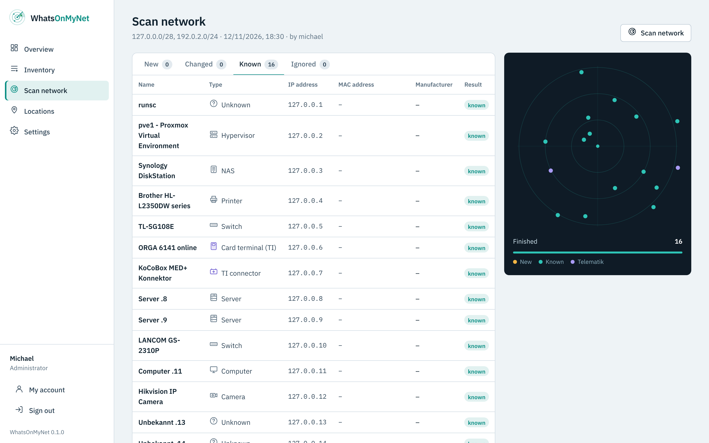
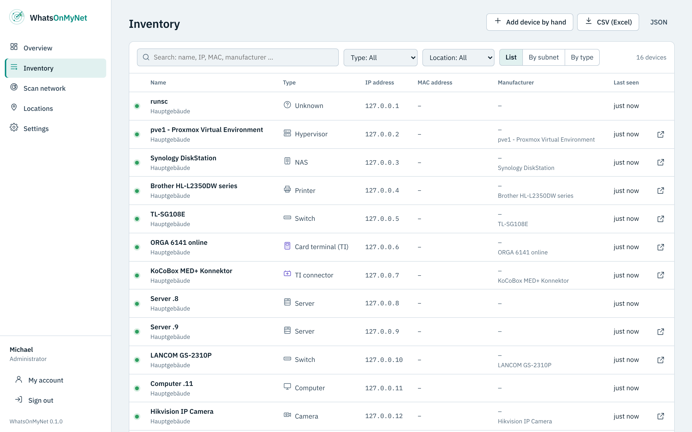

# WhatsOnMyNet

*Deutsche Fassung: [README.md](README.md)*

**Find what is on your network – keep what matters.**

WhatsOnMyNet scans your network, recognises manufacturer and device type by itself (switches, Proxmox, Synology, printers, Telematik components …) and lets you tick what goes into your inventory. No typing of manufacturers and models, no marathon of required fields. After signing in you only see your clean inventory – new devices only when you start a scan yourself.



> Built for own use. Whoever uses WhatsOnMyNet does so at their own risk.

## What version 0.1 does

- **Gentle network scan** – devices in local networks are found via ARP (every device answers, even with a closed firewall), in routed networks via ping and a few TCP connection attempts. Only 26 typical ports are checked, limited to 40 attempts per second. To a firewall this looks like normal traffic.
- **Automatic recognition** – manufacturer from the MAC address (IEEE registry), device type from open ports, web interface title, certificate, SNMP (read-only), NetBIOS name and reverse DNS. Unsure guesses are marked; you can change the type before adopting.
- **Telematik** – card terminals (SICCT port 4742, ORGA, Cherry …) and TI connectors (KoCoBox, secunet, RISE …) get their own icon and category. Their deep check always keeps the gentle profile.
- **Adopt only what you want** – scan results in four tabs: *New*, *Changed*, *Known*, *Ignored*. Tick new devices to adopt them or ignore them for good.
- **MAC address as identity** – when a known device gets a new IP, the next scan takes it over automatically, with an entry in the history.
- **Inventory** – search across everything, filter by type and location, view as list, by subnet or by type, "seen in the last scan" status, export as CSV (Excel) and JSON.
- **Quick access** – one click opens the device's web interface (Proxmox on 8006, Synology on 5001, printers …). The scan suggests the address.
- **Purchase, warranty, maintenance** – optional fields, with a notice on the overview when a warranty ends soon.
- **Deep check** – for single unclear devices, started by hand: about 120 ports and all web interfaces.
- **Locations** – group subnets. Before a scan you just tick them; devices found get their location automatically.
- **Users and roles** – administrator, editor, read only; sign-in with Active Directory too, rights can be limited to locations (from 0.3).
- **HTTPS from the first start** – generated certificate, own certificate (PEM or PFX) uploadable in the interface, HTTP always redirects to HTTPS.
- **German and English**, light and dark, usable on a phone.



## Monitoring (from version 0.2)

WhatsOnMyNet monitors devices, services and websites and replaces Uptime Kuma for the online status:

- **Checks**: web (HTTP/HTTPS with valid status codes and an optional keyword), TCP port or ping, every 20 seconds up to 24 hours.
- **No false alarms**: an alarm comes only after several failed checks in a row (default 3), the all-clear with the length of the outage. Optionally the alarm repeats while the outage lasts.
- **Certificates**: for HTTPS the expiry date is read; warnings e.g. 30, 14 and 7 days before, each step once. Checking chain and name can be switched on for internet sites; LAN devices with self-signed certificates work without it.
- **Notifications** under *Settings → Notifications*: email (through the SMTP server), Telegram bot (token from @BotFather, chat ID) and webhook with an own JSON template (`{{text}}`, `{{name}}`, `{{status}}`, `{{message}}`, `{{target}}`, `{{time}}`) and an optional header for a key. Token and header are stored encrypted. Every channel has a test message.
- **Maintenance windows** once or weekly (also across midnight), for all or selected monitors – no alarms meanwhile.
- **Availability** over 24 hours, 7 and 30 days, response time chart, events showing who was notified.
- **Devices**: on a device page, “Monitor” adds a fitting monitor (web interface, else ping or an open port). When the scan changes a device's IP address, its monitors follow.

Check results are kept in detail for 7 days and hourly for a year.

### Docker containers and databases (from version 0.3)

- **Docker**: add your Docker hosts under *Settings → Docker*. A monitor of type *Docker container* reports when a container is not running, keeps restarting or its health check says "unhealthy". "Watch all running" creates a monitor for every container with one click.
  Recommended is a **socket proxy** on the Docker host that only allows read-only container queries (e.g. `tecnativa/docker-socket-proxy` with `CONTAINERS=1`, `POST=0`; address `http://<host>:2375`). The template is shown in the settings. Passing the Docker socket directly also works (`unix:///var/run/docker.sock`, mounted `:ro` in `docker-compose.yml` plus `group_add` with the group ID of `docker`) – but that grants more rights than needed.
- **Databases**: MariaDB/MySQL, PostgreSQL and Redis/Valkey. The check logs in and runs one harmless query (version or `PING`), optionally over TLS. Best create a user of its own with login rights only. The password is stored encrypted and never sent back to the browser.

## Installation

Requirement: a **Linux host with Docker** (server, VM, Proxmox LXC with Docker, Synology Container Manager). WhatsOnMyNet runs in the **host network** – only this way it sees the MAC addresses of your devices. Docker Desktop on Windows or macOS does not see the real network and is therefore not suitable.

```sh
mkdir whatsonmynet && cd whatsonmynet
curl -fsSLO https://raw.githubusercontent.com/soleil0815/whatsonmynet/main/docker-compose.yml
curl -fsSL -o .env https://raw.githubusercontent.com/soleil0815/whatsonmynet/main/env.example
docker compose up -d
docker compose logs whatsonmynet      # shows the setup code
```

Then open `https://<server-address>:8743`. The first time the browser warns about the generated certificate – that is expected. In the wizard you enter the setup code from the log and create the main administrator.

Then:

1. Create **locations** and enter their subnets (the server's networks are suggested).
2. **Scan network** → tick locations → *Start scan*.
3. In the *New* tab choose what goes into the inventory, adjust type and name if needed → *Adopt into inventory*.

### Changing ports

The ports are in `.env`, not in `docker-compose.yml`:

```sh
WOMN_HTTPS_PORT=8743   # web interface
WOMN_HTTP_PORT=8780    # only redirects to HTTPS (0 = off)
```

Then `docker compose up -d`.

## Nightly light scan and new devices (from version 0.3)

Once a night (default 02:30 local time, `TZ` in `.env`) WhatsOnMyNet looks for devices in all subnets of your locations: ARP, NetBIOS and – if allowed – ping only. No ports, no SNMP, no web requests, so the scan stays inconspicuous.

- Known devices get their new IP address automatically (the MAC address is the identity), their monitors follow.
- Unknown devices wait in the scan result to be adopted or ignored; the overview shows how many are waiting.
- **Report new devices**: a device that shows up for the very first time is reported once through the notification channels (email, Telegram, webhook). The first scan after the update only learns what is already there – no flood of notices.
- Time, channels and "Run now" under *Settings → Scan*. After a restart the scan is caught up to 4 hours later.

## Printers via SNMP (from version 0.3)

Devices of type *Printer* are queried regularly (default hourly) via SNMP – read-only, using the Printer MIB that almost every network printer supports:

- Toner or ink per colour, drum, waste toner box, fuser – as bars in the colour of the toner
- Page counter in total and for the last 30 days, state (ready, printing …), errors such as paper jam, no paper, door open, and the text on the display
- **Notice** when a supply drops to the threshold (default 15 %) and again when it is empty – once per cartridge, armed again after replacing it
- The overview lists all printers that are running low

Settings under *Settings → Printers*. The community is the same as for the scan (*Settings → Scan*). SNMP (v1 or v2c) has to be switched on at the printer.

## Switches and NAS via SNMP (from version 0.3)

Devices of type *Switch* and *NAS* are queried regularly (default every 15 minutes) via SNMP – read-only:

- **Switch**: all ports as tiles like on the front (connected/disconnected, speed, label), which devices are plugged into which port (MAC table, VLAN-aware), LLDP neighbours, model, firmware and serial number.
- **Where is the device plugged in?** The page of every device shows under *Detection* the switch and port it is connected to. If many devices share a port, WhatsOnMyNet points out that another switch or access point is probably in between.
- **NAS**: volumes with usage (any NAS or Linux server with SNMP); on Synology also disks with state and temperature, storage pools/RAID, system state, fans, power supply, DSM version and available updates; on QNAP disks and temperature.
- **Notice** for a failing disk, a degraded RAID, fan or power supply failure and a volume running full (default 90 %) – once when it happens and once when everything is fine again. The overview lists open NAS problems.

Settings under *Settings → Switches & NAS*. Simple switches without SNMP (e.g. TP-Link "Easy Smart") give no data; on LANCOM, HP/Aruba, Cisco, Netgear Smart and others SNMP v1/v2c has to be enabled read-only.

## Network map (from version 0.3)

The *Network map* shows from the MAC tables and LLDP data of the switches which device hangs at which port and how the switches are connected – as a tree starting at the switch with the router. Devices without a place (no MAC address, WiFi, switch without SNMP) are listed below.

**Remote subnets**: behind a router the scan sees no MAC addresses. If SNMP is on at your routers/firewalls (in the inventory with type *Router* or *Firewall*), the scan reads their ARP table – so the MAC address stays the identity of a device in remote subnets too (can be switched off under *Settings → Scan*).

### Ping

WhatsOnMyNet runs without root. Ping then only works if the host allows ICMP for normal users (`net.ipv4.ping_group_range`, default on Debian, Ubuntu and Proxmox). Without ping the scan still finds local devices via ARP and remote ones via TCP; the program shows a notice.

### SNMP

By default the scan asks devices with the community `public` (SNMP v2c, else v1) for name, description and vendor ID – read-only. Own communities go under *Settings → Scan*; they are stored encrypted. Devices without SNMP (e.g. simple TP-Link switches) are still recognised, just with fewer details.

## Sign-in with Active Directory (from version 0.3)

Under *Settings → Active Directory* users sign in with their Windows account:

- Encrypted connections only: `ldaps://dc01.example.local` (port 636) or `ldap://` with StartTLS. The certificate of the domain controller is checked; the certificate of your company CA can be entered as PEM.
- A **service account without special rights** finds the account, the domain controller itself checks the password – WhatsOnMyNet never stores it.
- **Roles by group**: one group each for administrator, editor and read-only (full DN, nested groups included). Members of none cannot sign in. Name, e-mail and role are taken from AD at every sign-in.
- Local accounts keep working; for the same name the **local account always wins** – so the local admin stays the emergency access.
- "Test connection" shows the groups found for an account and the role it would get.

## Rights per location (from version 0.3)

Editors and viewers can be limited to one or more locations under *Settings → Users* – e.g. for the IT of a branch office. A limited account only sees and changes devices, scan results and monitors of these locations, scans only their subnets and counts only them on the overview. Devices without a location, free subnets, the nightly scan, maintenance windows and Docker hosts stay with unlimited accounts. Administrators are never limited; this also applies to accounts from Active Directory.

## Scan agent for branch offices (from version 0.3)

ARP – and so the MAC address – is only visible inside the own network. For a branch office a second container runs there as **scan agent**:

1. Central server: add the location of the branch office with its subnets, then *Settings → Scan agents → Add agent*. Key and – with the self-signed certificate – the certificate of the central server are shown as a ready `.env`.
2. Branch office: put `docker-compose.agent.yml` from the release and the `.env` there, `docker compose -f docker-compose.agent.yml up -d`.

The agent has no web interface and opens no port. It asks the central server for jobs every minute (HTTPS; with the self-signed certificate it trusts exactly this one certificate – checked before the key is sent. When the certificate is renewed, the agent needs the new value), scans there just as gently and follows the time of the nightly light scan. It may only report addresses from the subnets of its location. "Start scan" for that location is handed to the agent automatically; the results show up under *Earlier scans* as usual.

## HTTPS and certificate

- On first start WhatsOnMyNet creates a self-signed certificate for the host name, `localhost`, all IPv4 addresses of the host and the address in `WOMN_BASE_URL`. It is renewed automatically 30 days before it expires.
- Under *Settings → HTTPS certificate* you upload your own certificate: PEM (certificate with chain + key) or PFX/P12 with password. It is checked first (key matches, not expired) and becomes active without a restart.
- HTTP on `WOMN_HTTP_PORT` always redirects to HTTPS.
- WhatsOnMyNet only sends HSTS with an own certificate and a host name. With a self-signed certificate HSTS would stop the browser from letting you past the warning – you would be locked out.

### Behind a reverse proxy

In `.env`:

```sh
WOMN_BASE_URL=https://womn.company.local
WOMN_TRUST_PROXY=10.0.10.5          # address of the proxy
```

The proxy then forwards either to `https://<server>:8743` (self-signed – "do not verify certificate" in the proxy) or to `http://<server>:8780`: the HTTP port accepts requests from the trusted proxy and redirects everyone else to HTTPS. The rules for redirects and HSTS are the same as in Catalytix, AssetLotse and Helfi.Space.

## Security

- Only scan networks you are responsible for.
- The normal scan is deliberately gentle. Still: add the server running WhatsOnMyNet as trusted in your firewall, IDS or antivirus, then even the deep check raises no alarm.
- The container runs without root, with read-only program files and without extra rights (`cap_drop: ALL`, `no-new-privileges`).
- Passwords are stored with scrypt, the SMTP password and SNMP communities encrypted with AES-256-GCM. Back up the key (`data/secret.key`).
- Please report vulnerabilities confidentially, see [SECURITY.md](SECURITY.md).

## Locked out?

```sh
docker compose exec whatsonmynet womn-admin list
docker compose exec whatsonmynet womn-admin reset <user>    # new random password, administrator again
docker compose exec whatsonmynet womn-admin create <user>   # new administrator
```

## Updates and backup

- Dockhand or Watchtower fetch updates automatically, or by hand: `docker compose pull && docker compose up -d`.
- Security updates are published on patch day (second Tuesday of the month) as `<version>-s<n>`: the same program with a new base image and updated Alpine and npm packages, built, tested and checked with Trivy. If nothing changed, nothing is published.
- Trivy checks the published image every day. Fixable vulnerabilities open an issue; the security update on patch day fixes them.
- In the week before patch day a ZAP scan attacks the program in a throwaway container without login. The monthly code audit evaluates the result.
- WhatsOnMyNet writes a daily database backup to `data/backups/` (number under *Settings → General*). Back up the whole `data/` folder, including `secret.key` and `tls/`.

## What comes next

| Version | Content |
| --- | --- |
| 2 | ~~Monitoring like Uptime Kuma~~ (from 0.2), ~~nightly light scan with notice of unknown devices~~, ~~printer data via SNMP~~, ~~Docker and database monitoring~~ (from 0.3) |
| 3 | ~~Active Directory (LDAPS)~~, ~~rights per location~~ (from 0.3) |
| later | ~~Scan agent for branch offices~~, ~~topology via LLDP~~, ~~MAC addresses of remote subnets via SNMP from the router~~ (from 0.3) |

## License

WhatsOnMyNet is open source under the [GNU Affero General Public License 3.0](LICENSE) (AGPL-3.0-or-later). Whoever offers a modified version over a network has to make its source code available (`WOMN_SOURCE_URL`).

Font: IBM Plex (SIL Open Font License, `public/fonts/OFL.txt`). Manufacturer list: IEEE via the package `oui-data` (BSD-2-Clause).
