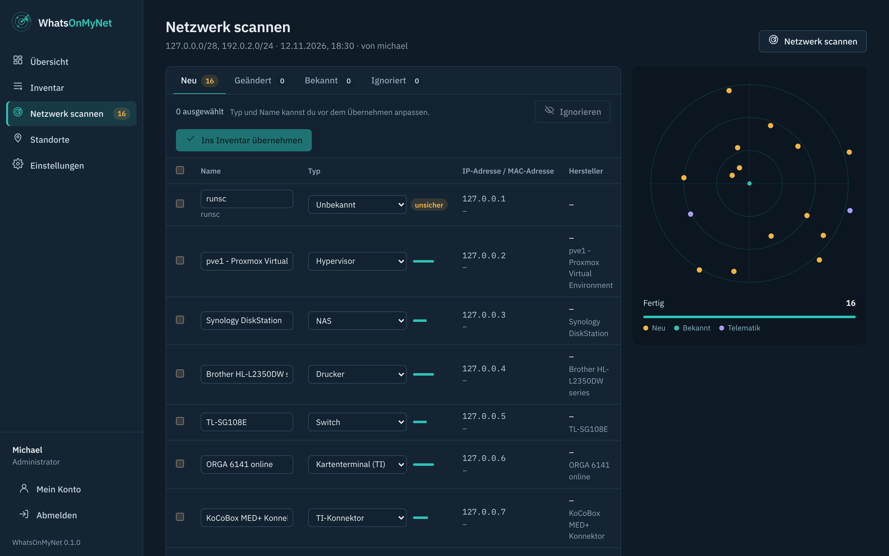
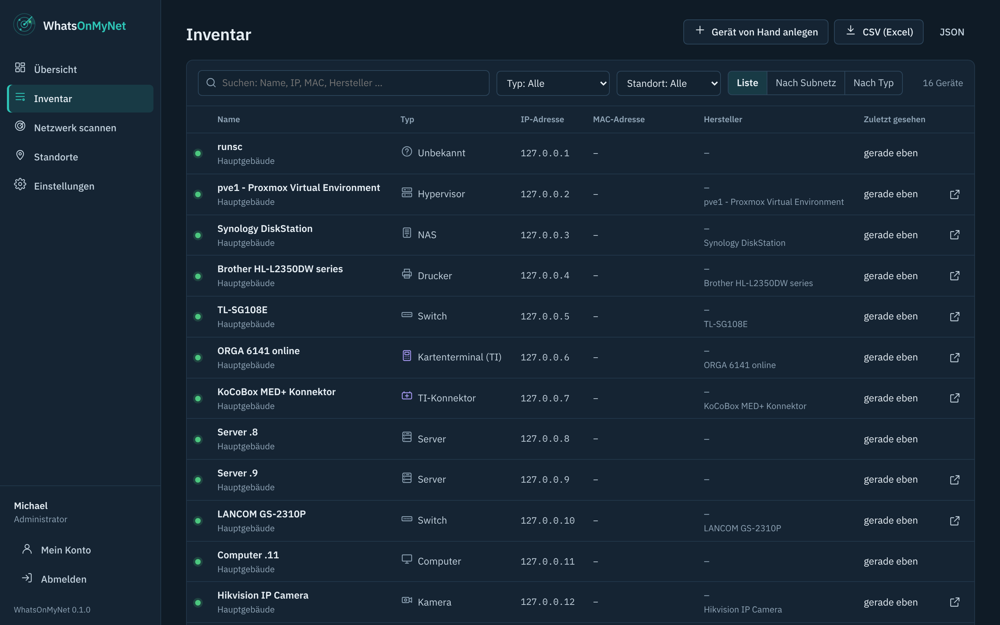

# WhatsOnMyNet

*English version: [README.en.md](README.en.md)*

**Finde, was in deinem Netz läuft – und behalte nur, was wichtig ist.**

WhatsOnMyNet scannt dein Netzwerk, erkennt Hersteller und Gerätetyp selbst (Switches, Proxmox, Synology, Drucker, Telematik-Komponenten …) und lässt dich per Häkchen auswählen, was in dein Inventar kommt. Kein Abtippen von Herstellern und Modellen, kein Pflichtfeld-Marathon. Nach dem Anmelden siehst du nur dein sauberes Inventar – neue Geräte erst, wenn du selbst einen Scan startest.



> Gebaut für den eigenen Einsatz. Wer WhatsOnMyNet nutzt, tut das in eigener Verantwortung.

## Was Version 0.1 kann

- **Schonender Netzwerkscan** – Geräte im eigenen Netz werden über ARP gefunden (jedes Gerät antwortet darauf, auch mit geschlossener Firewall), in gerouteten Netzen über Ping und wenige TCP-Verbindungsversuche. Geprüft werden nur 26 typische Ports, gedrosselt auf 40 Versuche pro Sekunde. Für eine Firewall sieht das aus wie normaler Netzwerkverkehr.
- **Automatische Erkennung** – Hersteller aus der MAC-Adresse (IEEE-Liste), Gerätetyp aus offenen Ports, Titel der Weboberfläche, Zertifikat, SNMP (nur lesend), NetBIOS-Name und Reverse DNS. Unsichere Erkennungen sind markiert, den Typ kannst du vor dem Übernehmen ändern.
- **Telematik** – Kartenterminals (SICCT-Port 4742, ORGA, Cherry …) und TI-Konnektoren (KoCoBox, secunet, RISE …) bekommen ein eigenes Symbol und eine eigene Kategorie. Ihre Tiefenprüfung bleibt immer beim schonenden Profil.
- **Nur übernehmen, was du willst** – Scan-Ergebnis in vier Reitern: *Neu*, *Geändert*, *Bekannt*, *Ignoriert*. Neue Geräte per Häkchen übernehmen oder dauerhaft ignorieren.
- **MAC-Adresse als Ausweis** – ändert sich die IP eines bekannten Geräts, übernimmt der nächste Scan die neue Adresse automatisch, mit Eintrag im Verlauf.
- **Inventar** – Suche über alles, Filter nach Typ und Standort, Ansicht als Liste, nach Subnetz oder nach Typ, Status „beim letzten Scan gesehen“, Export als CSV (Excel) und JSON.
- **Schnellzugriff** – ein Klick öffnet die Weboberfläche des Geräts (Proxmox auf 8006, Synology auf 5001, Drucker …). Die Adresse schlägt der Scan vor.
- **Kauf, Garantie, Wartung** – optionale Felder mit Hinweis auf der Übersicht, wenn die Garantie bald endet.
- **Tiefenprüfung** – für einzelne unklare Geräte, von Hand gestartet: rund 120 Ports und alle Weboberflächen.
- **Standorte** – fassen Subnetze zusammen. Vor dem Scan nur noch Häkchen setzen, gefundene Geräte bekommen ihren Standort automatisch.
- **Benutzer und Rollen** – Administrator, Bearbeiter, Nur lesen. Active Directory folgt in einer späteren Version.
- **HTTPS ab dem ersten Start** – selbst erzeugtes Zertifikat, eigenes Zertifikat (PEM oder PFX) in der Oberfläche hochladbar, HTTP leitet immer auf HTTPS um.
- **Deutsch und Englisch**, hell und dunkel, auch am Handy bedienbar.



## Monitoring (ab Version 0.2)

WhatsOnMyNet überwacht Geräte, Dienste und Webseiten und ersetzt damit Uptime Kuma für den Online-Status:

- **Prüfungen**: Web (HTTP/HTTPS mit gültigen Statuscodes und optionalem Stichwort), TCP-Port oder Ping, alle 20 Sekunden bis 24 Stunden.
- **Ohne Fehlalarme**: Ein Alarm kommt erst nach mehreren Fehlversuchen hintereinander (Standard 3), eine Entwarnung mit der Dauer des Ausfalls. Optional wiederholt sich der Alarm, solange die Störung anhält.
- **Zertifikate**: Bei HTTPS wird das Ablaufdatum gelesen, gewarnt wird z. B. 30, 14 und 7 Tage vorher, jede Stufe einmal. Die Prüfung von Kette und Name ist für Internetseiten einschaltbar; LAN-Geräte mit selbstsigniertem Zertifikat funktionieren ohne.
- **Benachrichtigungen** unter *Einstellungen → Benachrichtigungen*: E-Mail (über den SMTP-Server), Telegram-Bot (Token von @BotFather, Chat-ID) und Webhook mit eigener JSON-Vorlage (`{{text}}`, `{{name}}`, `{{status}}`, `{{message}}`, `{{target}}`, `{{time}}`) und optionalem Header für einen Schlüssel. Token und Header werden verschlüsselt gespeichert. Jeder Kanal hat eine Testnachricht.
- **Wartungsfenster** einmalig oder wöchentlich (auch über Mitternacht), für alle oder ausgewählte Monitore – währenddessen keine Alarme.
- **Verfügbarkeit** über 24 Stunden, 7 und 30 Tage, Antwortzeit als Diagramm, Ereignisse mit Hinweis, an wen gemeldet wurde.
- **Geräte**: Auf der Seite eines Geräts legt „Überwachen“ einen passenden Monitor an (Weboberfläche, sonst Ping oder ein offener Port). Ändert der Scan die IP-Adresse eines Geräts, ziehen seine Monitore mit.

Prüfergebnisse bleiben 7 Tage im Detail und stundenweise über ein Jahr gespeichert.

### Docker-Container und Datenbanken (ab Version 0.3)

- **Docker**: Unter *Einstellungen → Docker* trägst du deine Docker-Hosts ein. Ein Monitor vom Typ *Docker-Container* meldet, wenn ein Container nicht läuft, ständig neu startet oder sein Healthcheck „unhealthy“ meldet. „Alle laufenden überwachen“ legt mit einem Klick für jeden Container einen Monitor an.
  Empfohlen ist ein **Socket-Proxy** auf dem Docker-Host, der nur lesende Container-Abfragen erlaubt (z. B. `tecnativa/docker-socket-proxy` mit `CONTAINERS=1`, `POST=0`; Adresse dann `http://<host>:2375`). Die Vorlage steht in den Einstellungen. Den Docker-Socket direkt durchzureichen geht auch (`unix:///var/run/docker.sock`, in der `docker-compose.yml` als `:ro` einbinden und mit `group_add` die Gruppen-ID von `docker` ergänzen) – das gibt aber mehr Rechte als nötig.
- **Datenbanken**: MariaDB/MySQL, PostgreSQL und Redis/Valkey. Geprüft wird: anmelden und eine harmlose Abfrage (Version bzw. `PING`), auf Wunsch über TLS. Lege dafür am besten einen eigenen Benutzer nur mit Login-Recht an. Das Passwort wird verschlüsselt gespeichert und nie an den Browser zurückgegeben.

## Installation

Voraussetzung: ein **Linux-Host mit Docker** (Server, VM, Proxmox-LXC mit Docker, Synology Container Manager). WhatsOnMyNet läuft im **Host-Netzwerk** – nur so sieht es die MAC-Adressen deiner Geräte. Docker Desktop unter Windows oder macOS sieht das echte Netz nicht und eignet sich deshalb nicht.

```sh
mkdir whatsonmynet && cd whatsonmynet
curl -fsSLO https://raw.githubusercontent.com/soleil0815/whatsonmynet/main/docker-compose.yml
curl -fsSL -o .env https://raw.githubusercontent.com/soleil0815/whatsonmynet/main/env.example
docker compose up -d
docker compose logs whatsonmynet      # zeigt den Einrichtungscode
```

Dann `https://<adresse-des-servers>:8743` öffnen. Der Browser warnt beim ersten Mal vor dem selbst erzeugten Zertifikat – das ist erwartet. Im Assistenten gibst du den Einrichtungscode aus dem Protokoll ein und legst den Hauptadministrator an.

Danach:

1. **Standorte** anlegen und ihre Subnetze eintragen (die Netze des Servers werden vorgeschlagen).
2. **Netzwerk scannen** → Standorte ankreuzen → *Scan starten*.
3. Im Reiter *Neu* auswählen, was ins Inventar soll, Typ und Name bei Bedarf anpassen → *Ins Inventar übernehmen*.

### Ports ändern

Die Ports stehen in der `.env`, nicht in der `docker-compose.yml`:

```sh
WOMN_HTTPS_PORT=8743   # Weboberfläche
WOMN_HTTP_PORT=8780    # leitet nur auf HTTPS um (0 = aus)
```

Danach `docker compose up -d`.

## Nächtlicher Leicht-Scan und neue Geräte (ab Version 0.3)

Einmal pro Nacht (Standard 02:30 Uhr Ortszeit, `TZ` in der `.env`) sucht WhatsOnMyNet in allen Subnetzen deiner Standorte nur nach Geräten: ARP, NetBIOS und – wenn erlaubt – Ping, keine Ports, kein SNMP, keine Webanfragen. So bleibt der Scan unauffällig.

- Bekannte Geräte bekommen ihre neue IP-Adresse automatisch (die MAC-Adresse ist die Identität), ihre Monitore ziehen mit.
- Unbekannte Geräte landen im Scan-Ergebnis zum Übernehmen oder Ignorieren; die Übersicht zeigt, wie viele warten.
- **Neue Geräte melden**: Ein Gerät, das zum allerersten Mal auftaucht, wird einmal über die Benachrichtigungskanäle gemeldet (E-Mail, Telegram, Webhook). Der erste Scan nach dem Update lernt nur, was schon da ist – keine Flut an Meldungen.
- Uhrzeit, Kanäle und „Jetzt ausführen“ unter *Einstellungen → Scan*. Nach einem Neustart holt WhatsOnMyNet den Scan bis zu 4 Stunden später nach.

## Drucker per SNMP (ab Version 0.3)

Geräte vom Typ *Drucker* werden regelmäßig (Standard stündlich) per SNMP gefragt – nur lesend, über die Printer-MIB, die fast alle Netzwerkdrucker können:

- Toner bzw. Tinte je Farbe, Trommel, Resttonerbehälter, Fixiereinheit – als Balken in der Farbe des Toners
- Seitenzähler gesamt und der letzten 30 Tage, Zustand (bereit, druckt …), Fehler wie Papierstau, kein Papier, Klappe offen, und der Text auf dem Display
- **Meldung**, wenn ein Verbrauchsmaterial auf den Schwellwert fällt (Standard 15 %) und noch einmal, wenn es leer ist – einmal pro Kartusche, nach dem Wechsel wieder scharf
- Die Übersicht zeigt alle Drucker, bei denen etwas zur Neige geht

Einstellungen unter *Einstellungen → Drucker*. Die Community ist dieselbe wie beim Scan (*Einstellungen → Scan*). Am Drucker muss SNMP (v1 oder v2c) eingeschaltet sein.

## Switches und NAS per SNMP (ab Version 0.3)

Geräte vom Typ *Switch* und *NAS* werden regelmäßig (Standard alle 15 Minuten) per SNMP gefragt – nur lesend:

- **Switch**: alle Ports als Kacheln wie an der Front (verbunden/getrennt, Geschwindigkeit, Bezeichnung), welche Geräte an welchem Port hängen (MAC-Tabelle, auch mit VLANs), Nachbarn per LLDP, Modell, Firmware und Seriennummer.
- **Wo steckt das Gerät?** Auf der Seite jedes Geräts steht unter *Erkennung*, an welchem Switch und Port es angeschlossen ist. Hängen an einem Port viele Geräte, weist WhatsOnMyNet darauf hin, dass dazwischen vermutlich ein weiterer Switch oder Access Point steckt.
- **NAS**: Volumes mit Füllstand (jedes NAS bzw. jeder Linux-Server mit SNMP), bei Synology zusätzlich Festplatten mit Status und Temperatur, Speicherpools/RAID, Systemstatus, Lüfter, Netzteil, DSM-Version und verfügbare Updates; bei QNAP Festplatten und Temperatur.
- **Meldung** bei einer gestörten Festplatte, einem eingeschränkten RAID, Lüfter- oder Netzteilfehler und wenn ein Volume voll läuft (Standard 90 %) – einmal beim Auftreten und einmal, wenn alles wieder in Ordnung ist. Die Übersicht zeigt offene NAS-Probleme.

Einstellungen unter *Einstellungen → Switches & NAS*. Einfache Switches ohne SNMP (z. B. TP-Link „Easy Smart“) liefern keine Daten; bei LANCOM, HP/Aruba, Cisco, Netgear Smart und Co. muss SNMP v1/v2c lesend aktiv sein.

### Ping

WhatsOnMyNet läuft ohne Root-Rechte. Ping funktioniert dann nur, wenn der Host normalen Benutzern ICMP erlaubt (`net.ipv4.ping_group_range`, bei Debian, Ubuntu und Proxmox Standard). Ohne Ping findet der Scan lokale Geräte trotzdem über ARP und entfernte über TCP; das Programm zeigt dann einen Hinweis.

### SNMP

Standardmäßig fragt der Scan Geräte mit der Community `public` (SNMP v2c, sonst v1) nach Name, Beschreibung und Hersteller-ID – nur lesend. Eigene Communities trägst du unter *Einstellungen → Scan* ein; sie werden verschlüsselt gespeichert. Geräte ohne SNMP (z. B. einfache TP-Link-Switches) werden trotzdem erkannt, nur mit weniger Details.

## Anmeldung mit Active Directory (ab Version 0.3)

Unter *Einstellungen → Active Directory* meldest du dich mit dem Windows-Konto an:

- Verbindung nur verschlüsselt: `ldaps://dc01.firma.local` (Port 636) oder `ldap://` mit StartTLS. Das Zertifikat des Domänencontrollers wird geprüft; das Zertifikat deiner Unternehmens-CA kannst du als PEM eintragen.
- Ein **Dienstkonto ohne besondere Rechte** sucht das Konto, das Passwort prüft der Domänencontroller selbst – WhatsOnMyNet speichert es nie.
- **Rollen über Gruppen**: je eine Gruppe für Administrator, Bearbeiter und Nur lesen (vollständiger DN, verschachtelte Gruppen werden berücksichtigt). Wer in keiner Gruppe ist, kann sich nicht anmelden. Name, E-Mail und Rolle werden bei jeder Anmeldung aus dem AD übernommen.
- Lokale Konten funktionieren weiter; bei gleichem Namen hat das **lokale Konto immer Vorrang** – so bleibt der lokale Admin der Notfallzugang.
- „Verbindung testen“ zeigt für ein Konto die gefundenen Gruppen und die Rolle, die es bekäme.

## Rechte pro Standort (ab Version 0.3)

Bearbeiter und Leser lassen sich unter *Einstellungen → Benutzer* auf einen oder mehrere Standorte beschränken – etwa für die IT einer Außenstelle. Ein beschränktes Konto sieht und ändert nur Geräte, Scan-Ergebnisse und Monitore dieser Standorte, scannt nur deren Subnetze und zählt auf der Übersicht nur sie. Geräte ohne Standort, freie Subnetze, der nächtliche Scan, Wartungsfenster und Docker-Hosts bleiben unbeschränkten Konten vorbehalten. Administratoren sind nie beschränkt; das gilt auch für Konten aus dem Active Directory.

## HTTPS und Zertifikat

- Beim ersten Start erzeugt WhatsOnMyNet ein selbstsigniertes Zertifikat für den Hostnamen, `localhost`, alle IPv4-Adressen des Hosts und die Adresse aus `WOMN_BASE_URL`. Es wird 30 Tage vor Ablauf automatisch erneuert.
- Unter *Einstellungen → HTTPS-Zertifikat* lädst du ein eigenes Zertifikat hoch: PEM (Zertifikat mit Kette + Schlüssel) oder PFX/P12 mit Kennwort. Es wird vorher geprüft (Schlüssel passt, nicht abgelaufen) und ohne Neustart aktiv.
- HTTP auf `WOMN_HTTP_PORT` leitet immer auf HTTPS um.
- HSTS sendet WhatsOnMyNet nur mit eigenem Zertifikat und Hostnamen. Mit einem selbstsignierten Zertifikat würde HSTS dazu führen, dass der Browser die Warnung nicht mehr überspringen lässt – du kämst nicht mehr hinein.

### Hinter einem Reverse Proxy

In der `.env`:

```sh
WOMN_BASE_URL=https://womn.firma.local
WOMN_TRUST_PROXY=10.0.10.5          # Adresse des Proxys
```

Der Proxy leitet dann entweder an `https://<server>:8743` (selbstsigniert, beim Proxy „Zertifikat nicht prüfen“) oder an `http://<server>:8780` weiter – vom vertrauten Proxy nimmt der HTTP-Port Anfragen an, alle anderen leitet er auf HTTPS um. Die Regeln für Weiterleitung und HSTS sind dieselben wie bei Catalytix, AssetLotse und Helfi.Space.

## Sicherheit

- Scanne nur Netze, für die du zuständig bist.
- Der normale Scan ist bewusst schonend. Trotzdem: Trage den Server mit WhatsOnMyNet in Firewall, IDS oder Virenschutz als vertrauenswürdig ein, dann gibt es auch bei der Tiefenprüfung keinen Alarm.
- Der Container läuft ohne Root, mit schreibgeschütztem Programmverzeichnis und ohne zusätzliche Rechte (`cap_drop: ALL`, `no-new-privileges`).
- Passwörter werden mit scrypt gespeichert, SMTP-Passwort und SNMP-Communities mit AES-256-GCM verschlüsselt. Den Schlüssel (`data/secret.key`) bitte mitsichern.
- Sicherheitslücken bitte vertraulich melden, siehe [SECURITY.md](SECURITY.md).

## Ausgesperrt?

```sh
docker compose exec whatsonmynet womn-admin list
docker compose exec whatsonmynet womn-admin reset <benutzer>    # neues Zufallspasswort, wieder Administrator
docker compose exec whatsonmynet womn-admin create <benutzer>   # neuer Administrator
```

## Updates und Sicherung

- Updates holen Dockhand oder Watchtower automatisch, oder von Hand: `docker compose pull && docker compose up -d`.
- Sicherheitsupdates erscheinen am Patchday (zweiter Dienstag im Monat) als `<version>-s<n>`: dasselbe Programm mit neuem Basis-Image sowie aktualisierten Alpine- und npm-Paketen, gebaut, getestet und mit Trivy geprüft. Hat sich nichts geändert, wird nichts veröffentlicht.
- Jeden Tag prüft Trivy das veröffentlichte Image. Gibt es behebbare Lücken, öffnet sich ein Issue, und das Sicherheitsupdate am Patchday behebt sie.
- In der Woche vor dem Patchday greift ein ZAP-Scan das Programm in einem Wegwerf-Container ohne Anmeldung an. Das Ergebnis wertet der monatliche Code-Audit aus.
- WhatsOnMyNet legt jeden Tag eine Sicherung der Datenbank in `data/backups/` an (Anzahl unter *Einstellungen → Allgemein*). Sichere den ganzen Ordner `data/`, inklusive `secret.key` und `tls/`.

## Was als Nächstes kommt

| Version | Inhalt |
| --- | --- |
| 2 | ~~Monitoring wie Uptime Kuma~~ (ab 0.2), ~~nächtlicher leichter Scan mit Meldung unbekannter Geräte~~, ~~Druckerdaten per SNMP~~, ~~Docker- und Datenbanküberwachung~~ (ab 0.3) |
| 3 | ~~Active Directory (LDAPS)~~, ~~Rechte pro Standort~~ (ab 0.3) |
| später | Scan-Agent für Außenstellen, Topologie über LLDP/CDP, MAC-Adressen entfernter Subnetze per SNMP vom Router |

## Lizenz

WhatsOnMyNet ist Open Source unter der [GNU Affero General Public License 3.0](LICENSE) (AGPL-3.0-or-later). Wer eine veränderte Fassung im Netz anbietet, muss deren Quellcode zugänglich machen (`WOMN_SOURCE_URL`).

Schrift: IBM Plex (SIL Open Font License, `public/fonts/OFL.txt`). Herstellerliste: IEEE über das Paket `oui-data` (BSD-2-Clause).
