# WhatsOnMyNet - Handbuch

WhatsOnMyNet findet, was in deinem Netz läuft, und hält nur das im Inventar, was du übernimmst. Dazu überwacht es Geräte, Dienste und Webseiten, liest Drucker, Switches, NAS und Hypervisoren (Proxmox, VMware, Hyper-V …) aus und meldet sich per E-Mail, Messenger, Push aufs Handy oder Webhook, wenn etwas nicht stimmt.

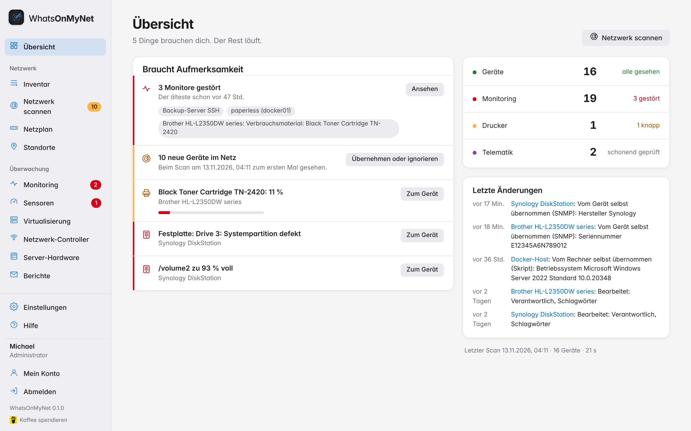

## Installation

WhatsOnMyNet läuft als Docker-Container mit Host-Netzwerk - nur so sieht der Scan die MAC-Adressen der Geräte.

1. `docker-compose.yml` und `env.example` aus dem Release in einen Ordner legen, `env.example` in `.env` umbenennen.
2. In der `.env` bei Bedarf Ports (`WOMN_HTTPS_PORT`, Standard 8743), Zeitzone (`TZ`) und Besitzer der Daten (`PUID`/`PGID`) anpassen.
3. `docker compose up -d` - oder den Stack in Dockhand anlegen.
4. Den **Einrichtungscode** aus dem Log holen (`docker compose logs whatsonmynet`) und `https://<server>:8743/setup` öffnen. Dort legst du den ersten Administrator an.

Die Oberfläche läuft immer über HTTPS. Beim ersten Start erzeugt WhatsOnMyNet ein selbstsigniertes Zertifikat; ein eigenes (PEM oder PFX) lädst du unter *Einstellungen → HTTPS-Zertifikat* hoch.

**Ping:** Der Container läuft ohne Root-Rechte. Ping funktioniert, wenn der Host normalen Benutzern ICMP erlaubt (`net.ipv4.ping_group_range`, bei Debian/Ubuntu/Proxmox Standard). Ohne Ping findet der Scan Geräte trotzdem über ARP und TCP.

**Ping im Proxmox-LXC freischalten** (im LXC ist es meist aus - `cat /proc/sys/net/ipv4/ping_group_range` zeigt `1 0`). Im LXC als root, nicht auf dem Proxmox-Host:

```sh
echo 'net.ipv4.ping_group_range = 0 65535' > /etc/sysctl.d/99-ping.conf
sysctl -p /etc/sysctl.d/99-ping.conf
docker compose restart
```

Die Einstellung bleibt nach einem Neustart erhalten und braucht keine zusätzlichen Rechte für den Container. Höher als `65535` geht im unprivilegierten LXC nicht („Invalid argument“). In der `docker-compose.yml` geht es nicht: Docker erlaubt `sysctls` im Host-Netzwerk nicht.

## Erste Schritte

Jeder Bereich unter *Einstellungen* beginnt mit einem kurzen Hinweis, wozu er da ist, und einem Link zum passenden Abschnitt dieses Handbuchs.

1. **Standort anlegen** (*Standorte*): Name und Subnetze, z. B. „Hauptgebäude“ mit `192.168.10.0/24`.
2. **Netzwerk scannen** (*Netzwerk scannen*): Standort anhaken, „Scan starten“. Der Radar zeigt die gefundenen Geräte; der Scan ist schonend (ARP, 26 typische Ports, SNMP nur lesend).
3. **Übernehmen**: Im Ergebnis unter „Neu“ Typ und Name prüfen, Geräte anhaken, „Ins Inventar übernehmen“. Was du nicht im Inventar willst, „Ignorieren“. Versehentlich ignoriert? Im Reiter „Ignoriert“ anhaken und „Nicht mehr ignorieren“ (steht dann wieder unter „Neu“) oder gleich „Ins Inventar übernehmen“. Die ganze Liste steht unter *Einstellungen → Ignorierte Geräte*. Übernehmen und Ignorieren geht nur aus dem neuesten Scan eines Subnetzes - hat ein neuerer Scan das Subnetz erfasst, bleibt ein älterer Scan lesbar, übernommen oder ignoriert wird im neueren. „Nicht mehr ignorieren“ geht auch im älteren Scan.

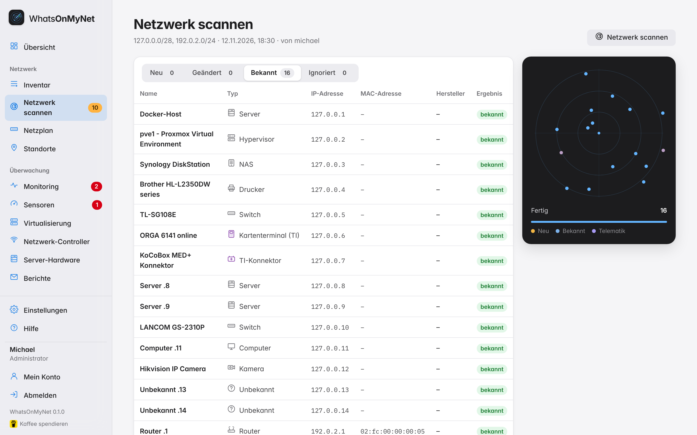

Die MAC-Adresse ist die Identität eines Geräts: Bekommt es eine neue IP, übernimmt der nächste Scan sie automatisch und schreibt es in den Verlauf. Einen Rechnernamen, den du von Hand eingetragen hast, lässt der Scan stehen; er füllt den Rechnernamen nur, solange das Feld leer ist oder der Name vom Scan stammt. Leerst du das Feld, füllt der Scan es wieder.

**Schon im Inventar?** Findet der Scan ein Gerät, das vermutlich schon im Inventar steht - gleicher Rechnername (z. B. die zweite Netzwerkkarte eines NAS) oder gleiche IP mit anderer MAC (VM, ausgetauschtes Gerät) -, steht in der Liste ein Tipp mit dem vorhandenen Gerät. Beim Übernehmen wird es übersprungen. „Diesem Gerät zuordnen“ übernimmt bei gleicher IP die neue MAC bzw. legt die zweite Netzwerkkarte mit Hinweis auf die Ignorierliste; „Trotzdem als neues Gerät“ nimmt es doch auf. Stehen Geräte schon doppelt im Inventar (gleicher Rechnername), zeigt das Inventar oben einen Hinweis mit „Zusammenführen“.

**Nichts doppelt überwachen:** Einen Monitor oder Sensor für etwas, das schon überwacht wird, legt WhatsOnMyNet kein zweites Mal an - es nennt den vorhandenen. Rechnername und IP desselben Geräts gelten als dasselbe Ziel; mehrere Dienste eines Servers (Weboberfläche, SSH, Datenbank …) gehen natürlich. Windows- und Linux-Rechner ohne Skript zeigen auf der Geräteseite den Tipp „Per Skript überwachen“.

## Inventar

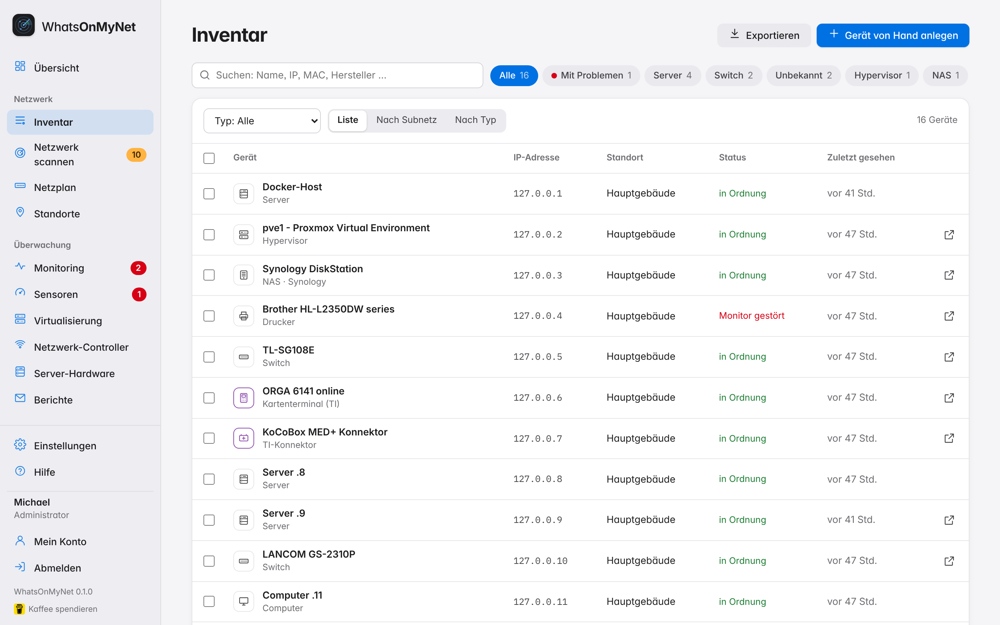

- **Suchen und filtern** nach Name, IP, MAC, Hersteller, Typ, Standort oder Schlagwort; Export als CSV oder JSON.
- **Geräteseite**: alle Angaben, Kauf- und Garantiedaten, Notizen, Schnellzugriff auf die Weboberfläche, was der Scan erkannt hat, Verlauf aller Änderungen.
- **Vorschläge beim Ausfüllen**: Hersteller, Modell, Betriebssystem, Verantwortlicher, Lieferant und Schlagwörter schlagen vor, was schon im Inventar steht. Ein bekanntes Modell füllt Hersteller und Typ aus.
- **Mehrfachauswahl**: Geräte anhaken und gemeinsam bearbeiten (Typ, Standort, Hersteller, Modell, Daten, Schlagwörter) oder löschen.
- **Tiefenprüfung**: prüft ein einzelnes Gerät mit einer längeren Port-Liste. Telematik-Geräte (Konnektor, Kartenterminal) werden immer nur schonend geprüft. Bei einem noch unklaren Gerät fragt die Tiefenprüfung zuerst nur Port 4742 (SICCT) ab - antwortet ein Kartenterminal, bleibt es beim schonenden Profil.

## Nächtlicher Leicht-Scan

**Von sich aus scannt WhatsOnMyNet nichts:** Bei einer neuen Installation ist der nächtliche Scan aus. Die Seite *Netzwerk scannen* sagt das und bietet Administratoren **Nächtlichen Scan einschalten** an (das steht im Protokoll); Installationen von vor 0.42 behalten ihre Einstellung. Eingeschaltet sucht WhatsOnMyNet jede Nacht (Standard 02:30) in allen Subnetzen deiner Standorte nur nach Geräten: ARP, NetBIOS und - wenn erlaubt - Ping; in gerouteten Subnetzen zusätzlich wenige TCP-Verbindungsversuche (Ports 443, 80, 22, 445, 3389) und die ARP-Tabelle der Router per SNMP. Keine Port-Prüfung der Geräte, keine Webanfragen. Bekannte Geräte bekommen ihre neue IP; ein Gerät, das zum allerersten Mal auftaucht, wird einmal gemeldet. Einstellungen, Uhrzeit und „Jetzt ausführen“ findest du unter *Einstellungen → Scan*.

## Monitoring

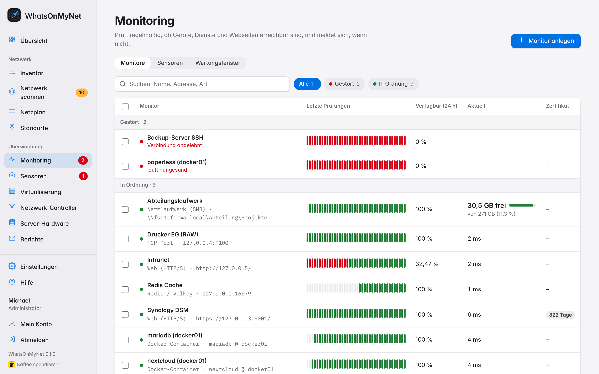

**Gleich überwacht:** Übernimmst du Geräte aus dem Scan ins Inventar (oder legst eins von Hand an), bekommt jedes sofort einen Monitor: die Weboberfläche, sonst Ping oder einen offenen Port. Sobald das Gerät Werte liefert, kommen ein paar wichtige Sensoren dazu:

- **Drucker:** jede Tonerkartusche und Störungen
- **NAS:** Volumes, RAID, Zustand (System, Lüfter, Netzteil) und Temperatur
- **USV:** Netz/Akku, Ladung und Restlaufzeit
- **Windows- und Linux-Rechner mit Skript:** online, CPU, RAM, Systemlaufwerk, höchste Temperatur, ausgefallene Dienste und der Zustand der Speicherpools (ZFS, RAID, Storage Spaces)
- **Hosts unter Virtualisierung:** Knoten, Speicher und Sicherungen; bei Backup Server Datenspeicher und Aufgaben; bei Controllern die Geräte; bei Servern mit Verwaltungschip der Zustand

Das gilt für Geräte und Hosts, die neu dazukommen, und jeweils einmal: Löschst du einen dieser Sensoren, kommt er nicht wieder. Abschalten unter *Einstellungen → Benachrichtigungen → Neue Geräte automatisch überwachen*.

Ein Monitor prüft regelmäßig (20 Sekunden bis 24 Stunden) und meldet sich erst nach mehreren Fehlversuchen hintereinander. Arten:

- **Web (HTTP/S)** mit Statuscodes, Stichwort und Ablaufdatum des Zertifikats (Warnung z. B. 30, 14 und 7 Tage vorher)
- **TCP-Port** und **Ping**
- **Docker-Container** (über einen Socket-Proxy, *Einstellungen → Docker*): läuft, startet ständig neu, Healthcheck „unhealthy“
- **Datenbanken**: MariaDB/MySQL, PostgreSQL, Redis/Valkey - Anmeldung und eine harmlose Abfrage
- **Netzlaufwerk (SMB)**: Windows-Freigaben und NAS - siehe unten
- **Mailserver**: SMTP, IMAP oder POP3 - Begrüßung, STARTTLS bzw. TLS und Ablauf des Zertifikats; ohne Anmeldung, es wird keine Mail verschickt
- **DNS-Auflösung**: ein Name (A, AAAA, MX, TXT, SRV …) an einem bestimmten DNS-Server, optional mit erwarteter Antwort - z. B. ob der interne DNS die richtige IP liefert
- **LDAP / Active Directory**: liest die rootDSE ohne Anmeldung (LDAPS oder StartTLS) - meldet, wenn ein Domänencontroller nicht synchronisiert ist; dazu der Ablauf des Zertifikats
- **Zeitserver (NTP)**: antwortet, ist selbst synchronisiert, und seine Uhr weicht höchstens so viele Millisekunden von der des WhatsOnMyNet-Servers ab
- **Microsoft SQL Server**: Anmeldevorbereitung (PRELOGIN) ohne Konto - Version und Verschlüsselung; benannte Instanzen über den SQL Browser
- **Meldung (Trap/Syslog)**: siehe *Meldungen der Geräte*
- **Sensor** (Wert eines Geräts, Rechners mit Skript, Hypervisors oder Controllers) und **SNMP-Wert (OID)** - siehe unten

Auf der Geräteseite legt „Überwachen“ einen passenden Monitor an. Ändert sich die IP eines Geräts, ziehen seine Monitore mit. Ausnahme: Ein Monitor mit gespeichertem Passwort (Datenbank, Netzlaufwerk) wird pausiert, denn das Passwort wurde für die alte Adresse eingegeben und geht nie ungefragt an eine andere. Er zeigt „Gerät hat neue IP - Passwort bitte neu eingeben“, seine Benachrichtigungskanäle bekommen eine Meldung, und im Bearbeiten-Dialog ist die neue Adresse schon eingetragen: Mit dem Passwort gespeichert läuft er wieder. Kehrt das Gerät zur alten Adresse zurück, läuft er von selbst weiter. Benennst du das Gerät um, heißen seine Monitore und Sensoren auch gleich so, damit ein Alarm den aktuellen Namen nennt (ein Monitor mit selbst vergebenem Namen ohne den Gerätenamen bleibt, wie er ist).

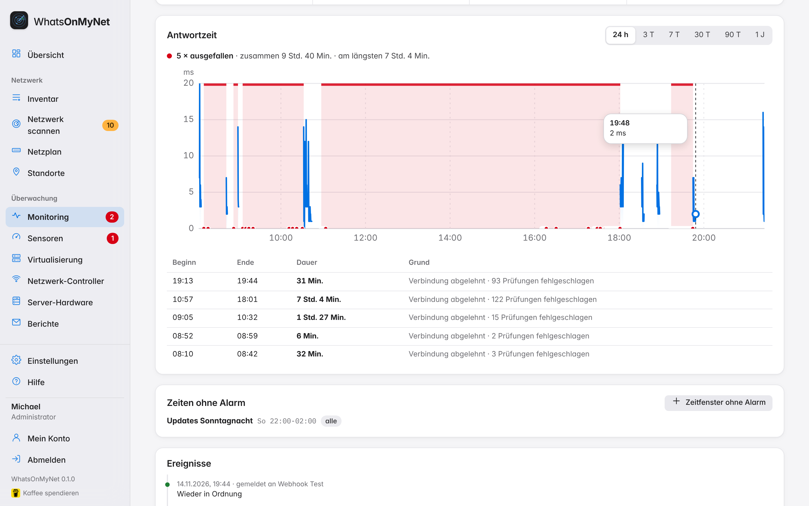

**Benachrichtigungen** (*Einstellungen → Benachrichtigungen → Kanal hinzufügen*): Dienst wählen, die kurze Anleitung im Formular befolgen, speichern und mit **Testnachricht** prüfen. Mit dem **Anzeigenamen** (Absender) steht über jeder Meldung, woher sie kommt - praktisch, wenn mehrere Installationen in denselben Chat melden. Bei E-Mail ist er der Name des Absenders und steht im Betreff, bei ntfy, Gotify, Pushover & Co. ist er der Titel, bei Discord und Mattermost der Name des Bots.

- **Häufig:** E-Mail (über den SMTP-Server), Telegram-Bot, Webhook mit eigener JSON-Vorlage (z. B. für n8n oder ein Skript)
- **Chat und Messenger:** Discord, Slack, Microsoft Teams (Workflows), Google Chat, Mattermost, Rocket.Chat, Matrix/Element, Signal (über signal-cli-rest-api), WhatsApp (CallMeBot, an die eigene Nummer)
- **Push aufs Handy:** ntfy, Gotify, Pushover, Pushbullet, Home Assistant (Companion-App)
- **Alles andere:** Apprise - eine Brücke zu über 100 weiteren Diensten (SMS, Threema …)

Tokens, Schlüssel und Webhook-Adressen werden verschlüsselt gespeichert und nie wieder angezeigt. Störungen kommen bei Push-Diensten mit hoher Priorität.

**Wartungsfenster** (*Überwachung → Monitoring → Wartungsfenster*): einmalig oder an bestimmten Wochentagen von-bis (auch über Mitternacht). Es gilt für die angehakten Monitore und Sensoren - die Auswahl ist nach Gerät bzw. Hypervisor gruppiert, mit Suche, ein Haken beim Gerät nimmt alles davon. Nichts angehakt = alles. Schneller für einen einzelnen: auf der Seite des Monitors oder Sensors unter *Zeiten ohne Alarm* → **Zeitfenster ohne Alarm** (vorbelegt: täglich 20-23 Uhr, z. B. für die Zeit des Backups, in der eine SSD warm wird). Geprüft und aufgezeichnet wird auch im Wartungsfenster, nur die Meldungen schweigen. Der Status „Wartung“ steht ab Beginn des Fensters da (nicht erst nach der nächsten Prüfung) und verschwindet mit seinem Ende.

**Was in einem Alarm steht:** Webseite, Port und Ping melden „ist nicht erreichbar“. Ein Messwert meldet „Grenzwert überschritten - 83,9 °C (≥ 80)“ und später „wieder im normalen Bereich“, ein Zustand (Dienst, VM, Festplatte, Container …) „Störung“ und „wieder in Ordnung“, ein Sensor ohne aktuelle Werte „keine aktuellen Werte“. Deutsche Kanäle bekommen auch die Einzelheiten auf Deutsch.

**So wird geprüft:** Jede Detailansicht eines Monitors oder Sensors zeigt, was genau gefragt wird (Adresse, Statuscode, Suchwort, OID, Freigabe, Messwert eines Geräts oder Hypervisors), woher die Werte kommen und wie alt sie sind (z. B. „neu alle 5 min · Stand vor 2 min“), wann alarmiert wird - mit Grenze, Abstand für die Entwarnung und Zahl der Fehlversuche - und die letzte Antwort im Wortlaut. So lässt sich jede Meldung bis zu ihrer Quelle zurückverfolgen.

### Mehrere Monitore oder Sensoren auf einmal ändern

In den Listen *Monitore* und *Sensoren* hat jede Zeile ein Kästchen, das Kästchen im Tabellenkopf nimmt alle gerade angezeigten (Suche und Filter gelten). Darüber erscheint eine Leiste mit der Anzahl und den Knöpfen **Pausieren**, **Fortsetzen**, **Löschen** (mit Rückfrage) und **Gemeinsam bearbeiten**. Im Dialog stehen die Felder aus *Erweitert*: Prüfen alle, Alarm nach … Fehlversuchen, Zeitlimit, Alarm wiederholen, Eskalation sowie - nach einem Haken bei *Kanäle ändern* - die Eskalations- und Benachrichtigungskanäle; bei Sensoren außerdem Bedingung und Grenzwert. Alle Felder stehen auf *unverändert*: Geändert wird nur, was du ausfüllst, alles andere bleibt bei jedem Monitor, wie es war. Ist ein Wert ungültig (z. B. weniger als 20 Sekunden), wird nichts geändert. Bedingung und Grenzwert gehen nur an Sensoren mit Zahlenwert; Zustands-Sensoren (online, in Ordnung …) werden dabei übersprungen, die Meldung nennt ihre Anzahl. Bearbeiter mit Standort-Beschränkung können nur Monitore ihrer Standorte auswählen.

### Eskalation

Bleibt eine Störung zu lange bestehen, soll es noch jemand anderes erfahren, z. B. die Leitung oder eine zweite Bereitschaft. Dafür gibt es die **Eskalation**.

- **Für alle Monitore:** *Einstellungen → Benachrichtigungen → Eskalation*. Dort wählst du, nach wie vielen Minuten noch gestört (15 Min. bis 8 Std.) eskaliert wird und an welche Kanäle. Die Kanäle legst du vorher wie gewohnt an, etwa eine eigene E-Mail oder einen zweiten Telegram-Chat.
- **Je Monitor:** Im Formular unter *Erweitert → Eskalation* stellst du eine andere Zeit ein, schaltest sie ab (*nie eskalieren*) oder wählst eigene Kanäle. Ohne eigene Auswahl gelten die Einstellungen für alle.
- Die Eskalation kommt **einmal je Störung**, mit hoher Priorität: „🚨 Eskalation: Firewall ist seit 30 Min. nicht erreichbar“. Ist die Störung behoben, kommt die Entwarnung auch an die Eskalationskanäle.
- Folgestörungen (siehe Abhängigkeiten) und Wartungsfenster eskalieren nicht. Im Verlauf des Monitors steht *Eskaliert*, mit den Kanälen, die erreicht wurden.

### Verlauf über Monate

Auf der Seite eines Monitors wählst du den Zeitraum: **24 h, 3 T, 7 T** zeigen jede einzelne Prüfung, **30 T, 90 T, 1 J** die Zusammenfassung.

- **Linie:** der Mittelwert, bei 30 Tagen je 6 Stunden, sonst je Tag. Je nach Monitor ist das die Antwortzeit oder der gemessene Wert, etwa CPU oder Füllstand.
- **Fläche:** der Bereich vom niedrigsten bis zum höchsten Wert.
- **Leiste darunter:** zeigt die Verfügbarkeit. Grün heißt immer erreichbar bzw. in Ordnung, gelb kurz gestört, rot länger gestört. Wenn du mit der Maus auf einen Abschnitt zeigst, stehen dort Datum, Prozent und Werte.

**Ausfälle im Diagramm:** Über dem Diagramm steht, wie oft der Monitor im gewählten Zeitraum ausgefallen ist, wie lange zusammen und wie lange am längsten (bei Sensoren: wie oft Alarm war). Jeder Ausfall ist rot hinterlegt, von der ersten fehlgeschlagenen Prüfung bis zur nächsten erfolgreichen. Darunter stehen die Ausfälle als Liste mit Beginn, Ende, Dauer und Grund, bei Sensoren mit dem höchsten (oder niedrigsten) Wert während des Alarms. Zeigst du auf eine Zeile, wird der Ausfall im Diagramm hervorgehoben. Klickst du im Diagramm in einen Ausfall, springt die Liste zur passenden Zeile.

**Zeigen statt suchen:** Wenn du mit der Maus über das Diagramm fährst (am Telefon: tippen), zeigt eine Linie die Stelle. Ein Kasten nennt Uhrzeit und Wert, bei fehlgeschlagenen Prüfungen den Grund und innerhalb eines Ausfalls dessen Zeitraum. Bei Sensoren zeigt eine gestrichelte rote Linie den Grenzwert.

Einzelne Prüfungen werden 7 Tage aufbewahrt, die stündliche Zusammenfassung gut ein Jahr. Für die ersten Monate nach dem Update auf 0.9 gilt: Ältere Stunden kennen nur den Mittelwert, die Fläche erscheint erst für neue Daten.

### Gruppen

Monitore und Sensoren lassen sich in **Gruppen** ordnen, z. B. „Webseiten“, „Telefonie“, „Speicher“ (Formular → *Gruppe*; vorhandene werden vorgeschlagen). Ohne eigene Gruppe gilt der **Standort des Geräts** als Gruppe, sonst *Ohne Gruppe*. Mehrere auf einmal: in der Liste ankreuzen → *Ändern* → *Gruppe* (oder *Aus der Gruppe nehmen*).

- **Ansicht „Nach Gruppe“** wie in Uptime Kuma (Auswahl über der Liste; sobald es eine eigene Gruppe gibt, ist sie der Standard, der Browser merkt sich die Wahl): Jede Gruppe ist eine eigene Zeile mit Zustand, einem Balken für alle Mitglieder (rot, wo eines gestört war – der Tooltip nennt es), dem Mittel ihrer Verfügbarkeit und „2 von 6 gestört“; die Mitglieder stehen eingerückt darunter. Gibt es für die Gruppe einen Gruppen-Monitor, ist er diese Zeile – mit seinen eigenen Prüfungen und Verfügbarkeit, ein Klick öffnet ihn. Gruppen mit einer Störung stehen oben und sind immer aufgeklappt, die übrigen lassen sich zuklappen. Die Suche findet auch Gruppennamen. Bei den Sensoren genauso.
- **Ein Alarm für die ganze Gruppe:** *Monitor anlegen* → *Gruppe*. Er ist gestört, wenn **ein** Mitglied gestört ist – oder erst, wenn **alle** gestört sind (z. B. zwei redundante Internetleitungen). Es zählen gestörte und nicht erreichbare Mitglieder; pausierte, solche im Wartungsfenster und noch nicht geprüfte nicht. Er hat eigene Kanäle, Eskalation und Wartungsfenster wie jeder Monitor. Tipp: Kanäle nur beim Gruppen-Monitor setzen, nicht bei den Mitgliedern – dann kommt ein Alarm statt vieler.
- **Wartungsfenster:** Monitore mit eigener Gruppe stehen dort unter *Gruppe …* – ein Haken nimmt die ganze Gruppe.
- Eine Webseite ohne Gerät gehört so trotzdem irgendwohin. Läuft sie auf einem eigenen Server, kann sie zusätzlich von dessen Ping **abhängen** (unten): Fällt der Server aus, kommt nur dessen Alarm.

### Statusseiten ohne Anmeldung

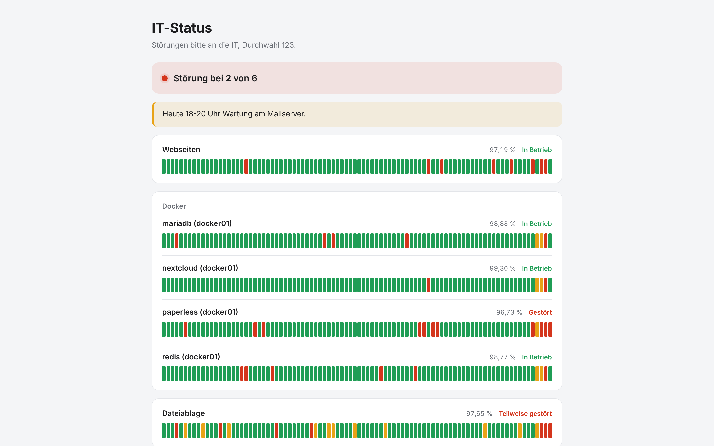

Wie in Uptime Kuma: eine Seite, die ohne Anmeldung zeigt, was läuft und was nicht – für Kollegen, den Empfang oder einen Bildschirm im Flur. Es gibt sie erst, wenn ein Administrator eine anlegt: *Monitoring → Statusseiten → Statusseite anlegen*.

- **Was sie zeigt**, bestimmst du: Gruppen und einzelne Monitore, in deiner Reihenfolge, jeweils unter einem **angezeigten Namen** (leer = der Name in WhatsOnMyNet). Eine Gruppe ist eine Zeile („Teilweise gestört“, wenn ein Teil ausfällt) – oder mit *Jeden einzeln zeigen* ein Abschnitt mit ihren Monitoren.
- Je Zeile: Zustand (*In Betrieb*, *Gestört*, *Teilweise gestört*, *Wartung*, *Nicht überwacht*), die **letzten 90 Tage** als Balken (auf dem Handy 30) und die Verfügbarkeit in Prozent (abschaltbar). Oben die Gesamtlage („Störung bei 2 von 6“), darunter auf Wunsch ein **Hinweis** (z. B. eine angekündigte Wartung) und eine Beschreibung.
- **Nie** auf der Seite: Adressen, Ziele und Fehlertexte – nur Namen: die du vergibst, sonst die der Monitore (bei *Jeden einzeln zeigen* also z. B. „DC01 Ping“ – dann lieber Gruppe als eine Zeile). Sie lädt nichts aus dem Internet, hat kein JavaScript und aktualisiert sich jede Minute; Suchmaschinen sollen sie nicht aufnehmen.
- **Zugang:** *Geheimer Link* (Standard) – eine Adresse aus Zufallszeichen, nur wer sie bekommt, sieht die Seite; *Neuer Link* macht den alten sofort ungültig. Oder *Eigene Adresse* wie `/status/it` – die kann jeder aufrufen, der sie kennt. Beide lassen sich auf **Netze beschränken** (z. B. `10.0.10.0/24`); hinter einem Reverse Proxy zählt die Adresse, die er weitergibt (`WOMN_TRUST_PROXY`).
- Eine ausgeschaltete, gelöschte oder für das Netz nicht freigegebene Seite antwortet genauso wie eine, die es nie gab: „nicht gefunden“.

### Abhängigkeiten: keine Alarmflut

Fällt ein Switch aus, sind auch alle Geräte dahinter nicht mehr erreichbar. Damit dann nicht zwanzig Meldungen kommen, kann jeder Monitor von einem anderen **abhängen** (Formular → *Hängt ab von*, z. B. der Ping auf den Switch oder den Internet-Router).

- Ist der Monitor davor gestört, gilt der dahinter als **Folgestörung** (hohler roter Punkt) und meldet nichts extra. Gemeldet wird nur die Ursache.
- Fallen beide gleichzeitig aus, wartet der dahinter kurz auf das Ergebnis des Monitors davor, statt selbst Alarm zu schlagen.
- Läuft der Monitor davor wieder, werden die dahinter sofort neu geprüft. Wer dann noch gestört ist, hat ein eigenes Problem und meldet sich ganz normal.
- Ketten sind möglich (Internet-Router → Core-Switch → Etagen-Switch → Drucker). Kreise lehnt das Programm ab.

**Automatisch über den Switch-Port:** Wird ein Switch per SNMP abgefragt, weiß WhatsOnMyNet, an welchem Switch ein Gerät steckt. Beim **Überwachen** eines Geräts ist der Monitor seines Switches dann schon als Abhängigkeit vorausgewählt. Auf der Seite des Switch-Monitors steht zudem, wie viele überwachte Geräte an ihm stecken und noch von nichts abhängen. **Hinter diesen Monitor hängen** ordnet sie alle auf einmal zu.

## Meldungen der Geräte: SNMP-Traps und Syslog

Viele Geräte melden ein Problem von sich aus, sobald es passiert: Ein Switch meldet einen getrennten Port, eine USV den Wechsel auf Akku, ein NAS eine Plattenwarnung, eine Firewall einen Ausfall der Leitung. WhatsOnMyNet empfängt diese Meldungen - **SNMP-Traps** (v1, v2c, auch Informs) und **Syslog** (RFC 3164 und 5424, über UDP, TCP oder verschlüsselt über TLS) - und ordnet sie über die Adresse dem Gerät im Inventar zu.

1. *Überwachung → Meldungen* → **Empfang einschalten**: SNMP-Traps und/oder Syslog anhaken. Traps werden nur mit einer bekannten Community angenommen (leer = die Communities des Scans).
2. In den Geräten WhatsOnMyNet als Ziel eintragen - Trap-Empfänger bzw. Syslog-Server.

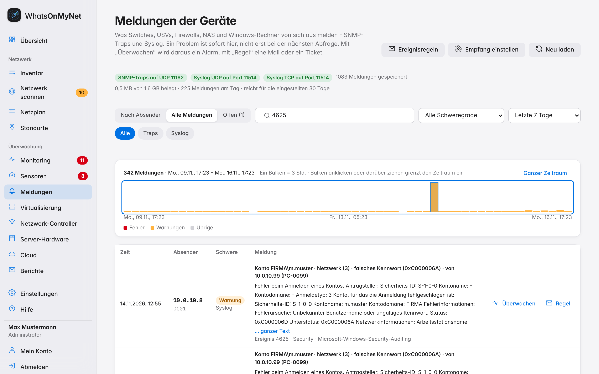

**Ports:** WhatsOnMyNet läuft ohne Root-Rechte und horcht deshalb auf **UDP 1162** (Traps) und **UDP 1514** (Syslog), nicht auf 162/514. Entweder in den Geräten diese Ports eintragen, oder auf dem Docker-Host einmal umleiten:

```
iptables -t nat -A PREROUTING -p udp --dport 162 -j REDIRECT --to-ports 1162
iptables -t nat -A PREROUTING -p udp --dport 514 -j REDIRECT --to-ports 1514
iptables -t nat -A PREROUTING -p tcp --dport 514 -j REDIRECT --to-ports 1514
```

Andere Ports: `WOMN_TRAP_PORT`, `WOMN_SYSLOG_PORT` (UDP), `WOMN_SYSLOG_TCP_PORT` und `WOMN_SYSLOG_TLS_PORT` in der `.env`.

**Syslog über TCP und TLS:** Über UDP können Meldungen verloren gehen oder gefälscht werden. Wer es zuverlässiger will, schaltet zusätzlich **TCP** (Port 1514, RFC 6587 - beide Arten der Trennung: Länge vorweg oder Zeile für Zeile) und/oder **TLS** (Port 6514, RFC 5425) ein. TLS nutzt das Zertifikat dieses Servers; es steht unter *Einstellungen → Prometheus & Grafana* zum Herunterladen, damit der Absender es prüfen kann (z. B. rsyslog: `StreamDriverAuthMode="x509/name"`). Je Absender höchstens 10 Verbindungen, insgesamt 200; eine Stunde ohne Meldung beendet die Verbindung; eine einzelne zu lange Meldung (über 8 KB) wird übersprungen, unsinnige Längenangaben beenden die Verbindung.

### Ereignis-Konsole: Zählen, reguläre Ausdrücke, offene Ereignisse

Ereignisregeln können mehr als „bei jedem Treffer eine Mail“:

- **Zählen:** *Erst ab so vielen Treffern innerhalb von … Minuten*, auf Wunsch **je Absender** - z. B. 5 fehlgeschlagene SSH-Anmeldungen in 10 Minuten am selben Rechner. Dann geht **eine** Nachricht mit allen Treffern hinaus; weniger im Zeitfenster gehen still verloren. Danach wird neu gezählt.
- **Regulärer Ausdruck** auf den Text (Groß-/Kleinschreibung egal), z. B. `Failed password|Invalid user` oder `Port (\d+) link down`. Vor dem Speichern wird er geprüft: Formen, die sich endlos verrennen können (eine wiederholte Gruppe, die sich selbst wiederholt oder Alternativen hat, Rückverweise), werden abgelehnt, und er wird in einem eigenen Prozess mit Zeitlimit an feindseligen Texten und echten Meldungen ausprobiert. Braucht er im Betrieb trotzdem einmal länger als 20 ms für eine Meldung, wird die Regel ausgeschaltet und zeigt den Grund.
- **Offene Ereignisse** (*Als offenes Ereignis führen*): Der erste Treffer öffnet ein Ereignis und benachrichtigt; weitere zählen nur hoch, statt erneut zu melden. Jedes Ereignis gehört zu einem Absender und einem **Schlüssel** - der ersten Klammer des Ausdrucks, z. B. der Portnummer. Geschlossen wird es durch die **Gegenmeldung** (Wörter, Ereignisnummern oder Ausdruck - mit Klammer nur das Ereignis mit demselben Schlüssel, also „Port 7 link up“ schließt nur Port 7), von Hand, oder nach einer einstellbaren Zeit ohne neue Meldung. Auf Wunsch kommt bei der Gegenmeldung eine Entwarnung. Unter *Meldungen → Offen* stehen alle offenen Ereignisse; **Quittieren** heißt „gesehen, wird erledigt“.
- Fertige Regeln dafür: SSH (5 in 10 Min. je Rechner), Windows-Anmeldefehler 4625 (10 in 10 Min. je Rechner), Switch-Port down (offen bis „up“), USV auf Batterie (offen bis Netzbetrieb).
- **Fehlgeschlagene Anmeldungen (4625)** zählen ab Werk ohne die Dienst-Anmeldungen des Rechners selbst (*Anmeldetyp 5*) und ohne „kein Anmeldeserver erreichbar“ (*0xC000005E* - z. B. ein Laptop beim Hochfahren, bevor das VPN steht): beides ist kein Angriff. Übrig bleiben falsche Kennwörter und unbekannte Benutzer über das Netz, am Gerät oder per Remotedesktop. Eine so angelegte Regel aus einer älteren Version bekommt die Ausnahmen beim Update; eine von Hand geänderte bleibt, wie sie ist.
- **Kurzfassung bei Anmeldeereignissen:** Bei 4625, 4740, 4771 und 4776 steht in der Benachrichtigung und in der Meldungsliste statt des Textanfangs, worum es geht - z. B. „Konto FIRMA\\m.muster · Netzwerk (3) · falsches Kennwort (0xC000006A) · von 10.0.10.23“. Meldungstexte werden bis 4000 Zeichen gespeichert; lange Texte zeigt die Liste gekürzt, *ganzer Text* klappt den Rest auf.

### Windows-Ereignisse (NXLog, Fluent Bit)

Windows-Server und -Clients schicken ihre Ereignisanzeige mit einem kleinen, kostenlosen Agenten per Syslog an WhatsOnMyNet. WhatsOnMyNet erkennt darin **Ereignisnummer**, **Protokoll**, **Quelle** und **Konto** und zeigt sie unter dem Meldungstext - so wie in der Ereignisanzeige. Unter *Meldungen → Empfang einstellen* **Syslog über TCP** einschalten (Port 1514); bei den Agenten muss nur die Adresse von WhatsOnMyNet eingetragen werden (hier `womn.firma.local`).

**NXLog** ([NXLog Community Edition](https://nxlog.co), kostenlos, läuft als Dienst). Eine vollständige `C:\Program Files\nxlog\conf\nxlog.conf`, die so im Betrieb läuft:

```
Panic Soft
#NoFreeOnExit TRUE

define ROOT     C:\Program Files\nxlog
define CERTDIR  %ROOT%\cert
define CONFDIR  %ROOT%\conf\nxlog.d
define LOGDIR   %ROOT%\data

include %CONFDIR%\\*.conf
define LOGFILE  %LOGDIR%\nxlog.log
LogFile %LOGFILE%

Moduledir %ROOT%\modules
CacheDir  %ROOT%\data
Pidfile   %ROOT%\data\nxlog.pid
SpoolDir  %ROOT%\data

<Extension _syslog>
    Module xm_syslog
</Extension>

<Extension _fileop>
    Module xm_fileop
    # NXLog's own log: at most 8 files of 5 MB
    <Schedule>
        Every 1 hour
        Exec if (file_exists('%LOGFILE%') and (file_size('%LOGFILE%') >= 5M)) file_cycle('%LOGFILE%', 8);
    </Schedule>
    <Schedule>
        When @weekly
        Exec if file_exists('%LOGFILE%') file_cycle('%LOGFILE%', 8);
    </Schedule>
</Extension>

<Input in>
    Module im_msvistalog
</Input>

<Output out>
    Module om_tcp
    Host   womn.firma.local
    Port   1514
    # Windows writes many messages over several lines - over TCP every line would
    # become a message of its own. Line breaks become spaces: one message, complete.
    Exec   $Message = replace($Message, "\r\n", " ");
    Exec   $Message = replace($Message, "\n", " ");
    # Number and log in front of the text, the source (e.g. Microsoft-Windows-Ntfs)
    # goes as syslog tag - so WhatsOnMyNet can tell "1 of Ntfs" from "1 of Sysmon"
    Exec   if not defined $Channel $Channel = "";
    Exec   $Message = "[" + string($EventID) + "] [" + $Channel + "] " + $Message;
    Exec   to_syslog_bsd();
</Output>

<Route r1>
    Path in => out
</Route>
```

Danach den Dienst neu starten (`Restart-Service nxlog`). Unter *Meldungen* steht bei jeder neuen Meldung z. B. „Ereignis 101 · Microsoft-Windows-Kernel-Cache/Operational · Microsoft-Windows-Kernel-Cache“. Fehlen die drei `Exec`-Zeilen ab `$Channel`, schickt NXLog nur Zeit, Rechner, Stufe, Nummer und Text: Regeln erkennen die Ereignisse dann nur an der Nummer, und ein Ausschluss für eine Quelle (`1@Ntfs`) greift nicht. Auch `Exec $Message = to_json(); to_syslog_ietf();` (alle Felder als JSON) wird verstanden, die Meldungen werden damit aber deutlich länger.

**Fluent Bit** ([fluentbit.io](https://fluentbit.io), kostenlos, Apache-Lizenz, läuft als Dienst) geht genauso. `fluent-bit.conf`:

```
[SERVICE]
    Flush        5
    Log_Level    warn

[INPUT]
    Name                 winevtlog
    Channels             System,Application,Security
    Interval_Sec         1
    # remembers where it was - after a restart nothing is sent twice
    DB                   C:\ProgramData\fluent-bit\winevtlog.sqlite
    # only the readable text, not every field twice (keeps messages short)
    String_Inserts       false

[OUTPUT]
    Name                 tcp
    Match                *
    Host                 womn.firma.local
    Port                 1514
    Format               json_lines
```

Fluent Bit schickt jedes Ereignis als JSON-Zeile; WhatsOnMyNet liest daraus Nummer, Quelle, Protokoll, Rechner und Schwere (auch „Überwachung fehlgeschlagen“ als Warnung). Den Ordner `C:\ProgramData\fluent-bit` vorher anlegen. Diese Konfiguration wird bei jeder Änderung an WhatsOnMyNet auf einem echten Windows Server mit Fluent Bit geprüft.

**Andere Agenten:** Winlogbeat (Elastic) kann nicht direkt per Syslog senden, nur über einen weiteren Dienst (Logstash) - für WhatsOnMyNet also nicht geeignet. Wer NXLog oder Fluent Bit nicht auf jedem Rechner verteilen will, kann die in Windows eingebaute **Ereignisweiterleitung** (Windows Event Forwarding, per Gruppenrichtlinie) nutzen: Die Rechner schicken ihre Ereignisse an einen Sammelserver, und nur dort läuft der Agent. Als Absender erscheint dann der Sammelserver; der echte Rechner steht in jeder Meldung als Rechnername.

Die Suche findet eine Ereignisnummer, wenn man nur die Zahl eingibt. Umlaute in der Codepage von Windows (z. B. „NT-AUTORITÄT“) werden richtig gelesen, auch gemischt mit UTF-8 in derselben Zeile.

**Was gespeichert wird:** Unter *Empfang einstellen* gilt für alle Absender z. B. „ab Warnung“; in der Ansicht *Nach Absender* bekommt jeder Absender über **Filter** seine eigene Grenze - alles (ein wichtiger Server), ab Fehler (ein gesprächiger Switch) oder gar nichts (stumm). Ein stummer Absender bleibt in der Liste, mit der Zahl der verworfenen Meldungen, damit man ihn wiederfindet. Was nicht gespeichert wird, löst auch keine Regel und keinen Monitor aus.

**Nur bestimmte Ereignisnummern:** Unter *Empfang einstellen* legst du fest, welche Windows-Ereignisse überhaupt gespeichert werden - *nur diese Nummern annehmen* (z. B. `1116, 1117, 4740, 865-868`; leer = alle) und *diese Nummern nie annehmen*. Eine neue Installation beginnt dort mit dem üblichen Rauschen: An-/Abmeldungen und Sonderrechte (4624, 4634, 4647, 4672), Prozessstart und -ende (4688, 4689), Objektzugriffe (4656, 4658, 4663, 4690), Token und Gruppenabfragen (4703, 4798, 4799), Firewall-Verbindungen (5156, 5158), Anmeldeinformationen gelesen (5379), WMI (5858), Uptime (6013), Dienststatus (7036), DCOM (10016), Softwareschutz (16384, 16394), Benutzerprofildienst (1531, 1532). Eine bestehende Installation behält ihre Liste; der Knopf *Übliches Rauschen einsetzen* ergänzt sie, ohne etwas zu entfernen. Fehlanmeldungen (4625), Kontosperren (4740) und die Nummern der fertigen Regeln sind nicht dabei, 8004 auch nicht (siehe unten). Das hält die Liste und den Platz klein; Meldungen von Switches, NAS und Co. betrifft es nicht. Eine Ereignisregel für eine Nummer, die der Empfang nicht annimmt, lässt sich nicht speichern, und die Regelliste warnt, wenn eine Regel deshalb nie mehr greifen kann.

**Gut zu wissen:** Dieselbe Nummer gibt es bei verschiedenen Quellen - 8004 ist bei AppLocker „Programm blockiert“, bei der Gruppenrichtlinie „Verarbeitung abgeschlossen“. Schickt NXLog ohne `Exec` (nur Nummer, keine Quelle), kann eine Regel beides nicht unterscheiden. Mit den `Exec`-Zeilen oben kommt die Quelle mit, und die Regel trifft genau.

**Nach Absender:** Die Seite zeigt zuerst je Rechner oder Gerät eine Zeile - mit der letzten Meldung und den Meldungen, Warnungen und Fehlern der letzten 24 Stunden - statt alle Meldungen untereinander. Ein Klick auf den Absender zeigt nur seine Meldungen; *Alle Meldungen* zeigt wie bisher alles. Auf der Seite eines Geräts führt *Mehr → Meldungen des Geräts* direkt dorthin. Die Liste kommt seitenweise (100 Absender, darunter *Weitere 100 anzeigen*), damit sie auch mit Tausenden Rechnern schnell bleibt. Darüber filtern Schnellfilter mit ihrer Anzahl: *Fehler* und *Warnungen* der letzten 24 Stunden, *Still seit 24 Std.* (ein Rechner, der plötzlich nichts mehr schickt - Agent beendet, Ziel geändert, Rechner aus) und *Mit eigenem Filter*. Daneben lassen sich die Absender nach Gerätetyp aus dem Inventar eingrenzen (*Server*, *Computer*, *NAS* …, *Nicht im Inventar*) und ordnen: neueste Meldung zuerst, meiste Meldungen oder nach Name. Die Reihenfolge merkt sich der Browser. Unter jedem Absender steht, **wie er schickt**: *UDP*, *TCP*, *TLS* oder *Trap* (der Weg der neuesten Meldung), dazu *auch UDP*, wenn in den letzten 24 Stunden noch etwas über UDP kam. Der Schnellfilter *Noch per UDP* zeigt die Geräte, die man umstellen kann: Über TCP geht bei einer Flut nichts verloren, und das Gerät merkt, wenn WhatsOnMyNet nicht erreichbar ist. Synology (*Protokoll-Center → Protokoll senden*), NXLog und Fluent Bit können TCP - derselbe Port wie UDP. Viele Switches, Drucker und USVs können nur UDP; die schicken meist wenig und bleiben so. SNMP-Traps kommen immer über UDP.

**Suchen:** Die Suche findet **ganze Wörter und Wortanfänge** in Text, Quelle, Absender, Protokoll und Konto - Groß- und Kleinschreibung und Umlaute egal (`Lufter` findet *Lüfter*). `m.muster` findet das Konto *FIRMA\m.muster*, `Druck` die *Druckwarteschlange*. **Mehrere Begriffe** mit Leerzeichen müssen alle vorkommen, egal in welcher Reihenfolge und in welchem Feld: `PC-0001 4104 svc-pocketknife` findet die Ereignisse 4104 von PC-0001, in denen *svc-pocketknife* steht. In **Anführungszeichen** steht eine feste Wortfolge (`"link down"`), ein **Minus** schließt aus (`4625 -svc-backup`: alle 4625 außer denen des Dienstkontos). Eine Zahl wie `4625` findet zusätzlich die Windows-Ereignis-ID, ein Name auch das Gerät aus dem Inventar. **Nur die Ereignis-ID** (nicht die Zahl irgendwo im Text): `Ereignis 1002`, `Event 1002`, `ID 1002` oder `id:1002`. Unter dem Suchfeld stehen Beispiele zum Anklicken. Findet eine Suche nach einer Ereignis-ID nichts, sagt die Seite warum: wird nicht gespeichert (Einstellungen), kam zuletzt am … (außerhalb des Zeitraums – mit Knopf *Ganzen Zeitraum zeigen*) oder ist gar nicht angekommen – dann sendet der Rechner es vermutlich nicht (Weiterleitungen wie NXLog oder Fluent Bit schicken oft nur System und Sicherheit, nicht Anwendung). Dafür führt WhatsOnMyNet einen **Suchindex** - so bleibt die Suche auch bei vielen Gigabyte und 30 oder 90 Tagen schnell. Teile mitten im Wort (z. B. `006A` aus *0xC000006A*) findet die normale Suche nicht; findet sie nichts, bietet die Seite **Auch in Wortteilen suchen** an - dann wird jede Meldung im gewählten Zeitraum gelesen, mit einem kurzen Zeitraum geht das trotzdem flott.

**Suchen speichern:** Was man öfter braucht, speichert man unter **Gespeichert → Aktuelle Suche speichern …** mit einem Namen - Suchbegriff, Schwere, Art (Traps/Syslog) und Zeitraum (die Vorgaben wie *Letzte 24 Stunden*, kein fester Tag). Ein Klick in der Liste stellt alles wieder ein, auch aus der Übersicht *Nach Absender*. Mit *Für alle sichtbar* sehen alle sie, die die Meldungen sehen; löschen kann sie nur, wer sie angelegt hat, oder ein Administrator. Derselbe Name noch einmal überschreibt die Suche; höchstens 50 je Benutzer.

Nach dem Update auf 0.39 baut WhatsOnMyNet den Index für die schon gespeicherten Meldungen einmal im Hintergrund auf (etwa eine halbe Minute je Million Meldungen); die Seite zeigt *Suchindex wird aufgebaut: … %*. Gesucht werden kann die ganze Zeit, bis dahin nur langsamer. Neue Meldungen kommen alle paar Sekunden in den Index und werden bis dahin trotzdem gefunden.

**Zeitraum und Zeitleiste:** In *Alle Meldungen* und bei einem einzelnen Absender legst du neben der Schwere den **Zeitraum** fest - letzte 15 Minuten, Stunde, 24 Stunden, 7 oder 30 Tage oder einen *eigenen Zeitraum* mit Von und Bis. Über der Liste zeigt eine Zeitleiste, wie viele Meldungen mit denselben Filtern je Zeitabschnitt kamen - unten rot die Fehler, darüber gelb die Warnungen, grau der Rest. So geht die Suche wie in Splunk oder Wazuh:

1. Nach dem Ereignis suchen, z. B. `4625` oder einem Kontonamen - die Zeitleiste zeigt, wann es gehäuft kam.
2. Einen Balken anklicken oder mit der Maus über mehrere ziehen: Liste und Zeitleiste zeigen nur noch diese Zeit, mit feineren Balken (bis hinunter zu einer Minute). Mit der Tastatur: Zeitleiste anwählen, Pfeiltasten, Eingabe.
3. Ein Klick auf die **Uhrzeit** einer Meldung zeigt, was sonst in den 5 Minuten davor und danach kam - ohne Suchbegriff, also auch die Meldungen drumherum.
4. *Zurück* geht einen Schritt zurück (mit dem Suchbegriff von vorher), *Ganzer Zeitraum* hebt die Eingrenzung auf.

Die gewählte Vorgabe (z. B. *Letzte 24 Stunden*) merkt sich der Browser; ein eigener Zeitraum gilt nur, solange die Seite offen ist. Die Übersicht *Nach Absender* zählt weiter die letzten 24 Stunden.

**Was belegt den Platz?** Der Knopf oben auf der Seite zeigt für die letzten 24 Stunden, 7 oder 30 Tage, welche **Windows-Ereignisse** und **Absender** die meisten Meldungen schicken: Menge pro Tag, Anteil, geschätzter Platz über die eingestellten Tage, von welchen Rechnern, ein Beispiel und ob nur Info oder auch Warnungen und Fehler dabei sind. Hinweise helfen beim Entscheiden: *Regel braucht es* (eine Benachrichtigungsregel wartet auf diese Nummer - ausschließen geht dann nicht), *meist wichtig* (Sicherheit, Abstürze, Neustarts wie 4625, 4740, 1102, 7045 - nur mit gutem Grund weglassen) und *übliches Rauschen*. Administratoren schließen ein Ereignis mit **Nicht speichern** aus; es kommt in die Liste *Windows-Ereignisse: diese Nummern nie annehmen* und lässt sich dort wieder herausnehmen. Schon gespeicherte bleiben bis zum Aufräumen. Für Geräte ohne Ereignis-ID (Switches, NAS) zeigt die Tabelle *Absender*, wie viel davon nur Info ist - oft reicht dort der Filter „ab Warnung“. „von 1.204 Rechnern“ ist genau gezählt, auch bei Tausenden (ganze Tage: im Zeitraum *Letzte 24 Stunden* zählt der erste Tag ganz). Unter den 15 größten Absendern steht, was **alle übrigen zusammen** schicken - in großen Netzen liegt dort oft der meiste Platz: viele Clients mit wenig statt eines Servers mit viel. Sind die Absender im Inventar, zeigt *Nach Gerätetyp*, wie sich die Meldungen auf Clients, Server, NAS usw. verteilen. Schon ausgeschlossene Ereignisse stehen zugeklappt am Ende unter *Schon ausgeschlossen*: Ihre älteren Meldungen sind noch gespeichert und verschwinden von selbst - „weg bis“ nennt den Tag. Oben steht, wie viel der Meldungen pro Tag nur noch solche Altlast ist.

**Dieselbe Nummer, verschiedene Quellen:** Die 1 von NTFS ist Rauschen, die 1 von Sysmon ein Prozessstart. Kommt eine Nummer von mehreren Quellen, zeigt die Übersicht je Quelle eine eigene Zeile, und **Nicht speichern** schließt dann nur diese Quelle aus. In der Liste *Windows-Ereignisse: diese Nummern nie annehmen* steht das als `1@Microsoft-Windows-Ntfs`; von Hand genügt ein Teil des Namens (`1@Ntfs`), Groß- und Kleinschreibung egal. Unter dem Feld steht lesbar, welche Einträge nur für eine Quelle gelten. Das wirkt nur, wenn die Meldung ihre Quelle mitbringt - bei NXLog mit der Konfiguration aus diesem Handbuch (JSON oder die lesbare Form); fehlt sie, wird die Meldung behalten. Eine Benachrichtigungsregel für eine andere Quelle verhindert das Ausschließen nicht.

**Für KI kopieren** macht aus der Liste eine fertige Frage an einen KI-Chat (welche Ereignisse sind ohne Wert, welche behalten?). Schon ausgeschlossene Ereignisse fragt sie nicht noch einmal, sie stehen nur in der Liste am Ende; die Quelle steht je Ereignis dabei, und die KI wird gebeten, Nummern mit wichtiger Bedeutung bei anderen Quellen als `ID@Quelle` zu nennen. Rechnernamen, IP-Adressen, Konten, SIDs, E-Mail-Adressen und Domänen sind darin durch Platzhalter wie *<Rechner 1>* oder *<Konto 2>* ersetzt; der Text wird vor dem Kopieren angezeigt, damit man sieht, was hinausgeht. Die Antwort ist ein Vorschlag - die Hinweise oben und die eigenen Regeln gehen vor.

**Auch bei Millionen Meldungen schnell:** Für die Zeitleiste ohne Suchbegriff, die Zahlen in *Nach Absender* und die Angaben zum Platz führt WhatsOnMyNet eine Zählung je Minute und Stunde (Absender, Art, Schwere, Windows-Ereignis-ID) - sie liest also nicht jedes Mal alle Meldungen. Neue Meldungen kommen alle paar Sekunden in die Zählung und werden bis dahin direkt mitgezählt; die Zahlen sind immer genau. Die Zählung braucht nur wenige Prozent der Meldungsdatei. Nach dem Update auf 0.41 wird eine bestehende Datei einmal im Hintergrund nachgezählt (einige Sekunden je Million Meldungen). Alte Meldungen werden in Stücken zu 10 000 gelöscht, damit ein großer Tag den Empfang nicht aufhält.

### Ereignisregeln: ausgewählte Meldungen per Mail oder ans Ticketsystem

Unter *Meldungen → Ereignisregeln* legst du fest, welche Meldungen wohin gehen - **getrennt von den Monitoren**: Eine Regel schickt nur an die Empfänger, die bei ihr angehakt sind, nie an die Standard-Empfänger. So landet „Virus gefunden“ im Postfach des Ticketsystems und nicht auf dem Handy.

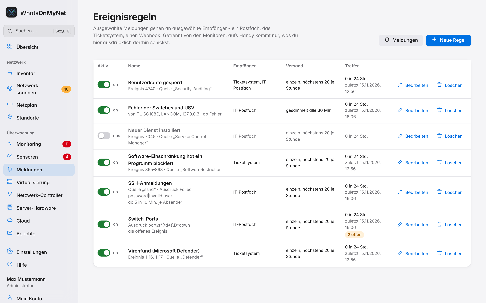

- **Ein und aus:** Der Schalter in der Spalte *Aktiv* der Regelliste schaltet eine Regel direkt ein oder aus. Ausgeschaltet verfallen noch nicht verschickte Treffer, offene Ereignisse der Regel werden geschlossen.
- **Fertige Regeln:** Virenfund (Defender 1116/1117), Software-Einschränkung (865-868), AppLocker (8004/8007), Benutzerkonto gesperrt (4740), Mitglied zu einer Sicherheitsgruppe hinzugefügt (4728/4732/4756), Ereignisprotokoll gelöscht (1102 Sicherheit, 104 System), neuer Dienst (7045), neue geplante Aufgabe (4698), Benutzerkonto angelegt (4720), Echtzeitschutz von Defender ausgeschaltet (5001), PowerShell: verdächtiges Skript (4104, nur Warnungen) und Fehler eines Befehls (4100), Fehler eines Geräts (Syslog), dazu gezählt: fehlgeschlagene Anmeldungen (4625) und SSH-Fehlversuche. Danach lässt sich alles ändern.
  - 4698 und 4720 schreibt Windows nur mit erweiterter Überwachung (Gruppenrichtlinie *Erweiterte Überwachungsrichtlinienkonfiguration*: *Objektzugriff → Andere Objektzugriffsereignisse* bzw. *Kontoverwaltung → Benutzerkontenverwaltung*, jeweils *Erfolg*). Die PowerShell-Regeln brauchen die Skriptblockprotokollierung (*Administrative Vorlagen → Windows-Komponenten → Windows PowerShell*).
  - Die PowerShell-Regeln sind am aussagekräftigsten, wenn die eigenen Werkzeuge still sind: Das Windows-Skript von WhatsOnMyNet erzeugt keine Warnungen 4104 und keine 4100.
- **Bedingungen:** Ereignisnummern (auch Bereiche), Quelle, Protokoll, Absender (Name, Gerät oder IP, auch Teile), Wörter im Text, Wörter, die nicht vorkommen dürfen, Art und Schwere. Alle angegebenen Bedingungen müssen passen. Fehlen Quelle und Protokoll in der Meldung (NXLog ohne `Exec`), entscheidet die Nummer.
- **Testen** zeigt, welche der Meldungen der letzten 7 Tage die Regel getroffen hätte - bevor sie gespeichert ist. Bei jeder Meldung macht **Regel** daraus eine neue Regel.
- **Versand:** *einzeln* - jede Meldung eine Nachricht (beim Ticketsystem: ein Ticket je Ereignis), höchstens so viele je Stunde wie eingestellt (Standard 20); was darüber hinaus kommt, geht nach der Sammelzeit gesammelt hinterher. *Gesammelt* - eine Nachricht mit allen Meldungen, sobald die älteste so alt ist wie die Sammelzeit (Standard 15 Minuten).
- **Nichts geht verloren:** Jeder Treffer wird zuerst gespeichert und erst nach dem Versand als erledigt markiert. Ist ein Empfänger nicht erreichbar, wird es alle 5 Minuten wieder versucht - eine Stunde lang; die Liste zeigt wartende und nicht zugestellte Meldungen.
- Die Mail nennt im Betreff Regel, Rechner, Ereignisnummer und Quelle, im Text Absender, Zeit, Schwere, Protokoll, Konto und die ganze Meldung. Ein Webhook bekommt dieselben Angaben als JSON (`rule`, `count`, `events`).
- Bei der Ausfallsicherung schickt nur die aktive Installation; die Regeln selbst gehen mit auf den Standby.

**Überwachen:** Bei jeder Meldung macht **Überwachen** daraus einen Monitor der Art *Meldung (Trap/Syslog)*: vom selben Gerät (oder jedem Absender), Trap oder Syslog, ab welcher Schwere, optional mit einem Text, den die Meldung enthalten muss. Kommt eine passende Meldung, alarmiert der Monitor **sofort** und bleibt so lange gestört, wie eingestellt (Standard 15 Minuten); kommt sie wieder, beginnt die Zeit neu.

**Gut zu wissen:**
- Die Meldungen liegen in einer **eigenen Datei** (`data/events.sqlite`) - nicht in der Datenbank und nicht in den täglichen Sicherungen. Aufbewahrt werden sie 30 Tage in höchstens 2 GB (beides unter *Empfang einstellen*); was zuerst erreicht ist, zählt, die ältesten gehen zuerst. Wird der Datenträger knapp, bleiben mindestens 10 % (und 1 GB) frei - dann wird früher aufgeräumt. Die Seite zeigt den belegten Platz, die Meldungen pro Tag und wie viele Tage der Platz reicht; reicht er nicht für die eingestellten Tage, steht dort, von wem die meisten Meldungen kommen.
- **Schutz vor Flut:** Über UDP (und bei Traps) höchstens 100 Meldungen pro Sekunde je Absender und 3.000 insgesamt - was darüber kommt, wird verworfen und oben auf der Seite gezählt („… wegen Überflutung verworfen“). Über **TCP und TLS geht nichts verloren:** Je Absender werden bis 500 pro Sekunde angenommen, der Rest wartet - die Verbindung pausiert bis zur nächsten Sekunde, NXLog bzw. Fluent Bit halten die Meldungen so lange fest. Für Windows-Rechner und Domänencontroller deshalb TCP nehmen. Die Grenze insgesamt lässt sich mit `WOMN_MESSAGES_PER_SECOND` in der `.env` ändern (100 bis 100.000).
- *Nur von Geräten im Inventar* verwirft Meldungen fremder Absender. Syslog über UDP lässt sich fälschen - für Alarme lieber Traps mit eigener Community nutzen.
- Bei der Ausfallsicherung empfängt jede Installation für sich: In den Geräten Master **und** Standby als Ziel eintragen.
- SNMPv3-Traps werden (noch) nicht angenommen.

### Wie viel Platz brauchen die Meldungen?

Eine gespeicherte Meldung braucht in `data/events.sqlite` gemessen rund **0,5 KB** (Zeile eines Switches, NAS oder einer USV) bis **5 KB** (langes Windows-Ereignis wie eine fehlgeschlagene Anmeldung 4625); gemischt kann man mit **2 KB** rechnen. Darin steckt der Suchindex (ab Version 0.39), der etwa ein Viertel davon ausmacht und die Suche auch in vielen GB schnell hält. Daraus:

**Platz ≈ Meldungen pro Tag × Tage × 2 KB**

| Meldungen pro Tag | 30 Tage | 90 Tage |
|---:|---:|---:|
| 1.000 | 60 MB | 180 MB |
| 10.000 | 600 MB | 1,8 GB |
| 50.000 | 3 GB | 9 GB |
| 100.000 | 6 GB | 18 GB |
| 300.000 | 18 GB | 54 GB |

Wie viele Meldungen kommen? Grobe Werte pro Absender und Tag, mit der ab Werk ausgefilterten Rauschliste:

| Absender | Meldungen pro Tag |
|---|---|
| Windows-Client | 100 - 1.000 (meist um 300) |
| Windows-Server (Dateien, Druck, Anwendungen) | 500 - 5.000 |
| Domänencontroller | 10.000 - 100.000 (Kerberos- und NTLM-Anmeldungen 4768, 4769, 4776) |
| Switch, NAS, USV, Drucker | 50 - 500 |
| Firewall oder Router mit Verbindungsprotokoll | 100.000 und mehr - nur Warnungen und Fehler schicken |

Typische Umgebungen:

| Umgebung | Beispiel | Meldungen pro Tag | Platz für 30 Tage | Einstellung |
|---|---|---:|---:|---|
| Klein | 5 - 20 PCs, 1 Server, NAS, Switches | 5.000 - 10.000 | 0,3 - 0,6 GB | Standard: 30 Tage, 2 GB |
| Klein mit Domänencontroller | dazu ein DC | 20.000 - 40.000 | 1,2 - 2,4 GB | 4 GB - oder der DC *ab Warnung* |
| Mittel | 20 - 100 PCs, 3 - 5 Server, 2 DCs | 50.000 - 150.000 | 3 - 9 GB | 10 GB |
| Groß | 100 - 500 PCs, 10 - 20 Server, 2 - 4 DCs | 150.000 - 500.000 | 9 - 30 GB | 40 GB, Rauschen und DCs filtern; ab hier lohnt zusätzlich ein SIEM (z. B. Wazuh) |

Für 90 Tage gilt das Dreifache. Dazu kommt, was WhatsOnMyNet ohnehin frei hält: mindestens 10 % des Datenträgers und 1 GB.

**So gehst du vor:**

1. Mit den Standardwerten anfangen (30 Tage, 2 GB).
2. Nach einer Woche unter *Überwachung → Meldungen* ablesen: „… Meldungen am Tag“ und „reicht für etwa … Tage“.
3. Reicht der Platz nicht: Unter *Nach Absender* steht, wer am meisten schickt. Erst dort ansetzen - gesprächige Absender auf *ab Warnung* (Domänencontroller, Firewalls), das übliche Rauschen unter *Empfang einstellen* ergänzen. Erst dann *Höchstens Platz (GB)* unter *Empfang einstellen* erhöhen.
4. **Tage:** 30 Tage reichen für den Alltag (Was war letzte Woche los?). Wer Vorfälle auch später noch nachvollziehen will - ein Angriff fällt oft erst nach Wochen auf -, nimmt 90 Tage. Die Meldungen enthalten Benutzer- und Rechnernamen: die Dauer mit Datenschutz bzw. Personalrat abstimmen und nicht länger aufbewahren als nötig.
5. Die Meldungsdatei ist nicht in den täglichen Sicherungen - ihre Größe zählt also nur einmal.

### Wie viele Meldungen schafft der Server?

Neue Meldungen werden gesammelt geschrieben: alles, was in einem Augenblick ankommt, in einem Rutsch. Wie viele pro Sekunde ein Server dauerhaft annimmt, hängt vor allem am Datenträger (SSD oder nicht) - der Lasttest misst es auf deiner Hardware, neben dem laufenden Programm:

```sh
docker compose exec whatsonmynet womn-admin loadtest
```

Er legt eine eigene Testdatei neben den Daten an (`data/loadtest-…`, braucht 3 GB frei, wird am Ende gelöscht - deine Meldungen bleiben unberührt), schickt Windows-Ereignisse über TCP wie NXLog, Stufe für Stufe schneller (250, 500, 1.000 … pro Sekunde, je 6 Sekunden), und hört auf, sobald der Server nicht mehr mitkommt: Meldungen bleiben liegen, Suchindex und Zählung fallen zurück oder das Programm muss länger als eine Viertelsekunde auf seine Runde warten. Am Ende steht, was das in Rechnern heißt, und wie viel Platz eine Meldung braucht. Beispiel auf einem kleinen Server mit 2 Kernen und SSD:

```
  asked/s  stored/s  index behind  waits (p99)
    4,000     3,949           380        18 ms
    8,000     7,926         9,326        46 ms
   16,000    15,710        16,041        73 ms
   32,000    31,924        86,745       253 ms   ← no longer keeps up

Kept up with 16,000 messages a second.
For every day count half of it (logon peaks, cleanup, the web pages): 8,000 a second ...
```

Für den Alltag die Hälfte rechnen - morgens melden sich alle gleichzeitig an, und Aufräumen und Weboberfläche brauchen auch ihren Teil. Meist begrenzt ohnehin der **Platz**, nicht die Geschwindigkeit: ein Windows-Rechner, der alles schickt, belegt einige MB am Tag. Bei sehr vielen Rechnern (ab etwa 1.000, die alles schicken) gehören die Ereignisse zusätzlich in eine Log-Plattform wie Graylog, Wazuh oder Elastic; WhatsOnMyNet bekommt dann nur, was wichtig ist (*ab Warnung*, Ereignisregeln).

## Drucker, Switches und NAS

Geräte vom Typ *Drucker*, *Switch* und *NAS* werden per SNMP gefragt (nur lesend). Die Community stellst du unter *Einstellungen → Scan* ein; am Gerät muss SNMP v1/v2c an sein.

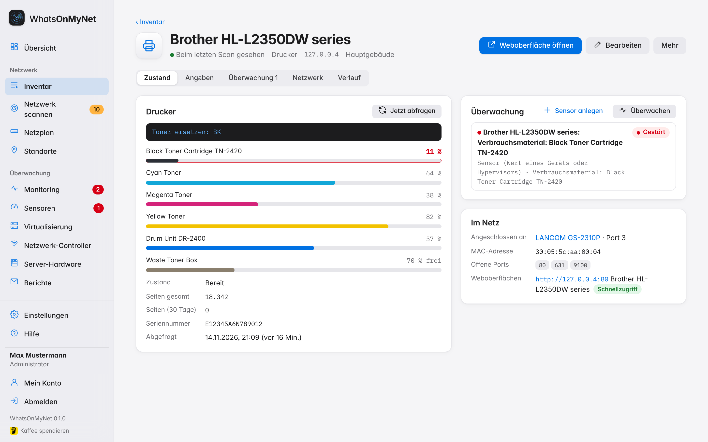

- **Drucker**: Toner bzw. Tinte je Farbe, Trommel, Resttoner, Seitenzähler, Störungen und Display-Text. Unter 15 % kommt eine Meldung - einmal pro Kartusche. Viele Farbdrucker nennen für Farbtoner keinen Füllstand, nur „vorhanden“ (gestreifter Balken); meldet der Drucker selbst „wenig“ oder „leer“ (wie auf seinem Display), zeigt WhatsOnMyNet das so an und meldet es genauso.
- **Switch**: Ports als Kacheln, welche Geräte an welchem Port hängen (auch mit VLANs), LLDP-Nachbarn, Firmware. Jede Geräteseite zeigt „Angeschlossen an“. Ab der zweiten Abfrage auch die **Auslastung** jedes Ports (ein und aus, in Mbit/s und Prozent der Portgeschwindigkeit) - das Mittel zwischen zwei Abfragen (Standard 15 Minuten). Stark belastete Ports sind in der Kachel markiert; der Sensor *Auslastung Port …* alarmiert ab 80 %.
- **NAS**: Volumes, bei Synology auch Festplatten, RAID, Temperatur, Lüfter, Netzteil und DSM-Update. Probleme werden gemeldet - und wieder, wenn alles in Ordnung ist.
- **Ins Inventar übernommen**: Was das Gerät über sich selbst sagt - Seriennummer, Modell, Firmware bzw. Betriebssystem (z. B. DSM-Version), bei Synology/QNAP der Hersteller - landet gleich in den Angaben des Geräts und bleibt aktuell (z. B. nach einem Firmware-Update). Was du selbst mit einem anderen Wert eingetragen hast, bleibt stehen. Der Verlauf zeigt jede Übernahme.
- **Gerät ausgetauscht**: Meldet das Gerät unter derselben IP eine andere Seriennummer, ist es neue Hardware. Seriennummer, Modell, Hersteller und Firmware kommen dann vom neuen Gerät, die alte MAC-Adresse wird verworfen und beim nächsten Scan durch die neue ersetzt (statt eines „neuen Geräts“). Der Verlauf vermerkt den Tausch - Kaufdatum und Garantie bitte selbst prüfen.

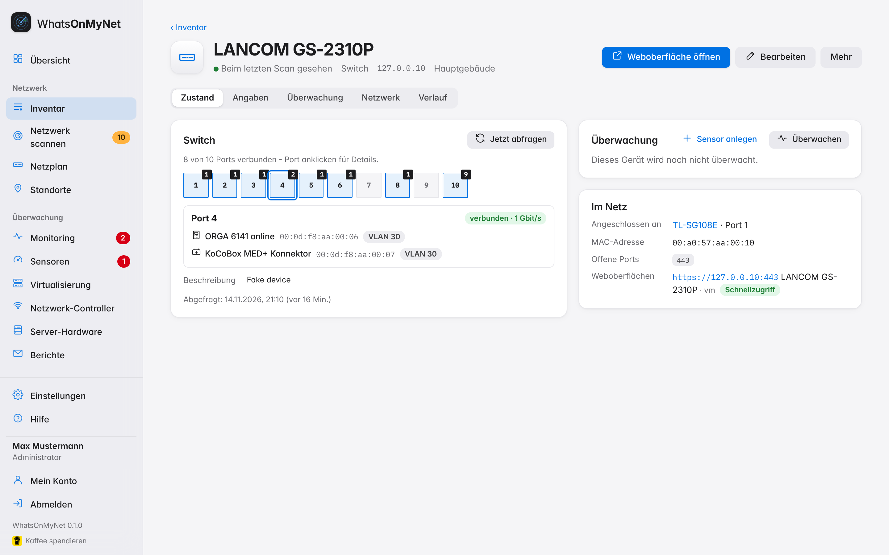

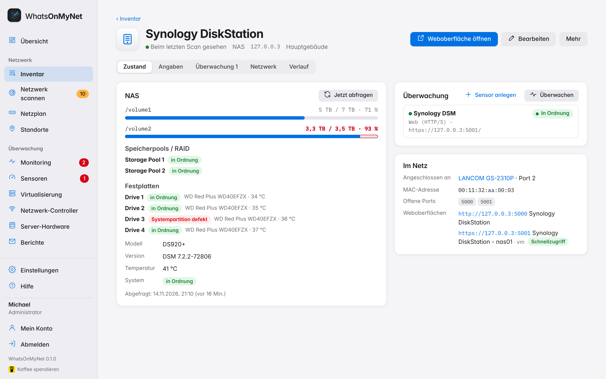

### USV (unterbrechungsfreie Stromversorgung)

WhatsOnMyNet liest USV-Werte mit, ohne dass du etwas einrichten musst. Die Werte sind immer dieselben: **Netzbetrieb oder Akku**, **Akkustand**, **wie lange der Akku noch reicht** und **Last**. Mit **Sensor anlegen** wählst du daraus z. B. „USV: Netz oder Akku“ (Alarm, sobald sie auf Akku läuft) oder „USV-Restlaufzeit (min)“.

- **USV an einer Synology** (USB oder Netzwerk): Ist der USV-Dienst der Synology an, erscheint im NAS-Bereich der Abschnitt *USV*. Abgefragt wird über dasselbe SNMP wie beim NAS. Du musst WhatsOnMyNet dafür nicht als vertrauenswürdiges Gerät im USV-Server eintragen.
- **USV mit eigener Netzwerkkarte:** APC oder jede Karte mit dem Standard UPS-MIB, z. B. Eaton, CyberPower oder Riello. Das Gerät im Inventar auf den Typ *USV* stellen, dann wird es wie Switches und NAS per SNMP abgefragt. Seriennummer, Modell und Firmware landen dabei im Inventar.
- **USV an einem Linux-Rechner:** Läuft dort schon NUT (`upsc`) oder apcupsd (`apcaccess`), liest das Rechner-Skript die Werte lokal mit.
- **USV per USB an einem Windows-Rechner:** Windows sieht sie wie einen Akku, das Rechner-Skript schickt die Werte mit. Bei Laptops ist das der eingebaute Akku, deshalb heißt der Abschnitt dort *USV oder Akku*.

Eine USV an einem **QNAP** gibt ihre Werte nicht per SNMP heraus, dort zeigt WhatsOnMyNet keine USV. Herunterfahren und Steuern bleibt bei der USV-Software, WhatsOnMyNet liest nur.

### Netzplan

Der *Netzplan* zeigt aus den MAC-Tabellen und LLDP, welches Gerät an welchem Port hängt und wie die Switches verbunden sind. Einfache Switches ohne SNMP erscheinen als Zweig hinter dem Port, an dem sie stecken. Hinter Routern liest der Scan die ARP-Tabelle der Router per SNMP, damit die MAC-Adresse auch dort die Identität bleibt.

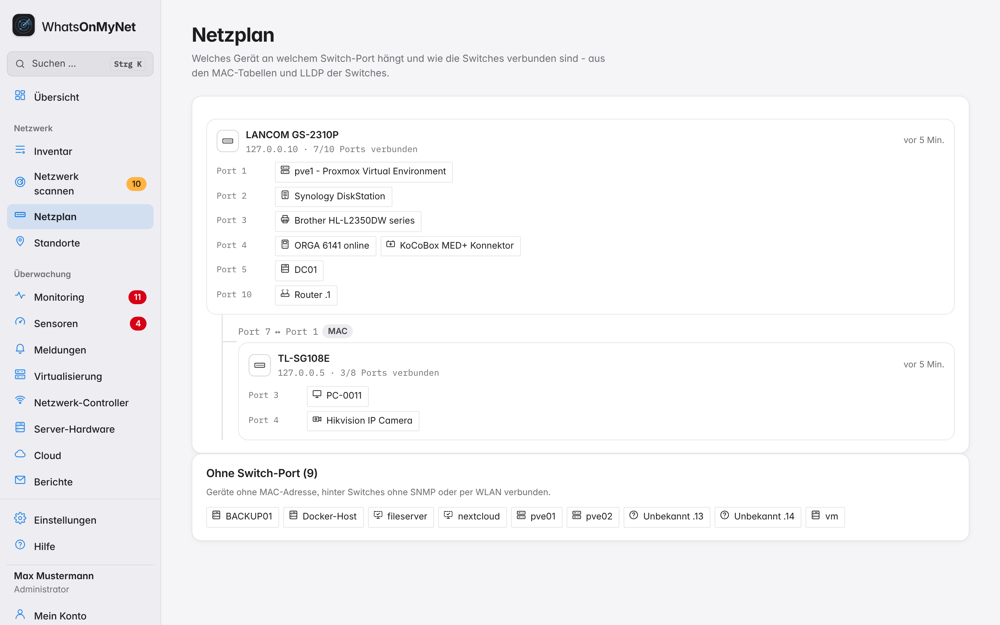

## Sensoren

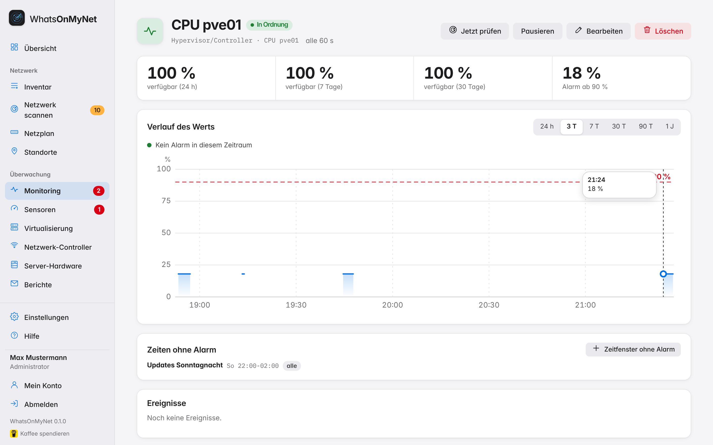

Jeder Wert, den ein Gerät liefert, kann ein eigener Monitor werden - mit Verlauf, Alarm und Wartungsfenstern. Alle Sensoren stehen unter *Überwachung → Sensoren*. „Sensor anlegen“ gibt es auf der Geräteseite, unter *Virtualisierung* am Host und unter *Überwachung → Sensoren*. Es ist immer derselbe Dialog: Gerät oder Host wählen, dann Wert und Bedingung. Werte, die schon ein anderer Sensor überwacht, bietet der Dialog nicht noch einmal an (auch nicht über den Hypervisor, wenn das Linux-Skript denselben Wert liefert). Beispiele:

- „Toner Cyan kleiner oder gleich 10 %“
- „Belegung /volume1 größer oder gleich 85 %“
- „Temperatur Drive 2 größer als 50 °C“
- „Port 10 (Uplink) verbunden“

**Proxmox-Knoten:** Ein Knoten, der auch im Inventar steht (gleicher Name, z. B. `pve2` bzw. `pve2.firma.local`), hat eine gemeinsame Liste - egal ob über das Gerät oder über den Host unter Virtualisierung geöffnet: „Knoten pve2 online“ von Proxmox und, wenn dort das Linux-Skript läuft, jede Temperatur, CPU, RAM, Laufwerke und Dienste aus dem Skript. Was beide liefern (CPU, RAM, die höchste Temperatur), steht nur einmal drin. Unter Virtualisierung ist die Liste nach Knoten gruppiert. Ebenso zeigt ein Server mit Verwaltungschip (Redfish) dessen Hardware-Werte und ein Proxmox Backup Server seine Datenspeicher und Sicherungen am Gerät.

Ein bestehender Sensor lässt sich beim Bearbeiten auf jeden anderen Wert dieser Liste umstellen, zum Beispiel von „Temperatur pve2“ auf „Temperatur: NVMe nvme0 Sensor 2“. Der Name zieht dabei mit („pve2: Temperatur: NVMe nvme0 Sensor 2“) - außer er wird im selben Dialog von Hand geändert.

Der Typ **SNMP-Wert (OID)** fragt jeden beliebigen SNMP-Wert ab (z. B. Restlaufzeit einer USV) und vergleicht mit kleiner, größer, gleich oder „enthält Text“.

In der Monitorliste zeigt die Spalte **Aktuell** den Wert gleich mit: Zahl und Einheit, einen kleinen Balken bei Prozentwerten, bei Speicher und RAM „belegt von gesamt“ und die Alarmgrenze („Alarm ab 90 %“). Nahe an der Grenze wird der Wert gelb, beim Alarm rot. **Entwarnung mit Abstand:** Ein Sensor, der wegen einer Grenze Alarm gibt, meldet sich erst wieder „in Ordnung“, wenn der Wert die Grenze deutlich verlassen hat - bei Temperaturen um 2 °C, bei Prozentwerten um 2 Punkte (Alarm ab 86 °C → Entwarnung unter 84 °C). So schickt ein Fühler, der um seine Grenze pendelt, nicht alle 5 Minuten Alarm und Entwarnung. Liefert ein NAS eine Tabelle nur halb (beschäftigt, zu späte Antwort), bleiben die fehlenden Platten und Volumes für bis zu zwei Abfragen mit ihren letzten Werten stehen - ein „nicht gefunden“-Alarm kommt erst, wenn sie wirklich weg sind. Knoten und VMs zeigen ihren Zustand mit CPU und RAM, Netzlaufwerke den freien Platz.

## Netzlaufwerke (SMB)

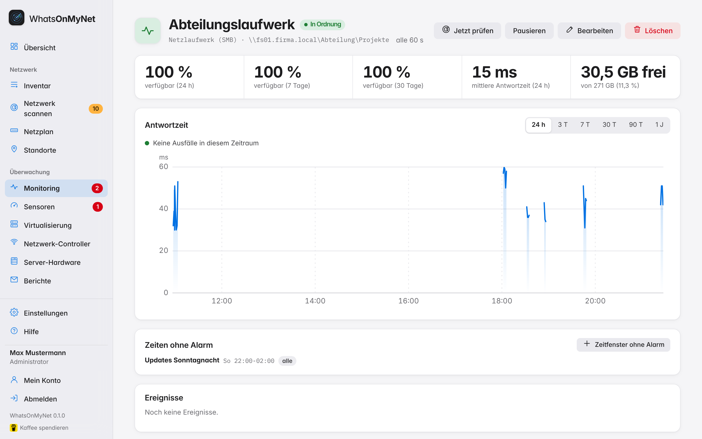

Der Typ **Netzlaufwerk (SMB)** meldet sich wirklich an einer Freigabe an - nicht nur am offenen Port. So fällt auch auf, wenn das Passwort abgelaufen ist, die Rechte nicht mehr stimmen oder ein Ordner fehlt.

1. Ein eigenes Konto nur mit **Leserecht** auf die Freigabe anlegen (im AD z. B. `FIRMA\monitor`, auf dem NAS ein lokaler Benutzer).
2. *Monitor anlegen* → Art **Netzlaufwerk (SMB)**. Einfach den Pfad einfügen, z. B. `\\fs01\Abteilung\Projekte` - Server, Freigabe und Ordner werden daraus übernommen.
3. Benutzer, Domäne (bei NAS-Konten leer) und Passwort eintragen. Optional: warnen unter … % oder … GB frei.

Geprüft wird über SMB 2/3: anmelden, die Freigabe (oder den Ordner bzw. die Datei) lesen, den freien Platz abfragen. WhatsOnMyNet schreibt nichts auf die Freigabe. Die Detailseite zeigt den freien Platz; im Bericht gibt es dafür den Abschnitt *Netzlaufwerke*.

## Proxmox VE und Backup Server

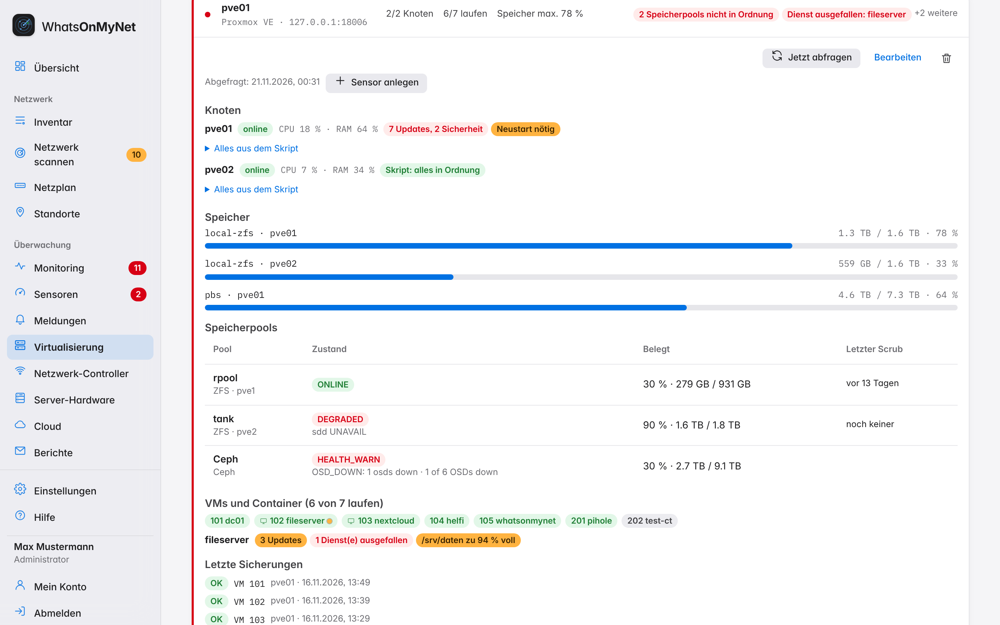

WhatsOnMyNet liest Proxmox VE und den Proxmox Backup Server über deren eingebaute Schnittstelle (API). Auf Proxmox wird nichts installiert. WhatsOnMyNet bekommt dort einen eigenen Benutzer, der **nur lesen** darf, und einen Schlüssel dafür (API-Token). Der Dialog *Überwachung → Virtualisierung → Host hinzufügen → Proxmox VE* zeigt dieselben Schritte, mit Knopf zum Kopieren.

**Cluster:** Einen Knoten einzutragen genügt. WhatsOnMyNet fragt den Cluster, welche Knoten es gibt, unter welcher Adresse sie erreichbar sind und welches Zertifikat sie haben (alle 6 Stunden neu). Antwortet der eingetragene Knoten nicht, wird der nächste Knoten gefragt - mit demselben Token (er gilt im ganzen Cluster) und erst nachdem dessen Zertifikat geprüft ist. Die Seite Virtualisierung zeigt dann „über Knoten pve2 gelesen“. Der Proxmox Backup Server kennt keinen Cluster: jeder wird einzeln eingetragen.

**Temperaturen der Knoten:** Die Proxmox-Schnittstelle kennt keine Temperaturen. Läuft auf einem Knoten zusätzlich das Linux-Skript (siehe *Windows- und Linux-Rechner per Skript*), steht seine höchste Temperatur auf der Seite Virtualisierung am Knoten. Ein Sensor dafür: am Proxmox-Host oder am Gerät **Sensor anlegen** → *Temperatur: die höchste aller Fühler* (Alarm ab 85 °C, änderbar; einzelne Fühler mit der Warnschwelle des Chips); einzelne Fühler (CPU, NVMe …) stehen in derselben Liste unter „Knoten pve1“. Zugeordnet wird über den Namen: Knoten `pve1` ↔ Rechner `pve1` bzw. `pve1.firma.local`.

### Schritt 1: Proxmox vorbereiten (einmalig)

**Mit Befehlen (empfohlen) - Proxmox VE**

1. In Proxmox links auf einen Knoten klicken und oben **>_ Shell** öffnen. Ein Knoten genügt - im Cluster gilt es für alle.
2. Diese drei Zeilen kopieren, in die Shell einfügen und Enter drücken:

```
pveum user add whatsonmynet@pve --comment "WhatsOnMyNet (read only)"
pveum acl modify / --users whatsonmynet@pve --roles PVEAuditor
pveum user token add whatsonmynet@pve womn --privsep 0
```

3. Die Ausgabe zeigt eine Tabelle. In der Zeile `value` steht das **Geheimnis** (eine lange Zeichenkette mit Bindestrichen). Kopieren und aufheben - Proxmox zeigt es nur dieses eine Mal.

**Mit Befehlen - Proxmox Backup Server**

1. Im Backup Server links *Administration → Shell* öffnen.
2. Diese vier Zeilen einfügen und Enter drücken:

```
proxmox-backup-manager user create whatsonmynet@pbs --comment "WhatsOnMyNet (read only)"
proxmox-backup-manager acl update / Audit --auth-id whatsonmynet@pbs
proxmox-backup-manager user generate-token whatsonmynet@pbs womn
proxmox-backup-manager acl update / Audit --auth-id 'whatsonmynet@pbs!womn'
```

3. Nach dem dritten Befehl steht bei `"value"` das **Geheimnis**. Kopieren - es wird nur einmal angezeigt.

**Per Mausklick - Proxmox VE**

1. *Rechenzentrum → Berechtigungen → Benutzer* → *Hinzufügen*: Benutzername `whatsonmynet`, Realm *Proxmox VE authentication server*, irgendein Passwort → *Hinzufügen*.
2. *Rechenzentrum → Berechtigungen* → *Hinzufügen* → *Benutzer-Berechtigung*: Pfad `/`, Benutzer `whatsonmynet@pve`, Rolle `PVEAuditor` → *Hinzufügen*.
3. *Rechenzentrum → Berechtigungen → API Tokens* → *Hinzufügen*: Benutzer `whatsonmynet@pve`, Token ID **nur** `womn` (ohne @ und !), den Haken bei *Privilege Separation* **entfernen** → *Hinzufügen*.
4. Proxmox zeigt jetzt das *Secret* - nur dieses eine Mal. Kopieren und aufheben.

Beim Backup Server geht es genauso unter *Konfiguration → Zugriffskontrolle*: Benutzer `whatsonmynet` (Realm *Proxmox Backup authentication server*), Reiter *API Token* mit Token Name `womn`, dann unter *Berechtigungen* zweimal die Rolle `Audit` auf den Pfad `/` - einmal für den Benutzer `whatsonmynet@pbs`, einmal für den Token `whatsonmynet@pbs!womn`.

### Schritt 2: In WhatsOnMyNet eintragen

1. *Überwachung → Virtualisierung* → **Host hinzufügen** → *Proxmox VE* bzw. *Proxmox Backup Server*.
2. Einen Namen vergeben.
3. **Adresse** so eintragen, wie du Proxmox im Browser öffnest, z. B. `https://192.168.1.10:8006` (Backup Server: Port `8007`).
4. **Zertifikat abrufen** klicken. WhatsOnMyNet zeigt den Fingerabdruck des Proxmox-Zertifikats. Vergleiche ihn - Proxmox VE: Knoten anklicken → *System → Zertifikate* → Zeile `pve-ssl.pem`; Backup Server: *Dashboard* → *Fingerabdruck anzeigen*. Stimmt er, **Fingerabdruck stimmt - vertrauen**.
5. Die **Token-ID** ist schon ausgefüllt (`whatsonmynet@pve!womn` bzw. `whatsonmynet@pbs!womn`). Bei **Token-Geheimnis** das kopierte Geheimnis einfügen.
6. **Speichern und verbinden.** Nach wenigen Sekunden erscheinen Knoten, Speicher, VMs und Container sowie die Sicherungen.

### Sensoren anlegen

In der Detailansicht **Sensor anlegen** - z. B. „VM 101 läuft“, „Speicher local-lvm unter 85 %“ oder „letzte Sicherung älter als 26 Stunden“. Jeder Sensor ist ein Monitor mit Verlauf und Benachrichtigung.

### Fehlgeschlagene Aufgaben

Fehlgeschlagene Aufgaben (Sicherung, Prüfung, Aufräumen, Paketlisten …) stehen mit verständlichem Namen da und darunter mit den Fehlerzeilen aus dem Aufgabenprotokoll von Proxmox - man sieht also, *warum* etwas schiefging. Sicherungen, Prüfungen und Synchronisierungen zählen als Störung (rot), Wartungsaufgaben wie Aufräumen oder Paketlisten als Hinweis (gelb). Scheitert das Aktualisieren der Paketlisten nur an einer fremden Paketquelle (z. B. Webmin), ist das nur ein Hinweis und wird nicht als Fehler gezählt; scheitert eine offizielle Quelle von Proxmox oder Debian, gibt es weiter einen Alarm.

### Wenn etwas nicht klappt

- **„tokenid: value does not match the regex pattern“ in Proxmox**: Beim Anlegen des Tokens nur `womn` eintragen - ohne Benutzer, @ und !.
- **„sign-in refused (401)“**: Token-ID oder Geheimnis stimmen nicht. Token in Proxmox löschen, neu anlegen und das neue Geheimnis eintragen.
- **Hinweis „Dem Token fehlen Leserechte“**: Meist blieb beim Token *Privilege Separation* angehakt. Der Hinweis zeigt zwei Befehle - in der Proxmox-Shell einfügen, Enter, dann **Jetzt abfragen**.
- **„certificate changed“**: Proxmox hat ein neues Zertifikat bekommen. *Bearbeiten* → **Zertifikat abrufen** → bestätigen.

### Viele Hosts im Blick

Ab zwei Hosts zeigt die Seite *Virtualisierung* (ebenso *Netzwerk-Controller* und *Server-Hardware*) oben die Lage in Zahlen: Hosts mit Problemen, Knoten online, laufende VMs, volle Speicher, Sicherungsprobleme. Darunter steht **eine Zeile je Host** mit den wichtigsten Werten und dem, was nicht stimmt. Hosts mit Problemen stehen oben. Ein Klick auf die Zeile klappt die Details auf (das merkt sich der Browser bis zum Schließen des Tabs).

Die **Suche** findet Hosts, Knoten, VMs (Name oder ID), Datastores und Sicherungsgruppen. Die Knöpfe filtern nach *Probleme* oder nach Art (Proxmox VE, Backup Server …).

## Weitere Hypervisoren: VMware, XCP-ng, Hyper-V, Nutanix, oVirt, KVM

Unter *Überwachung → Virtualisierung → Host hinzufügen* stehen neben Proxmox weitere Hypervisoren zur Wahl. Alle erscheinen gleich: Hosts mit CPU und RAM, Speicher, VMs - und aus allem lassen sich Sensoren anlegen („Host online“, „CPU esx01“, „Speicher vsan“, „VM dc01 läuft“). Gelesen wird nur.

**Über die Schnittstelle abgefragt** - ein Konto, das nur lesen darf, genügt; Adresse eintragen, **Zertifikat abrufen**, Fingerabdruck vergleichen, Konto eintragen:

| Hypervisor | Konto mit Leserechten | Adresse |
|---|---|---|
| **VMware ESXi / vCenter** | Benutzer mit Rolle *Nur Lesen* (Read-only), oben in der Bestandsliste vergeben, „an untergeordnete Objekte weitergeben“ | vCenter oder ESXi, z. B. `https://vcenter.firma.local` |
| **XCP-ng / XenServer** | mit AD: Rolle *read-only*; ohne AD gibt es nur `root` | Pool-Master, z. B. `https://xcp01.firma.local` |
| **Nutanix AHV** | Prism-Benutzer mit Rolle *Viewer* | Prism mit Port, z. B. `https://prism.firma.local:9440` |
| **oVirt / RHV / OLVM** | `whatsonmynet@internal` mit Rolle *ReadOnlyAdmin* (Befehle stehen im Dialog) | Engine, z. B. `https://engine.firma.local` |

**Hyper-V und KVM/libvirt melden sich selbst.** Beide haben keine Schnittstelle zum Abfragen. Stattdessen schickt ein kleines Skript auf dem Host alle 5 Minuten Auslastung, Laufwerke bzw. Speicherpools und VMs. Es liest nur und braucht keinen offenen Port auf dem Host.

1. *Host hinzufügen* → **Microsoft Hyper-V** bzw. **KVM / libvirt**, Namen vergeben, speichern.
2. Der Dialog zeigt das Skript mit einem eigenen Schlüssel (nur dieses eine Mal) - **Skript herunterladen**.
3. Einmal ausführen, es richtet sich selbst ein. **Hyper-V** als Administrator: `powershell.exe -NoProfile -ExecutionPolicy Bypass -File .\womn-hyperv.ps1` (geplante Aufgabe *WhatsOnMyNet-HyperV*, alle 5 Minuten als SYSTEM). Im Cluster auf jedem Knoten - alle Knoten landen im selben Eintrag.
   **KVM:** `sh womn-libvirt.sh` als root oder als Benutzer der Gruppe `libvirt` (cron-Eintrag, alle 5 Minuten) - sonst darf `virsh` die VMs des Systems nicht sehen. Nötig sind `virsh`, `awk` und `curl`; gelesen wird mit `virsh -r`.
   Wieder entfernen: das **Deinstallationsskript** aus dem Dialog bzw. *Einstellungen → Rechner-Skripte* - es entfernt auch die Einrichtung von Version 0.6.0.
4. Nach ein paar Sekunden erscheint der Host. Meldet er sich länger als 15 Minuten nicht, gilt er als offline - ein Sensor „Host online“ schlägt dann Alarm.

Ist der Schlüssel weg oder soll er erneuert werden: **Neues Skript** - das alte hört dann auf zu funktionieren.

Mit dem selbstsignierten Zertifikat von WhatsOnMyNet vertraut das Skript genau dessen Schlüssel (fest hinterlegt); mit einem Zertifikat einer echten CA wird ganz normal geprüft. Erneuert WhatsOnMyNet sein Zertifikat (30 Tage vor Ablauf, nach einer neuen IP-Adresse oder `WOMN_BASE_URL`), bleibt der Schlüssel gleich und die Skripte melden weiter. Ausnahme: Windows-Skripte aus Versionen bis 0.10.1 kennen nur das Zertifikat selbst - sie einmal neu erzeugen. Scan-Agenten mit `WOMN_AGENT_CA` brauchen nach einer Erneuerung den neuen Wert aus *Einstellungen → Scan-Agenten*.

## Netzwerk-Controller: UniFi, Omada, MikroTik

Unter *Überwachung → Netzwerk-Controller → Controller hinzufügen* liest WhatsOnMyNet die verbreiteten Netzwerk-Systeme - mit einem Konto, das **nur lesen** darf; Adresse eintragen, **Zertifikat abrufen**, Fingerabdruck vergleichen, Konto eintragen. Der Dialog zeigt die Schritte für das jeweilige System.

| System | Konto | Adresse |
|---|---|---|
| **UniFi Network** - UniFi-OS-Konsolen (UDM, UCG, Cloud Key Gen2+) oder die installierte Network-App | lokales Konto (ohne Zwei-Faktor) mit Rolle *Nur anzeigen*/*Site Viewer* | Konsole, bzw. `https://server:8443` |
| **TP-Link Omada** - Software-Controller, OC200/OC300 | Konto mit Rolle *Viewer* | meist `https://server:8043` |
| **MikroTik RouterOS 7** - jeder Router/Switch einzeln | Benutzer in einer Gruppe mit `read,api,rest-api` | Router mit Dienst *www-ssl* |

Die Seite zeigt je Controller alle Access Points, Switches und Gateways mit Modell, IP, Firmware (samt „Update“, wenn eine neue bereitsteht), Clients und Zustand.

**Abgleich mit dem Inventar:** Jedes Gerät, das per MAC-Adresse im Inventar steht, bekommt Modell, Seriennummer, Firmware, Hersteller und den richtigen **Typ** vom Controller - nach denselben Regeln wie bei SNMP (leere oder noch vom Gerät stammende Angaben werden gefüllt bzw. aktuell gehalten, eigene abweichende Eingaben bleiben, ein Tausch wird erkannt). Geräte, die noch nicht im Inventar sind, tragen den Hinweis *nicht im Inventar* - per Scan übernehmen.

**Sensoren:** „AP Flur online“, „Clients an AP Flur“, „CPU …“, „RAM …“, „Clients gesamt“ und „Geräte mit Firmware-Update“.

Auch der **Scan** erkennt diese Geräte jetzt besser an ihren Modellnamen: UniFi (USW = Switch, UAP/U6/U7 = Access Point, UDM/UCG/USG = Gateway, Network-App = Server), Omada (EAP = Access Point, ER = Gateway, OC200/OC300 = Controller), MikroTik (CRS = Switch, cAP/wAP = Access Point) und Aruba Instant On.

## Server-Hardware: iDRAC, iLO, XClarity, Supermicro (Redfish)

Lüfter, Netzteile, Temperaturen, RAID-Controller und die Laufwerke dahinter kennt das Betriebssystem meist nicht. Der Management-Chip des Servers kennt sie, und zwar auch, wenn der Server ausgeschaltet ist. Alle aktuellen Chips sprechen den Standard **Redfish**: Dell iDRAC, HPE iLO, Lenovo XClarity Controller, Supermicro, Fujitsu iRMC, Cisco CIMC.

1. Im Management-Chip ein eigenes Konto anlegen, das **nur lesen** darf: iDRAC Rolle *Read Only*, iLO nur das Recht *Login*, XClarity Rolle *ReadOnly*, Supermicro Rolle *User*.
2. *Überwachung → Server-Hardware* → **Management-Chip anbinden**: die Adresse des Chips (nicht die des Servers), **Zertifikat abrufen** und den Fingerabdruck bestätigen, Benutzer und Passwort.

Angezeigt werden:
- Gesamtzustand und Stromzustand, Verbrauch
- Modell, Seriennummer (bei Dell die Service-Tag-Nummer), BIOS, Prozessoren, Arbeitsspeicher, Firmware des Chips
- Lüfter, Temperaturen mit Warnschwelle, Netzteile
- RAID-Controller, Volumes und Laufwerke, mit Restlebensdauer und vorhergesagtem Ausfall

Was nicht in Ordnung ist, steht oben. WhatsOnMyNet ordnet den Server über die MAC-Adressen seiner Netzwerkkarten oder die Seriennummer **seinem Gerät im Inventar** zu. Auf dessen Seite erscheint dann der Bereich *Server-Hardware*, und Hersteller, Modell und Seriennummer werden übernommen.

Sensoren (*Sensor anlegen*): Gesamtzustand, Server eingeschaltet, jeder Lüfter, jede Temperatur, jedes Netzteil, jedes Laufwerk (auch Restlebensdauer), jedes Volume, Stromverbrauch. Abgefragt wird wie bei Proxmox alle 5 Minuten, nur lesend.

## Cloud: AWS, Azure, Google Cloud

Was in der Cloud läuft, überwacht WhatsOnMyNet über die Schnittstelle des Anbieters - mit einem Konto, das **nur lesen** darf, alle 5 Minuten. Nichts wird dort installiert oder verändert. *Überwachung → Cloud* → **Cloud-Konto anbinden**; der Dialog zeigt die Schritte für den jeweiligen Anbieter.

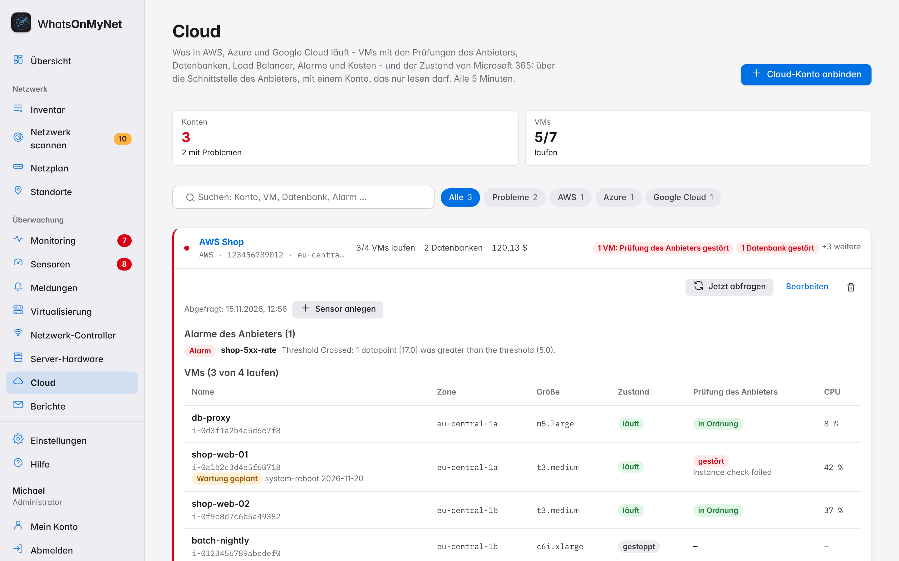

**Was gelesen wird:**

| | AWS | Azure | Google Cloud |
|---|---|---|---|
| VMs: läuft, CPU | EC2 | Virtuelle Computer | Compute Engine |
| Prüfung des Anbieters | Status-Checks (System und Instanz), geplante Wartungen | Resource Health | Reparatur nach Hostausfall |
| Datenbanken: erreichbar, CPU, Speicher | RDS (Aurora ohne Speicher - wächst selbst) | Azure SQL, PostgreSQL und MySQL Flexible Server | Cloud SQL |
| Load Balancer | Zielgruppen: gesunde und gestörte Ziele | über Resource Health | – |
| Alarme | CloudWatch-Alarme im Zustand ALARM | ausgelöste Azure-Monitor-Warnungen | – |
| Kosten (auf Wunsch) | Cost Explorer (0,01 USD je Abfrage, 2× täglich) | Cost Management (kostenlos) | – (nur über BigQuery-Export) |

**Rechte:**
- **AWS:** ein IAM-Benutzer mit einer Inline-Richtlinie, die nur die nötigen Lese-Aktionen erlaubt (der Dialog zeigt sie zum Kopieren), und ein Zugriffsschlüssel.
- **Azure:** eine App-Registrierung mit geheimem Clientschlüssel und der Rolle **Leser** auf dem Abonnement. Der Schlüssel läuft ab - WhatsOnMyNet meldet es deutlich, wenn er abgelaufen ist.
- **Google Cloud:** ein Dienstkonto mit den Rollen *Compute Viewer*, *Monitoring Viewer* und *Cloud SQL Viewer* und ein JSON-Schlüssel.

Fehlt dem Konto ein Recht, liest WhatsOnMyNet den Rest und sagt genau, welches Recht fehlt. Dienste, die im Konto nicht eingeschaltet sind (z. B. Cloud SQL), erscheinen nur als Hinweis.

**Sicherheit:** Das Geheimnis wird verschlüsselt gespeichert und geht nie an den Browser. WhatsOnMyNet schickt es nur an die festen Adressen des Anbieters (z. B. `*.amazonaws.com`, `management.azure.com`, `*.googleapis.com`) und prüft dabei das Zertifikat - auch Weiterleitungen auf andere Adressen werden abgelehnt. Ohne eingetragenes Cloud-Konto geht nichts davon ins Internet.

**Sensoren:** „VM … läuft“, „Prüfung des Anbieters: …“, „CPU …“, „Datenbank … erreichbar“, CPU und Speicher der Datenbank, „Load Balancer …: Ziele gestört“, „Alarme des Anbieters“, „Gestörte Ressourcen“ und „Kosten diesen Monat“ (Grenze anfangs: Vormonat + 20 %). Eine VM oder Datenbank, die nicht läuft, hat keine Werte - das ist kein Alarm; ob sie laufen soll, sagt ihr eigener Sensor. Mit *Neue Geräte selbst überwachen* bekommt ein neues Konto gleich Sensoren für die Alarme, die Prüfungen der VMs, die Datenbanken und die Load Balancer.

## Veeam Backup & Replication

Ab Version 12 liest WhatsOnMyNet über die REST-API (Port 9419) die **Jobs** mit letztem Ergebnis, letztem und nächstem Lauf sowie die **Repositories** mit ihrem Platz - unter *Überwachung → Virtualisierung* → **Host hinzufügen** → *Veeam Backup & Replication*.

1. In Veeam unter *Benutzer und Rollen* ein eigenes Konto mit der Rolle **Veeam Backup Viewer** anlegen - es darf nur lesen.
2. Adresse mit Port eintragen (z. B. `https://vbr01.firma.local:9419`), **Zertifikat abrufen** und den Fingerabdruck bestätigen, Benutzer und Passwort.

Sensoren: *Veeam-Job …* (Alarm bei **Fehler oder Warnung** im letzten Lauf; abgeschaltete Jobs schweigen), *Letzter Lauf …* (Alarm, wenn ein geplanter Job über 26 Stunden nicht gelaufen ist), *Repository …* (ab 85 % voll) und *Veeam-Jobs mit Fehler oder Warnung* (alle zusammen).

## Speicherpools: ZFS, Ceph, Software-RAID, Storage Spaces, TrueNAS

Was mehr ist als eine Platte, zeigt WhatsOnMyNet überall gleich: **Zustand** (ONLINE, DEGRADED, HEALTH_WARN …) mit dem Grund, **Belegung**, **ausgefallene Mitglieder** (Platten, OSDs) und bei ZFS der **letzte Scrub** samt gefundener Fehler. Alles nur lesend.

- **Proxmox VE:** die ZFS-Pools jedes Knotens und - falls vorhanden - der Ceph-Cluster, über dieselbe Anbindung und dasselbe Token (Recht `Sys.Audit`). Neu angebundene Hosts bekommen gleich Sensoren für den Zustand.
- **Linux-Rechner mit Skript:** ZFS-Pools (`zpool`, auch ohne root) und Software-RAID (`/proc/mdstat`: degraded, ausgefallene Platte, Resync).
- **Windows-Rechner mit Skript:** Storage Spaces - Pools, ihre virtuellen Datenträger und Platten, die nicht gesund sind.
- **TrueNAS** (ab 25.04): *Überwachung → Virtualisierung* → **Host hinzufügen** → *TrueNAS*. Einen eigenen Benutzer mit der Rolle **Read-Only Administrator** anlegen, für ihn einen **API-Schlüssel** erzeugen, Adresse eintragen und das Zertifikat bestätigen. WhatsOnMyNet liest Pools, die offenen **Warnungen** von TrueNAS und die **Replikationen** - über die WebSocket-API (die alte REST-API gibt es ab TrueNAS 26 nicht mehr).
- **Ceph ohne Proxmox:** *Host hinzufügen* → *Ceph*, über das Ceph-Dashboard (meist Port 8443) mit einem Dashboard-Benutzer der Rolle **read-only**: Zustand mit den Meldungen von Ceph, OSDs, Belegung, PGs.

Sensoren: *Zustand …* (Alarm, sobald ein Pool nicht in Ordnung ist - auch wenn der letzte Scrub Fehler fand), *Belegung …* (ZFS ab 80 %, weil ZFS darüber langsam wird; Ceph ab 75 %), *Tage seit dem letzten Scrub …* (ab 35 Tagen) und *Ausgefallene Platten/OSDs …*. Bei TrueNAS dazu *Offene/Kritische Warnungen* und *Replikation …* (Alarm bei Fehler).

## Microsoft 365

Unter *Überwachung → Cloud* → **Cloud-Konto anbinden** → *Microsoft 365* liest WhatsOnMyNet über Microsoft Graph den **Zustand der Dienste** (Exchange Online, Teams, SharePoint …), die **offenen Störungen und Hinweise** und die **Abonnements** mit vergebenen und freien Lizenzen.

1. Im Entra-Admin-Center eine **App-Registrierung** anlegen; Anwendungs-ID und Verzeichnis-ID abschreiben.
2. Unter *API-Berechtigungen* die **Anwendungsberechtigungen** `ServiceHealth.Read.All` und `Organization.Read.All` hinzufügen und **Administratorzustimmung erteilen** - beide dürfen nur lesen.
3. Einen geheimen Clientschlüssel anlegen und seinen **Wert** eintragen. Er läuft ab; WhatsOnMyNet meldet deutlich, wenn er abgelaufen ist.

Sensoren: *Microsoft 365: Dienst* (Alarm bei Einschränkung oder Unterbrechung), *offene Störungen* (nur Störungen, keine Hinweise), *Abonnement …* (Alarm, wenn es ausläuft oder gesperrt ist) und *Freie Lizenzen …*. Neu angebundene Konten bekommen gleich Sensoren für Störungen und Abonnements.

## Windows- und Linux-Rechner per Skript (ohne Agent)

**Wofür das Skript?** Viele Werte eines Rechners kennt nur das Betriebssystem selbst: Temperaturen von CPU und NVMe, der Zustand der Festplatten (SMART), Dienste, ausstehende Updates. Große Server liefern einiges davon über ihren Management-Chip (iDRAC, iLO, XClarity - siehe *Server-Hardware*). Ein Mini-PC, ein Selbstbau-Server oder ein Proxmox-Knoten im Homelab hat so etwas nicht - hier holt das Skript diese Infos. Für Proxmox gilt: Die Schnittstelle liefert Knoten, VMs, Speicher und Sicherungen; Temperaturen, Festplatten, Dienste und Updates der Knoten kommen nur mit dem Skript dazu.

**Der Tipp im Programm:** Rechner, Server, VMs und Hypervisoren mit Windows oder Linux, die noch keine Systemwerte haben, zeigen auf der Geräteseite den Tipp „Per Skript überwachen“; unter *Virtualisierung* steht er bei Proxmox-Knoten ohne Skript. Er verschwindet von selbst, sobald das Gerät Werte liefert - über das Skript oder über die Server-Hardware (iDRAC, iLO …). Brauchst du das Skript für ein Gerät bewusst nicht, blendet **Nicht mehr anzeigen** den Tipp dort dauerhaft aus; über *Mehr → Per Skript überwachen* geht es trotzdem jederzeit.

Server und PCs lassen sich ohne Agent überwachen: Ein kleines Skript auf dem Rechner meldet alle 5 Minuten **CPU, RAM, Laufwerke, Laufzeit und Dienste**, dazu eine angeschlossene **USV** (siehe oben).

Dazu kommt, was ein Administrator von einem Server wissen will. Alles steht auf der Geräteseite im Bereich *System*, aus allem lassen sich Sensoren mit Alarm anlegen:

- **Updates und Schutz:** ausstehende Updates (davon wichtige/Sicherheit), ob ein Neustart ansteht, Virenschutz (Defender oder ein anderes im Sicherheitscenter eingetragenes Produkt: aktiv, Signaturen aktuell) und Firewall (Windows: Domäne/Privat/Öffentlich, Linux: ufw oder firewalld). Die Update-Suche läuft nur alle 6 Stunden und nach der Meldung, damit die 5-Minuten-Meldung schnell bleibt. Sie sucht nur und installiert nie etwas.
- **Festplatten:** Modell, Seriennummer, Zustand, Temperatur, Verschleiß und Betriebsstunden. Unter Linux braucht das `smartctl` und root, sonst gibt es nur Modell, Seriennummer und Größe.
- **Ereignisse:** kritische Einträge und Fehler der letzten 24 Stunden (Windows: System-Protokoll, Linux: Journal), die neuesten zehn mit Text.
- **Zertifikate** des Rechners (Windows, Speicher „Eigene Zertifikate“ des Computers), mit Tagen bis zum Ablauf.
- **Hardware:** Hersteller, Modell, Seriennummer, BIOS, Prozessoren, Speichermodule und Netzwerkkarten. Hersteller, Modell und Seriennummer kommen dabei auch ins Inventar. Unter Linux gibt es Seriennummer und Speichermodule nur als root (`dmidecode`).
- **Temperaturen (Linux):** CPU, NVMe, Chipsatz und - je nach Hauptplatine - weitere Fühler, direkt aus dem Kernel (`/sys/class/hwmon`, dieselbe Quelle wie `sensors`). Installiert werden muss nichts, auch nicht lm-sensors, und root ist nicht nötig. Als Warnschwelle gilt, was der Chip selbst angibt, sonst 80 °C. Sensoren: *Temperatur* (ein Fühler) oder *Temperatur: die höchste* (alle zusammen, Alarm ab 85 °C). Fehlt ein Fühler der Hauptplatine, lädt der Kernel dessen Treiber nicht von selbst - `sensors-detect` aus lm-sensors findet ihn und trägt ihn in `/etc/modules` ein.

Lüfter, Netzteile, weitere Temperaturen und RAID-Controller kennt das Betriebssystem meist nicht. Die liefert der Management-Chip des Servers (siehe *Server-Hardware* oben).

Das Skript installiert nichts, lädt nichts nach, öffnet keinen Port und braucht kein Konto - es sendet nur an WhatsOnMyNet. (Unter Windows fragt die Update-Suche, wie Windows selbst, den WSUS-Server bzw. Windows Update.) Unter Windows ist es ein PowerShell-Skript (läuft als SYSTEM), unter Linux ein POSIX-sh-Skript (braucht `sh`, `awk` und `curl`, root ist nicht nötig).

**Ein einzelner Rechner:** *Monitoring* → **Monitor anlegen** → **Rechner per Skript (Windows/Linux)** → Rechner wählen. Auf der Geräteseite geht es genauso über **Überwachen** (Art der Prüfung *Rechner per Skript*) oder *Mehr* → **Per Skript überwachen**. Dann Windows oder Linux → **Skript erzeugen**.

1. **Skript herunterladen** (es enthält Adresse und Schlüssel - nur dieses eine Mal angezeigt).
2. Einmal ausführen - es richtet sich selbst ein:
   - **Windows** als Administrator: `powershell.exe -NoProfile -ExecutionPolicy Bypass -File .\womn-host.ps1` - es legt sich nach `C:\ProgramData\WhatsOnMyNet` (nur für SYSTEM und Administratoren lesbar) und legt die geplante Aufgabe *WhatsOnMyNet-Host* an.
   - **Linux**: `sh womn-host.sh` - als root nach `/usr/local/sbin` mit `/etc/cron.d/whatsonmynet-host`, sonst nach `~/.local/bin` mit einem Eintrag in der eigenen crontab.
3. Nach ein paar Sekunden zeigt die Geräteseite den Bereich **System**. Mit **Sensor anlegen** werden daraus Monitore mit Alarm: „Rechner meldet sich“, „CPU-Auslastung“, „Arbeitsspeicher“, „Laufwerk C:“, „Gestörte Dienste“ oder „Dienst … läuft“.

**Viele Rechner auf einmal:** *Einstellungen → Rechner-Skripte* → **Gemeinsames Skript**. Dieses eine Skript verteilst du über die Softwareverteilung, ein Startskript per Gruppenrichtlinie oder Ansible. Jede Meldung wird dem passenden Gerät im Inventar zugeordnet (MAC-Adresse, Rechnername, IP). Rechner, die noch nicht im Inventar stehen, erscheinen dort unter *Unbekannte Rechner* - es wird nichts von allein angelegt.

**Gestörte Dienste:** Windows - automatisch startende Dienste, die mit einem Fehlercode beendet wurden (normal beendete Dienste mit Auslösestart zählen nicht); Linux - systemd-Dienste im Zustand *failed*.

**Neue Version des Skripts:** Bringt ein Update neue Werte mit (z. B. die USV), erzeugst du unter *Einstellungen → Rechner-Skripte* in der Zeile des vorhandenen Eintrags mit **Neues Skript** das aktuelle Skript und führst es einfach noch einmal aus bzw. verteilst es neu. Es überschreibt die alte Kopie und die geplante Aufgabe. Der alte Schlüssel ist ab dann gesperrt, also gleich verteilen.

**Skriptblockprotokoll (Ereignis 4104):** Das Windows-Skript liest Netzwerkkarten, Festplatten, Defender und Firewall direkt aus WMI und lädt dafür keine PowerShell-Module. Ist das Skriptblockprotokoll eingeschaltet, hinterlässt ein Lauf deshalb nur wenige Einträge der Stufe *Ausführlich* mit dem Pfad `C:\ProgramData\WhatsOnMyNet\womn-host.ps1` - keine Warnungen. Das Skript enthält auch keines der Wörter, die PowerShell als verdächtig einstuft (etwa eingebetteten C#-Code mit `Add-Type` oder `Bypass`): Das angeheftete Zertifikat prüft es in PowerShell selbst, die geplante Aufgabe läuft unter *RemoteSigned* und ohne Fortschrittsanzeige. Auch „Systemfehler“ (Ereignis 4100) entstehen keine: Das Skript nimmt die ersten Einträge einer Liste per Index statt mit `Select-Object -First`, das Windows PowerShell beim Abbrechen der Abfrage als Systemfehler protokolliert. Ältere Skripte erzeugten pro Lauf Warnungen 4104 - vor 0.33 rund 70 ohne Pfad, bis 0.33.2 eine mit dem Pfad des Skripts; mit *Neues Skript* sind sie weg.

**Für Softwareverteilung und Inventar:** Welche Skriptversion auf einem Rechner läuft, steht in der Registry - so findet sie jedes Inventar- oder Verteilungswerkzeug (PDQ Inventory, Intune, SCCM/MECM, eigene Lösungen):

| | Windows-Skript | Hyper-V-Skript |
|---|---|---|
| Schlüssel | `HKEY_LOCAL_MACHINE\SOFTWARE\WhatsOnMyNet` | `HKEY_LOCAL_MACHINE\SOFTWARE\WhatsOnMyNet` |
| Wert | `HostScript` | `HyperVScript` |
| Typ | Zeichenfolge (REG_SZ) | Zeichenfolge (REG_SZ) |
| Inhalt | Version, z. B. `0.42.0` | Version, z. B. `0.42.0` |

Geschrieben wird der Wert bei der Einrichtung (dem ersten Aufruf als Administrator), das Deinstallationsskript entfernt ihn wieder - den Schlüssel nur, wenn danach nichts mehr darin steht. Fehlt der Wert oder ist die Version kleiner als die, die WhatsOnMyNet gerade ausgibt (steht im Fenster beim Herunterladen des Skripts), läuft dort ein älteres Skript: einmal neu verteilen. Rechner mit einem Skript vor 0.42 haben den Wert noch nicht. Abfragen von Hand:

```
reg query "HKLM\SOFTWARE\WhatsOnMyNet" /v HostScript
(Get-ItemProperty 'HKLM:\SOFTWARE\WhatsOnMyNet' -ErrorAction SilentlyContinue).HostScript
```

Als Erkennungsregel (Intune, SCCM): Registry, Schlüssel und Wert wie oben, Vergleich *Version größer oder gleich* der aktuellen Skriptversion.

**Version und abgewiesene Berichte:** Jedes Windows-Skript trägt eine Versionsnummer: in der ersten Zeile, in der Registry unter `HKLM\SOFTWARE\WhatsOnMyNet` (Wert `HostScript`, beim Hyper-V-Skript `HyperVScript`) und im Bericht. Die Geräteseite zeigt sie unter *System* und markiert ein älteres Skript als *veraltet*; in der Softwareverteilung filtert man auf den Registry-Wert. Die Nummer ändert sich nur, wenn sich das Skript selbst ändert - nicht bei jedem Update von WhatsOnMyNet. Weist WhatsOnMyNet einen Bericht ab (Schlüssel nicht mehr gültig, Gerät gelöscht) oder ist nicht erreichbar, steht die Antwort in `C:\ProgramData\WhatsOnMyNet\womn-host-send.json` (Zeit, Status, Meldung), und die geplante Aufgabe endet mit Ergebnis 2 - ohne Eintrag im PowerShell-Protokoll. Skripte vor 0.42 schrieben dafür bei jedem Lauf eine Warnung 4100.

**Wieder entfernen:** Zu jedem Skript gibt es ein **Deinstallationsskript** (im Skript-Dialog unter *Wieder entfernen* und unter *Einstellungen → Rechner-Skripte*). Es entfernt die geplante Aufgabe bzw. den cron-Eintrag und das Skript - genauso ausführen oder verteilen. Danach ist der Rechner wie vorher. Ein Skript unter *Einstellungen → Rechner-Skripte* zu löschen oder neu zu erzeugen, sperrt den alten Schlüssel; beim Skript eines einzelnen Rechners geht dabei auch seine letzte Meldung.

**Meldet sich nicht mehr:** Hat das Skript eines Rechners einen Tag lang nichts gemeldet (entfernt oder Rechner weg), wird der Rechner für neue Sensoren nicht mehr angeboten. Seine Geräteseite zeigt *Das Skript meldet sich nicht mehr* mit **Skript neu erzeugen** und **Skript-Daten entfernen**. Letzteres löscht die letzte Meldung und den Schlüssel des Rechners - danach steht dort wieder der Tipp *Per Skript überwachen*. Bestehende Sensoren auf diesen Werten bleiben und melden dann „Skript-Daten entfernt“, bis du sie löschst.

Meldet sich ein Rechner 15 Minuten nicht, gilt er als offline - der Sensor „Rechner meldet sich“ schlägt dann Alarm.

### Eigene Prüfungen

Was WhatsOnMyNet nicht von sich aus kennt - ein Lizenzserver, eine Warteschlange, ein Sicherungsprotokoll, eine Fachanwendung -, prüft ein **eigenes kleines Skript** auf dem Rechner. Das Rechner-Skript führt bei jeder Meldung alle Skripte im Ordner *checks* aus und schickt ihr Ergebnis mit. Jedes gibt eine oder mehrere Zeilen im bekannten Format von Checkmk („Local Checks“) aus:

```
<Status> <Name> <Wert oder -> <Text>
0 Backup_NAS count=12 letzte Sicherung vor 2 Stunden
2 Lizenzserver - lic01 nicht erreichbar
```

Status `0` = OK, `1` = Warnung, `2` = kritisch, `3` = unbekannt. Der Name hat keine Leerzeichen; der Wert ist `-` oder z. B. `count=12` (er erscheint im Verlauf).

- **Linux:** `/etc/whatsonmynet/checks/` (Skript läuft als root) bzw. `~/.config/whatsonmynet/checks/` (anderer Benutzer). Jede ausführbare Datei wird gestartet.
- **Windows:** `C:\ProgramData\WhatsOnMyNet\checks\` - `.ps1`, `.cmd` und `.bat`.

**Sicherheit:** Die Prüfskripte laufen mit den Rechten des Rechner-Skripts (unter Windows als SYSTEM). Deshalb startet es nur Dateien, die **niemand sonst ändern kann**: Ordner und Dateien gehören root bzw. dem Benutzer (Windows: SYSTEM, Administratoren oder TrustedInstaller), sind für Gruppe und andere nicht beschreibbar und keine Verknüpfung. Unsichere Dateien laufen nicht und erscheinen als *unbekannt* mit dem Grund. Jede Prüfung hat höchstens 30 Sekunden, es laufen höchstens 50.

Auf der Geräteseite stehen die Prüfungen unter *Eigene Prüfungen*; als Sensor *Eigene Prüfung …* alarmiert alles außer OK (auch Warnung und unbekannt). Neue Rechner bekommen die Sensoren gleich mit. Dafür das Rechner-Skript ab dieser Version einmal neu ausrollen.

## Prometheus und Grafana

Wer schon Prometheus und Grafana betreibt, kann den Zustand aller Monitore und Sensoren dorthin holen: *Einstellungen → Prometheus & Grafana*.

1. **Schlüssel erzeugen.** Er wird nur einmal angezeigt; gespeichert wird nur sein Fingerabdruck. Ohne Schlüssel gibt es `/metrics` gar nicht. Ein Schlüssel darf nur die Werte lesen, sonst nichts.
2. Die gezeigte **prometheus.yml** übernehmen und das **Zertifikat des Servers** herunterladen und als `ca_file` angeben - so bleibt die Prüfung des Zertifikats an (kein `insecure_skip_verify`).
3. In Grafana unter *Dashboards → Neu → Importieren* das **Grafana-Dashboard** hochladen und die Prometheus-Datenquelle wählen: gestörte Monitore, Verfügbarkeit, Antwortzeiten, Sensorwerte, Zertifikate.

| Wert | Bedeutung |
|---|---|
| `womn_monitor_up` | 1 in Ordnung, 0 gestört (pausierte und neue fehlen) |
| `womn_monitor_state` | Zustand als Label: up, down, pending, paused |
| `womn_monitor_down_seconds` | Sekunden seit der Störung |
| `womn_monitor_response_seconds` | Antwortzeit (Web, Port, Ping, Datenbanken …) |
| `womn_sensor_value` | Messwert eines Sensors, mit Einheit und Grenze als Label |
| `womn_cert_expiry_timestamp_seconds` | Ablauf des Zertifikats; Tage: `(womn_cert_expiry_timestamp_seconds - time()) / 86400` |
| `womn_devices`, `womn_events_stored`, `womn_info` | Geräte, gespeicherte Meldungen, Version und Rolle |

Jeder Wert trägt `id`, `name`, `type`, `target` und - wenn vorhanden - `device`. Bei der Ausfallsicherung kann Prometheus beide fragen; `womn_info` sagt, wer gerade Master ist.

## Berichte

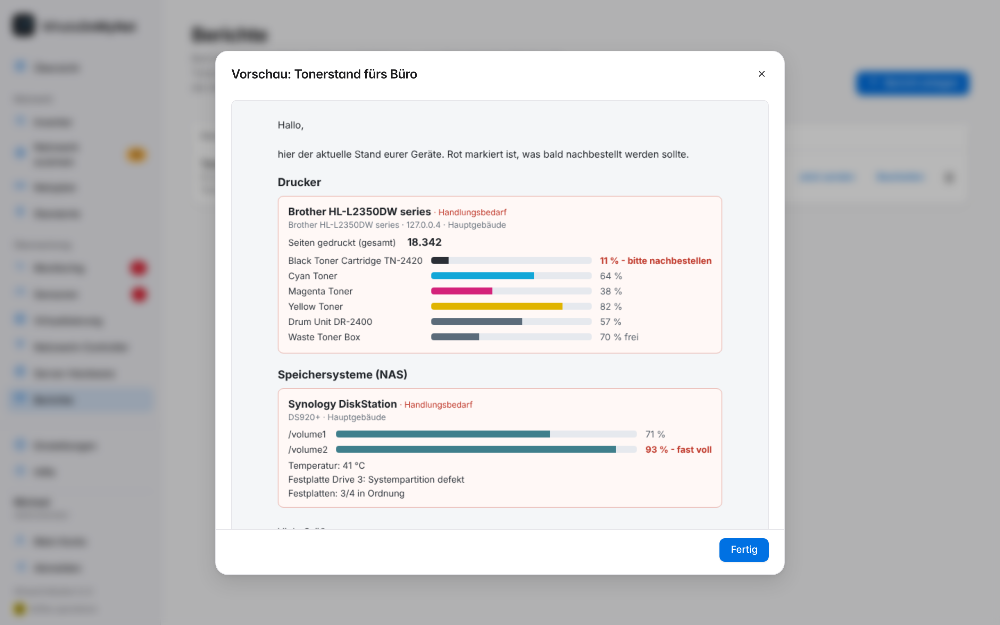

Unter *Überwachung → Berichte* gehen Berichte zu festen Zeiten per E-Mail raus - z. B. jeden Montag um 8 Uhr die Tonerstände ans Büro.

- Inhalt: Drucker, NAS, Switches, Netzlaufwerke; auf Standorte beschränkbar; wahlweise nur Geräte mit Handlungsbedarf.
- **Geräte**: alle Geräte der gewählten Inhalte - oder nur ausgewählte, z. B. ein eigener Bericht für den Drucker im Sekretariat.
- Drucker zeigen die **gedruckten Seiten** (gesamt und im Berichtszeitraum, z. B. „in den letzten 7 Tagen“) und - wenn der Drucker es meldet - wie viele Seiten der Toner noch reicht.
- Die Mail ist **neutral**: kein Link, kein Programmname - nur dein Absendername, Betreff (`{kw}`, `{datum}`), Einleitung, die Geräte und dein Gruß.
- „Vorschau“, „Test an mich“ und „Jetzt senden“ direkt in der Liste; mit dem Schalter in der Spalte *Aktiv* schaltest du einen Bericht ein oder aus, ohne ihn zu öffnen.

## Benutzer und Rechte

- **Rollen**: *Administrator* (alles), *Bearbeiter* (scannen, übernehmen, pflegen, Monitore), *Nur lesen*. Bearbeiter scannen nur private Netze (10.x, 172.16-31.x, 192.168.x, 100.64-127.x) und die Subnetze der Standorte; öffentliche Adressen nur Administratoren.
- **Standorte**: Bearbeiter und Leser lassen sich auf Standorte beschränken - sie sehen und ändern dann nur deren Geräte, Scans und Monitore.
- **Active Directory**: Anmeldung mit dem Windows-Konto, siehe nächster Abschnitt.
- **Zwei-Faktor-Anmeldung** (*Mein Konto*): QR-Code mit einer Authenticator-App scannen, Code bestätigen, Wiederherstellungscodes aufbewahren. Für Administratoren lässt sie sich unter *Einstellungen → Benutzer* (Abschnitt *Anmeldung*) verpflichtend machen.

## Anmeldung mit Active Directory

Mitarbeitende melden sich mit ihrem Windows-Konto an. Welche Rolle sie bekommen, steuern AD-Gruppen. Lokale Konten funktionieren weiter; bei gleichem Namen hat das lokale Konto Vorrang, so bleibt der lokale Admin der Notfallzugang.

### Schritt 1: Im AD vorbereiten (einmalig)

1. Ein **Dienstkonto** anlegen, z. B. `svc-womn`. Es braucht keine besonderen Rechte, ein normales Domänenkonto mit Passwort genügt.
2. Bis zu drei **Gruppen** anlegen, z. B. `WOMN-Admins`, `WOMN-Bearbeiter` und `WOMN-Lesen`, und die Mitarbeitenden hineinlegen. Gruppen in Gruppen werden berücksichtigt.

### Schritt 2: In WhatsOnMyNet eintragen

1. *Einstellungen → Active Directory*.
2. **Server**: Name des Domänencontrollers so, wie er im Zertifikat steht, z. B. `dc01.firma.local`. Verschlüsselung **LDAPS** (Port 636) oder **StartTLS** (Port 389). Ohne Verschlüsselung geht es nicht.
3. **Zertifikat**: Vertrauen auf *Abgerufenes Zertifikat* lassen und **Zertifikat vom DC abrufen** klicken. Den Fingerabdruck mit dem Zertifikat auf dem DC vergleichen (`certlm.msc` → *Eigene Zertifikate* → Zertifikat öffnen → *Details* → *Fingerabdruck*) und bestätigen. Fehlt die Stamm-CA, holt WhatsOnMyNet sie selbst (über die AIA-Adresse im Zertifikat oder nach dem Bestätigen aus dem AD).
4. **Verzeichnis**: Basis-DN leer lassen, der Test findet ihn. Dienstkonto eintragen, z. B. `svc-womn@firma.local`, dazu sein Passwort.
5. **Gruppen**: einfach die Gruppennamen eintragen, z. B. `WOMN-Admins`. Wer in mehreren Gruppen ist, bekommt die höchste Rolle; wer in keiner ist, kommt nicht herein.
6. **Verbindung testen**, am besten mit dem eigenen Benutzernamen. Jeder Schritt bekommt ✓ oder ✗ mit dem Grund: Verbindung, Dienstkonto, Basis-DN, Gruppen, Benutzer, Rolle und auf Wunsch das Passwort.
7. Wenn alles ✓ ist: *Anmeldung über Active Directory erlauben* anhaken und **Speichern**.

### Wenn etwas nicht klappt

- **„Das Zertifikat des DC ist nicht vertrauenswürdig“**: *Zertifikat vom DC abrufen* und bestätigen.
- **„Der Name im Zertifikat passt nicht“**: Beim Domänencontroller den Namen aus dem Zertifikat eintragen (der Abruf zeigt ihn an). Nur wenn du den DC über die IP-Adresse ansprichst: *Servernamen im Zertifikat prüfen* abschalten.
- **„Dienstkonto: Anmeldung abgelehnt“**: Name oder Passwort des Dienstkontos falsch, oder das Konto ist gesperrt.
- **„Gruppe nicht gefunden“**: Schreibweise der Gruppe im AD prüfen.
- **„Keine Rolle“**: Der Benutzer ist in keiner der eingetragenen Gruppen.

## Scan-Agent für Außenstellen

Für eine Außenstelle läuft dort ein zweiter Container als Scan-Agent. Unter *Einstellungen → Scan-Agenten* einen Agenten für den Standort anlegen; die angezeigte `.env` neben die `docker-compose.agent.yml` aus dem Release legen und `docker compose -f docker-compose.agent.yml up -d` starten. Der Agent öffnet keinen Port, holt sich Aufträge über HTTPS und meldet nur Adressen seines Standorts.

## Ausfallsicherung: Master und Standby

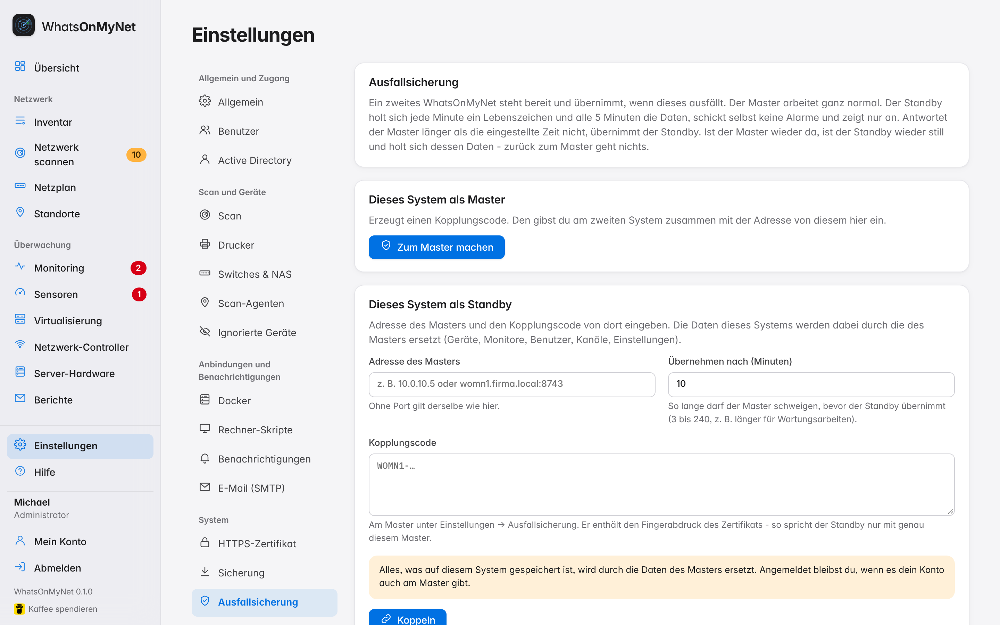

Ein zweites WhatsOnMyNet (anderer Rechner, am besten anderer Host oder anderer Raum) steht bereit und übernimmt, wenn das erste ausfällt.

**Einrichten (einmalig):**

1. Am ersten System (**Master**): *Einstellungen → Ausfallsicherung → Zum Master machen*. Es erscheint ein **Kopplungscode** (`WOMN1-…`). Er wird nur jetzt angezeigt und gibt vollen Zugriff - wie ein Passwort behandeln.
2. Am zweiten System (frisch installiert oder vorhandenes): *Einstellungen → Ausfallsicherung → Dieses System als Standby*. Adresse des Masters (z. B. `10.0.10.5` oder `womn1.firma.local:8743`) und den Code eintragen, auf Wunsch die Zeit bis zur Übernahme (Standard 10 Minuten, 3 bis 240) - **Koppeln**.

Beim Koppeln übernimmt der Standby **alle Daten des Masters** (Geräte, Monitore, Benutzer, Kanäle, Einstellungen) und auch dessen Schlüssel (`data/secret.key`), damit er gespeicherte Passwörter lesen kann. Sein bisheriger Schlüssel bleibt als `secret.key.before-standby` liegen. Ist am Standby `WOMN_SECRET` gesetzt, muss es denselben Wert haben wie am Master. Beide Systeme brauchen dieselbe Version.

**Im Betrieb:**

- Der **Master** arbeitet wie immer und muss nichts tun.
- Der **Standby** fragt jede Minute beim Master nach und holt alle 5 Minuten dessen Daten. Er prüft nichts, scannt nichts und alarmiert nicht.
- **Der Standby weiß alles, was der Master weiß** - auch die Empfangs-Einstellungen (Syslog, TCP, TLS, Traps, welche Ereignis-IDs genommen werden, gespeicherte Suchen, Ereignisregeln) und die **Meldungen der Geräte**: Neue Meldungen holt er jede Minute nach (bis zu 100 000 auf einmal, ab dem Koppeln auch die älteren). Ändert sich am Master eine Empfangs-Einstellung, öffnet oder schließt der Standby seine Ports gleich mit, nicht erst nach einem Neustart. Wird er Master, läuft der Empfang also genau so weiter. Schicken Geräte ihre Meldungen an beide (empfohlen, sonst fehlt während einer Übernahme, was nur an den Master geht), steht jede Meldung trotzdem nur einmal da. Die Ports (`WOMN_SYSLOG_PORT` usw.) stehen in der `docker-compose.yml` jedes Systems - beim Standby gleich wie beim Master setzen. Oben steht ein Hinweis; ändern lässt sich dort nichts (bitte am Master).
- Die Verbindung läuft über HTTPS, der Standby prüft dabei den Fingerabdruck des Master-Zertifikats aus dem Code. Bleibt der Schlüssel des Zertifikats bei einer Erneuerung gleich (beim selbstsignierten immer), muss man nichts tun. Bei einem neuen Zertifikat mit neuem Schlüssel am Master einen neuen Code erzeugen und neu koppeln.

**Auf dem Standby lässt sich nichts verstellen** - weder Kanäle, E-Mail-Adressen und Webhooks noch Einstellungen, Benutzer, Monitore oder Geräte, auch nicht, während er für den Master überwacht: Seine Daten kommen ja vom Master und würden beim nächsten Abgleich überschrieben. Die Seiten zeigen nur an. Erlaubt sind nur die Steuerung unter *Ausfallsicherung* (entkoppeln, zum Master machen, Wartezeit) sowie Hell/Dunkel und Sprache im eigenen Konto.

**Wenn der Master ausfällt:** Antwortet er länger als die eingestellte Zeit nicht, **übernimmt der Standby**. Er prüft und alarmiert dann selbst und meldet an alle Standard-Kanäle: „Ausfallsicherung: Der Master … ist seit 10 Min. nicht erreichbar - dieses System hat die Überwachung übernommen.“ Für eine längere Wartung am Master stellst du die Zeit vorher am Standby hoch.

**Wenn der Master wiederkommt:** Sobald er antwortet, ist der Standby wieder still („… ist wieder da“). Vorher **gibt er dem Master zurück, was er in der Zeit gemessen hat**: die Prüfungen, die Stundenwerte (Verfügbarkeit, Antwortzeiten, Sensorwerte) und die Alarme. So hat der Verlauf des Masters keine Lücke, und man sieht dort, an welchem Tag was war. Danach holt sich der Standby wie gewohnt die Daten des Masters. **Einstellungen gehen nie zurück** - nur Messwerte und Alarme, Einstellungen immer nur vom Master zum Standby. Hat der Master einen Monitor in der Zeit selbst geprüft (er war gar nicht weg, nur der Standby war abgeschnitten), behält er dafür seine eigenen Werte; ebenso, wenn er einen Monitor inzwischen geändert oder gelöscht hat. Jeder Teil wird nur einmal übernommen, auch wenn die Verbindung zwischendurch abreißt. Am Standby steht unter *Übernahmen*, was zurückgegeben wurde, am Master unter *Vom Standby zurückgegeben*. Übernahmen aus älteren Versionen geben ihre Alarme nach dem Update ebenfalls zurück (die Messwerte hatte der Standby damals schon durch die Daten des Masters ersetzt). Auch die **Meldungen der Geräte** (Syslog, Traps), die in der Zeit am Standby ankamen, gehen an den Master - doppelte nicht.

**Beide immer auf derselben Version:** Master und Standby gleich aktualisieren - nur dann arbeitet der Standby im Notfall genauso, und nur bei gleicher Datenbankversion kann er die Daten des Masters übernehmen. Der Standby passt darauf auf: Laufen die beiden eine halbe Stunde lang mit unterschiedlichen Versionen (eins nach dem anderen zu aktualisieren ist also kein Problem), schickt er eine Erinnerung an die Standard-Kanäle - z. B. „Der Master … läuft mit Version 0.39.0, dieses System (Standby) mit 0.38.0. Bitte diesen Standby auf 0.39.0 aktualisieren.“ Bleibt es so, kommt sie alle 7 Tage wieder; kann der Standby die Daten wegen der Datenbankversion nicht mehr übernehmen, sofort und dann täglich, als dringende Meldung. Sind beide wieder gleich, meldet er das einmal. Unter *Ausfallsicherung* steht der Unterschied auf beiden Seiten, auf dem Standby auch in der Leiste oben.

**Wenn der Master nicht wiederkommt:** Am Standby **Zum Master machen**. Er ist dann dauerhaft Master und zeigt einen neuen Kopplungscode. Kommt der alte Master doch wieder hoch, erfährt er das beim ersten Kontakt und hört auf zu alarmieren. Dort dann am besten als Standby an den neuen Master koppeln.

**Auflösen:** *Kopplung lösen* auf der jeweiligen Seite. Am Master: Der Standby übernimmt nicht mehr und bleibt still, bis dort entschieden wird. Am Standby: Er arbeitet danach allein (läuft der Master noch, kommen Alarme doppelt). Ein neuer Kopplungscode am Master trennt den bisherigen Standby ebenfalls.

## Sicherung und Updates

- Einmal am Tag sichert WhatsOnMyNet die Datenbank komprimiert nach `data/backups/` (`whatsonmynet-….sqlite.gz`, das erste Mal eine Stunde nach dem Start); vor jedem Update der Datenbank zusätzlich. Aufbewahrt werden standardmäßig die 10 neuesten, von den Kopien vor Updates und vor dem Einspielen ebenso je die 10 neuesten. Die Anzahl stellst du unter *Einstellungen → Sicherung → Aufbewahrung* ein (1 - 90); beim Speichern werden überzählige gleich gelöscht, die ältesten zuerst. Ältere unkomprimierte Sicherungen werden einmal komprimiert.
- *Einstellungen → Sicherung*: Sicherung herunterladen, jetzt sichern, einzelne Sicherungen löschen (Papierkorb in der Liste, mit Rückfrage), Sicherung einspielen - `.sqlite` oder `.sqlite.gz` (der aktuelle Stand wird vorher gesichert, dann startet das Programm neu). Zum Öffnen von Hand: `gunzip -k whatsonmynet-….sqlite.gz`.
- **Bewahre `data/secret.key` (bzw. `WOMN_SECRET`) mit auf** - ohne ihn sind gespeicherte Passwörter in einer Sicherung unlesbar.
- Updates: in Dockhand/Watchtower oder `docker compose pull && docker compose up -d`. Einmal im Monat erscheint ein Sicherheits-Update mit neuen Paketen.

**Was ist neu?** Ein Klick auf die Versionsnummer unten links im Menü zeigt *Über WhatsOnMyNet*: die Änderungen der letzten Versionen, den Link zum Quellcode, die Website und einen Kaffee-Link. Den Kaffee-Link gibt es auch direkt unten im Menü. Das geht für alle Benutzer, nicht nur für Administratoren.

## Fehlerbehebung

- **Oberfläche nicht erreichbar**: Firewall des Hosts für den HTTPS-Port öffnen. Mit Host-Netzwerk zeigt Docker/Dockhand keine Port-Zuordnung - das ist richtig so.
- **Keine Drucker-/Switch-Daten**: SNMP am Gerät einschalten, Community unter *Einstellungen → Scan* prüfen, auf der Geräteseite „Jetzt abfragen“.
- **Ausgesperrt**: `docker compose exec whatsonmynet womn-admin reset <benutzer>` setzt ein neues Passwort, macht das Konto wieder zum Administrator und schaltet die Zwei-Faktor-Anmeldung aus. `womn-admin create <benutzer>` legt einen neuen Administrator an.
- **Netzlaufwerk meldet „protocol not supported“**: Das Gerät kann nur das alte SMB1 - das wird aus Sicherheitsgründen nicht verwendet. SMB2/3 am Gerät einschalten (bei Synology: *Dateidienste → SMB → Erweitert*).
- **Diagnosepaket**: *Einstellungen → Diagnose* erstellt ein ZIP mit Protokoll (wird 30 Tage aufbewahrt), Warnungen und Fehlern, Monitoren und Sensoren samt Prüfungen, Geräten mit den Werten, die ihre Sensoren sehen, Hypervisoren, Cloud, Veeam und Microsoft 365, den Meldungen der Geräte (Empfänger, Platz, Formate von NXLog, Ereignisregeln mit Versand), Scans, Einstellungen und den Änderungen seit der ältesten Version im Zeitraum - für die letzten 1 bis 30 Tage oder seit dem letzten Update. Standardmäßig anonymisiert: Namen und Adressen werden zu Platzhaltern (GERAET-001, 10.99.0.7 …), die in jedem Paket gleich bleiben und sich dort nachschlagen lassen. Kennwörter, Schlüssel und Communities sind nie enthalten; verschickt wird nichts.
- **Rechner-Skript lässt sich nicht neu einrichten („Zugriff verweigert“ auf `C:\ProgramData\WhatsOnMyNet\womn-host.ps1`)**: Einrichtungen vor Version 0.33.2 haben beim erneuten Einrichten der alten Kopie alle Rechte genommen. Ein Skript ab 0.33.2 repariert das selbst. Klappt es trotzdem nicht, einmal als SYSTEM oder Administrator `icacls C:\ProgramData\WhatsOnMyNet\* /reset` ausführen und das Skript erneut verteilen.
- **Protokoll**: *Einstellungen → Protokoll* zeigt, wer was geändert hat; technische Meldungen stehen im Container-Log.
