# WhatsOnMyNet - Handbuch

WhatsOnMyNet findet, was in deinem Netz läuft, und hält nur das im Inventar, was du übernimmst. Dazu überwacht es Geräte, Dienste und Webseiten, liest Drucker, Switches, NAS und Hypervisoren (Proxmox, VMware, Hyper-V …) aus und meldet sich per E-Mail, Messenger, Push aufs Handy oder Webhook, wenn etwas nicht stimmt.

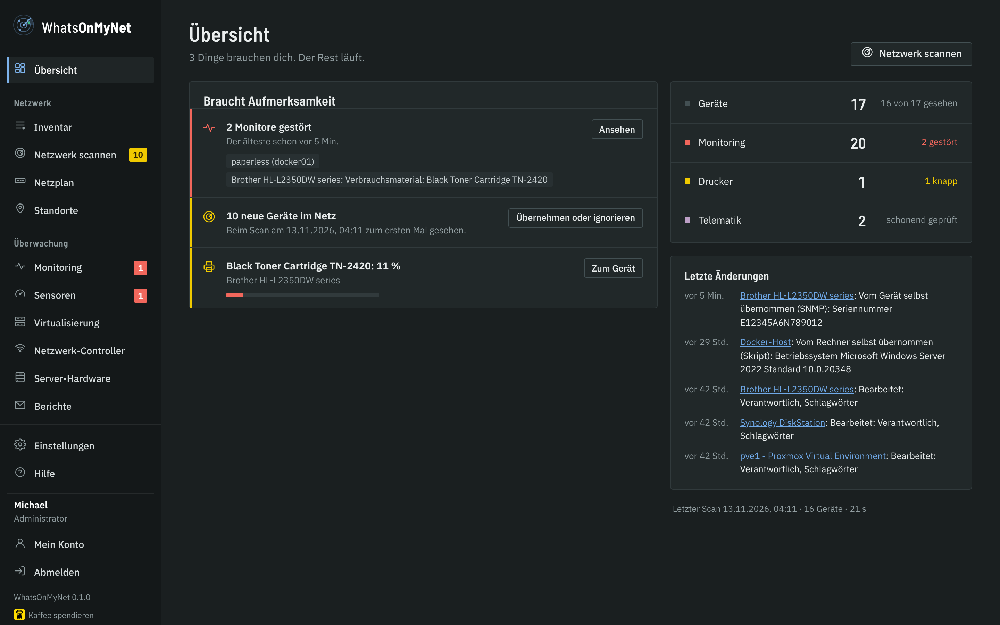

## Installation

WhatsOnMyNet läuft als Docker-Container mit Host-Netzwerk - nur so sieht der Scan die MAC-Adressen der Geräte.

1. `docker-compose.yml` und `env.example` aus dem Release in einen Ordner legen, `env.example` in `.env` umbenennen.
2. In der `.env` bei Bedarf Ports (`WOMN_HTTPS_PORT`, Standard 8743), Zeitzone (`TZ`) und Besitzer der Daten (`PUID`/`PGID`) anpassen.
3. `docker compose up -d` - oder den Stack in Dockhand anlegen.
4. Den **Einrichtungscode** aus dem Log holen (`docker compose logs whatsonmynet`) und `https://<server>:8743/setup` öffnen. Dort legst du den ersten Administrator an.

Die Oberfläche läuft immer über HTTPS. Beim ersten Start erzeugt WhatsOnMyNet ein selbstsigniertes Zertifikat; ein eigenes (PEM oder PFX) lädst du unter *Einstellungen → HTTPS-Zertifikat* hoch.

**Ping:** Der Container läuft ohne Root-Rechte. Ping funktioniert, wenn der Host normalen Benutzern ICMP erlaubt (`net.ipv4.ping_group_range`, bei Debian/Ubuntu/Proxmox Standard; in LXC-Containern `0 65535` setzen). Ohne Ping findet der Scan Geräte trotzdem über ARP und TCP.

## Erste Schritte

1. **Standort anlegen** (*Standorte*): Name und Subnetze, z. B. „Hauptgebäude“ mit `192.168.10.0/24`.
2. **Netzwerk scannen** (*Netzwerk scannen*): Standort anhaken, „Scan starten“. Der Radar zeigt die gefundenen Geräte; der Scan ist schonend (ARP, rund 25 typische Ports, SNMP nur lesend).
3. **Übernehmen**: Im Ergebnis unter „Neu“ Typ und Name prüfen, Geräte anhaken, „Ins Inventar übernehmen“. Was du nicht im Inventar willst, „Ignorieren“. Versehentlich ignoriert? Im Reiter „Ignoriert“ anhaken und „Nicht mehr ignorieren“ (steht dann wieder unter „Neu“) oder gleich „Ins Inventar übernehmen“. Die ganze Liste steht unter *Einstellungen → Ignorierte Geräte*.

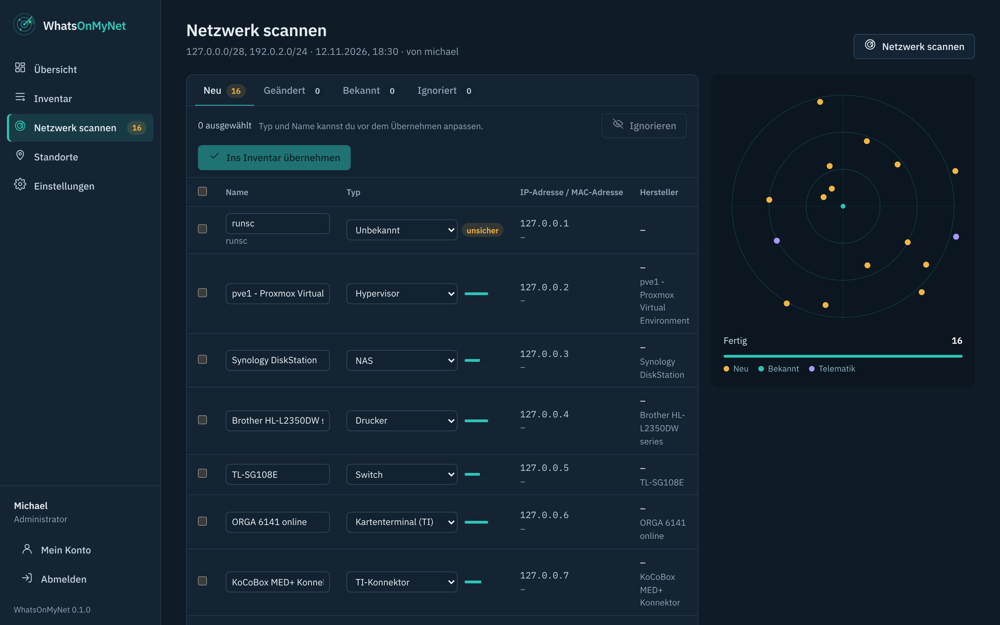

Die MAC-Adresse ist die Identität eines Geräts: Bekommt es eine neue IP, übernimmt der nächste Scan sie automatisch und schreibt es in den Verlauf.

## Inventar

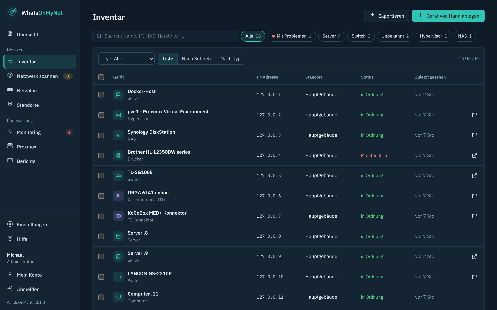

- **Suchen und filtern** nach Name, IP, MAC, Hersteller, Typ, Standort oder Schlagwort; Export als CSV oder JSON.
- **Geräteseite**: alle Angaben, Kauf- und Garantiedaten, Notizen, Schnellzugriff auf die Weboberfläche, was der Scan erkannt hat, Verlauf aller Änderungen.
- **Vorschläge beim Ausfüllen**: Hersteller, Modell, Betriebssystem, Verantwortlicher, Lieferant und Schlagwörter schlagen vor, was schon im Inventar steht. Ein bekanntes Modell füllt Hersteller und Typ aus.
- **Mehrfachauswahl**: Geräte anhaken und gemeinsam bearbeiten (Typ, Standort, Hersteller, Modell, Daten, Schlagwörter) oder löschen.
- **Tiefenprüfung**: prüft ein einzelnes Gerät mit einer längeren Port-Liste. Telematik-Geräte (Konnektor, Kartenterminal) werden immer nur schonend geprüft.

## Nächtlicher Leicht-Scan

Jede Nacht (Standard 02:30) sucht WhatsOnMyNet in allen Subnetzen deiner Standorte nur nach Geräten - ohne Ports, ohne SNMP. Bekannte Geräte bekommen ihre neue IP; ein Gerät, das zum allerersten Mal auftaucht, wird einmal gemeldet. Einstellungen, Uhrzeit und „Jetzt ausführen“ findest du unter *Einstellungen → Scan*.

## Monitoring

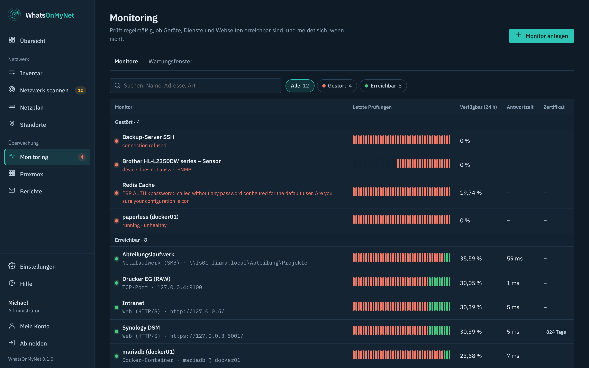

Ein Monitor prüft regelmäßig (20 Sekunden bis 24 Stunden) und meldet sich erst nach mehreren Fehlversuchen hintereinander. Arten:

- **Web (HTTP/S)** mit Statuscodes, Stichwort und Ablaufdatum des Zertifikats (Warnung z. B. 30, 14 und 7 Tage vorher)
- **TCP-Port** und **Ping**
- **Docker-Container** (über einen Socket-Proxy, *Einstellungen → Docker*): läuft, startet ständig neu, Healthcheck „unhealthy“
- **Datenbanken**: MariaDB/MySQL, PostgreSQL, Redis/Valkey - Anmeldung und eine harmlose Abfrage
- **Netzlaufwerk (SMB)**: Windows-Freigaben und NAS - siehe unten
- **Sensor** (Wert eines Geräts, Rechners mit Skript, Hypervisors oder Controllers) und **SNMP-Wert (OID)** - siehe unten

Auf der Geräteseite legt „Überwachen“ einen passenden Monitor an. Ändert sich die IP eines Geräts, ziehen seine Monitore mit. Benennst du das Gerät um, heißen seine Monitore und Sensoren auch gleich so, damit ein Alarm den aktuellen Namen nennt (ein Monitor mit selbst vergebenem Namen ohne den Gerätenamen bleibt, wie er ist).

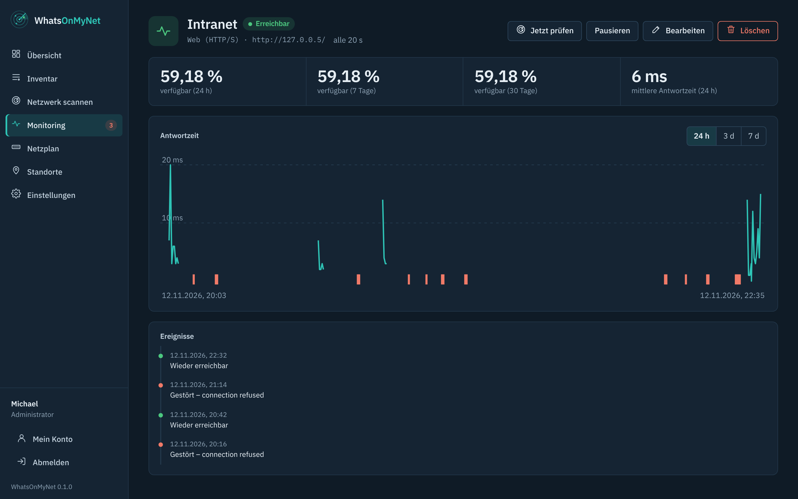

**Benachrichtigungen** (*Einstellungen → Benachrichtigungen → Kanal hinzufügen*): Dienst wählen, die kurze Anleitung im Formular befolgen, speichern und mit **Testnachricht** prüfen.

- **Häufig:** E-Mail (über den SMTP-Server), Telegram-Bot, Webhook mit eigener JSON-Vorlage (z. B. für n8n oder ein Skript)
- **Chat und Messenger:** Discord, Slack, Microsoft Teams (Workflows), Google Chat, Mattermost, Rocket.Chat, Matrix/Element, Signal (über signal-cli-rest-api), WhatsApp (CallMeBot, an die eigene Nummer)
- **Push aufs Handy:** ntfy, Gotify, Pushover, Pushbullet, Home Assistant (Companion-App)
- **Alles andere:** Apprise - eine Brücke zu über 100 weiteren Diensten (SMS, Threema …)

Tokens, Schlüssel und Webhook-Adressen werden verschlüsselt gespeichert und nie wieder angezeigt. Störungen kommen bei Push-Diensten mit hoher Priorität.

**Wartungsfenster** (*Überwachung → Monitoring → Wartungsfenster*): einmalig oder an bestimmten Wochentagen von-bis (auch über Mitternacht). Es gilt für die angehakten Monitore und Sensoren - die Auswahl ist nach Gerät bzw. Hypervisor gruppiert, mit Suche, ein Haken beim Gerät nimmt alles davon. Nichts angehakt = alles. Schneller für einen einzelnen: auf der Seite des Monitors oder Sensors unter *Zeiten ohne Alarm* → **Zeitfenster ohne Alarm** (vorbelegt: täglich 20-23 Uhr, z. B. für die Zeit des Backups, in der eine SSD warm wird). Geprüft und aufgezeichnet wird auch im Wartungsfenster, nur die Meldungen schweigen.

**Was in einem Alarm steht:** Webseite, Port und Ping melden „ist nicht erreichbar“. Ein Messwert meldet „Grenzwert überschritten - 83,9 °C (≥ 80)“ und später „wieder im normalen Bereich“, ein Zustand (Dienst, VM, Festplatte, Container …) „Störung“ und „wieder in Ordnung“, ein Sensor ohne aktuelle Werte „keine aktuellen Werte“. Deutsche Kanäle bekommen auch die Einzelheiten auf Deutsch.

### Eskalation

Bleibt eine Störung zu lange bestehen, soll es noch jemand anderes erfahren, z. B. die Leitung oder eine zweite Bereitschaft. Dafür gibt es die **Eskalation**.

- **Für alle Monitore:** *Einstellungen → Benachrichtigungen → Eskalation*. Dort wählst du, nach wie vielen Minuten noch gestört (15 Min. bis 8 Std.) eskaliert wird und an welche Kanäle. Die Kanäle legst du vorher wie gewohnt an, etwa eine eigene E-Mail oder einen zweiten Telegram-Chat.
- **Je Monitor:** Im Formular unter *Erweitert → Eskalation* stellst du eine andere Zeit ein, schaltest sie ab (*nie eskalieren*) oder wählst eigene Kanäle. Ohne eigene Auswahl gelten die Einstellungen für alle.
- Die Eskalation kommt **einmal je Störung**, mit hoher Priorität: „🚨 Eskalation: Firewall ist seit 30 Min. nicht erreichbar“. Ist die Störung behoben, kommt die Entwarnung auch an die Eskalationskanäle.
- Folgestörungen (siehe Abhängigkeiten) und Wartungsfenster eskalieren nicht. Im Verlauf des Monitors steht *Eskaliert*, mit den Kanälen, die erreicht wurden.

### Verlauf über Monate

Auf der Seite eines Monitors wählst du den Zeitraum: **24 h, 3 T, 7 T** zeigen jede einzelne Prüfung, **30 T, 90 T, 1 J** die Zusammenfassung.

- **Linie:** der Mittelwert, bei 30 Tagen je 6 Stunden, sonst je Tag. Je nach Monitor ist das die Antwortzeit oder der gemessene Wert, etwa CPU oder Füllstand.
- **Fläche:** der Bereich vom niedrigsten bis zum höchsten Wert.
- **Leiste darunter:** zeigt die Verfügbarkeit. Grün heißt immer erreichbar bzw. in Ordnung, gelb kurz gestört, rot länger gestört. Wenn du mit der Maus auf einen Abschnitt zeigst, stehen dort Datum, Prozent und Werte.

Einzelne Prüfungen werden 7 Tage aufbewahrt, die stündliche Zusammenfassung gut ein Jahr. Für die ersten Monate nach dem Update auf 0.9 gilt: Ältere Stunden kennen nur den Mittelwert, die Fläche erscheint erst für neue Daten.

### Abhängigkeiten: keine Alarmflut

Fällt ein Switch aus, sind auch alle Geräte dahinter nicht mehr erreichbar. Damit dann nicht zwanzig Meldungen kommen, kann jeder Monitor von einem anderen **abhängen** (Formular → *Hängt ab von*, z. B. der Ping auf den Switch oder den Internet-Router).

- Ist der Monitor davor gestört, gilt der dahinter als **Folgestörung** (hohler roter Punkt) und meldet nichts extra. Gemeldet wird nur die Ursache.
- Fallen beide gleichzeitig aus, wartet der dahinter kurz auf das Ergebnis des Monitors davor, statt selbst Alarm zu schlagen.
- Läuft der Monitor davor wieder, werden die dahinter sofort neu geprüft. Wer dann noch gestört ist, hat ein eigenes Problem und meldet sich ganz normal.
- Ketten sind möglich (Internet-Router → Core-Switch → Etagen-Switch → Drucker). Kreise lehnt das Programm ab.

**Automatisch über den Switch-Port:** Wird ein Switch per SNMP abgefragt, weiß WhatsOnMyNet, an welchem Switch ein Gerät steckt. Beim **Überwachen** eines Geräts ist der Monitor seines Switches dann schon als Abhängigkeit vorausgewählt. Auf der Seite des Switch-Monitors steht zudem, wie viele überwachte Geräte an ihm stecken und noch von nichts abhängen. **Hinter diesen Monitor hängen** ordnet sie alle auf einmal zu.

## Drucker, Switches und NAS

Geräte vom Typ *Drucker*, *Switch* und *NAS* werden per SNMP gefragt (nur lesend). Die Community stellst du unter *Einstellungen → Scan* ein; am Gerät muss SNMP v1/v2c an sein.

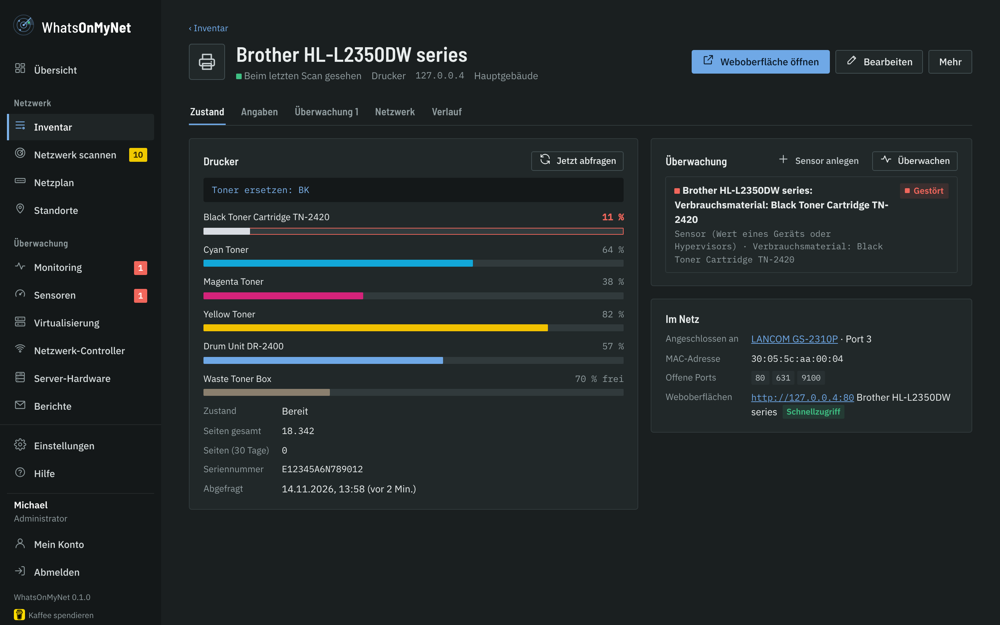

- **Drucker**: Toner bzw. Tinte je Farbe, Trommel, Resttoner, Seitenzähler, Störungen und Display-Text. Unter 15 % kommt eine Meldung - einmal pro Kartusche.
- **Switch**: Ports als Kacheln, welche Geräte an welchem Port hängen (auch mit VLANs), LLDP-Nachbarn, Firmware. Jede Geräteseite zeigt „Angeschlossen an“.
- **NAS**: Volumes, bei Synology auch Festplatten, RAID, Temperatur, Lüfter, Netzteil und DSM-Update. Probleme werden gemeldet - und wieder, wenn alles in Ordnung ist.
- **Ins Inventar übernommen**: Was das Gerät über sich selbst sagt - Seriennummer, Modell, Firmware bzw. Betriebssystem (z. B. DSM-Version), bei Synology/QNAP der Hersteller - landet gleich in den Angaben des Geräts und bleibt aktuell (z. B. nach einem Firmware-Update). Was du selbst mit einem anderen Wert eingetragen hast, bleibt stehen. Der Verlauf zeigt jede Übernahme.
- **Gerät ausgetauscht**: Meldet das Gerät unter derselben IP eine andere Seriennummer, ist es neue Hardware. Seriennummer, Modell, Hersteller und Firmware kommen dann vom neuen Gerät, die alte MAC-Adresse wird verworfen und beim nächsten Scan durch die neue ersetzt (statt eines „neuen Geräts“). Der Verlauf vermerkt den Tausch - Kaufdatum und Garantie bitte selbst prüfen.

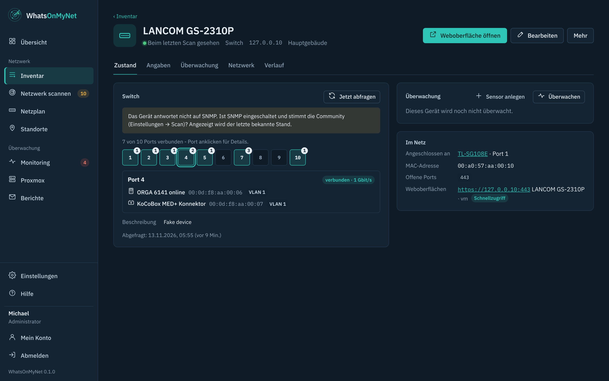

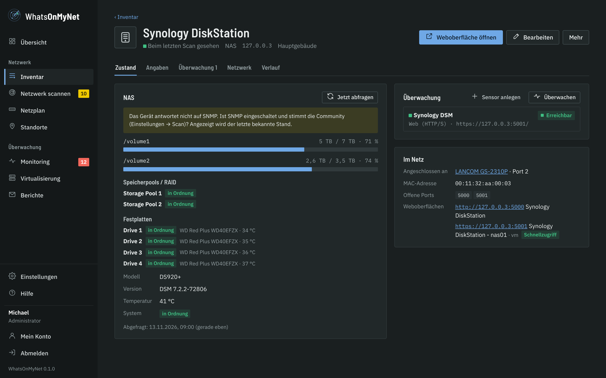

### USV (unterbrechungsfreie Stromversorgung)

WhatsOnMyNet liest USV-Werte mit, ohne dass du etwas einrichten musst. Die Werte sind immer dieselben: **Netzbetrieb oder Akku**, **Akkustand**, **wie lange der Akku noch reicht** und **Last**. Mit **Sensor anlegen** wählst du daraus z. B. „USV: Netz oder Akku“ (Alarm, sobald sie auf Akku läuft) oder „USV-Restlaufzeit (min)“.

- **USV an einer Synology** (USB oder Netzwerk): Ist der USV-Dienst der Synology an, erscheint im NAS-Bereich der Abschnitt *USV*. Abgefragt wird über dasselbe SNMP wie beim NAS. Du musst WhatsOnMyNet dafür nicht als vertrauenswürdiges Gerät im USV-Server eintragen.
- **USV mit eigener Netzwerkkarte:** APC oder jede Karte mit dem Standard UPS-MIB, z. B. Eaton, CyberPower oder Riello. Das Gerät im Inventar auf den Typ *USV* stellen, dann wird es wie Switches und NAS per SNMP abgefragt. Seriennummer, Modell und Firmware landen dabei im Inventar.
- **USV an einem Linux-Rechner:** Läuft dort schon NUT (`upsc`) oder apcupsd (`apcaccess`), liest das Rechner-Skript die Werte lokal mit.
- **USV per USB an einem Windows-Rechner:** Windows sieht sie wie einen Akku, das Rechner-Skript schickt die Werte mit. Bei Laptops ist das der eingebaute Akku, deshalb heißt der Abschnitt dort *USV oder Akku*.

Eine USV an einem **QNAP** gibt ihre Werte nicht per SNMP heraus, dort zeigt WhatsOnMyNet keine USV. Herunterfahren und Steuern bleibt bei der USV-Software, WhatsOnMyNet liest nur.

### Netzplan

Der *Netzplan* zeigt aus den MAC-Tabellen und LLDP, welches Gerät an welchem Port hängt und wie die Switches verbunden sind. Einfache Switches ohne SNMP erscheinen als Zweig hinter dem Port, an dem sie stecken. Hinter Routern liest der Scan die ARP-Tabelle der Router per SNMP, damit die MAC-Adresse auch dort die Identität bleibt.

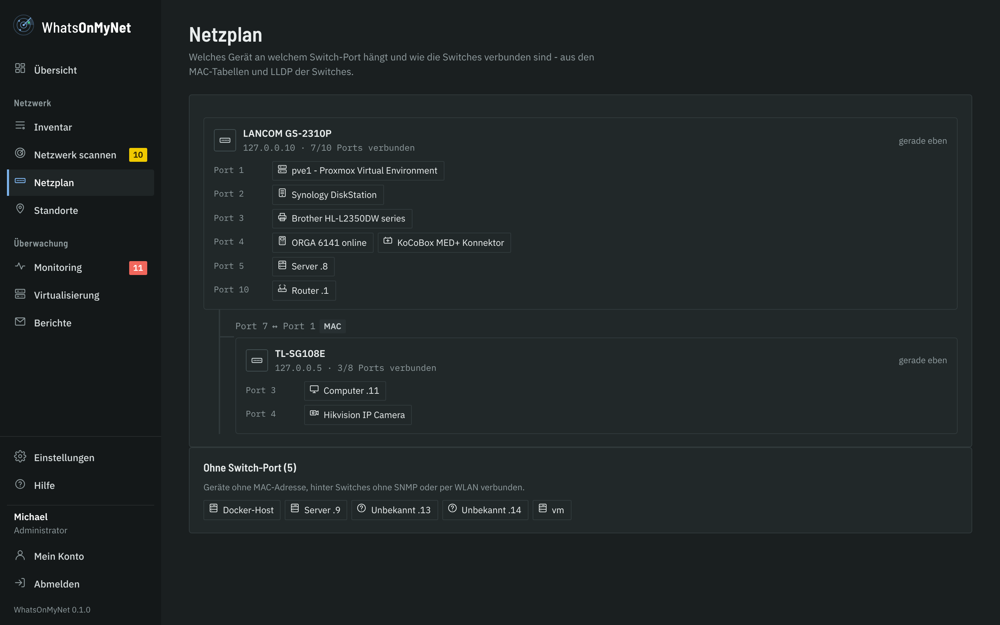

## Sensoren

Jeder Wert, den ein Gerät liefert, kann ein eigener Monitor werden - mit Verlauf, Alarm und Wartungsfenstern. Alle Sensoren stehen unter *Überwachung → Sensoren*. „Sensor anlegen“ gibt es auf der Geräteseite, unter *Virtualisierung* am Host und unter *Überwachung → Sensoren*. Es ist immer derselbe Dialog: Gerät oder Host wählen, dann Wert und Bedingung, z. B.:

- „Toner Cyan kleiner oder gleich 10 %“
- „Belegung /volume1 größer oder gleich 85 %“
- „Temperatur Drive 2 größer als 50 °C“
- „Port 10 (Uplink) verbunden“

**Proxmox-Knoten:** Ein Knoten, der auch im Inventar steht (gleicher Name, z. B. `pve2` bzw. `pve2.firma.local`), hat eine gemeinsame Liste - egal ob über das Gerät oder über den Host unter Virtualisierung geöffnet: „Knoten pve2 online“ von Proxmox und, wenn dort das Linux-Skript läuft, jede Temperatur, CPU, RAM, Laufwerke und Dienste aus dem Skript. Was beide liefern (CPU, RAM, die höchste Temperatur), steht nur einmal drin. Unter Virtualisierung ist die Liste nach Knoten gruppiert. Ebenso zeigt ein Server mit Verwaltungschip (Redfish) dessen Hardware-Werte und ein Proxmox Backup Server seine Datenspeicher und Sicherungen am Gerät.

Ein bestehender Sensor lässt sich beim Bearbeiten auf jeden anderen Wert dieser Liste umstellen, zum Beispiel von „Temperatur pve2“ auf „Temperatur: NVMe nvme0 Sensor 2“. Der Name zieht dabei mit („pve2: Temperatur: NVMe nvme0 Sensor 2“) - außer er wird im selben Dialog von Hand geändert.

Der Typ **SNMP-Wert (OID)** fragt jeden beliebigen SNMP-Wert ab (z. B. Restlaufzeit einer USV) und vergleicht mit kleiner, größer, gleich oder „enthält Text“.

In der Monitorliste zeigt die Spalte **Aktuell** den Wert gleich mit: Zahl und Einheit, einen kleinen Balken bei Prozentwerten, bei Speicher und RAM „belegt von gesamt“ und die Alarmgrenze („Alarm ab 90 %“). Nahe an der Grenze wird der Wert gelb, beim Alarm rot. Knoten und VMs zeigen ihren Zustand mit CPU und RAM, Netzlaufwerke den freien Platz.

## Netzlaufwerke (SMB)

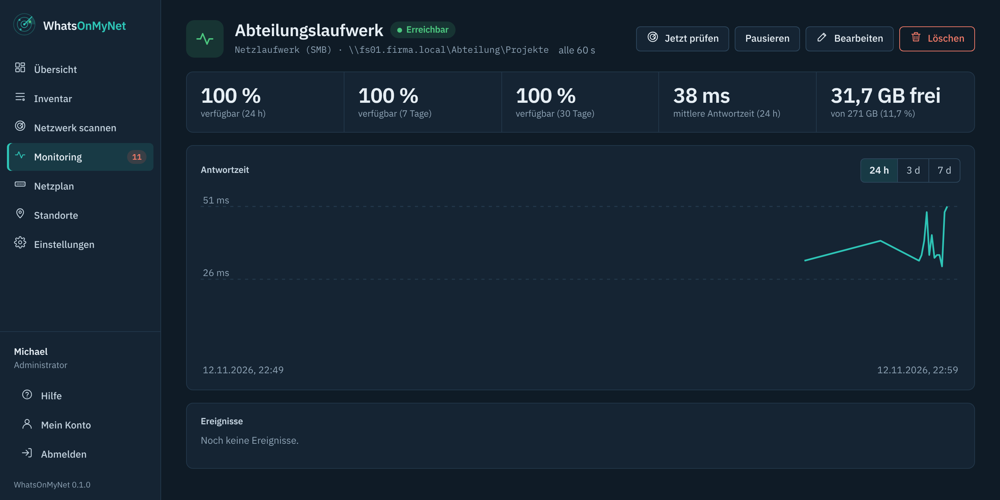

Der Typ **Netzlaufwerk (SMB)** meldet sich wirklich an einer Freigabe an - nicht nur am offenen Port. So fällt auch auf, wenn das Passwort abgelaufen ist, die Rechte nicht mehr stimmen oder ein Ordner fehlt.

1. Ein eigenes Konto nur mit **Leserecht** auf die Freigabe anlegen (im AD z. B. `FIRMA\monitor`, auf dem NAS ein lokaler Benutzer).
2. *Monitor anlegen* → Art **Netzlaufwerk (SMB)**. Einfach den Pfad einfügen, z. B. `\\fs01\Abteilung\Projekte` - Server, Freigabe und Ordner werden daraus übernommen.
3. Benutzer, Domäne (bei NAS-Konten leer) und Passwort eintragen. Optional: warnen unter … % oder … GB frei.

Geprüft wird über SMB 2/3: anmelden, die Freigabe (oder den Ordner bzw. die Datei) lesen, den freien Platz abfragen. WhatsOnMyNet schreibt nichts auf die Freigabe. Die Detailseite zeigt den freien Platz; im Bericht gibt es dafür den Abschnitt *Netzlaufwerke*.

## Proxmox VE und Backup Server

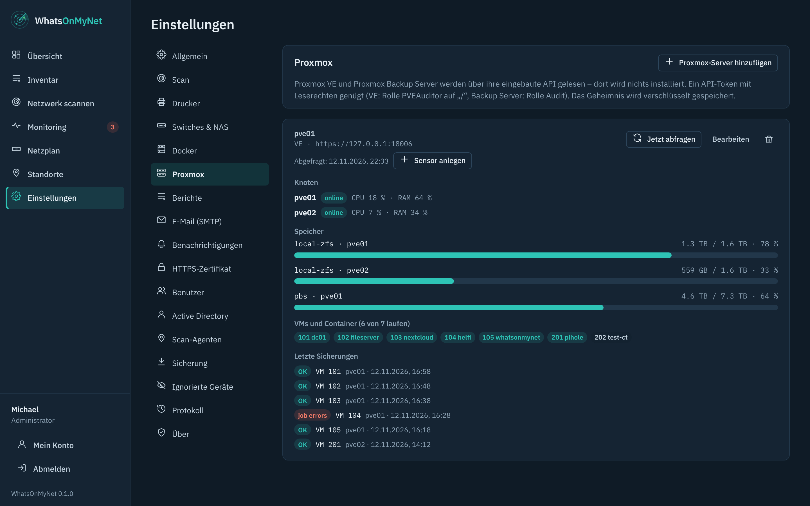

WhatsOnMyNet liest Proxmox VE und den Proxmox Backup Server über deren eingebaute Schnittstelle (API). Auf Proxmox wird nichts installiert. WhatsOnMyNet bekommt dort einen eigenen Benutzer, der **nur lesen** darf, und einen Schlüssel dafür (API-Token). Der Dialog *Überwachung → Virtualisierung → Host hinzufügen → Proxmox VE* zeigt dieselben Schritte, mit Knopf zum Kopieren.

**Cluster:** Einen Knoten einzutragen genügt. WhatsOnMyNet fragt den Cluster, welche Knoten es gibt, unter welcher Adresse sie erreichbar sind und welches Zertifikat sie haben (alle 6 Stunden neu). Antwortet der eingetragene Knoten nicht, wird der nächste Knoten gefragt - mit demselben Token (er gilt im ganzen Cluster) und erst nachdem dessen Zertifikat geprüft ist. Die Seite Virtualisierung zeigt dann „über Knoten pve2 gelesen“. Der Proxmox Backup Server kennt keinen Cluster: jeder wird einzeln eingetragen.

**Temperaturen der Knoten:** Die Proxmox-Schnittstelle kennt keine Temperaturen. Läuft auf einem Knoten zusätzlich das Linux-Skript (siehe *Windows- und Linux-Rechner per Skript*), steht seine höchste Temperatur auf der Seite Virtualisierung am Knoten. Ein Sensor dafür: am Proxmox-Host oder am Gerät **Sensor anlegen** → *Temperatur: die höchste aller Fühler* (Alarm ab der Warnschwelle des Chips, änderbar); einzelne Fühler (CPU, NVMe …) stehen in derselben Liste unter „Knoten pve1“. Zugeordnet wird über den Namen: Knoten `pve1` ↔ Rechner `pve1` bzw. `pve1.firma.local`.

### Schritt 1: Proxmox vorbereiten (einmalig)

**Mit Befehlen (empfohlen) - Proxmox VE**

1. In Proxmox links auf einen Knoten klicken und oben **>_ Shell** öffnen. Ein Knoten genügt - im Cluster gilt es für alle.
2. Diese drei Zeilen kopieren, in die Shell einfügen und Enter drücken:

```
pveum user add whatsonmynet@pve --comment "WhatsOnMyNet (read only)"
pveum acl modify / --users whatsonmynet@pve --roles PVEAuditor
pveum user token add whatsonmynet@pve womn --privsep 0
```

3. Die Ausgabe zeigt eine Tabelle. In der Zeile `value` steht das **Geheimnis** (eine lange Zeichenkette mit Bindestrichen). Kopieren und aufheben - Proxmox zeigt es nur dieses eine Mal.

**Mit Befehlen - Proxmox Backup Server**

1. Im Backup Server links *Administration → Shell* öffnen.
2. Diese vier Zeilen einfügen und Enter drücken:

```
proxmox-backup-manager user create whatsonmynet@pbs --comment "WhatsOnMyNet (read only)"
proxmox-backup-manager acl update / Audit --auth-id whatsonmynet@pbs
proxmox-backup-manager user generate-token whatsonmynet@pbs womn
proxmox-backup-manager acl update / Audit --auth-id 'whatsonmynet@pbs!womn'
```

3. Nach dem dritten Befehl steht bei `"value"` das **Geheimnis**. Kopieren - es wird nur einmal angezeigt.

**Per Mausklick - Proxmox VE**

1. *Rechenzentrum → Berechtigungen → Benutzer* → *Hinzufügen*: Benutzername `whatsonmynet`, Realm *Proxmox VE authentication server*, irgendein Passwort → *Hinzufügen*.
2. *Rechenzentrum → Berechtigungen* → *Hinzufügen* → *Benutzer-Berechtigung*: Pfad `/`, Benutzer `whatsonmynet@pve`, Rolle `PVEAuditor` → *Hinzufügen*.
3. *Rechenzentrum → Berechtigungen → API Tokens* → *Hinzufügen*: Benutzer `whatsonmynet@pve`, Token ID **nur** `womn` (ohne @ und !), den Haken bei *Privilege Separation* **entfernen** → *Hinzufügen*.
4. Proxmox zeigt jetzt das *Secret* - nur dieses eine Mal. Kopieren und aufheben.

Beim Backup Server geht es genauso unter *Konfiguration → Zugriffskontrolle*: Benutzer `whatsonmynet` (Realm *Proxmox Backup authentication server*), Reiter *API Token* mit Token Name `womn`, dann unter *Berechtigungen* zweimal die Rolle `Audit` auf den Pfad `/` - einmal für den Benutzer `whatsonmynet@pbs`, einmal für den Token `whatsonmynet@pbs!womn`.

### Schritt 2: In WhatsOnMyNet eintragen

1. *Überwachung → Virtualisierung* → **Host hinzufügen** → *Proxmox VE* bzw. *Proxmox Backup Server*.
2. Einen Namen vergeben.
3. **Adresse** so eintragen, wie du Proxmox im Browser öffnest, z. B. `https://192.168.1.10:8006` (Backup Server: Port `8007`).
4. **Zertifikat abrufen** klicken. WhatsOnMyNet zeigt den Fingerabdruck des Proxmox-Zertifikats. Vergleiche ihn - Proxmox VE: Knoten anklicken → *System → Zertifikate* → Zeile `pve-ssl.pem`; Backup Server: *Dashboard* → *Fingerabdruck anzeigen*. Stimmt er, **Fingerabdruck stimmt - vertrauen**.
5. Die **Token-ID** ist schon ausgefüllt (`whatsonmynet@pve!womn` bzw. `whatsonmynet@pbs!womn`). Bei **Token-Geheimnis** das kopierte Geheimnis einfügen.
6. **Speichern und verbinden.** Nach wenigen Sekunden erscheinen Knoten, Speicher, VMs und Container sowie die Sicherungen.

### Sensoren anlegen

In der Detailansicht **Sensor anlegen** - z. B. „VM 101 läuft“, „Speicher local-lvm unter 85 %“ oder „letzte Sicherung älter als 26 Stunden“. Jeder Sensor ist ein Monitor mit Verlauf und Benachrichtigung.

### Wenn etwas nicht klappt

- **„tokenid: value does not match the regex pattern“ in Proxmox**: Beim Anlegen des Tokens nur `womn` eintragen - ohne Benutzer, @ und !.
- **„sign-in refused (401)“**: Token-ID oder Geheimnis stimmen nicht. Token in Proxmox löschen, neu anlegen und das neue Geheimnis eintragen.
- **Hinweis „Dem Token fehlen Leserechte“**: Meist blieb beim Token *Privilege Separation* angehakt. Der Hinweis zeigt zwei Befehle - in der Proxmox-Shell einfügen, Enter, dann **Jetzt abfragen**.
- **„certificate changed“**: Proxmox hat ein neues Zertifikat bekommen. *Bearbeiten* → **Zertifikat abrufen** → bestätigen.

### Viele Hosts im Blick

Ab zwei Hosts zeigt die Seite *Virtualisierung* (ebenso *Netzwerk-Controller* und *Server-Hardware*) oben die Lage in Zahlen: Hosts mit Problemen, Knoten online, laufende VMs, volle Speicher, Sicherungsprobleme. Darunter steht **eine Zeile je Host** mit den wichtigsten Werten und dem, was nicht stimmt. Hosts mit Problemen stehen oben. Ein Klick auf die Zeile klappt die Details auf (das merkt sich der Browser bis zum Schließen des Tabs).

Die **Suche** findet Hosts, Knoten, VMs (Name oder ID), Datastores und Sicherungsgruppen. Die Knöpfe filtern nach *Probleme* oder nach Art (Proxmox VE, Backup Server …).

## Weitere Hypervisoren: VMware, XCP-ng, Hyper-V, Nutanix, oVirt, KVM

Unter *Überwachung → Virtualisierung → Host hinzufügen* stehen neben Proxmox weitere Hypervisoren zur Wahl. Alle erscheinen gleich: Hosts mit CPU und RAM, Speicher, VMs - und aus allem lassen sich Sensoren anlegen („Host online“, „CPU esx01“, „Speicher vsan“, „VM dc01 läuft“). Gelesen wird nur.

**Über die Schnittstelle abgefragt** - ein Konto, das nur lesen darf, genügt; Adresse eintragen, **Zertifikat abrufen**, Fingerabdruck vergleichen, Konto eintragen:

| Hypervisor | Konto mit Leserechten | Adresse |
|---|---|---|
| **VMware ESXi / vCenter** | Benutzer mit Rolle *Nur Lesen* (Read-only), oben in der Bestandsliste vergeben, „an untergeordnete Objekte weitergeben“ | vCenter oder ESXi, z. B. `https://vcenter.firma.local` |
| **XCP-ng / XenServer** | mit AD: Rolle *read-only*; ohne AD gibt es nur `root` | Pool-Master, z. B. `https://xcp01.firma.local` |
| **Nutanix AHV** | Prism-Benutzer mit Rolle *Viewer* | Prism mit Port, z. B. `https://prism.firma.local:9440` |
| **oVirt / RHV / OLVM** | `whatsonmynet@internal` mit Rolle *ReadOnlyAdmin* (Befehle stehen im Dialog) | Engine, z. B. `https://engine.firma.local` |

**Hyper-V und KVM/libvirt melden sich selbst.** Beide haben keine Schnittstelle zum Abfragen. Stattdessen schickt ein kleines Skript auf dem Host alle 5 Minuten Auslastung, Laufwerke bzw. Speicherpools und VMs. Es liest nur und braucht keinen offenen Port auf dem Host.

1. *Host hinzufügen* → **Microsoft Hyper-V** bzw. **KVM / libvirt**, Namen vergeben, speichern.
2. Der Dialog zeigt das Skript mit einem eigenen Schlüssel (nur dieses eine Mal) - **Skript herunterladen**.
3. Einmal ausführen, es richtet sich selbst ein. **Hyper-V** als Administrator: `powershell.exe -NoProfile -ExecutionPolicy Bypass -File .\womn-hyperv.ps1` (geplante Aufgabe *WhatsOnMyNet-HyperV*, alle 5 Minuten als SYSTEM). Im Cluster auf jedem Knoten - alle Knoten landen im selben Eintrag.
   **KVM:** `sh womn-libvirt.sh` als root oder als Benutzer der Gruppe `libvirt` (cron-Eintrag, alle 5 Minuten) - sonst darf `virsh` die VMs des Systems nicht sehen. Nötig sind `virsh`, `awk` und `curl`; gelesen wird mit `virsh -r`.
   Wieder entfernen: das **Deinstallationsskript** aus dem Dialog bzw. *Einstellungen → Rechner-Skripte* - es entfernt auch die Einrichtung von Version 0.6.0.
4. Nach ein paar Sekunden erscheint der Host. Meldet er sich länger als 15 Minuten nicht, gilt er als offline - ein Sensor „Host online“ schlägt dann Alarm.

Ist der Schlüssel weg oder soll er erneuert werden: **Neues Skript** - das alte hört dann auf zu funktionieren.

Mit dem selbstsignierten Zertifikat von WhatsOnMyNet vertraut das Skript genau dessen Schlüssel (fest hinterlegt); mit einem Zertifikat einer echten CA wird ganz normal geprüft. Erneuert WhatsOnMyNet sein Zertifikat (30 Tage vor Ablauf, nach einer neuen IP-Adresse oder `WOMN_BASE_URL`), bleibt der Schlüssel gleich und die Skripte melden weiter. Ausnahme: Windows-Skripte aus Versionen bis 0.10.1 kennen nur das Zertifikat selbst - sie einmal neu erzeugen. Scan-Agenten mit `WOMN_AGENT_CA` brauchen nach einer Erneuerung den neuen Wert aus *Einstellungen → Scan-Agenten*.

## Netzwerk-Controller: UniFi, Omada, MikroTik

Unter *Überwachung → Netzwerk-Controller → Controller hinzufügen* liest WhatsOnMyNet die verbreiteten Netzwerk-Systeme - mit einem Konto, das **nur lesen** darf; Adresse eintragen, **Zertifikat abrufen**, Fingerabdruck vergleichen, Konto eintragen. Der Dialog zeigt die Schritte für das jeweilige System.

| System | Konto | Adresse |
|---|---|---|
| **UniFi Network** - UniFi-OS-Konsolen (UDM, UCG, Cloud Key Gen2+) oder die installierte Network-App | lokales Konto (ohne Zwei-Faktor) mit Rolle *Nur anzeigen*/*Site Viewer* | Konsole, bzw. `https://server:8443` |
| **TP-Link Omada** - Software-Controller, OC200/OC300 | Konto mit Rolle *Viewer* | meist `https://server:8043` |
| **MikroTik RouterOS 7** - jeder Router/Switch einzeln | Benutzer in einer Gruppe mit `read,api,rest-api` | Router mit Dienst *www-ssl* |

Die Seite zeigt je Controller alle Access Points, Switches und Gateways mit Modell, IP, Firmware (samt „Update“, wenn eine neue bereitsteht), Clients und Zustand.

**Abgleich mit dem Inventar:** Jedes Gerät, das per MAC-Adresse im Inventar steht, bekommt Modell, Seriennummer, Firmware, Hersteller und den richtigen **Typ** vom Controller - nach denselben Regeln wie bei SNMP (leere oder noch vom Gerät stammende Angaben werden gefüllt bzw. aktuell gehalten, eigene abweichende Eingaben bleiben, ein Tausch wird erkannt). Geräte, die noch nicht im Inventar sind, tragen den Hinweis *nicht im Inventar* - per Scan übernehmen.

**Sensoren:** „AP Flur online“, „Clients an AP Flur“, „CPU …“, „RAM …“, „Clients gesamt“ und „Geräte mit Firmware-Update“.

Auch der **Scan** erkennt diese Geräte jetzt besser an ihren Modellnamen: UniFi (USW = Switch, UAP/U6/U7 = Access Point, UDM/UCG/USG = Gateway, Network-App = Server), Omada (EAP = Access Point, ER = Gateway, OC200/OC300 = Controller), MikroTik (CRS = Switch, cAP/wAP = Access Point) und Aruba Instant On.

## Server-Hardware: iDRAC, iLO, XClarity, Supermicro (Redfish)

Lüfter, Netzteile, Temperaturen, RAID-Controller und die Laufwerke dahinter kennt das Betriebssystem meist nicht. Der Management-Chip des Servers kennt sie, und zwar auch, wenn der Server ausgeschaltet ist. Alle aktuellen Chips sprechen den Standard **Redfish**: Dell iDRAC, HPE iLO, Lenovo XClarity Controller, Supermicro, Fujitsu iRMC, Cisco CIMC.

1. Im Management-Chip ein eigenes Konto anlegen, das **nur lesen** darf: iDRAC Rolle *Read Only*, iLO nur das Recht *Login*, XClarity Rolle *ReadOnly*, Supermicro Rolle *User*.
2. *Überwachung → Server-Hardware* → **Management-Chip anbinden**: die Adresse des Chips (nicht die des Servers), **Zertifikat abrufen** und den Fingerabdruck bestätigen, Benutzer und Passwort.

Angezeigt werden:
- Gesamtzustand und Stromzustand, Verbrauch
- Modell, Seriennummer (bei Dell die Service-Tag-Nummer), BIOS, Prozessoren, Arbeitsspeicher, Firmware des Chips
- Lüfter, Temperaturen mit Warnschwelle, Netzteile
- RAID-Controller, Volumes und Laufwerke, mit Restlebensdauer und vorhergesagtem Ausfall

Was nicht in Ordnung ist, steht oben. WhatsOnMyNet ordnet den Server über die MAC-Adressen seiner Netzwerkkarten oder die Seriennummer **seinem Gerät im Inventar** zu. Auf dessen Seite erscheint dann der Bereich *Server-Hardware*, und Hersteller, Modell und Seriennummer werden übernommen.

Sensoren (*Sensor anlegen*): Gesamtzustand, Server eingeschaltet, jeder Lüfter, jede Temperatur, jedes Netzteil, jedes Laufwerk (auch Restlebensdauer), jedes Volume, Stromverbrauch. Abgefragt wird wie bei Proxmox alle 5 Minuten, nur lesend.

## Windows- und Linux-Rechner per Skript (ohne Agent)

Server und PCs lassen sich ohne Agent überwachen: Ein kleines Skript auf dem Rechner meldet alle 5 Minuten **CPU, RAM, Laufwerke, Laufzeit und Dienste**, dazu eine angeschlossene **USV** (siehe oben).

Dazu kommt, was ein Administrator von einem Server wissen will. Alles steht auf der Geräteseite im Bereich *System*, aus allem lassen sich Sensoren mit Alarm anlegen:

- **Updates und Schutz:** ausstehende Updates (davon wichtige/Sicherheit), ob ein Neustart ansteht, Virenschutz (Defender oder ein anderes im Sicherheitscenter eingetragenes Produkt: aktiv, Signaturen aktuell) und Firewall (Windows: Domäne/Privat/Öffentlich, Linux: ufw oder firewalld). Die Update-Suche läuft nur alle 6 Stunden und nach der Meldung, damit die 5-Minuten-Meldung schnell bleibt. Sie sucht nur und installiert nie etwas.
- **Festplatten:** Modell, Seriennummer, Zustand, Temperatur, Verschleiß und Betriebsstunden. Unter Linux braucht das `smartctl` und root, sonst gibt es nur Modell, Seriennummer und Größe.
- **Ereignisse:** kritische Einträge und Fehler der letzten 24 Stunden (Windows: System-Protokoll, Linux: Journal), die neuesten zehn mit Text.
- **Zertifikate** des Rechners (Windows, Speicher „Eigene Zertifikate“ des Computers), mit Tagen bis zum Ablauf.
- **Hardware:** Hersteller, Modell, Seriennummer, BIOS, Prozessoren, Speichermodule und Netzwerkkarten. Hersteller, Modell und Seriennummer kommen dabei auch ins Inventar. Unter Linux gibt es Seriennummer und Speichermodule nur als root (`dmidecode`).
- **Temperaturen (Linux):** CPU, NVMe, Chipsatz und - je nach Hauptplatine - weitere Fühler, direkt aus dem Kernel (`/sys/class/hwmon`, dieselbe Quelle wie `sensors`). Installiert werden muss nichts, auch nicht lm-sensors, und root ist nicht nötig. Als Warnschwelle gilt, was der Chip selbst angibt, sonst 80 °C. Sensoren: *Temperatur* (ein Fühler) oder *Temperatur: die höchste* (alle zusammen, Alarm ab 85 °C). Fehlt ein Fühler der Hauptplatine, lädt der Kernel dessen Treiber nicht von selbst - `sensors-detect` aus lm-sensors findet ihn und trägt ihn in `/etc/modules` ein.

Lüfter, Netzteile, weitere Temperaturen und RAID-Controller kennt das Betriebssystem meist nicht. Die liefert der Management-Chip des Servers (siehe *Server-Hardware* oben).

Das Skript installiert nichts, lädt nichts nach, öffnet keinen Port und braucht kein Konto - es sendet nur an WhatsOnMyNet. (Unter Windows fragt die Update-Suche, wie Windows selbst, den WSUS-Server bzw. Windows Update.) Unter Windows ist es ein PowerShell-Skript (läuft als SYSTEM), unter Linux ein POSIX-sh-Skript (braucht `sh`, `awk` und `curl`, root ist nicht nötig).

**Ein einzelner Rechner:** *Monitoring* → **Monitor anlegen** → **Rechner per Skript (Windows/Linux)** → Rechner wählen. Auf der Geräteseite geht es genauso über **Überwachen** (Art der Prüfung *Rechner per Skript*) oder *Mehr* → **Per Skript überwachen**. Dann Windows oder Linux → **Skript erzeugen**.

1. **Skript herunterladen** (es enthält Adresse und Schlüssel - nur dieses eine Mal angezeigt).
2. Einmal ausführen - es richtet sich selbst ein:
   - **Windows** als Administrator: `powershell.exe -NoProfile -ExecutionPolicy Bypass -File .\womn-host.ps1` - es legt sich nach `C:\ProgramData\WhatsOnMyNet` (nur für SYSTEM und Administratoren lesbar) und legt die geplante Aufgabe *WhatsOnMyNet-Host* an.
   - **Linux**: `sh womn-host.sh` - als root nach `/usr/local/sbin` mit `/etc/cron.d/whatsonmynet-host`, sonst nach `~/.local/bin` mit einem Eintrag in der eigenen crontab.
3. Nach ein paar Sekunden zeigt die Geräteseite den Bereich **System**. Mit **Sensor anlegen** werden daraus Monitore mit Alarm: „Rechner meldet sich“, „CPU-Auslastung“, „Arbeitsspeicher“, „Laufwerk C:“, „Gestörte Dienste“ oder „Dienst … läuft“.

**Viele Rechner auf einmal:** *Einstellungen → Rechner-Skripte* → **Gemeinsames Skript**. Dieses eine Skript verteilst du über die Softwareverteilung, ein Startskript per Gruppenrichtlinie oder Ansible. Jede Meldung wird dem passenden Gerät im Inventar zugeordnet (MAC-Adresse, Rechnername, IP). Rechner, die noch nicht im Inventar stehen, erscheinen dort unter *Unbekannte Rechner* - es wird nichts von allein angelegt.

**Gestörte Dienste:** Windows - automatisch startende Dienste, die mit einem Fehlercode beendet wurden (normal beendete Dienste mit Auslösestart zählen nicht); Linux - systemd-Dienste im Zustand *failed*.

**Neue Version des Skripts:** Bringt ein Update neue Werte mit (z. B. die USV), erzeugst du unter *Einstellungen → Rechner-Skripte* in der Zeile des vorhandenen Eintrags mit **Neues Skript** das aktuelle Skript und führst es einfach noch einmal aus bzw. verteilst es neu. Es überschreibt die alte Kopie und die geplante Aufgabe. Der alte Schlüssel ist ab dann gesperrt, also gleich verteilen.

**Wieder entfernen:** Zu jedem Skript gibt es ein **Deinstallationsskript** (im Skript-Dialog unter *Wieder entfernen* und unter *Einstellungen → Rechner-Skripte*). Es entfernt die geplante Aufgabe bzw. den cron-Eintrag und das Skript - genauso ausführen oder verteilen. Danach ist der Rechner wie vorher. Ein Skript unter *Einstellungen → Rechner-Skripte* zu löschen oder neu zu erzeugen, sperrt den alten Schlüssel.

Meldet sich ein Rechner 15 Minuten nicht, gilt er als offline - der Sensor „Rechner meldet sich“ schlägt dann Alarm.

## Berichte

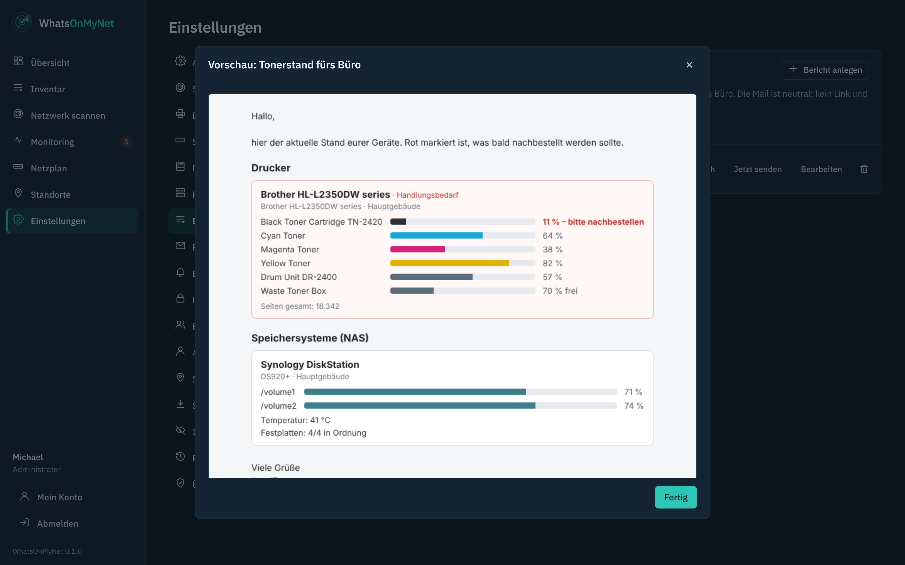

Unter *Überwachung → Berichte* gehen Berichte zu festen Zeiten per E-Mail raus - z. B. jeden Montag um 8 Uhr die Tonerstände ans Büro.

- Inhalt: Drucker, NAS, Switches, Netzlaufwerke; auf Standorte beschränkbar; wahlweise nur Geräte mit Handlungsbedarf.
- **Geräte**: alle Geräte der gewählten Inhalte - oder nur ausgewählte, z. B. ein eigener Bericht für den Drucker im Sekretariat.
- Drucker zeigen die **gedruckten Seiten** (gesamt und im Berichtszeitraum, z. B. „in den letzten 7 Tagen“) und - wenn der Drucker es meldet - wie viele Seiten der Toner noch reicht.
- Die Mail ist **neutral**: kein Link, kein Programmname - nur dein Absendername, Betreff (`{kw}`, `{datum}`), Einleitung, die Geräte und dein Gruß.
- „Vorschau“, „Test an mich“ und „Jetzt senden“ direkt in der Liste.

## Benutzer und Rechte

- **Rollen**: *Administrator* (alles), *Bearbeiter* (scannen, übernehmen, pflegen, Monitore), *Nur lesen*.
- **Standorte**: Bearbeiter und Leser lassen sich auf Standorte beschränken - sie sehen und ändern dann nur deren Geräte, Scans und Monitore.
- **Active Directory**: Anmeldung mit dem Windows-Konto, siehe nächster Abschnitt.
- **Zwei-Faktor-Anmeldung** (*Mein Konto*): QR-Code mit einer Authenticator-App scannen, Code bestätigen, Wiederherstellungscodes aufbewahren. Für Administratoren lässt sie sich unter *Einstellungen → Allgemein* verpflichtend machen.

## Anmeldung mit Active Directory

Mitarbeitende melden sich mit ihrem Windows-Konto an. Welche Rolle sie bekommen, steuern AD-Gruppen. Lokale Konten funktionieren weiter; bei gleichem Namen hat das lokale Konto Vorrang, so bleibt der lokale Admin der Notfallzugang.

### Schritt 1: Im AD vorbereiten (einmalig)

1. Ein **Dienstkonto** anlegen, z. B. `svc-womn`. Es braucht keine besonderen Rechte, ein normales Domänenkonto mit Passwort genügt.
2. Bis zu drei **Gruppen** anlegen, z. B. `WOMN-Admins`, `WOMN-Bearbeiter` und `WOMN-Lesen`, und die Mitarbeitenden hineinlegen. Gruppen in Gruppen werden berücksichtigt.

### Schritt 2: In WhatsOnMyNet eintragen

1. *Einstellungen → Active Directory*.
2. **Server**: Name des Domänencontrollers so, wie er im Zertifikat steht, z. B. `dc01.firma.local`. Verschlüsselung **LDAPS** (Port 636) oder **StartTLS** (Port 389). Ohne Verschlüsselung geht es nicht.
3. **Zertifikat**: Vertrauen auf *Abgerufenes Zertifikat* lassen und **Zertifikat vom DC abrufen** klicken. Den Fingerabdruck mit dem Zertifikat auf dem DC vergleichen (`certlm.msc` → *Eigene Zertifikate* → Zertifikat öffnen → *Details* → *Fingerabdruck*) und bestätigen. Fehlt die Stamm-CA, holt WhatsOnMyNet sie selbst (über die AIA-Adresse im Zertifikat oder nach dem Bestätigen aus dem AD).
4. **Verzeichnis**: Basis-DN leer lassen, der Test findet ihn. Dienstkonto eintragen, z. B. `svc-womn@firma.local`, dazu sein Passwort.
5. **Gruppen**: einfach die Gruppennamen eintragen, z. B. `WOMN-Admins`. Wer in mehreren Gruppen ist, bekommt die höchste Rolle; wer in keiner ist, kommt nicht herein.
6. **Verbindung testen**, am besten mit dem eigenen Benutzernamen. Jeder Schritt bekommt ✓ oder ✗ mit dem Grund: Verbindung, Dienstkonto, Basis-DN, Gruppen, Benutzer, Rolle und auf Wunsch das Passwort.
7. Wenn alles ✓ ist: *Anmeldung über Active Directory erlauben* anhaken und **Speichern**.

### Wenn etwas nicht klappt

- **„Das Zertifikat des DC ist nicht vertrauenswürdig“**: *Zertifikat vom DC abrufen* und bestätigen.
- **„Der Name im Zertifikat passt nicht“**: Beim Domänencontroller den Namen aus dem Zertifikat eintragen (der Abruf zeigt ihn an). Nur wenn du den DC über die IP-Adresse ansprichst: *Servernamen im Zertifikat prüfen* abschalten.
- **„Dienstkonto: Anmeldung abgelehnt“**: Name oder Passwort des Dienstkontos falsch, oder das Konto ist gesperrt.
- **„Gruppe nicht gefunden“**: Schreibweise der Gruppe im AD prüfen.
- **„Keine Rolle“**: Der Benutzer ist in keiner der eingetragenen Gruppen.

## Scan-Agent für Außenstellen

Für eine Außenstelle läuft dort ein zweiter Container als Scan-Agent. Unter *Einstellungen → Scan-Agenten* einen Agenten für den Standort anlegen; die angezeigte `.env` neben die `docker-compose.agent.yml` aus dem Release legen und `docker compose -f docker-compose.agent.yml up -d` starten. Der Agent öffnet keinen Port, holt sich Aufträge über HTTPS und meldet nur Adressen seines Standorts.

## Sicherung und Updates

- Jede Nacht sichert WhatsOnMyNet die Datenbank nach `data/backups/`; vor jedem Update der Datenbank zusätzlich.
- *Einstellungen → Sicherung*: Sicherung herunterladen, jetzt sichern, Sicherung einspielen (der aktuelle Stand wird vorher gesichert, dann startet das Programm neu).
- **Bewahre `data/secret.key` (bzw. `WOMN_SECRET`) mit auf** - ohne ihn sind gespeicherte Passwörter in einer Sicherung unlesbar.
- Updates: in Dockhand/Watchtower oder `docker compose pull && docker compose up -d`. Einmal im Monat erscheint ein Sicherheits-Update mit neuen Paketen.

**Was ist neu?** Ein Klick auf die Versionsnummer unten links im Menü zeigt *Über WhatsOnMyNet*: die Änderungen der letzten Versionen, den Link zum Quellcode, die Website und einen Kaffee-Link. Den Kaffee-Link gibt es auch direkt unten im Menü. Das geht für alle Benutzer, nicht nur für Administratoren.

## Fehlerbehebung

- **Oberfläche nicht erreichbar**: Firewall des Hosts für den HTTPS-Port öffnen. Mit Host-Netzwerk zeigt Docker/Dockhand keine Port-Zuordnung - das ist richtig so.
- **Keine Drucker-/Switch-Daten**: SNMP am Gerät einschalten, Community unter *Einstellungen → Scan* prüfen, auf der Geräteseite „Jetzt abfragen“.
- **Ausgesperrt**: `docker compose exec whatsonmynet womn-admin reset <benutzer>` setzt ein neues Passwort, macht das Konto wieder zum Administrator und schaltet die Zwei-Faktor-Anmeldung aus. `womn-admin create <benutzer>` legt einen neuen Administrator an.
- **Netzlaufwerk meldet „protocol not supported“**: Das Gerät kann nur das alte SMB1 - das wird aus Sicherheitsgründen nicht verwendet. SMB2/3 am Gerät einschalten (bei Synology: *Dateidienste → SMB → Erweitert*).
- **Protokoll**: *Einstellungen → Protokoll* zeigt, wer was geändert hat; technische Meldungen stehen im Container-Log.
