# WhatsOnMyNet - Manual

WhatsOnMyNet finds what runs on your network and keeps only what you adopt in the inventory. It also monitors devices, services and websites, reads printers, switches, NAS and hypervisors (Proxmox, VMware, Hyper-V …), and reports by e-mail, messenger, push to the phone or webhook when something is wrong.

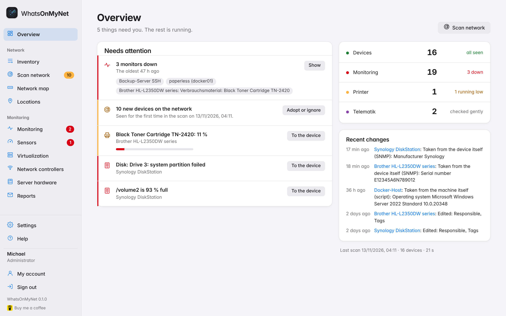

## Installation

WhatsOnMyNet runs as a Docker container with host networking - only this way the scan sees the MAC addresses of the devices.

1. Put `docker-compose.yml` and `env.example` from the release into a folder, rename `env.example` to `.env`.
2. Adjust ports (`WOMN_HTTPS_PORT`, default 8743), time zone (`TZ`) and owner of the data (`PUID`/`PGID`) in `.env` if needed.
3. `docker compose up -d` - or create the stack in Dockhand.
4. Get the **setup code** from the log (`docker compose logs whatsonmynet`) and open `https://<server>:8743/setup`. There you create the first administrator.

The interface always runs over HTTPS. On first start WhatsOnMyNet creates a self-signed certificate; upload your own (PEM or PFX) under *Settings → HTTPS certificate*.

**Ping:** the container runs without root rights. Ping works if the host allows ICMP for normal users (`net.ipv4.ping_group_range`, default on Debian/Ubuntu/Proxmox). Without ping the scan still finds devices via ARP and TCP.

**Allow ping in a Proxmox LXC** (it is usually off there - `cat /proc/sys/net/ipv4/ping_group_range` shows `1 0`). Inside the LXC as root, not on the Proxmox host:

```sh
echo 'net.ipv4.ping_group_range = 0 65535' > /etc/sysctl.d/99-ping.conf
sysctl -p /etc/sysctl.d/99-ping.conf
docker compose restart
```

The setting survives a restart and needs no extra rights for the container. Higher than `65535` does not work in an unprivileged LXC ("Invalid argument"). It cannot go into `docker-compose.yml`: Docker does not allow `sysctls` in the host network.

## First steps

1. **Add a location** (*Locations*): name and subnets, e.g. "Main building" with `192.168.10.0/24`.
2. **Scan the network** (*Scan network*): tick the location, "Start scan". The radar shows the devices found; the scan is gentle (ARP, 26 typical ports, SNMP read-only).
3. **Adopt**: in the result under "New" check type and name, tick devices, "Adopt into inventory". What you do not want in the inventory, "Ignore". Ignored by mistake? Tick it in the "Ignored" tab and choose "Stop ignoring" (it is listed under "New" again) or "Adopt into inventory" right away. The full list is under *Settings → Ignored devices*. Adopt and ignore work only from the newest scan of a subnet - once a newer scan has covered the subnet, an older scan stays readable, adopting or ignoring happens in the newer one. "Stop ignoring" works in the older scan too.

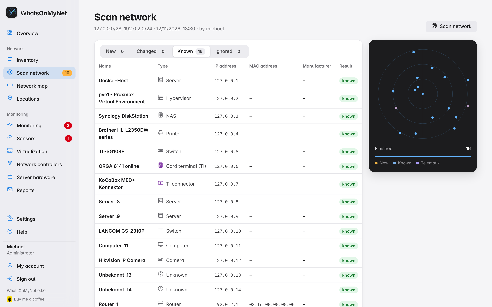

The MAC address is the identity of a device: if it gets a new IP, the next scan takes it over automatically and records it in the history. A host name you typed by hand stays; the scan only fills the host name while the field is empty or the name came from the scan. If you empty the field, the scan fills it again.

**In the inventory already?** When the scan finds a device that is probably in the inventory already - same host name (e.g. the second network card of a NAS) or same IP with another MAC (VM, exchanged device) -, the list shows a tip with the existing device. Adopting skips it. "Assign to this device" takes over the new MAC for the same IP, or puts the second network card on the ignore list with a note; "Add as new device anyway" adds it after all. When devices are in the inventory twice already (same host name), the inventory shows a note with "Merge" at the top.

**Nothing watched twice:** WhatsOnMyNet does not create a second monitor or sensor for something watched already - it names the existing one. Host name and IP of the same device count as the same target; several services of one server (web interface, SSH, database …) are of course fine. Windows and Linux machines without script show the tip "Monitor with script" on the device page.

## Inventory

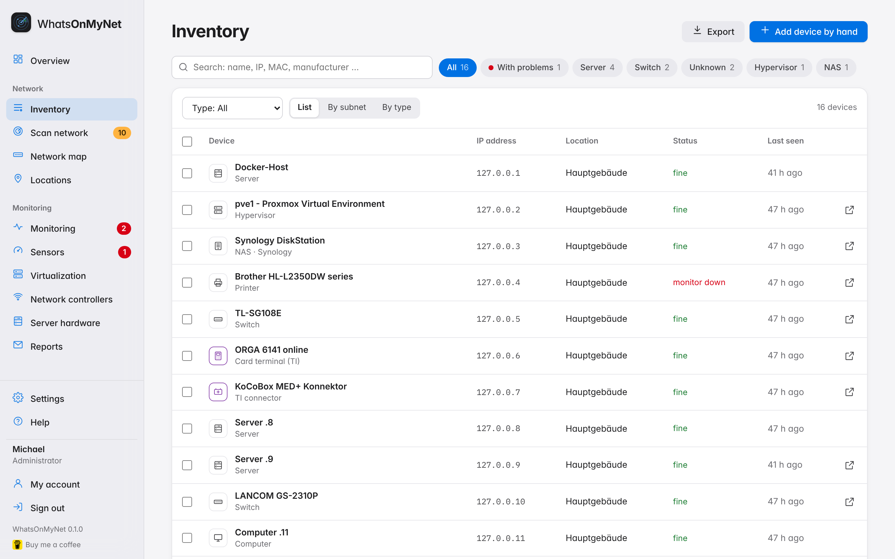

- **Search and filter** by name, IP, MAC, manufacturer, type, location or tag; export as CSV or JSON.
- **Device page**: all details, purchase and warranty dates, notes, quick access to the web interface, what the scan detected, history of all changes.
- **Suggestions while typing**: manufacturer, model, operating system, owner, supplier and tags suggest what is already in the inventory. A known model fills in manufacturer and type.
- **Multiple selection**: tick devices and edit them together (type, location, manufacturer, model, dates, tags) or delete them.
- **Deep check**: checks one device with a longer port list. Telematik devices (connector, card terminal) are always checked gently. For a device not yet recognised, the deep check first asks port 4742 (SICCT) alone - if a card terminal answers, the gentle profile stays.

## Nightly light scan

**WhatsOnMyNet scans nothing on its own:** on a new installation the nightly scan is off. The page *Scan network* says so and offers administrators **Switch the nightly scan on** (it is written to the log); installations from before 0.42 keep their setting. Switched on, every night (default 02:30) WhatsOnMyNet only looks for devices in all subnets of your locations: ARP, NetBIOS and - if allowed - ping; in routed subnets also a few TCP connection attempts (ports 443, 80, 22, 445, 3389) and the ARP table of the routers via SNMP. No port check of the devices, no web requests. Known devices get their new IP; a device showing up for the very first time is reported once. Settings, time and "Run now" are under *Settings → Scan*.

## Monitoring

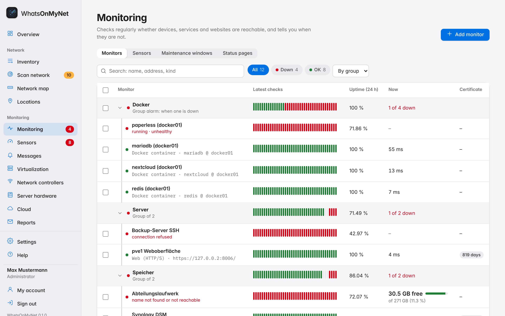

**Watched right away:** when you adopt devices from the scan into the inventory (or add one by hand), each gets a monitor at once: its web interface, else ping or an open port. As soon as the device delivers values, a few important sensors follow:

- **Printer:** every toner cartridge and faults
- **NAS:** volumes, RAID, health (system, fans, power supply) and temperature
- **UPS:** mains/battery, charge and runtime
- **Windows and Linux machines with the script:** online, CPU, RAM, system drive, highest temperature, failed services and the state of the storage pools (ZFS, RAID, Storage Spaces)
- **Hosts under Virtualization:** nodes, storage and backups; for Backup Server datastores and tasks; for controllers the devices; for servers with a management chip the health

This applies to devices and hosts added from now on, and once each: if you delete one of these sensors, it does not come back. Switch it off under *Settings → Notifications → Watch new devices by themselves*.

A monitor checks regularly (20 seconds to 24 hours) and reports only after several failures in a row. Kinds:

- **Web (HTTP/S)** with status codes, keyword and certificate expiry (warning e.g. 30, 14 and 7 days before)
- **TCP port** and **ping**
- **Docker container** (through a socket proxy, *Settings → Docker*): running, restarting all the time, health check "unhealthy"
- **Databases**: MariaDB/MySQL, PostgreSQL, Redis/Valkey - sign-in and one harmless query
- **Network drive (SMB)**: Windows shares and NAS - see below
- **Mail server**: SMTP, IMAP or POP3 - greeting, STARTTLS or TLS and certificate expiry; without signing in, no mail is sent
- **DNS resolution**: a name (A, AAAA, MX, TXT, SRV …) at a given DNS server, optionally with an expected answer - e.g. whether the internal DNS gives the right IP
- **LDAP / Active Directory**: reads the rootDSE without signing in (LDAPS or StartTLS) - reports when a domain controller is not synchronized; plus certificate expiry
- **Time server (NTP)**: answers, is synchronized itself, and its clock differs at most so many milliseconds from the WhatsOnMyNet server's
- **Microsoft SQL Server**: pre-login (PRELOGIN) without an account - version and encryption; named instances through the SQL Browser
- **Message (trap/syslog)**: see *Messages of the devices*
- **Sensor** (value of a device, a machine with script, a hypervisor or controller) and **SNMP value (OID)** - see below

On the device page "Monitor" creates a fitting monitor. If the IP of a device changes, its monitors follow. Exception: a monitor with a stored password (database, network share) is paused, because the password was entered for the old address and is never sent to another one unasked. It shows "Device has a new IP - please enter the password again", its notification channels get a message, and the edit dialog already has the new address filled in: saved with the password, it runs again. When the device returns to the old address, it runs on by itself. If you rename the device, its monitors and sensors take the new name too, so an alarm names it as it is called now (a monitor with a name of your own without the device name stays as it is).

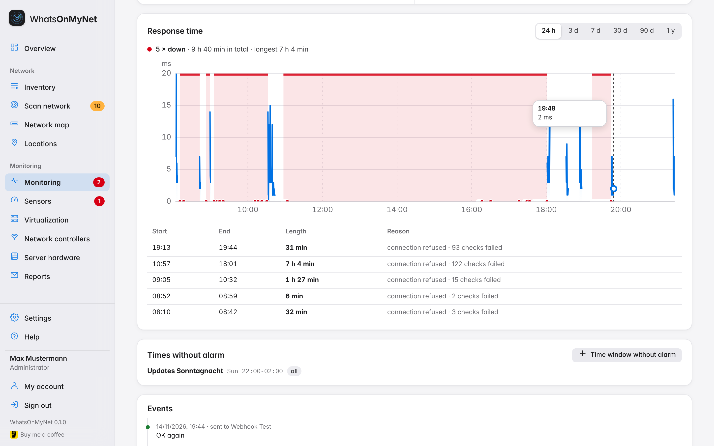

**Notifications** (*Settings → Notifications → Add channel*): choose the service, follow the short guide in the form, save and check with **Test message**. The **display name** (sender) shows above every message where it comes from - handy when several installations report to the same chat. For e-mail it is the sender's name and appears in the subject, for ntfy, Gotify, Pushover & co. it is the title, for Discord and Mattermost the name of the bot.

- **Common:** e-mail (through the SMTP server), Telegram bot, webhook with your own JSON template (e.g. for n8n or a script)
- **Chat and messengers:** Discord, Slack, Microsoft Teams (Workflows), Google Chat, Mattermost, Rocket.Chat, Matrix/Element, Signal (through signal-cli-rest-api), WhatsApp (CallMeBot, to your own number)
- **Push to the phone:** ntfy, Gotify, Pushover, Pushbullet, Home Assistant (companion app)
- **Everything else:** Apprise - a bridge to more than 100 further services (SMS, Threema …)

Tokens, keys and webhook addresses are stored encrypted and never shown again. Outages arrive with high priority on push services.

**Maintenance windows** (*Monitoring → Monitoring → Maintenance windows*): once or on certain weekdays from-to (also over midnight). A window is for the ticked monitors and sensors - the choice is grouped by device or hypervisor, with search, a tick at the device takes all of it. Nothing ticked = everything. Quicker for a single one: on the page of the monitor or sensor under *Times without alarm* → **Time window without alarm** (preset: daily 20-23 h, e.g. for the time of the backup in which an SSD gets warm). Checks and history go on in a maintenance window, only the messages are silent. The status "maintenance" is shown from the start of the window (not only after the next check) and goes with its end.

**What an alarm says:** web page, port and ping report "is down". A measured value reports "limit exceeded - 83.9 °C (≥ 80)" and later "back in the normal range", a state (service, VM, disk, container …) "fault" and "fine again", a sensor without current values "no current values".

**How it is checked:** every detail view of a monitor or sensor shows what exactly is asked (address, status code, keyword, OID, share, value of a device or hypervisor), where the values come from and how old they are (e.g. "new every 5 min · as of 2 min ago"), when it alarms - with the limit, the margin for the all-clear and the number of failed checks - and the last answer word for word. So every message can be traced back to its source.

### Changing several monitors or sensors at once

In the *Monitors* and *Sensors* lists every row has a box; the box in the table header takes all rows shown right now (search and filter apply). A bar above shows the number and the buttons **Pause**, **Resume**, **Delete** (asks first) and **Edit together**. The dialog holds the fields of *Advanced*: check every, alarm after … failed checks, time limit, repeat the alarm, escalation and - after ticking *Change channels* - the escalation and notification channels; for sensors also condition and limit. Every field starts as *unchanged*: only what you fill in changes, everything else stays as it was for each monitor. If a value is invalid (e.g. less than 20 seconds), nothing changes. Condition and limit only go to sensors with a numeric value; state sensors (online, healthy …) are skipped, the message says how many. Editors limited to locations can only select monitors of their locations.

### Escalation

When an outage lasts too long, someone else should know as well, e.g. the management or a second on-call team. That is what **escalation** is for.

- **For all monitors:** *Settings → Notifications → Escalation*. There you choose after how many minutes still down (15 min to 8 h) it escalates, and to which channels. You add those channels beforehand as usual, e.g. an extra e-mail or a second Telegram chat.
- **Per monitor:** in the form under *Advanced → Escalation* you set another time, switch it off (*never escalate*) or choose own channels. Without an own choice the settings for all apply.
- The escalation arrives **once per outage**, with high priority: "🚨 Escalation: Firewall has been down for 30 min". When the outage is solved, the all-clear also goes to the escalation channels.
- Follow-up outages (see dependencies) and maintenance windows do not escalate. The history of the monitor shows *Escalated* with the channels that were reached.

### History over months

On the page of a monitor you choose the range: **24 h, 3 d, 7 d** show every single check, **30 d, 90 d, 1 y** the summary.

- **Line:** the average, per 6 hours for 30 days, otherwise per day. Depending on the monitor this is the response time or the measured value, such as CPU or how full a drive is.
- **Area:** the range from the lowest to the highest value.
- **Strip below:** shows the availability. Green means always up or fine, yellow briefly down, red down for longer. Pointing the mouse at a section shows the date, percentage and values.

**Outages in the chart:** above the chart you see how often the monitor was down in the chosen range, for how long in total and the longest (for sensors: how often there was an alarm). Every outage has a red background, from the first failed check to the next good one. Below the chart the outages are listed with start, end, length and reason, for sensors with the highest (or lowest) value during the alarm. Pointing at a row highlights the outage in the chart; clicking into an outage in the chart takes you to its row.

**Point instead of search:** moving the mouse over the chart (on a phone: tap) shows a line at that spot and a box with time and value, the reason of a failed check, and within an outage its period. For sensors a dashed red line shows the alarm limit.

Single checks are kept for 7 days, the hourly summary for a good year. For the first months after the update to 0.9: older hours only know the average, so the area appears only for new data.

### Groups

Monitors and sensors can be put in **groups**, e.g. "Websites", "Telephony", "Storage" (form → *Group*; the ones in use are offered). Without a group of its own, the **location of the device** counts as group, else *No group*. Several at once: tick them in the list → *Change* → *Group* (or *Take out of the group*).

- **View "By group"** (choice above the list, the browser remembers it): one block per group with a summary ("2 of 6 down"). Groups with something down come first and are always open, the others can be folded. The search finds group names too.
- **One alarm for the whole group:** *Add monitor* → *Group*. It is down when **one** member is down – or only when **all** are (e.g. two redundant internet lines). Members down or unreachable count; paused ones, ones in a maintenance window and ones not checked yet do not. It has channels, escalation and maintenance windows of its own like every monitor. Tip: set channels only on the group monitor, not on the members – then one alarm comes instead of many.
- **Maintenance windows:** monitors with a group of their own are listed there under *Group …* – one tick takes the whole group.
- A website without a device belongs somewhere this way too. If it runs on a server of its own, it can also **depend** on that server's ping (below): when the server fails, only its alarm comes.

### Dependencies: no alarm flood

When a switch fails, every device behind it is unreachable too. So that twenty messages do not arrive at once, every monitor can **depend on** another one (form → *Depends on*, e.g. the ping of the switch or the internet router).

- While the monitor in front is down, the one behind it is a **follow-up outage** (hollow red dot) and sends nothing. Only the cause is reported.
- When both fail at the same time, the one behind waits briefly for the result of the one in front instead of raising its own alarm.
- When the monitor in front is back, the ones behind are checked again right away. Whatever still fails has a problem of its own and is reported as usual.
- Chains are possible (internet router → core switch → floor switch → printer). Circles are refused.

**Automatically by switch port:** When a switch is queried by SNMP, WhatsOnMyNet knows which switch a device is plugged in at. When you **Monitor** a device, the monitor of its switch is already chosen as dependency. The page of the switch monitor also tells how many monitored devices are plugged in at it and depend on nothing yet. **Put them behind this monitor** sets them all at once.

## Messages of the devices: SNMP traps and syslog

Many devices report a problem by themselves the moment it happens: a switch reports a port down, a UPS the change to battery, a NAS a disk warning, a firewall a line failure. WhatsOnMyNet receives these messages - **SNMP traps** (v1, v2c, informs too) and **syslog** (RFC 3164 and 5424, over UDP, TCP or encrypted over TLS) - and matches them to the device in the inventory by its address.

1. *Monitoring → Messages* → **Switch on receiving**: tick SNMP traps and/or syslog. Traps are only taken with a known community (empty = the communities of the scan).
2. In the devices enter WhatsOnMyNet as the target - trap receiver or syslog server.

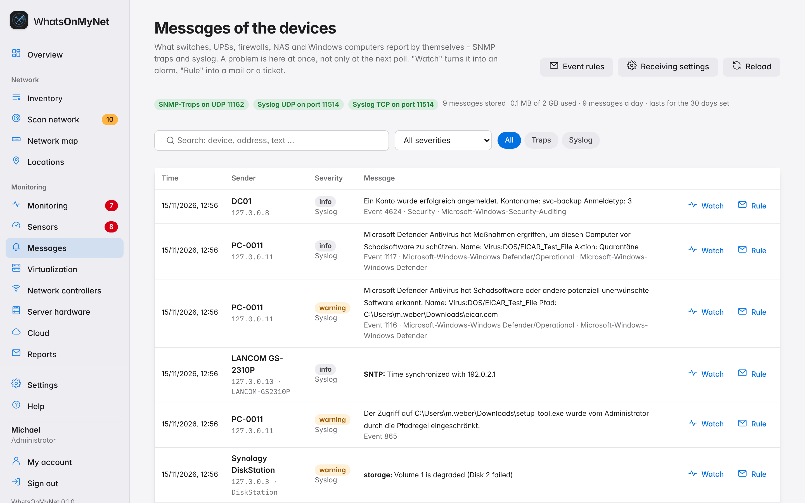

**Ports:** WhatsOnMyNet runs without root rights and therefore listens on **UDP 1162** (traps) and **UDP 1514** (syslog), not on 162/514. Either enter these ports in the devices, or redirect once on the Docker host:

```
iptables -t nat -A PREROUTING -p udp --dport 162 -j REDIRECT --to-ports 1162
iptables -t nat -A PREROUTING -p udp --dport 514 -j REDIRECT --to-ports 1514
iptables -t nat -A PREROUTING -p tcp --dport 514 -j REDIRECT --to-ports 1514
```

Other ports: `WOMN_TRAP_PORT`, `WOMN_SYSLOG_PORT` (UDP), `WOMN_SYSLOG_TCP_PORT` and `WOMN_SYSLOG_TLS_PORT` in `.env`.

**Syslog over TCP and TLS:** over UDP messages can get lost or be forged. For more reliability switch on **TCP** too (port 1514, RFC 6587 - both kinds of framing: length first or line by line) and/or **TLS** (port 6514, RFC 5425). TLS uses the certificate of this server; it can be downloaded under *Settings → Prometheus & Grafana* so the sender can check it (e.g. rsyslog: `StreamDriverAuthMode="x509/name"`). At most 10 connections per sender, 200 in all; an hour without a message ends the connection; a single message that is too long (over 8 KB) is skipped, nonsense lengths end the connection.

### Event console: counting, regular expressions, open events

Event rules can do more than "a mail at every match":

- **Counting:** *only from this many matches within … minutes*, **per sender** if wanted - e.g. 5 failed SSH logons in 10 minutes on the same computer. Then **one** notification with all matches goes out; fewer in the window are dropped silently. Counting then starts again.
- **Regular expression** on the text (case does not matter), e.g. `Failed password|Invalid user` or `Port (\d+) link down`. It is checked before saving: shapes that can backtrack without end (a repeated group that repeats itself or has alternatives, backreferences) are refused, and it is tried in a separate process with a time limit on hostile texts and real messages. Should it still take longer than 20 ms on a message while running, the rule is switched off and shows why.
- **Open events** (*Keep as an open event*): the first match opens an event and notifies; further ones only count up instead of notifying again. Each event belongs to a sender and a **key** - the first group of the expression, e.g. the port number. It is closed by the **counter-message** (words, event ids or expression - with a group only the event with the same key, so "Port 7 link up" only closes port 7), by hand, or after a time without a new message. On request an all-clear comes with the counter-message. *Messages → Open* lists all open events; **Acknowledge** means "seen, being dealt with".
- Ready-made rules for it: SSH (5 in 10 min per computer), Windows failed logons 4625 (10 in 10 min per computer), switch port down (open until "up"), UPS on battery (open until back on mains).
- **Failed logons (4625)** count by default without the computer's own service logons (*logon type 5*) and without "no logon server reachable" (*0xC000005E* - e.g. a laptop starting up before its VPN is up): neither is an attack. What is left are wrong passwords and unknown users over the network, at the device or by remote desktop. A rule made that way by an older version gets the exceptions with the update; one changed by hand stays as it is.
- **Summary for sign-in events:** for 4625, 4740, 4771 and 4776 the notification and the message list show what it is about instead of the start of the text - e.g. "account FIRMA\\m.muster · network (3) · wrong password (0xC000006A) · from 10.0.10.23". Message texts are kept up to 4000 characters; the list shows long texts shortened, *whole text* opens the rest.

### Windows events (NXLog, Fluent Bit)

Windows servers and clients send their event log by syslog to WhatsOnMyNet with a small free agent. WhatsOnMyNet recognises the **event id**, **log**, **source** and **account** in it and shows them below the text of the message - as in the event viewer. Under *Messages → Receiving settings* switch on **Syslog over TCP** (port 1514); in the agents only the address of WhatsOnMyNet is entered (here `womn.firma.local`).

**NXLog** ([NXLog Community Edition](https://nxlog.co), free, runs as a service). A complete `C:\Program Files\nxlog\conf\nxlog.conf` as it runs in production:

```
Panic Soft
#NoFreeOnExit TRUE

define ROOT     C:\Program Files\nxlog
define CERTDIR  %ROOT%\cert
define CONFDIR  %ROOT%\conf\nxlog.d
define LOGDIR   %ROOT%\data

include %CONFDIR%\\*.conf
define LOGFILE  %LOGDIR%\nxlog.log
LogFile %LOGFILE%

Moduledir %ROOT%\modules
CacheDir  %ROOT%\data
Pidfile   %ROOT%\data\nxlog.pid
SpoolDir  %ROOT%\data

<Extension _syslog>
    Module xm_syslog
</Extension>

<Extension _fileop>
    Module xm_fileop
    # NXLog's own log: at most 8 files of 5 MB
    <Schedule>
        Every 1 hour
        Exec if (file_exists('%LOGFILE%') and (file_size('%LOGFILE%') >= 5M)) file_cycle('%LOGFILE%', 8);
    </Schedule>
    <Schedule>
        When @weekly
        Exec if file_exists('%LOGFILE%') file_cycle('%LOGFILE%', 8);
    </Schedule>
</Extension>

<Input in>
    Module im_msvistalog
</Input>

<Output out>
    Module om_tcp
    Host   womn.firma.local
    Port   1514
    # Windows writes many messages over several lines - over TCP every line would
    # become a message of its own. Line breaks become spaces: one message, complete.
    Exec   $Message = replace($Message, "\r\n", " ");
    Exec   $Message = replace($Message, "\n", " ");
    # Number and log in front of the text, the source (e.g. Microsoft-Windows-Ntfs)
    # goes as syslog tag - so WhatsOnMyNet can tell "1 of Ntfs" from "1 of Sysmon"
    Exec   if not defined $Channel $Channel = "";
    Exec   $Message = "[" + string($EventID) + "] [" + $Channel + "] " + $Message;
    Exec   to_syslog_bsd();
</Output>

<Route r1>
    Path in => out
</Route>
```

Then restart the service (`Restart-Service nxlog`). Under *Messages* each new message shows e.g. "Event 101 · Microsoft-Windows-Kernel-Cache/Operational · Microsoft-Windows-Kernel-Cache". Without the three `Exec` lines from `$Channel` on, NXLog only sends time, computer, level, id and text: rules then recognise the events by their id only, and leaving out for one source (`1@Ntfs`) does not apply. `Exec $Message = to_json(); to_syslog_ietf();` (all fields as JSON) is understood too, but makes the messages much longer.

**Fluent Bit** ([fluentbit.io](https://fluentbit.io), free, Apache licence, runs as a service) works just as well. `fluent-bit.conf`:

```
[SERVICE]
    Flush        5
    Log_Level    warn

[INPUT]
    Name                 winevtlog
    Channels             System,Application,Security
    Interval_Sec         1
    # remembers where it was - after a restart nothing is sent twice
    DB                   C:\ProgramData\fluent-bit\winevtlog.sqlite
    # only the readable text, not every field twice (keeps messages short)
    String_Inserts       false

[OUTPUT]
    Name                 tcp
    Match                *
    Host                 womn.firma.local
    Port                 1514
    Format               json_lines
```

Fluent Bit sends every event as a JSON line; WhatsOnMyNet reads id, source, log, computer and severity from it (also "audit failure" as a warning). Create the folder `C:\ProgramData\fluent-bit` first. This configuration is checked with Fluent Bit on a real Windows Server with every change to WhatsOnMyNet.

**Other agents:** Winlogbeat (Elastic) cannot send by syslog directly, only through another service (Logstash) - so it does not suit WhatsOnMyNet. If you do not want to roll out NXLog or Fluent Bit to every computer, use the **event forwarding** built into Windows (Windows Event Forwarding, by group policy): the computers send their events to a collector, and only there the agent runs. The sender is the collector then; the real computer is in every message as computer name.

The search finds an event id when only the number is entered. Umlauts in the code page of Windows (e.g. "NT-AUTORITÄT") are read right, also mixed with UTF-8 in the same line.

**What is kept:** under *Receiving settings* one limit applies to all senders, e.g. "warning and worse"; in the view *By sender* every sender gets its own limit with **Filter** - everything (an important server), error and worse (a chatty switch) or nothing (muted). A muted sender stays in the list with the number of dropped messages, so it can be found again. What is not kept fires no rule and no monitor either.

**Only some event ids:** under *Receiving settings* you set which Windows events are stored at all - *only take these ids* (e.g. `1116, 1117, 4740, 865-868`; empty = all) and *never take these ids*. A new installation starts there with the usual noise: logons/logoffs and special privileges (4624, 4634, 4647, 4672), process start and end (4688, 4689), object access (4656, 4658, 4663, 4690), token and group lookups (4703, 4798, 4799), firewall connections (5156, 5158), credentials read (5379), WMI (5858), uptime (6013), service state (7036), DCOM (10016), software protection (16384, 16394), user profile service (1531, 1532). An existing installation keeps its list; the button *Add the usual noise* adds to it without removing anything. Failed logons (4625), account lockouts (4740) and the ids of the ready-made rules are not in it, nor is 8004 (see below). That keeps the list and the space small; messages of switches, NAS and the like are not touched. An event rule for an id the receiving does not take cannot be saved, and the rule list warns when a rule can therefore never fire.

**Good to know:** the same id exists for different sources - 8004 is "program blocked" for AppLocker and "processing completed" for group policy. If NXLog sends without `Exec` (only the id, no source), a rule cannot tell them apart. With the `Exec` lines above the source comes along and the rule hits exactly.

**By sender:** the page first shows one row per computer or device - with the last message and the messages, warnings and errors of the last 24 hours - instead of all messages one below the other. A click on the sender shows only its messages; *All messages* shows everything as before. On the page of a device *More → Messages of the device* leads straight there. The list comes a page at a time (100 senders, below them *Show 100 more*), so it stays fast with thousands of computers too. Above it quick filters with their numbers: *Errors* and *Warnings* of the last 24 hours, *Silent for 24 h* (a computer that suddenly sends nothing any more - agent stopped, target changed, computer off) and *With a filter of its own*. Next to them the senders can be narrowed by device type from the inventory (*Server*, *Computer*, *NAS* …, *Not in the inventory*) and ordered: newest message first, most messages or by name. The browser remembers the order. Below each sender stands **how it sends**: *UDP*, *TCP*, *TLS* or *Trap* (the way of its newest message), plus *also UDP* when something came over UDP in the last 24 hours. The quick filter *Still over UDP* shows the devices that could be switched: over TCP nothing is lost in a flood, and the device notices when WhatsOnMyNet cannot be reached. Synology (*Log Center → Log Sending*), NXLog and Fluent Bit can do TCP - the same port as UDP. Many switches, printers and UPSs can only do UDP; they usually send little and stay as they are. SNMP traps always come over UDP.

**Searching:** the search finds **whole words and beginnings of words** in text, source, sender, log and account - upper or lower case and umlauts alike (`Lufter` finds *Lüfter*). `m.muster` finds the account *FIRMA\m.muster*, `print` the *printer*. **Several terms** separated by spaces must all be there, in any order and any field: `PC-0001 4104 svc-pocketknife` finds the events 4104 of PC-0001 that mention *svc-pocketknife*. **Quotes** make a fixed sequence of words (`"link down"`), a **minus** leaves out (`4625 -svc-backup`: every 4625 except those of the service account). A number like `4625` also finds the Windows event id, a name also the device in the inventory. For this WhatsOnMyNet keeps a **search index** - searching stays fast with many gigabytes and 30 or 90 days too. Parts in the middle of a word (e.g. `006A` of *0xC000006A*) are not found by the normal search; when it finds nothing, the page offers **Search parts of words too** - then every message in the time range is read, which is still quick with a short range.

**Saving searches:** what you need more often you save under **Saved → Save current search …** with a name - search term, severity, kind (traps/syslog) and time range (the presets like *Last 24 hours*, not a fixed day). A click in the list sets everything again, from the *By sender* overview too. With *Visible to everyone* all who see the messages see it; only who made it, or an administrator, can delete it. The same name again replaces the search; at most 50 per user.

After the update to 0.39 WhatsOnMyNet builds the index for the messages already stored once in the background (about half a minute per million messages); the page shows *Building the search index: … %*. You can search all the time, just more slowly until then. New messages go into the index every few seconds and are found before that as well.

**Time range and timeline:** in *All messages* and for a single sender you set the **time range** next to the severity - last 15 minutes, hour, 24 hours, 7 or 30 days, or a *custom range* with From and To. Above the list a timeline shows how many messages with the same filters came per step of time - errors in red at the bottom, warnings in yellow above them, the rest in grey. Searching works as in Splunk or Wazuh:

1. Search for the event, e.g. `4625` or an account name - the timeline shows when it piled up.
2. Click a bar or drag the mouse across several: list and timeline show only that time, with finer bars (down to one minute). With the keyboard: focus the timeline, arrow keys, Enter.
3. A click on the **time** of a message shows what else came in the 5 minutes before and after - without the search term, so the messages around it too.
4. *Back* goes one step back (with the search term from before), *Whole time range* lifts the narrowing.

The browser remembers the preset chosen (e.g. *Last 24 hours*); a custom range only holds while the page is open. The *By sender* overview still counts the last 24 hours.

**What takes the space?** The button at the top of the page shows for the last 24 hours, 7 or 30 days which **Windows events** and **senders** send the most messages: amount a day, share, estimated space over the days set, from which computers, an example and whether it is info only or warnings and errors too. Hints help to decide: *a rule needs it* (a notification rule waits for this id - it cannot be left out then), *usually important* (security, crashes, restarts such as 4625, 4740, 1102, 7045 - leave out only with a good reason) and *usual noise*. Admins leave an event out with **Do not keep**; it goes into the list *Windows events: never take these ids* and can be taken out there again. Messages already stored stay until the cleanup. For devices without event ids (switches, NAS) the table *Senders* shows how much of it is info only - the filter "warning and worse" is often enough there. "from 1,204 computers" is counted exactly, with thousands too (whole days: in the period *Last 24 hours* the first day counts whole). Below the 15 biggest senders stands what **all the others together** send - in large networks most of the space is often there: many clients with a little instead of one server with a lot. With the senders in the inventory, *By type of device* shows how the messages are spread over clients, servers, NAS and so on. Events left out already are folded at the end under *Left out already*: their older messages are still stored and go by themselves - "gone by" names the day. At the top it says how much of the messages a day are only such leftovers.

**One number, several sources:** 1 of NTFS is noise, 1 of Sysmon a process start. When a number comes from several sources, the overview shows a row of its own per source, and **Do not keep** then leaves out that source only. In the list *Windows events: never take these ids* it reads `1@Microsoft-Windows-Ntfs`; by hand part of the name is enough (`1@Ntfs`), any case. Below the field it says which entries apply to one source only. This only works when the message brings its source along - with NXLog with the configuration of this manual (JSON or the readable form); without it the message is kept. A notification rule for another source does not prevent leaving it out.

**Copy for AI** turns the list into a ready question for an AI chat (which events are of no value, which to keep?). Events already left out are not asked again, they are only in the list at the end; the source is given per event, and the AI is asked to name numbers that mean something important for other sources as `ID@source`. Computer names, IP addresses, accounts, SIDs, email addresses and domains are replaced by placeholders such as *<Computer 1>* or *<Account 2>*; the text is shown before copying, so you see what leaves the house. The answer is a suggestion - the hints above and your own rules come first.

**Fast with millions of messages too:** for the timeline without a search term, the figures in *By sender* and the space details WhatsOnMyNet keeps counts per minute and hour (sender, kind, severity, Windows event id) - so it does not read every message each time. New messages go into the counts every few seconds and are counted directly until then; the figures are always exact. The counts take only a few per cent of the messages file. After the update to 0.41 an existing file is counted once in the background (a few seconds per million messages). Old messages are removed in pieces of 10,000, so that a big day does not hold up the receiving.

### Event rules: chosen messages by mail or to the ticket system

Under *Messages → Event rules* you set which messages go where - **apart from the monitors**: a rule only sends to the recipients ticked in it, never to the default recipients. So "virus found" lands in the mailbox of the ticket system and not on the phone.

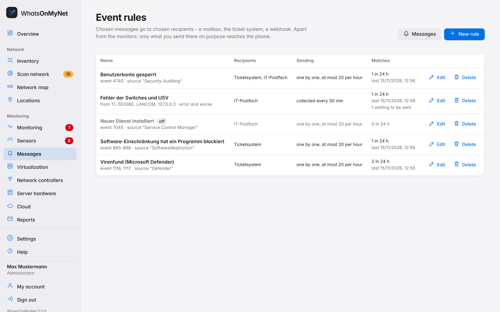

- **On and off:** the switch in the *Active* column of the rule list turns a rule on or off right there. Switched off, matches not yet sent are dropped and open events of the rule are closed.
- **Ready-made rules:** virus found (Defender 1116/1117), software restriction (865-868), AppLocker (8004/8007), user account locked (4740), member added to a security group (4728/4732/4756), event log cleared (1102 security, 104 system), new service (7045), new scheduled task (4698), user account created (4720), Defender real-time protection turned off (5001), PowerShell: suspicious script (4104, warnings only) and error of a command (4100), errors of a device (syslog), and counted: failed logons (4625) and SSH failures. Everything can be changed afterwards.
  - Windows writes 4698 and 4720 only with advanced auditing (group policy *Advanced Audit Policy Configuration*: *Object Access → Other Object Access Events* and *Account Management → User Account Management*, *Success* each). The PowerShell rules need script block logging (*Administrative Templates → Windows Components → Windows PowerShell*).
  - The PowerShell rules say the most when your own tools are quiet: the Windows script of WhatsOnMyNet causes no warnings 4104 and no 4100.
- **Conditions:** event ids (ranges too), source, log, sender (name, device or IP, parts too), words in the text, words that must not be there, kind and severity. All conditions given must match. If source and log are missing in the message (NXLog without `Exec`), the id decides.
- **Test** shows which of the messages of the last 7 days the rule would have matched - before it is saved. At every message **Rule** turns it into a new rule.
- **Sending:** *one by one* - one notification per message (with a ticket system: one ticket per event), at most as many per hour as set (default 20); what comes beyond follows collected after the collecting time. *Collected* - one notification with all messages once the oldest is as old as the collecting time (default 15 minutes).
- **Nothing is lost:** every match is stored first and only marked done once sent. If a recipient cannot be reached it is tried again every 5 minutes - for an hour; the list shows waiting and undelivered messages.
- The mail names rule, computer, event id and source in the subject, and sender, time, severity, log, account and the whole message in the text. A webhook gets the same as JSON (`rule`, `count`, `events`).
- With failover only the active installation sends; the rules themselves go to the standby too.

**Watching:** at every message **Watch** turns it into a monitor of the kind *Message (trap/syslog)*: from the same device (or any sender), trap or syslog, from which severity on, optionally with a text the message must contain. When a matching message comes in, the monitor alarms **at once** and stays down as long as set (default 15 minutes); if it comes again, the time starts over.

**Good to know:**
- The messages are in a **file of their own** (`data/events.sqlite`) - not in the database and not in the daily backups. They are kept 30 days in at most 2 GB (both under *Receiving settings*); whichever comes first counts, the oldest go first. When the disk gets short, at least 10 % (and 1 GB) stay free - the cleanup then starts earlier. The page shows the space used, the messages per day and how many days the space lasts; if it does not last for the days set, it says who sends the most.
- **Flood protection:** over UDP (and for traps) at most 100 messages a second per sender and 3,000 in all - what comes beyond is dropped and counted at the top of the page ("… dropped (flood)"). Over **TCP and TLS nothing is lost:** up to 500 a second per sender are taken, the rest waits - the connection pauses until the next second, NXLog or Fluent Bit keep the messages meanwhile. So use TCP for Windows computers and domain controllers. The limit in all can be changed with `WOMN_MESSAGES_PER_SECOND` in `.env` (100 to 100,000).
- *Only from devices in the inventory* drops messages of other senders. Syslog over UDP can be forged - for alarms better use traps with a community of your own.
- With failover every installation receives for itself: enter master **and** standby as targets in the devices.
- SNMPv3 traps are not taken (yet).


### How much space do the messages need?

A stored message takes, measured in `data/events.sqlite`, about **0.5 KB** (a line from a switch, NAS or UPS) up to **5 KB** (a long Windows event such as a failed sign-in 4625); mixed, reckon with **2 KB**. That includes the search index (from version 0.39), about a quarter of it, which keeps searching fast in many GB too. So:

**Space ≈ messages per day × days × 2 KB**

| Messages per day | 30 days | 90 days |
|---:|---:|---:|
| 1,000 | 60 MB | 180 MB |
| 10,000 | 600 MB | 1.8 GB |
| 50,000 | 3 GB | 9 GB |
| 100,000 | 6 GB | 18 GB |
| 300,000 | 18 GB | 54 GB |

How many messages come in? Rough values per sender and day, with the noise list left out by default:

| Sender | Messages per day |
|---|---|
| Windows client | 100 - 1,000 (mostly around 300) |
| Windows server (files, print, applications) | 500 - 5,000 |
| Domain controller | 10,000 - 100,000 (Kerberos and NTLM sign-ins 4768, 4769, 4776) |
| Switch, NAS, UPS, printer | 50 - 500 |
| Firewall or router logging connections | 100,000 and more - send warnings and errors only |

Typical setups:

| Setup | Example | Messages per day | Space for 30 days | Setting |
|---|---|---:|---:|---|
| Small | 5 - 20 PCs, 1 server, NAS, switches | 5,000 - 10,000 | 0.3 - 0.6 GB | default: 30 days, 2 GB |
| Small with domain controller | plus one DC | 20,000 - 40,000 | 1.2 - 2.4 GB | 4 GB - or the DC *warning and worse* |
| Medium | 20 - 100 PCs, 3 - 5 servers, 2 DCs | 50,000 - 150,000 | 3 - 9 GB | 10 GB |
| Large | 100 - 500 PCs, 10 - 20 servers, 2 - 4 DCs | 150,000 - 500,000 | 9 - 30 GB | 40 GB, filter noise and DCs; from here a SIEM (e.g. Wazuh) is worth it as well |

For 90 days, three times as much. On top comes what WhatsOnMyNet keeps free anyway: at least 10 % of the disk and 1 GB.

**How to go about it:**

1. Start with the defaults (30 days, 2 GB).
2. After a week read under *Monitoring → Messages*: "… messages a day" and "lasts about … days".
3. Not enough space: *By sender* shows who sends the most. Start there - chatty senders to *warning and worse* (domain controllers, firewalls), add the usual noise under *Receiving settings*. Only then raise *At most space (GB)* under *Receiving settings*.
4. **Days:** 30 days cover everyday work (what happened last week?). To trace incidents later as well - an attack is often noticed only after weeks - take 90 days. The messages contain user and computer names: agree the time with data protection or the works council and keep them no longer than needed.
5. The messages file is not in the daily backups - its size counts only once.

### How many messages does the server take?

New messages are written in batches: all that arrives in one moment, in one go. How many a second a server takes for good depends mostly on the disk (SSD or not) - the load test measures it on your hardware, next to the running program:

```sh
docker compose exec whatsonmynet womn-admin loadtest
```

It makes a test file of its own next to the data (`data/loadtest-…`, needs 3 GB free, removed at the end - your messages are not touched), sends Windows events over TCP as NXLog does, faster step by step (250, 500, 1,000 … a second, 6 seconds each), and stops as soon as the server no longer keeps up: messages are left lying, search index and counts fall behind, or the program has to wait longer than a quarter of a second for its turn. At the end it says what that means in computers and how much space a message takes. Example on a small server with 2 cores and an SSD:

```
  asked/s  stored/s  index behind  waits (p99)
    4,000     3,949           380        18 ms
    8,000     7,926         9,326        46 ms
   16,000    15,710        16,041        73 ms
   32,000    31,924        86,745       253 ms   ← no longer keeps up

Kept up with 16,000 messages a second.
For every day count half of it (logon peaks, cleanup, the web pages): 8,000 a second ...
```

Count half of it for every day - in the morning everybody signs in at once, and cleanup and web interface need their share too. Usually the **space** limits anyway, not the speed: a Windows computer sending everything takes a few MB a day. With very many computers (from about 1,000 sending everything) the events belong in a log platform such as Graylog, Wazuh or Elastic as well; WhatsOnMyNet then gets what matters (*warning and worse*, event rules).

## Printers, switches and NAS

Devices of type *Printer*, *Switch* and *NAS* are queried via SNMP (read-only). Set the community under *Settings → Scan*; SNMP v1/v2c has to be on at the device.

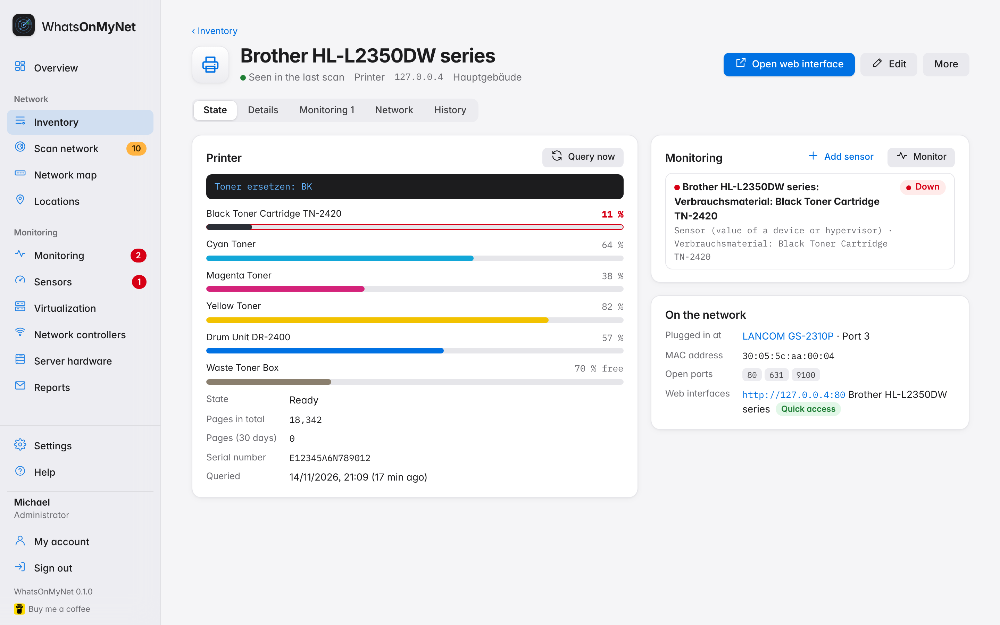

- **Printer**: toner or ink per colour, drum, waste toner, page counter, faults and display text. Below 15 % a notice is sent - once per cartridge.
- **Switch**: ports as tiles, which devices hang at which port (VLAN-aware), LLDP neighbours, firmware. Every device page shows "Plugged in at". From the second query on also the **load** of every port (in and out, in Mbit/s and percent of the port speed) - the average between two queries (default 15 minutes). Busy ports are marked in the tile; the sensor *Load port …* alarms from 80 %.
- **NAS**: volumes; on Synology also disks, RAID, temperature, fans, power supply and DSM update. Problems are reported - and again when everything is fine.
- **Taken into the inventory**: what the device says about itself - serial number, model, firmware or operating system (e.g. DSM version), for Synology/QNAP the manufacturer - goes right into the details of the device and stays current (e.g. after a firmware update). What you entered yourself with another value stays. The history shows every takeover.
- **Device exchanged**: if the device at the same IP reports another serial number, it is new hardware. Serial number, model, manufacturer and firmware then come from the new device, the old MAC address is dropped and replaced by the new one on the next scan (instead of a "new device"). The history notes the exchange - please check purchase date and warranty yourself.

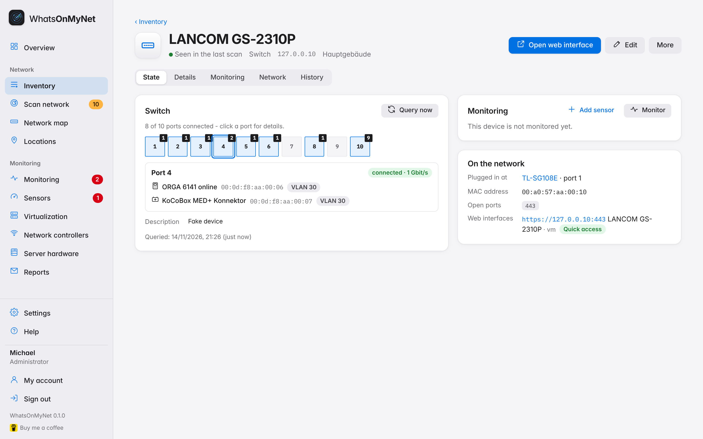

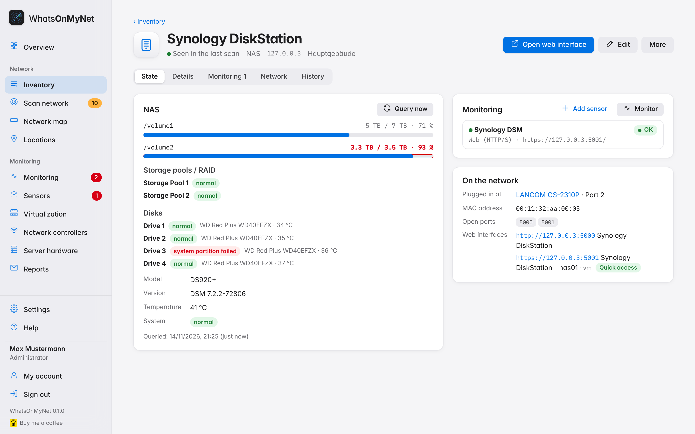

### UPS (uninterruptible power supply)

WhatsOnMyNet reads UPS values along the way, without anything to set up. The values are always the same: **on mains or battery**, **battery charge**, **how long the battery lasts** and **load**. With **Add sensor** you pick e.g. "UPS: mains or battery" (alarm as soon as it runs on battery) or "UPS runtime left (min)".

- **UPS at a Synology** (USB or network): when the UPS service of the Synology is on, the NAS area shows a *UPS* section. It is read over the same SNMP as the NAS. You do not have to add WhatsOnMyNet as a trusted device in the UPS server.
- **UPS with its own network card:** APC, or any card with the standard UPS-MIB, e.g. Eaton, CyberPower or Riello. Set the device in the inventory to type *UPS*, then it is read by SNMP like switches and NAS. Serial number, model and firmware go into the inventory.
- **UPS at a Linux machine:** when NUT (`upsc`) or apcupsd (`apcaccess`) already runs there, the machine script reads the values locally.
- **UPS on USB at a Windows machine:** Windows sees it like a battery, and the machine script sends the values along. On laptops this is the built-in battery, so the section is called *UPS or battery* there.

A UPS at a **QNAP** does not give its values over SNMP, so WhatsOnMyNet shows no UPS there. Shutting down and control stay with the UPS software; WhatsOnMyNet only reads.

### Network map

The *Network map* shows from MAC tables and LLDP which device hangs at which port and how the switches are connected. Simple switches without SNMP show up as a branch behind the port they are plugged into. Behind routers the scan reads the ARP table of the routers via SNMP, so the MAC address stays the identity there too.

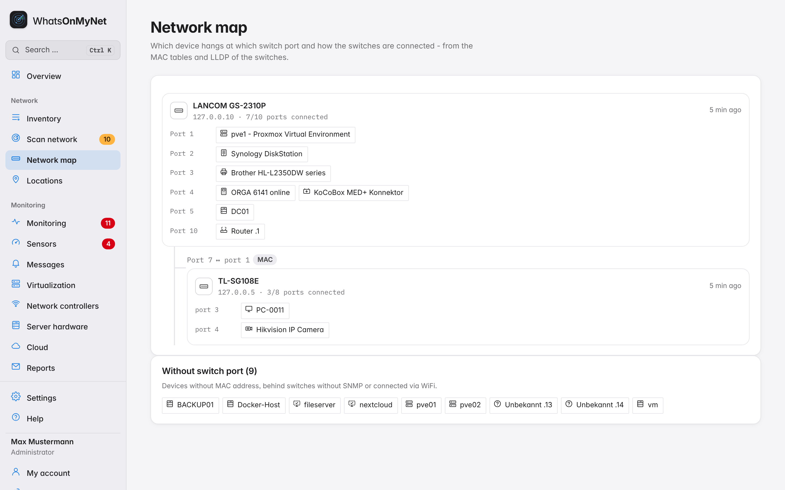

## Sensors

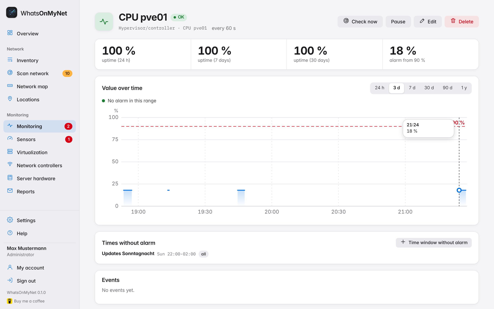

Every value a device delivers can become a monitor of its own - with history, alarm and maintenance windows. All sensors are listed under *Monitoring → Sensors*. "Add sensor" is on the device page, at the host under *Virtualization* and under *Monitoring → Sensors*. It is always the same dialog: choose device or host, then value and condition. Values another sensor already watches are not offered again (also not through the hypervisor when the Linux script delivers the same value). Examples:

- "toner cyan less than or equal 10 %"
- "usage /volume1 greater than or equal 85 %"
- "temperature drive 2 greater than 50 °C"
- "port 10 (uplink) connected"

**Proxmox nodes:** a node that is also in the inventory (same name, e.g. `pve2` or `pve2.firma.local`) has one common list - whether opened from the device or from the host under Virtualization: "Node pve2 online" from Proxmox and, if the Linux script runs there, every temperature, CPU, RAM, drives and services from the script. What both deliver (CPU, RAM, the highest temperature) is listed only once. Under Virtualization the list is grouped by node. Likewise a server with a management chip (Redfish) shows its hardware values and a Proxmox Backup Server its datastores and backups at the device.

When editing, an existing sensor can be switched to any other value of this list, for example from "Temperature pve2" to "Temperature: NVMe nvme0 Sensor 2". The name follows ("pve2: Temperature: NVMe nvme0 Sensor 2") - unless it is changed by hand in the same dialog.

The kind **SNMP value (OID)** reads any SNMP value (e.g. runtime left of a UPS) and compares with less, greater, equal or "contains text".

In the monitor list the column **Now** shows the value right away: number and unit, a small bar for percentages, "used of total" for storage and RAM, and the alarm limit ("alarm from 90 %"). Close to the limit the value turns yellow, at the alarm red. **All-clear with a margin:** a sensor in alarm because of a limit only reports "fine" again once the value has clearly left the limit - by 2 °C for temperatures, by 2 points for percentages (alarm from 86 °C → all-clear below 84 °C). So a sensor swinging around its limit does not send alarm and all-clear every 5 minutes. When a NAS delivers a table only halfway (busy, late answer), the missing disks and volumes stay with their last values for up to two polls - a "not found" alarm only comes once they are really gone. Nodes and VMs show their state with CPU and RAM, network drives the free space.

## Network drives (SMB)

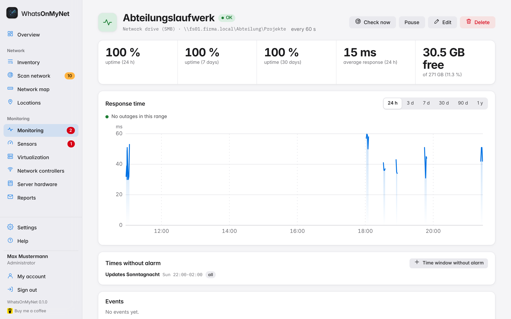

The kind **Network drive (SMB)** really signs in to a share - not just to the open port. So you also notice when the password expired, the rights changed or a folder is missing.

1. Create an account of its own with **read rights** on the share (in AD e.g. `COMPANY\monitor`, on a NAS a local user).
2. *Add monitor* → kind **Network drive (SMB)**. Just paste the path, e.g. `\\fs01\Department\Projects` - server, share and folder are taken from it.
3. Enter user, domain (empty for NAS accounts) and password. Optional: warn below … % or … GB free.

The check runs over SMB 2/3: sign in, read the share (or the folder or file), ask for the free space. WhatsOnMyNet writes nothing to the share. The detail page shows the free space; reports have the section *Network drives* for it.

## Proxmox VE and Backup Server

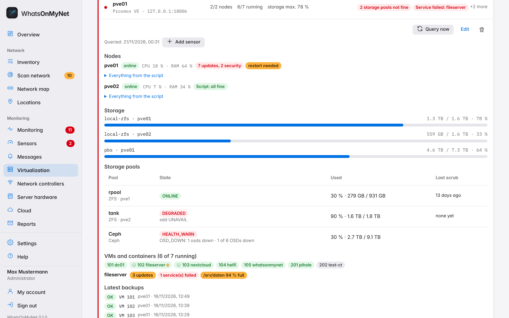

WhatsOnMyNet reads Proxmox VE and the Proxmox Backup Server through their built-in interface (API). Nothing is installed on Proxmox. WhatsOnMyNet gets a user of its own there that may **only read**, and a key for it (API token). The dialog *Monitoring → Virtualization → Add host → Proxmox VE* shows the same steps, with a button to copy.

**Cluster:** entering one node is enough. WhatsOnMyNet asks the cluster which nodes there are, at which address they are reachable and which certificate they have (again every 6 hours). If the entered node does not answer, the next node is asked - with the same token (it is valid in the whole cluster) and only after its certificate has been checked. The virtualisation page then shows "read through node pve2". The Proxmox Backup Server knows no cluster: each one is entered on its own.

**Temperatures of the nodes:** the Proxmox interface knows no temperatures. If a node also runs the Linux script (see *Windows and Linux machines by script*), its highest temperature is shown at the node on the virtualisation page. A sensor for it: at the Proxmox host or at the device **Add sensor** → *Temperature: the highest of all sensors* (alarm from 85 °C, can be changed; single sensors with the chip's warning limit); single sensors (CPU, NVMe …) are in the same list under "Node pve1". They are matched by name: node `pve1` ↔ machine `pve1` or `pve1.firma.local`.

### Step 1: prepare Proxmox (once)

**With commands (recommended) - Proxmox VE**

1. In Proxmox click a node on the left and open **>_ Shell** at the top. One node is enough - in a cluster it applies to all.
2. Copy these three lines, paste them into the shell and press Enter:

```
pveum user add whatsonmynet@pve --comment "WhatsOnMyNet (read only)"
pveum acl modify / --users whatsonmynet@pve --roles PVEAuditor
pveum user token add whatsonmynet@pve womn --privsep 0
```

3. The output shows a table. The row `value` holds the **secret** (a long string with dashes). Copy and keep it - Proxmox shows it only this once.

**With commands - Proxmox Backup Server**

1. In the Backup Server open *Administration → Shell* on the left.
2. Paste these four lines and press Enter:

```
proxmox-backup-manager user create whatsonmynet@pbs --comment "WhatsOnMyNet (read only)"
proxmox-backup-manager acl update / Audit --auth-id whatsonmynet@pbs
proxmox-backup-manager user generate-token whatsonmynet@pbs womn
proxmox-backup-manager acl update / Audit --auth-id 'whatsonmynet@pbs!womn'
```

3. After the third command `"value"` holds the **secret**. Copy it - it is shown only once.

**By clicking - Proxmox VE**

1. *Datacenter → Permissions → Users* → *Add*: user name `whatsonmynet`, realm *Proxmox VE authentication server*, any password → *Add*.
2. *Datacenter → Permissions* → *Add* → *User Permission*: path `/`, user `whatsonmynet@pve`, role `PVEAuditor` → *Add*.
3. *Datacenter → Permissions → API Tokens* → *Add*: user `whatsonmynet@pve`, token ID **only** `womn` (no @ or !), **untick** *Privilege Separation* → *Add*.
4. Proxmox now shows the *Secret* - only this once. Copy and keep it.

On the Backup Server it works the same under *Configuration → Access Control*: user `whatsonmynet` (realm *Proxmox Backup authentication server*), tab *API Token* with token name `womn`, then under *Permissions* the role `Audit` on the path `/` twice - once for the user `whatsonmynet@pbs`, once for the token `whatsonmynet@pbs!womn`.

### Step 2: enter it in WhatsOnMyNet

1. *Monitoring → Virtualization* → **Add host** → *Proxmox VE* or *Proxmox Backup Server*.
2. Give it a name.
3. Enter the **address** the way you open Proxmox in the browser, e.g. `https://192.168.1.10:8006` (Backup Server: port `8007`).
4. Click **Fetch certificate**. WhatsOnMyNet shows the fingerprint of the Proxmox certificate. Compare it - Proxmox VE: click the node → *System → Certificates* → row `pve-ssl.pem`; Backup Server: *Dashboard* → *Show Fingerprint*. If it matches, **Fingerprint matches - trust**.
5. The **token ID** is already filled in (`whatsonmynet@pve!womn` or `whatsonmynet@pbs!womn`). Paste the copied secret into **Token secret**.
6. **Save and connect.** After a few seconds nodes, storage, VMs and containers and the backups appear.

### Adding sensors

In the detail view **Add sensor** - e.g. "VM 101 running", "storage local-lvm below 85 %" or "last backup older than 26 hours". Every sensor is a monitor with history and notification.

### Failed tasks

Failed tasks (backup, verify, prune, package lists …) are shown with a plain name and below it the error lines from the Proxmox task log - so one sees *why* something went wrong. Backups, verifications and syncs count as a fault (red), upkeep tasks like pruning or package lists as a note (yellow). When updating the package lists fails only because of a third-party repository (e.g. Webmin), it is just a note and not counted as an error; when an official Proxmox or Debian repository fails, it still alarms.

### If something does not work

- **"tokenid: value does not match the regex pattern" in Proxmox**: when adding the token enter only `womn` - without user, @ and !.
- **"sign-in refused (401)"**: token ID or secret are wrong. Delete the token in Proxmox, add it again and enter the new secret.
- **Notice "The token lacks read rights"**: usually *Privilege Separation* stayed ticked on the token. The notice shows two commands - paste them into the Proxmox shell, Enter, then **Query now**.
- **"certificate changed"**: Proxmox got a new certificate. *Edit* → **Fetch certificate** → confirm.

### Many hosts at a glance

From two hosts on, the page *Virtualization* (as well as *Network controllers* and *Server hardware*) shows the situation in numbers at the top: hosts with problems, nodes online, running VMs, full storage, backup problems. Below there is **one line per host** with the key values and what is wrong. Hosts with problems come first. A click on the line unfolds the details (the browser remembers that until the tab is closed).

The **search** finds hosts, nodes, VMs (name or ID), datastores and backup groups. The buttons filter by *Problems* or by kind (Proxmox VE, Backup Server …).

## More hypervisors: VMware, XCP-ng, Hyper-V, Nutanix, oVirt, KVM

Under *Monitoring → Virtualization → Add host* further hypervisors are offered beside Proxmox. All appear the same way: hosts with CPU and RAM, storage, VMs - and sensors can be added from everything ("host online", "CPU esx01", "storage vsan", "VM dc01 running"). It only reads.

**Asked through their interface** - an account that may only read is enough; enter the address, **Fetch certificate**, compare the fingerprint, enter the account:

| Hypervisor | Account with read rights | Address |
|---|---|---|
| **VMware ESXi / vCenter** | user with role *Read-only*, given at the top of the inventory, "propagate to children" | vCenter or ESXi, e.g. `https://vcenter.firma.local` |
| **XCP-ng / XenServer** | with AD: role *read-only*; without AD there is only `root` | pool master, e.g. `https://xcp01.firma.local` |
| **Nutanix AHV** | Prism user with role *Viewer* | Prism with port, e.g. `https://prism.firma.local:9440` |
| **oVirt / RHV / OLVM** | `whatsonmynet@internal` with role *ReadOnlyAdmin* (commands are in the dialog) | engine, e.g. `https://engine.firma.local` |

**Hyper-V and KVM/libvirt report on their own.** Neither has an interface to ask. Instead a small script on the host sends load, volumes or storage pools and VMs every 5 minutes. It only reads and needs no open port on the host.

1. *Add host* → **Microsoft Hyper-V** or **KVM / libvirt**, give a name, save.
2. The dialog shows the script with a key of its own (only this once) - **Download script**.
3. Run it once, it sets itself up. **Hyper-V** as administrator: `powershell.exe -NoProfile -ExecutionPolicy Bypass -File .\womn-hyperv.ps1` (scheduled task *WhatsOnMyNet-HyperV*, every 5 minutes as SYSTEM). In a cluster on every node - all nodes land in the same entry.
   **KVM:** `sh womn-libvirt.sh` as root or as a user of the group `libvirt` (cron entry, every 5 minutes) - otherwise `virsh` may not see the VMs of the system. It needs `virsh`, `awk` and `curl`; it reads with `virsh -r`.
   Removing again: the **uninstall script** from the dialog or *Settings → Machine scripts* - it also removes the setup of version 0.6.0.
4. After a few seconds the host appears. If it does not report for more than 15 minutes it counts as offline - a sensor "host online" then raises the alarm.

If the key is lost or should be renewed: **New script** - the old one stops working then.

With the self-signed certificate of WhatsOnMyNet the script trusts exactly its key (built in); with a certificate of a real CA it checks as usual. When WhatsOnMyNet renews its certificate (30 days before it expires, after a new IP address or `WOMN_BASE_URL`), the key stays the same and the scripts go on reporting. Exception: Windows scripts made with versions up to 0.10.1 only know the certificate itself - create them once more. Scan agents with `WOMN_AGENT_CA` need the new value from *Settings → Scan agents* after a renewal.

## Network controllers: UniFi, Omada, MikroTik

Under *Monitoring → Network controllers → Add controller* WhatsOnMyNet reads the widespread network systems - with an account that may **only read**; enter the address, **Fetch certificate**, compare the fingerprint, enter the account. The dialog shows the steps for each system.

| System | Account | Address |
|---|---|---|
| **UniFi Network** - UniFi OS consoles (UDM, UCG, Cloud Key Gen2+) or the installed Network app | local account (without two-factor) with role *View only*/*Site Viewer* | console, or `https://server:8443` |
| **TP-Link Omada** - software controller, OC200/OC300 | account with role *Viewer* | usually `https://server:8043` |
| **MikroTik RouterOS 7** - every router/switch on its own | user in a group with `read,api,rest-api` | router with service *www-ssl* |

The page shows all access points, switches and gateways of each controller with model, IP, firmware (with "Update" when a new one is ready), clients and state.

**Matched with the inventory:** every device that is in the inventory by its MAC address gets model, serial number, firmware, manufacturer and the right **type** from the controller - by the same rules as for SNMP (empty or still device-reported details are filled or kept current, your own different entries stay, an exchange is recognised). Devices that are not in the inventory yet carry the note *not in the inventory* - adopt them by scan.

**Sensors:** "AP hall online", "Clients on AP hall", "CPU …", "RAM …", "Clients in total" and "Devices with firmware update".

The **scan** now also recognises these devices better by their model names: UniFi (USW = switch, UAP/U6/U7 = access point, UDM/UCG/USG = gateway, Network app = server), Omada (EAP = access point, ER = gateway, OC200/OC300 = controller), MikroTik (CRS = switch, cAP/wAP = access point) and Aruba Instant On.

## Server hardware: iDRAC, iLO, XClarity, Supermicro (Redfish)

Fans, power supplies, temperatures, RAID controllers and the drives behind them are usually unknown to the operating system. The management chip of the server knows them, even while the server is switched off. All current chips speak the standard **Redfish**: Dell iDRAC, HPE iLO, Lenovo XClarity Controller, Supermicro, Fujitsu iRMC, Cisco CIMC.

1. Add an account of its own in the management chip that may **only read**: iDRAC role *Read Only*, iLO only the right *Login*, XClarity role *ReadOnly*, Supermicro role *User*.
2. *Monitoring → Server hardware* → **Connect management chip**: the address of the chip (not of the server), **Fetch certificate** and confirm the fingerprint, user and password.

Shown are:
- overall health and power state, consumption
- model, serial number (at Dell the service tag), BIOS, processors, memory, firmware of the chip
- fans, temperatures with warning limit, power supplies
- RAID controllers, volumes and drives, with life left and predicted failure

Whatever is not fine is listed at the top. WhatsOnMyNet matches the server to **its device in the inventory** by the MAC addresses of its network cards or by the serial number. Its page then shows the *Server hardware* area, and manufacturer, model and serial number are taken over.

Sensors (*Add sensor*): overall health, server switched on, every fan, temperature, power supply, drive (also life left), volume, and power consumption. It is asked every 5 minutes like Proxmox, read only.

## Cloud: AWS, Azure, Google Cloud

WhatsOnMyNet watches what runs in the cloud through the API of the provider - with an account that may **only read**, every 5 minutes. Nothing is installed or changed there. *Monitoring → Cloud* → **Connect cloud account**; the dialog shows the steps for each provider.

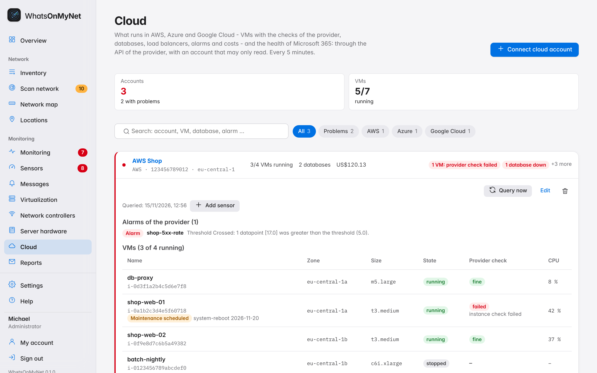

**What is read:**

| | AWS | Azure | Google Cloud |
|---|---|---|---|
| VMs: running, CPU | EC2 | Virtual machines | Compute Engine |
| Provider check | status checks (system and instance), scheduled maintenance | Resource Health | repair after a host failure |
| Databases: available, CPU, storage | RDS (Aurora without storage - it grows by itself) | Azure SQL, PostgreSQL and MySQL flexible server | Cloud SQL |
| Load balancers | target groups: healthy and unhealthy targets | through Resource Health | – |
| Alarms | CloudWatch alarms in state ALARM | fired Azure Monitor alerts | – |
| Costs (if wanted) | Cost Explorer (0.01 USD per request, twice a day) | Cost Management (free) | – (only through a BigQuery export) |

**Rights:**
- **AWS:** an IAM user with an inline policy that allows only the read actions needed (the dialog shows it for copying), and an access key.
- **Azure:** an app registration with a client secret and the role **Reader** on the subscription. The secret expires - WhatsOnMyNet says so plainly when it has.
- **Google Cloud:** a service account with the roles *Compute Viewer*, *Monitoring Viewer* and *Cloud SQL Viewer* and a JSON key.

If the account lacks a right, WhatsOnMyNet reads the rest and names exactly which right is missing. Services not switched on in the account (e.g. Cloud SQL) only show as a note.

**Security:** the secret is stored encrypted and never goes to the browser. WhatsOnMyNet sends it only to the fixed addresses of the provider (e.g. `*.amazonaws.com`, `management.azure.com`, `*.googleapis.com`) and checks the certificate - links to other addresses are refused too. Without a cloud account entered, none of this goes to the internet.

**Sensors:** "VM … running", "Provider check: …", "CPU …", "Database … available", CPU and storage of the database, "Load balancer …: unhealthy targets", "Alarms of the provider", "Unhealthy resources" and "Costs this month" (limit at first: last month + 20 %). A VM or database that does not run has no values - that is no alarm; whether it should run, its own sensor says. With *Watch new devices by themselves* a new account gets sensors for the alarms, the checks of the VMs, the databases and the load balancers right away.

## Veeam Backup & Replication

From version 12 on WhatsOnMyNet reads through the REST API (port 9419) the **jobs** with last result, last and next run, and the **repositories** with their space - under *Monitoring → Virtualization* → **Add host** → *Veeam Backup & Replication*.

1. In Veeam under *Users and roles* create an account of its own with the role **Veeam Backup Viewer** - it may only read.
2. Enter the address with port (e.g. `https://vbr01.company.local:9419`), **Fetch certificate** and confirm the fingerprint, user and password.

Sensors: *Veeam job …* (alarm on **error or warning** in the last run; disabled jobs stay quiet), *Last run …* (alarm when a scheduled job has not run for more than 26 hours), *Repository …* (from 85 % full) and *Veeam jobs with error or warning* (all together).

## Storage pools: ZFS, Ceph, software RAID, Storage Spaces, TrueNAS

What is more than a disk, WhatsOnMyNet shows the same way everywhere: **state** (ONLINE, DEGRADED, HEALTH_WARN …) with the reason, **usage**, **failed members** (disks, OSDs) and for ZFS the **last scrub** with the errors it found. Read only.

- **Proxmox VE:** the ZFS pools of every node and - if there is one - the Ceph cluster, through the same connection and token (privilege `Sys.Audit`). Hosts added from now on get sensors for the state right away.
- **Linux machines with the script:** ZFS pools (`zpool`, root not needed) and software RAID (`/proc/mdstat`: degraded, failed disk, resync).
- **Windows machines with the script:** Storage Spaces - pools, their virtual disks and disks that are not healthy.
- **TrueNAS** (25.04 or newer): *Monitoring → Virtualization* → **Add host** → *TrueNAS*. Create a user of its own with the role **Read-Only Administrator**, create an **API key** for it, enter the address and confirm the certificate. WhatsOnMyNet reads the pools, the open **alerts** of TrueNAS and the **replications** - through the WebSocket API (the old REST API is gone from TrueNAS 26).
- **Ceph without Proxmox:** *Add host* → *Ceph*, through the Ceph dashboard (mostly port 8443) with a dashboard user of the role **read-only**: health with the messages of Ceph, OSDs, usage, PGs.

Sensors: *State …* (alarm as soon as a pool is not fine - also when the last scrub found errors), *Usage …* (ZFS from 80 %, as ZFS gets slow above it; Ceph from 75 %), *Days since the last scrub …* (from 35 days) and *Failed disks/OSDs …*. For TrueNAS also *Open/Critical alerts* and *Replication …* (alarm on an error).

## Microsoft 365

Under *Monitoring → Cloud* → **Connect cloud account** → *Microsoft 365* WhatsOnMyNet reads through Microsoft Graph the **health of the services** (Exchange Online, Teams, SharePoint …), the **open incidents and advisories** and the **subscriptions** with assigned and free licences.

1. In the Entra admin center create an **app registration**; note application ID and directory ID.
2. Under *API permissions* add the **application permissions** `ServiceHealth.Read.All` and `Organization.Read.All` and **grant admin consent** - both may only read.
3. Create a client secret and enter its **value**. It expires; WhatsOnMyNet says so plainly when it has.

Sensors: *Microsoft 365: service* (alarm on degradation or interruption), *open incidents* (incidents only, no advisories), *Subscription …* (alarm when it runs out or is suspended) and *Free licences …*. Newly connected accounts get sensors for incidents and subscriptions right away.

## Windows and Linux machines by script (without agent)

**What is the script for?** Many values of a machine are known only to its operating system: temperatures of CPU and NVMe, the health of the disks (SMART), services, pending updates. Big servers deliver part of it through their management chip (iDRAC, iLO, XClarity - see *Server hardware*). A mini PC, a self-built server or a Proxmox node in a homelab has nothing like that - here the script fetches this information. For Proxmox: the API delivers nodes, VMs, storage and backups; temperatures, disks, services and updates of the nodes only come with the script.

**The tip in the program:** machines, servers, VMs and hypervisors with Windows or Linux that have no system values yet show the tip "Monitor with script" on the device page; under *Virtualisation* it appears for Proxmox nodes without the script. It disappears by itself as soon as the device delivers values - through the script or through the server hardware (iDRAC, iLO …). If you deliberately do not want the script for a device, **Do not show again** hides the tip there for good; *More → Monitor with script* still works at any time.

Servers and PCs can be monitored without an agent: a small script on the machine reports **CPU, RAM, drives, uptime and services** every 5 minutes, plus a connected **UPS** (see above).

On top comes what an administrator wants to know about a server. Everything is on the device page in the *System* area, and every value can become a sensor with alarm:

- **Updates and protection:** pending updates (how many important/security), whether a restart is pending, virus protection (Defender or another product registered in the Security Center: active, signatures current) and firewall (Windows: domain/private/public, Linux: ufw or firewalld). The update search runs only every 6 hours and after the report, so that the 5-minute report stays quick. It only searches and never installs anything.
- **Disks:** model, serial number, health, temperature, wear and power-on hours. On Linux this needs `smartctl` and root, otherwise there is only model, serial number and size.
- **Events:** critical entries and errors of the last 24 hours (Windows: system log, Linux: journal), the newest ten with text.
- **Certificates** of the machine (Windows, store "Personal" of the computer), with days until they expire.
- **Hardware:** manufacturer, model, serial number, BIOS, processors, memory modules and network cards. Manufacturer, model and serial number also go into the inventory. On Linux, serial number and memory modules only come as root (`dmidecode`).
- **Temperatures (Linux):** CPU, NVMe, chipset and - depending on the mainboard - further sensors, straight from the kernel (`/sys/class/hwmon`, the same source as `sensors`). Nothing has to be installed, not even lm-sensors, and root is not needed. The warning limit is the one the chip names itself, otherwise 80 °C. Sensors: *Temperature* (one sensor) or *Temperature: the highest* (all together, alarm from 85 °C). If a mainboard sensor is missing, the kernel does not load its driver by itself - `sensors-detect` from lm-sensors finds it and adds it to `/etc/modules`.

Fans, power supplies, further temperatures and RAID controllers are usually unknown to the operating system. They come from the management chip of the server (see *Server hardware* above).

The script installs nothing, loads nothing, opens no port and needs no account - it only sends to WhatsOnMyNet. (On Windows the update search asks the WSUS server or Windows Update, like Windows itself.) On Windows it is a PowerShell script (runs as SYSTEM), on Linux a POSIX sh script (needs `sh`, `awk` and `curl`, root is not needed).

**A single machine:** *Monitoring* → **Add monitor** → **Machine by script (Windows/Linux)** → choose the machine. On the device page the same works with **Monitor** (kind of check *Machine by script*) or *More* → **Monitor with script**. Then Windows or Linux → **Create script**.

1. **Download script** (it holds the address and the key - shown only this once).
2. Run it once - it sets itself up:
   - **Windows** as administrator: `powershell.exe -NoProfile -ExecutionPolicy Bypass -File .\womn-host.ps1` - it puts itself into `C:\ProgramData\WhatsOnMyNet` (readable only for SYSTEM and administrators) and adds the scheduled task *WhatsOnMyNet-Host*.
   - **Linux**: `sh womn-host.sh` - as root into `/usr/local/sbin` with `/etc/cron.d/whatsonmynet-host`, otherwise into `~/.local/bin` with an entry in the own crontab.
3. After a few seconds the device page shows the section **System**. **Add sensor** turns it into monitors with alarms: "Machine reports", "CPU load", "Memory", "Drive C:", "Failed services" or "Service … running".

**Many machines at once:** *Settings → Machine scripts* → **Shared script**. You roll out this one script by software distribution, a startup script by group policy or Ansible. Each report is matched to its device in the inventory (MAC address, machine name, IP). Machines that are not in the inventory yet show up there under *Unknown machines* - nothing is created on its own.

**Failed services:** Windows - services that start automatically and stopped with an error code (trigger-start services that stopped normally do not count); Linux - systemd services in the state *failed*.

**New version of the script:** when an update brings new values (e.g. the UPS), create the current script under *Settings → Machine scripts* in the row of the existing entry with **New script** and simply run or roll it out again. It overwrites the old copy and the scheduled task. The old key is blocked from then on, so roll it out right away.

**Script block logging (event 4104):** the Windows script reads network cards, disks, Defender and firewall straight from WMI and loads no PowerShell modules for it. With script block logging on, a run therefore leaves only a few entries of level *Verbose* with the path `C:\ProgramData\WhatsOnMyNet\womn-host.ps1` - no warnings. The script also contains none of the words PowerShell rates as suspicious (such as embedded C# code with `Add-Type`, or `Bypass`): it checks the pinned certificate in PowerShell itself, the scheduled task runs under *RemoteSigned* and without progress bar. No "System error" (event 4100) either: the script takes the first entries of a list by index instead of `Select-Object -First`, which Windows PowerShell logs as system error when it stops the query. Older scripts caused warnings 4104 on every run - before 0.33 some 70 without a path, up to 0.33.2 one with the path of the script; *New script* makes them go away.

**For software distribution and inventory:** which script version runs on a computer is in the registry - so every inventory or distribution tool finds it (PDQ Inventory, Intune, SCCM/MECM, own solutions):

| | Windows script | Hyper-V script |
|---|---|---|
| Key | `HKEY_LOCAL_MACHINE\SOFTWARE\WhatsOnMyNet` | `HKEY_LOCAL_MACHINE\SOFTWARE\WhatsOnMyNet` |
| Value | `HostScript` | `HyperVScript` |
| Type | string (REG_SZ) | string (REG_SZ) |
| Data | version, e.g. `0.42.0` | version, e.g. `0.42.0` |

The value is written when the script is set up (the first run as administrator); the uninstall script removes it again - the key only when nothing else is left in it. If the value is missing or the version is lower than the one WhatsOnMyNet hands out now (shown in the window where the script is downloaded), an older script runs there: roll it out once more. Computers with a script from before 0.42 do not have the value yet. To query by hand:

```
reg query "HKLM\SOFTWARE\WhatsOnMyNet" /v HostScript
(Get-ItemProperty 'HKLM:\SOFTWARE\WhatsOnMyNet' -ErrorAction SilentlyContinue).HostScript
```

As detection rule (Intune, SCCM): registry, key and value as above, comparison *version greater than or equal to* the current script version.

**Version and refused reports:** every Windows script carries a version number: in the first line, in the registry under `HKLM\SOFTWARE\WhatsOnMyNet` (value `HostScript`, `HyperVScript` for the Hyper-V script) and in the report. The device page shows it under *System* and marks an older script as *outdated*; in software distribution, filter on the registry value. The number only changes when the script itself changes - not with every update of WhatsOnMyNet. When WhatsOnMyNet refuses a report (key no longer valid, device deleted) or cannot be reached, the answer is in `C:\ProgramData\WhatsOnMyNet\womn-host-send.json` (time, status, message) and the scheduled task ends with result 2 - with no entry in the PowerShell log. Scripts before 0.42 wrote a warning 4100 for it on every run.

**Removing again:** every script comes with an **uninstall script** (in the script dialog under *Remove again* and under *Settings → Machine scripts*). It removes the scheduled task or cron entry and the script - run or distribute it the same way. Afterwards the machine is as before. Deleting or recreating a script under *Settings → Machine scripts* locks the old key.

If a machine does not report for 15 minutes it counts as offline - the sensor "Machine reports" then raises the alarm.

### Own checks

What WhatsOnMyNet does not know by itself - a licence server, a queue, a backup log, a line-of-business application - an **own small script** on the machine checks. On every report the machine script runs all scripts in the *checks* folder and sends their result along. Each prints one or more lines in the well-known format of Checkmk ("local checks"):

```
<status> <name> <value or -> <text>
0 Backup_NAS count=12 last backup 2 hours ago
2 Licence_server - lic01 not reachable
```

Status `0` = OK, `1` = warning, `2` = critical, `3` = unknown. The name has no spaces; the value is `-` or e.g. `count=12` (it shows in the history).

- **Linux:** `/etc/whatsonmynet/checks/` (script runs as root) or `~/.config/whatsonmynet/checks/` (other user). Every executable file is started.
- **Windows:** `C:\ProgramData\WhatsOnMyNet\checks\` - `.ps1`, `.cmd` and `.bat`.

**Security:** the check scripts run with the rights of the machine script (on Windows as SYSTEM). So it only starts files **nobody else can change**: folder and files belong to root or the user (Windows: SYSTEM, Administrators or TrustedInstaller), are not writable for group and others and are no link. Unsafe files do not run and show as *unknown* with the reason. Every check has at most 30 seconds, at most 50 run.

On the device page the checks are under *Own checks*; as the sensor *Own check …* everything but OK alarms (warning and unknown too). New machines get the sensors right away. For this, roll out the machine script of this version once again.

## Prometheus and Grafana

If you already run Prometheus and Grafana, you can bring the state of all monitors and sensors there: *Settings → Prometheus & Grafana*.

1. **Create key.** It is shown only once; only its fingerprint is stored. Without a key `/metrics` does not exist at all. A key may only read the values, nothing else.
2. Take over the shown **prometheus.yml**, download the **certificate of the server** and give it as `ca_file` - so the certificate check stays on (no `insecure_skip_verify`).
3. In Grafana under *Dashboards → New → Import* upload the **Grafana dashboard** and choose the Prometheus data source: monitors down, availability, response times, sensor values, certificates.

| Value | Meaning |
|---|---|
| `womn_monitor_up` | 1 fine, 0 down (paused and new ones are left out) |
| `womn_monitor_state` | state as a label: up, down, pending, paused |
| `womn_monitor_down_seconds` | seconds since the outage began |
| `womn_monitor_response_seconds` | response time (web, port, ping, databases …) |
| `womn_sensor_value` | value of a sensor, with unit and limit as labels |
| `womn_cert_expiry_timestamp_seconds` | certificate expiry; days: `(womn_cert_expiry_timestamp_seconds - time()) / 86400` |
| `womn_devices`, `womn_events_stored`, `womn_info` | devices, stored messages, version and role |

Every value carries `id`, `name`, `type`, `target` and - where there is one - `device`. With failover Prometheus can ask both; `womn_info` tells which one is master.

## Reports

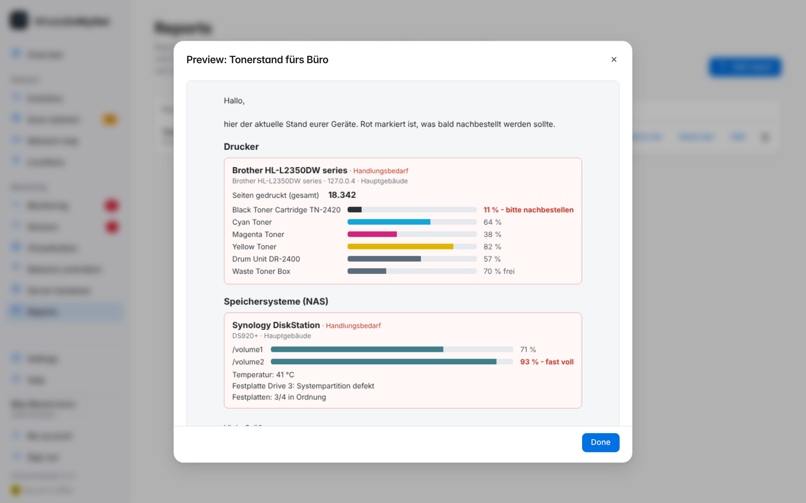

Under *Monitoring → Reports* reports go out by e-mail at set times - e.g. the toner levels to the office every Monday at 8:00.

- Content: printers, NAS, switches, network drives; can be limited to locations; optionally only devices that need action.
- **Devices**: all devices of the chosen content - or only chosen ones, e.g. a report of its own for the printer in the front office.
- Printers show the **pages printed** (in total and in the report period, e.g. "in the last 7 days") and - if the printer reports it - how many pages the toner still lasts.
- The mail is **neutral**: no link, no program name - only your sender name, subject (`{week}`, `{date}`), introduction, the devices and your closing.
- "Preview", "Test to me" and "Send now" right in the list; the switch in the *Active* column turns a report on or off without opening it.

## Users and rights

- **Roles**: *Administrator* (everything), *Editor* (scan, adopt, maintain, monitors), *Read only*. Editors only scan private networks (10.x, 172.16-31.x, 192.168.x, 100.64-127.x) and the subnets of the locations; public addresses only administrators.
- **Locations**: editors and viewers can be limited to locations - they then only see and change devices, scans and monitors of these.
- **Active Directory**: sign-in with the Windows account, see the next section.
- **Two-factor sign-in** (*My account*): scan the QR code with an authenticator app, confirm a code, keep the recovery codes. It can be made mandatory for administrators under *Settings → Users* (section *Sign-in*).

## Sign-in with Active Directory

Staff sign in with their Windows account. AD groups decide which role they get. Local accounts keep working; for the same name the local account wins, so the local admin stays the emergency access.

### Step 1: prepare AD (once)

1. Create a **service account**, e.g. `svc-womn`. It needs no special rights, a normal domain account with a password is enough.
2. Create up to three **groups**, e.g. `WOMN-Admins`, `WOMN-Editors` and `WOMN-Read`, and put the staff into them. Groups in groups count.

### Step 2: enter it in WhatsOnMyNet

1. *Settings → Active Directory*.
2. **Server**: name of the domain controller as it is in the certificate, e.g. `dc01.company.local`. Encryption **LDAPS** (port 636) or **StartTLS** (port 389). Without encryption it does not work.
3. **Certificate**: leave trust on *Fetched certificate* and click **Fetch certificate from DC**. Compare the fingerprint with the certificate on the DC (`certlm.msc` → *Personal* → open the certificate → *Details* → *Thumbprint*) and confirm. If the root CA is missing, WhatsOnMyNet gets it itself (via the AIA address in the certificate or, after confirming, from AD).
4. **Directory**: leave the base DN empty, the test finds it. Enter the service account, e.g. `svc-womn@company.local`, and its password.
5. **Groups**: simply enter the group names, e.g. `WOMN-Admins`. Members of several groups get the highest role; members of none cannot sign in.
6. **Test connection**, best with your own user name. Every step gets ✓ or ✗ with the reason: connection, service account, base DN, groups, user, role and, if you like, the password.
7. When everything is ✓: tick *Allow sign-in through Active Directory* and **Save**.

### If something does not work

- **"The certificate of the DC is not trusted"**: *Fetch certificate from DC* and confirm.
- **"The name in the certificate does not fit"**: enter the name from the certificate as domain controller (fetching shows it). Only if you reach the DC by its IP address: switch *Check the server name in the certificate* off.
- **"Service account: sign-in refused"**: name or password of the service account wrong, or the account is locked.
- **"Group not found"**: check the spelling of the group in AD.
- **"No role"**: the user is in none of the groups entered.

## Scan agent for branch offices

For a branch office a second container runs there as scan agent. Under *Settings → Scan agents* add an agent for the location; put the `.env` shown next to `docker-compose.agent.yml` from the release and start `docker compose -f docker-compose.agent.yml up -d`. The agent opens no port, fetches jobs over HTTPS and reports only addresses of its location.

## Failover: master and standby

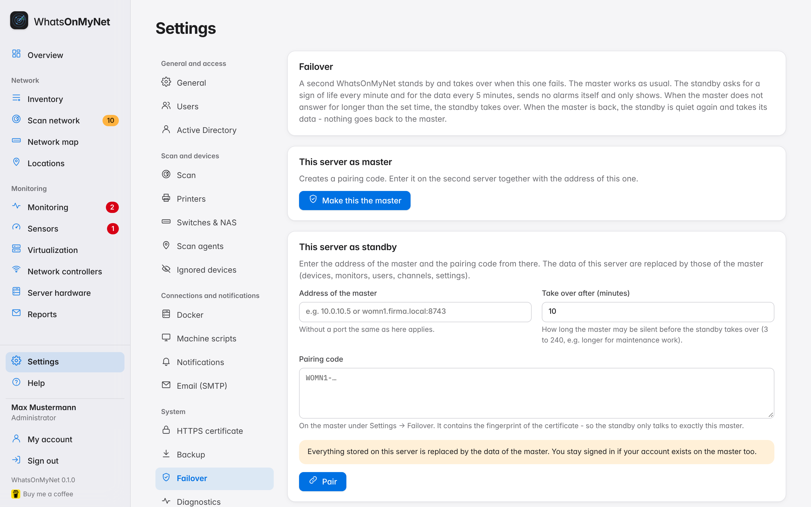

A second WhatsOnMyNet (another machine, best on another host or in another room) stands by and takes over when the first one fails.

**Setting up (once):**

1. On the first server (**master**): *Settings → Failover → Make this the master*. A **pairing code** appears (`WOMN1-…`). It is shown only now and gives full access - treat it like a password.
2. On the second server (freshly installed or existing): *Settings → Failover → This server as standby*. Enter the address of the master (e.g. `10.0.10.5` or `womn1.firma.local:8743`) and the code, if you like the time until it takes over (10 minutes by default, 3 to 240) - **Pair**.

When pairing, the standby takes **all data of the master** (devices, monitors, users, channels, settings) and its key (`data/secret.key`) too, so it can read stored passwords. Its previous key is kept as `secret.key.before-standby`. If `WOMN_SECRET` is set on the standby, it must have the same value as on the master. Both servers need the same version.

**In operation:**

- The **master** works as always and does not have to do anything.
- The **standby** asks the master every minute and takes its data every 5 minutes. It checks nothing, scans nothing and sends no alarms. A note shows at the top; nothing can be changed there (please on the master).
- The connection uses HTTPS; the standby checks the fingerprint of the master's certificate from the code. If the key of the certificate stays the same on renewal (always with the self-signed one), nothing needs to be done. With a new certificate with a new key, create a new code on the master and pair again.

**Nothing can be changed on the standby** - neither channels, e-mail addresses and webhooks nor settings, users, monitors or devices, also not while it monitors in place of the master: its data come from the master and would be overwritten at the next copy. The pages only show. Allowed are only the controls under *Failover* (unpair, make master, waiting time) and light/dark and language of one's own account.

**When the master fails:** if it does not answer for longer than the set time, the **standby takes over**. It then checks and alarms itself and reports to all default channels: "Failover: the master … has not answered for 10 min - this server (standby) has taken over monitoring." For longer maintenance on the master, raise the time on the standby beforehand.

**When the master comes back:** as soon as it answers, the standby is quiet again ("… is back") and takes its data. **Nothing goes back to the master.** What the standby reported meanwhile is listed on the standby under *Takeovers*.

**Both always on the same version:** update master and standby alike - only then does the standby work the same way when it has to take over, and only with the same database version can it take the data of the master. The standby keeps an eye on it: if the two run different versions for half an hour (updating one after the other is no problem), it sends a reminder to the default channels - e.g. "the master … runs version 0.39.0, this server (standby) 0.38.0. Please update this standby to 0.39.0." If it stays like that, it comes again every 7 days; if the standby cannot take the data any more because of the database version, at once and then daily, as an urgent message. When both are the same again, it says so once. Under *Failover* the difference shows on both sides, on the standby in the bar at the top too.

**When the master does not come back:** on the standby, **Make this the master**. It is then the master for good and shows a new pairing code. If the old master comes up again after all, it learns this on its first contact and stops alarming. Best pair it there as standby of the new master.

**Ending:** *End pairing* on either side. On the master: the standby does not take over any more and stays quiet until decided there. On the standby: it works alone afterwards (if the master still runs, alarms arrive twice). A new pairing code on the master also lets the current standby go.

## Backup and updates

- Once a day WhatsOnMyNet backs up the database compressed to `data/backups/` (`whatsonmynet-….sqlite.gz`, the first time one hour after the start); additionally before every database update. By default the 10 newest are kept, and likewise the 10 newest of the copies before updates and before a restore each. Set the number under *Settings → Backup → Retention* (1 - 90); saving deletes the ones over it at once, the oldest first. Older uncompressed backups are compressed once.
- *Settings → Backup*: download a backup, back up now, delete single backups (bin in the list, with a question first), restore a backup - `.sqlite` or `.sqlite.gz` (the current state is backed up first, then the program restarts). To open one by hand: `gunzip -k whatsonmynet-….sqlite.gz`.
- **Keep `data/secret.key` (or `WOMN_SECRET`) as well** - without it stored passwords in a backup are unreadable.
- Updates: in Dockhand/Watchtower or `docker compose pull && docker compose up -d`. Once a month a security update with new packages is released.

**What's new?** A click on the version number at the bottom left of the menu shows *About WhatsOnMyNet*: the changes of the latest versions, the link to the source code, the website and a coffee link. The coffee link is also right at the bottom of the menu. This works for every user, not only for administrators.

## Troubleshooting

- **Interface not reachable**: open the host firewall for the HTTPS port. With host networking Docker/Dockhand shows no port mapping - that is correct.
- **No printer/switch data**: switch on SNMP at the device, check the community under *Settings → Scan*, "Query now" on the device page.
- **Locked out**: `docker compose exec whatsonmynet womn-admin reset <user>` sets a new password, makes the account administrator again and switches two-factor sign-in off. `womn-admin create <user>` adds a new administrator.
- **Network drive reports "protocol not supported"**: the device only speaks the old SMB1 - it is not used for security reasons. Switch on SMB2/3 at the device (Synology: *File Services → SMB → Advanced*).
- **Diagnostic package**: *Settings → Diagnostics* makes a ZIP with the log (kept for 30 days), warnings and errors, monitors and sensors with their checks, devices with the values their sensors see, hypervisors, cloud, Veeam and Microsoft 365, the messages of the devices (receivers, space, NXLog formats, event rules with what they sent), scans, settings and the changes since the oldest version in the period - for the last 1 to 30 days or since the last update. Anonymised by default: names and addresses become placeholders (GERAET-001, 10.99.0.7 …) that stay the same in every package and can be looked up there. Passwords, keys and communities are never included; nothing is sent anywhere.
- **Machine script cannot be set up again ("access denied" on `C:\ProgramData\WhatsOnMyNet\womn-host.ps1`)**: setups before version 0.33.2 took all rights from the old copy when set up again. A script from 0.33.2 on repairs this itself. If it still fails, run `icacls C:\ProgramData\WhatsOnMyNet\* /reset` once as SYSTEM or administrator and distribute the script again.
- **Log**: *Settings → Log* shows who changed what; technical messages are in the container log.
