# WhatsOnMyNet - Manual

WhatsOnMyNet finds what runs on your network and keeps only what you adopt in the inventory. It also monitors devices, services and websites, reads printers, switches, NAS and Proxmox, and reports by e-mail, messenger, push to the phone or webhook when something is wrong.

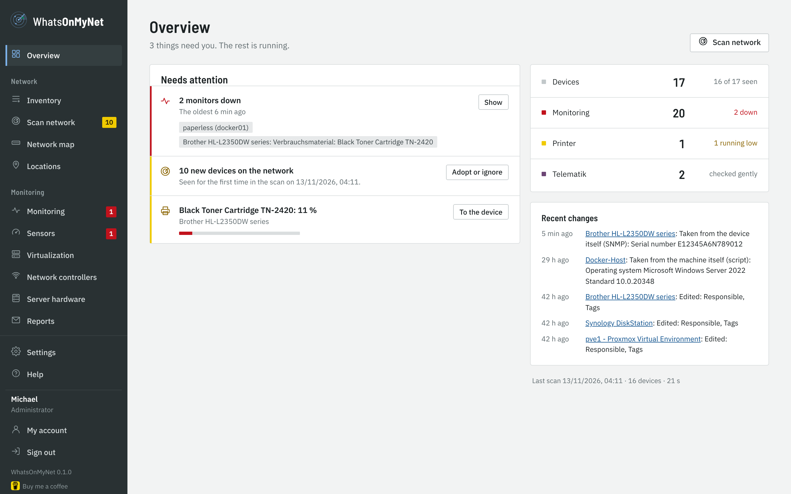

## Installation

WhatsOnMyNet runs as a Docker container with host networking - only this way the scan sees the MAC addresses of the devices.

1. Put `docker-compose.yml` and `env.example` from the release into a folder, rename `env.example` to `.env`.
2. Adjust ports (`WOMN_HTTPS_PORT`, default 8743), time zone (`TZ`) and owner of the data (`PUID`/`PGID`) in `.env` if needed.
3. `docker compose up -d` - or create the stack in Dockhand.
4. Get the **setup code** from the log (`docker compose logs whatsonmynet`) and open `https://<server>:8743/setup`. There you create the first administrator.

The interface always runs over HTTPS. On first start WhatsOnMyNet creates a self-signed certificate; upload your own (PEM or PFX) under *Settings → HTTPS certificate*.

**Ping:** the container runs without root rights. Ping works if the host allows ICMP for normal users (`net.ipv4.ping_group_range`, default on Debian/Ubuntu/Proxmox; set `0 65535` in LXC containers). Without ping the scan still finds devices via ARP and TCP.

## First steps

1. **Add a location** (*Locations*): name and subnets, e.g. "Main building" with `192.168.10.0/24`.
2. **Scan the network** (*Scan network*): tick the location, "Start scan". The radar shows the devices found; the scan is gentle (ARP, about 25 typical ports, SNMP read-only).
3. **Adopt**: in the result under "New" check type and name, tick devices, "Adopt into inventory". What you do not want in the inventory, "Ignore".

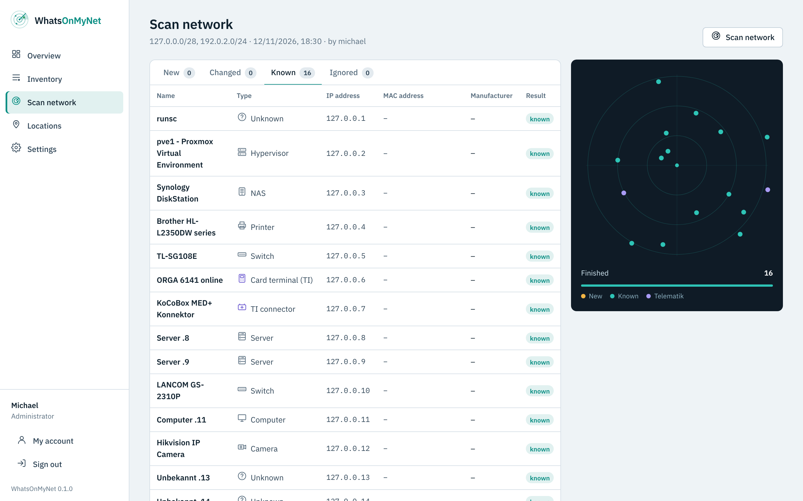

The MAC address is the identity of a device: if it gets a new IP, the next scan takes it over automatically and records it in the history.

## Inventory

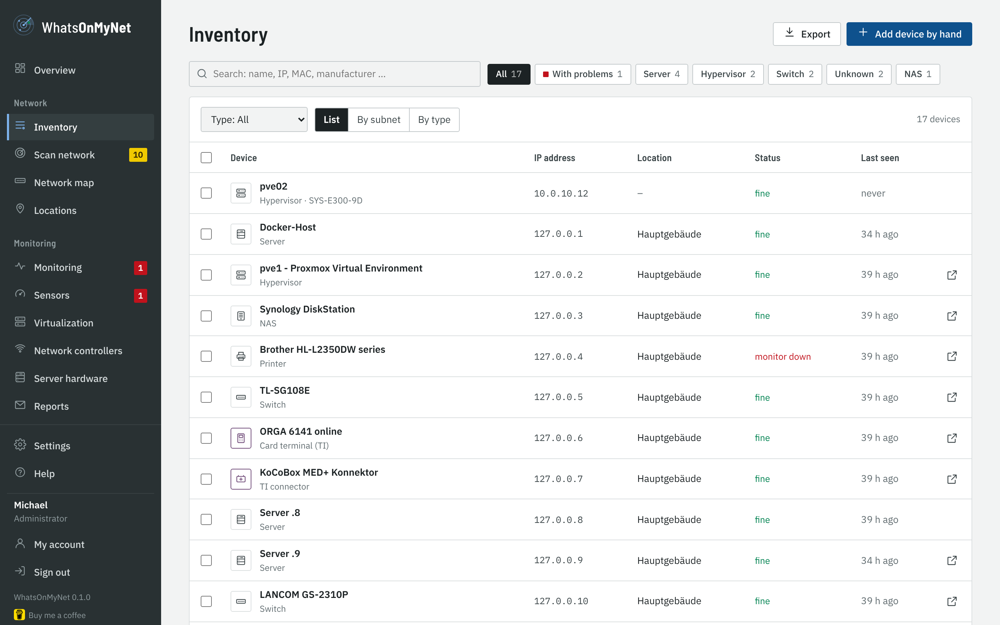

- **Search and filter** by name, IP, MAC, manufacturer, type, location or tag; export as CSV or JSON.
- **Device page**: all details, purchase and warranty dates, notes, quick access to the web interface, what the scan detected, history of all changes.
- **Suggestions while typing**: manufacturer, model, operating system, owner, supplier and tags suggest what is already in the inventory. A known model fills in manufacturer and type.
- **Multiple selection**: tick devices and edit them together (type, location, manufacturer, model, dates, tags) or delete them.
- **Deep check**: checks one device with a longer port list. Telematik devices (connector, card terminal) are always checked gently.

## Nightly light scan

Every night (default 02:30) WhatsOnMyNet looks for devices in all subnets of your locations - no ports, no SNMP. Known devices get their new IP; a device showing up for the very first time is reported once. Settings, time and "Run now" are under *Settings → Scan*.

## Monitoring

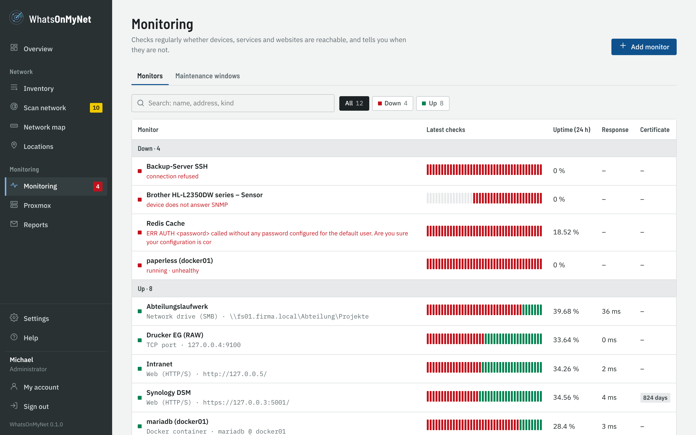

A monitor checks regularly (20 seconds to 24 hours) and reports only after several failures in a row. Kinds:

- **Web (HTTP/S)** with status codes, keyword and certificate expiry (warning e.g. 30, 14 and 7 days before)
- **TCP port** and **ping**
- **Docker container** (through a socket proxy, *Settings → Docker*): running, restarting all the time, health check "unhealthy"
- **Databases**: MariaDB/MySQL, PostgreSQL, Redis/Valkey - sign-in and one harmless query
- **Network drive (SMB)**: Windows shares and NAS - see below
- **Sensor (device value)**, **SNMP value (OID)** and **Proxmox** - see below

On the device page "Monitor" creates a fitting monitor. If the IP of a device changes, its monitors follow. If you rename the device, its monitors and sensors take the new name too, so an alarm names it as it is called now (a monitor with a name of your own without the device name stays as it is).

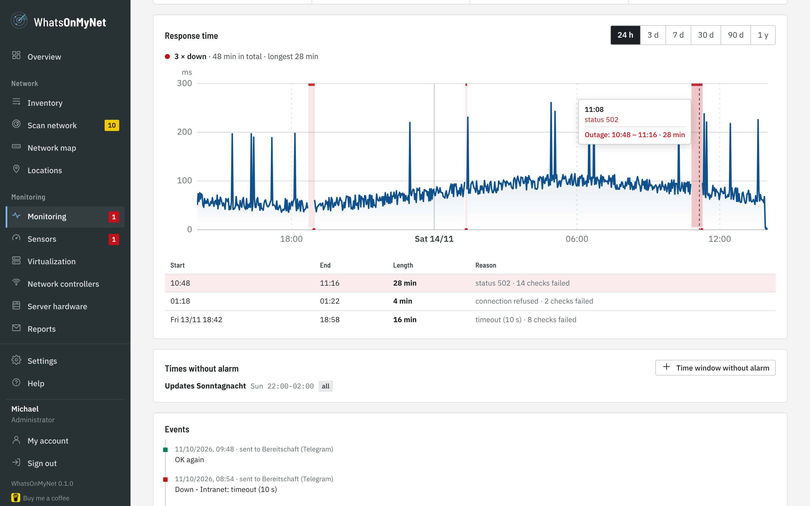

**Notifications** (*Settings → Notifications → Add channel*): choose the service, follow the short guide in the form, save and check with **Test message**.

- **Common:** e-mail (through the SMTP server), Telegram bot, webhook with your own JSON template (e.g. for n8n or a script)
- **Chat and messengers:** Discord, Slack, Microsoft Teams (Workflows), Google Chat, Mattermost, Rocket.Chat, Matrix/Element, Signal (through signal-cli-rest-api), WhatsApp (CallMeBot, to your own number)
- **Push to the phone:** ntfy, Gotify, Pushover, Pushbullet, Home Assistant (companion app)
- **Everything else:** Apprise - a bridge to more than 100 further services (SMS, Threema …)

Tokens, keys and webhook addresses are stored encrypted and never shown again. Outages arrive with high priority on push services. **Maintenance windows** (once or weekly) suppress alarms.

## Printers, switches and NAS

Devices of type *Printer*, *Switch* and *NAS* are queried via SNMP (read-only). Set the community under *Settings → Scan*; SNMP v1/v2c has to be on at the device.

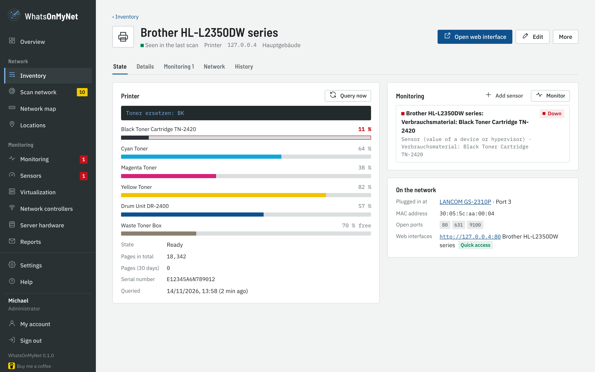

- **Printer**: toner or ink per colour, drum, waste toner, page counter, faults and display text. Below 15 % a notice is sent - once per cartridge.
- **Switch**: ports as tiles, which devices hang at which port (VLAN-aware), LLDP neighbours, firmware. Every device page shows "Plugged in at".
- **NAS**: volumes; on Synology also disks, RAID, temperature, fans, power supply and DSM update. Problems are reported - and again when everything is fine.

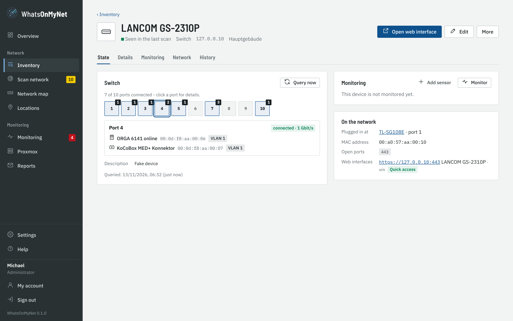

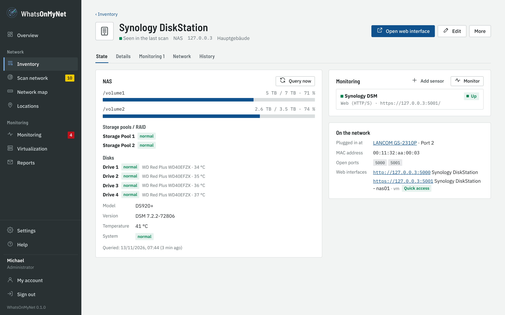

### Network map

The *Network map* shows from MAC tables and LLDP which device hangs at which port and how the switches are connected. Simple switches without SNMP show up as a branch behind the port they are plugged into. Behind routers the scan reads the ARP table of the routers via SNMP, so the MAC address stays the identity there too.

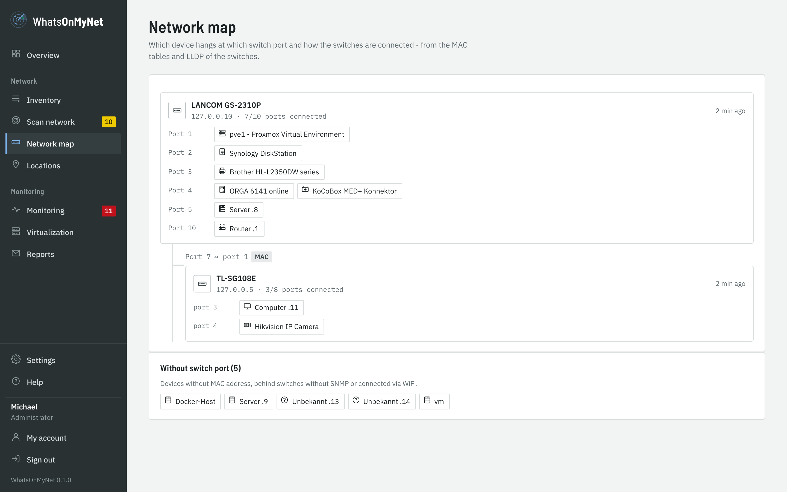

## Sensors

Every value a device delivers can become a monitor of its own - with history, alarm and maintenance windows. On the device page "Add sensor", then choose value and condition, e.g.:

- "toner cyan less than or equal 10 %"
- "usage /volume1 greater than or equal 85 %"
- "temperature drive 2 greater than 50 °C"
- "port 10 (uplink) connected"

The kind **SNMP value (OID)** reads any SNMP value (e.g. runtime left of a UPS) and compares with less, greater, equal or "contains text".

In the monitor list the column **Now** shows the value right away: number and unit, a small bar for percentages, "used of total" for storage and RAM, and the alarm limit ("alarm from 90 %"). Close to the limit the value turns yellow, at the alarm red. Nodes and VMs show their state with CPU and RAM, network drives the free space.

## Network drives (SMB)

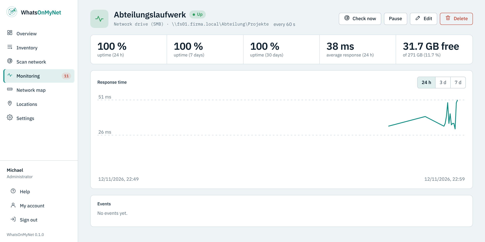

The kind **Network drive (SMB)** really signs in to a share - not just to the open port. So you also notice when the password expired, the rights changed or a folder is missing.

1. Create an account of its own with **read rights** on the share (in AD e.g. `COMPANY\monitor`, on a NAS a local user).
2. *Add monitor* → kind **Network drive (SMB)**. Just paste the path, e.g. `\\fs01\Department\Projects` - server, share and folder are taken from it.
3. Enter user, domain (empty for NAS accounts) and password. Optional: warn below … % or … GB free.

The check runs over SMB 2/3: sign in, read the share (or the folder or file), ask for the free space. WhatsOnMyNet writes nothing to the share. The detail page shows the free space; reports have the section *Network drives* for it.

## Proxmox VE and Backup Server

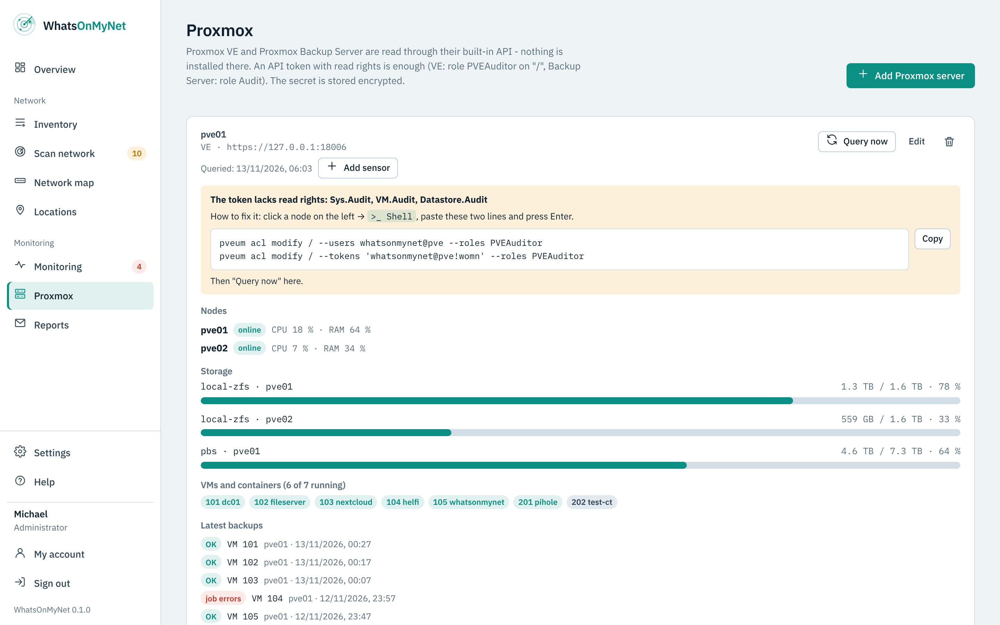

WhatsOnMyNet reads Proxmox VE and the Proxmox Backup Server through their built-in interface (API). Nothing is installed on Proxmox. WhatsOnMyNet gets a user of its own there that may **only read**, and a key for it (API token). The dialog *Monitoring → Proxmox → Add Proxmox server* shows the same steps, with a button to copy.

### Step 1: prepare Proxmox (once)

**With commands (recommended) - Proxmox VE**

1. In Proxmox click a node on the left and open **>_ Shell** at the top. One node is enough - in a cluster it applies to all.
2. Copy these three lines, paste them into the shell and press Enter:

```
pveum user add whatsonmynet@pve --comment "WhatsOnMyNet (read only)"
pveum acl modify / --users whatsonmynet@pve --roles PVEAuditor
pveum user token add whatsonmynet@pve womn --privsep 0
```

3. The output shows a table. The row `value` holds the **secret** (a long string with dashes). Copy and keep it - Proxmox shows it only this once.

**With commands - Proxmox Backup Server**

1. In the Backup Server open *Administration → Shell* on the left.
2. Paste these four lines and press Enter:

```
proxmox-backup-manager user create whatsonmynet@pbs --comment "WhatsOnMyNet (read only)"
proxmox-backup-manager acl update / Audit --auth-id whatsonmynet@pbs
proxmox-backup-manager user generate-token whatsonmynet@pbs womn
proxmox-backup-manager acl update / Audit --auth-id 'whatsonmynet@pbs!womn'
```

3. After the third command `"value"` holds the **secret**. Copy it - it is shown only once.

**By clicking - Proxmox VE**

1. *Datacenter → Permissions → Users* → *Add*: user name `whatsonmynet`, realm *Proxmox VE authentication server*, any password → *Add*.
2. *Datacenter → Permissions* → *Add* → *User Permission*: path `/`, user `whatsonmynet@pve`, role `PVEAuditor` → *Add*.
3. *Datacenter → Permissions → API Tokens* → *Add*: user `whatsonmynet@pve`, token ID **only** `womn` (no @ or !), **untick** *Privilege Separation* → *Add*.
4. Proxmox now shows the *Secret* - only this once. Copy and keep it.

On the Backup Server it works the same under *Configuration → Access Control*: user `whatsonmynet` (realm *Proxmox Backup authentication server*), tab *API Token* with token name `womn`, then under *Permissions* the role `Audit` on the path `/` twice - once for the user `whatsonmynet@pbs`, once for the token `whatsonmynet@pbs!womn`.

### Step 2: enter it in WhatsOnMyNet

1. *Monitoring → Proxmox* → **Add Proxmox server**.
2. Give it a name and choose the kind (Proxmox VE or Backup Server).
3. Enter the **address** the way you open Proxmox in the browser, e.g. `https://192.168.1.10:8006` (Backup Server: port `8007`).
4. Click **Fetch certificate**. WhatsOnMyNet shows the fingerprint of the Proxmox certificate. Compare it - Proxmox VE: click the node → *System → Certificates* → row `pve-ssl.pem`; Backup Server: *Dashboard* → *Show Fingerprint*. If it matches, **Fingerprint matches - trust**.
5. The **token ID** is already filled in (`whatsonmynet@pve!womn` or `whatsonmynet@pbs!womn`). Paste the copied secret into **Token secret**.
6. **Save and connect.** After a few seconds nodes, storage, VMs and containers and the backups appear.

### Adding sensors

In the detail view **Add sensor** - e.g. "VM 101 running", "storage local-lvm below 85 %" or "last backup older than 26 hours". Every sensor is a monitor with history and notification.

### If something does not work

- **"tokenid: value does not match the regex pattern" in Proxmox**: when adding the token enter only `womn` - without user, @ and !.
- **"sign-in refused (401)"**: token ID or secret are wrong. Delete the token in Proxmox, add it again and enter the new secret.
- **Notice "The token lacks read rights"**: usually *Privilege Separation* stayed ticked on the token. The notice shows two commands - paste them into the Proxmox shell, Enter, then **Query now**.
- **"certificate changed"**: Proxmox got a new certificate. *Edit* → **Fetch certificate** → confirm.

## Reports

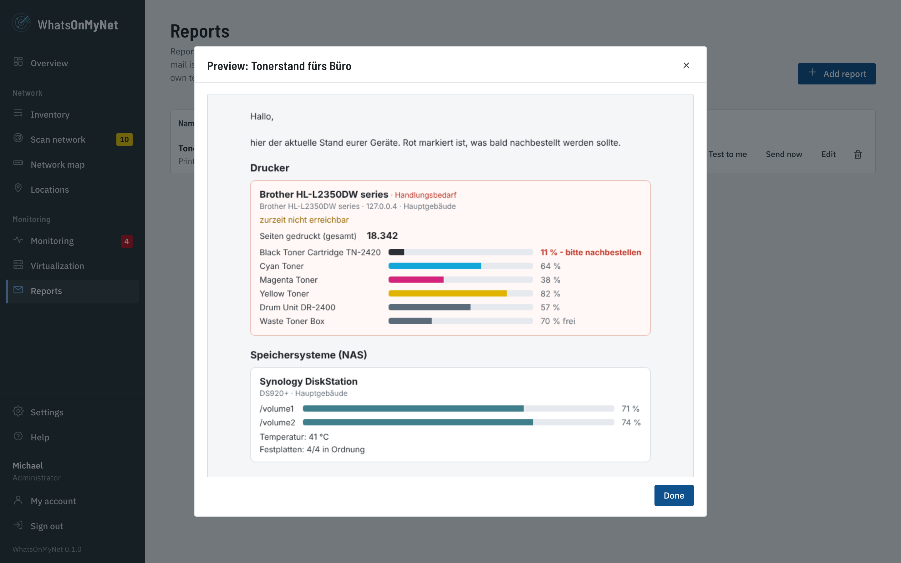

Under *Monitoring → Reports* reports go out by e-mail at set times - e.g. the toner levels to the office every Monday at 8:00.

- Content: printers, NAS, switches, network drives; can be limited to locations; optionally only devices that need action.
- **Devices**: all devices of the chosen content - or only chosen ones, e.g. a report of its own for the printer in the front office.
- Printers show the **pages printed** (in total and in the report period, e.g. "in the last 7 days") and - if the printer reports it - how many pages the toner still lasts.
- The mail is **neutral**: no link, no program name - only your sender name, subject (`{week}`, `{date}`), introduction, the devices and your closing.
- "Preview", "Test to me" and "Send now" right in the list.

## Users and rights

- **Roles**: *Administrator* (everything), *Editor* (scan, adopt, maintain, monitors), *Read only*.
- **Locations**: editors and viewers can be limited to locations - they then only see and change devices, scans and monitors of these.
- **Active Directory**: sign-in with the Windows account, see the next section.
- **Two-factor sign-in** (*My account*): scan the QR code with an authenticator app, confirm a code, keep the recovery codes. It can be made mandatory for administrators under *Settings → General*.

## Sign-in with Active Directory

Staff sign in with their Windows account. AD groups decide which role they get. Local accounts keep working; for the same name the local account wins, so the local admin stays the emergency access.

### Step 1: prepare AD (once)

1. Create a **service account**, e.g. `svc-womn`. It needs no special rights, a normal domain account with a password is enough.
2. Create up to three **groups**, e.g. `WOMN-Admins`, `WOMN-Editors` and `WOMN-Read`, and put the staff into them. Groups in groups count.

### Step 2: enter it in WhatsOnMyNet

1. *Settings → Active Directory*.
2. **Server**: name of the domain controller as it is in the certificate, e.g. `dc01.company.local`. Encryption **LDAPS** (port 636) or **StartTLS** (port 389). Without encryption it does not work.
3. **Certificate**: leave trust on *Fetched certificate* and click **Fetch certificate from DC**. Compare the fingerprint with the certificate on the DC (`certlm.msc` → *Personal* → open the certificate → *Details* → *Thumbprint*) and confirm. If the root CA is missing, WhatsOnMyNet gets it itself (via the AIA address in the certificate or, after confirming, from AD).
4. **Directory**: leave the base DN empty, the test finds it. Enter the service account, e.g. `svc-womn@company.local`, and its password.
5. **Groups**: simply enter the group names, e.g. `WOMN-Admins`. Members of several groups get the highest role; members of none cannot sign in.
6. **Test connection**, best with your own user name. Every step gets ✓ or ✗ with the reason: connection, service account, base DN, groups, user, role and, if you like, the password.
7. When everything is ✓: tick *Allow sign-in through Active Directory* and **Save**.

### If something does not work

- **"The certificate of the DC is not trusted"**: *Fetch certificate from DC* and confirm.
- **"The name in the certificate does not fit"**: enter the name from the certificate as domain controller (fetching shows it). Only if you reach the DC by its IP address: switch *Check the server name in the certificate* off.
- **"Service account: sign-in refused"**: name or password of the service account wrong, or the account is locked.
- **"Group not found"**: check the spelling of the group in AD.
- **"No role"**: the user is in none of the groups entered.

## Scan agent for branch offices

For a branch office a second container runs there as scan agent. Under *Settings → Scan agents* add an agent for the location; put the `.env` shown next to `docker-compose.agent.yml` from the release and start `docker compose -f docker-compose.agent.yml up -d`. The agent opens no port, fetches jobs over HTTPS and reports only addresses of its location.

## Backup and updates

- Every night WhatsOnMyNet backs up the database to `data/backups/`; additionally before every database update.
- *Settings → Backup*: download a backup, back up now, restore a backup (the current state is backed up first, then the program restarts).
- **Keep `data/secret.key` (or `WOMN_SECRET`) as well** - without it stored passwords in a backup are unreadable.
- Updates: in Dockhand/Watchtower or `docker compose pull && docker compose up -d`. Once a month a security update with new packages is released.

## Troubleshooting

- **Interface not reachable**: open the host firewall for the HTTPS port. With host networking Docker/Dockhand shows no port mapping - that is correct.
- **No printer/switch data**: switch on SNMP at the device, check the community under *Settings → Scan*, "Query now" on the device page.
- **Locked out**: `docker compose exec whatsonmynet womn-admin reset <user>` sets a new password, makes the account administrator again and switches two-factor sign-in off. `womn-admin create <user>` adds a new administrator.
- **Network drive reports "protocol not supported"**: the device only speaks the old SMB1 - it is not used for security reasons. Switch on SMB2/3 at the device (Synology: *File Services → SMB → Advanced*).
- **Log**: *Settings → Log* shows who changed what; technical messages are in the container log.
